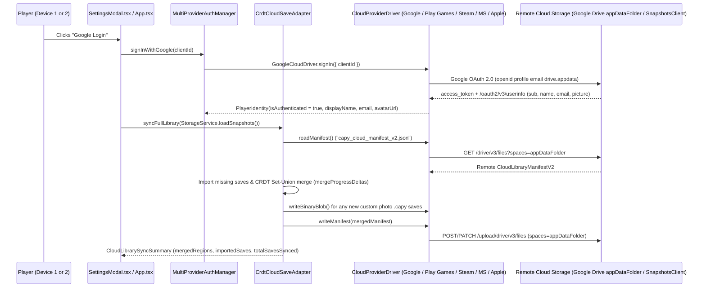
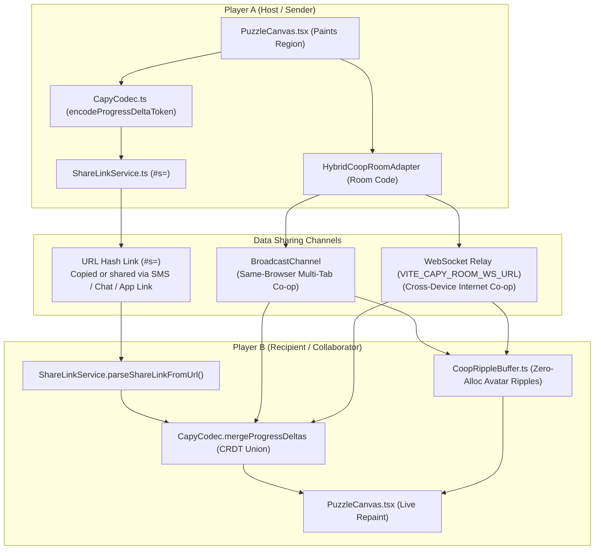

# Modular Cloud Sync, Google Account / Play Games v2 & Multiplayer Data Sharing (`CLOUD.md`)

This document explains how modular multi-platform cloud login (`Google`, `Google Play Games v2`, `Steam`, `Microsoft`, `Apple`), conflict-free cross-device Save Library sync, shareable progress links, and simultaneous Co-op multiplayer rooms work across the **Capy** monorepo (`web/` and `app/`).

---

## 1. Plain-English Overview: How Everything Works

### A. Modular Cloud Provider Architecture (`CloudProviderDriver`)
Capy separates **CRDT save merging** (`CrdtCloudSaveAdapter` in [`ProviderRegistry.ts`](./web/src/services/providers/ProviderRegistry.ts)) from **platform-specific authentication and cloud storage** via the modular [`CloudProviderDriver`](./web/src/services/providers/types.ts) interface implemented in [`CloudProviderDrivers.ts`](./web/src/services/providers/CloudProviderDrivers.ts):

| Provider ID (`CloudProviderId`) | Driver Class | Authentication Mechanism | Cloud Storage Backend | Status |
| :--- | :--- | :--- | :--- | :--- |
| `'google'` | `GoogleCloudDriver` | Google Identity Services OAuth 2.0 (`https://accounts.google.com/gsi/client`, `openid profile email drive.appdata`) | Google Drive `appDataFolder` REST API v3 (`capy_cloud_manifest_v2.json` + `.capy` v2 binaries) | **Active (Web, Desktop, iOS & Android)** |
| `'play_games_v2'` | `PlayGamesAndroidDriver` | Native Android Google Play Games Services v2 SDK (`GamesSignInClient` + `PlayersClient`) | Android `PlayGames.getSnapshotsClient(activity)` Saved Games API + local `filesDir/capy_cloud/` cache | **Active (Android App)** |
| `'steam'` | `SteamCloudDriver` | Steamworks Auth Session Ticket (`window.__capySteamBridge`) | Steam Cloud `ISteamRemoteStorage` (`fileWriteAsync` / `fileReadAsync`) | **Modular Driver Ready (Awaiting Desktop Tauri Wrapper)** |
| `'microsoft'` | `MicrosoftCloudDriver` | Microsoft Entra ID / MSA OAuth 2.0 PKCE (`Files.ReadWrite.AppFolder`) | Microsoft Graph OneDrive `special/approot` REST API / Xbox Connected Storage | **Modular Driver Ready (Planned)** |
| `'apple'` | `AppleCloudDriver` | Sign in with Apple JS / Native GameKit (`GKLocalPlayer`) | Apple CloudKit JS (`privateCloudDatabase`) / iCloud `GKSavedGame` | **Modular Driver Ready (Planned)** |

### B. How Google Account & Play Games Login Works
1. **Instant Local Profile (Zero Friction)**:
   - Every player starts immediately with a local profile (for example, `Sunny Capy` with a chosen avatar color) stored in `localStorage` under `capy_player_identity_v1`. No account is required to play, save, or share links.
2. **Google Account OAuth 2.0 Login (Web, Desktop & Cross-Device)**:
   - When the user clicks **Google Login** in **Settings -> Saves**, [`GoogleCloudDriver`](./web/src/services/providers/CloudProviderDrivers.ts) invokes [`signInWithGoogleOAuthPopup`](./web/src/services/providers/GoogleCloudSyncClient.ts) using Google Identity Services (`google.accounts.oauth2.initTokenClient`) with scopes `openid profile email https://www.googleapis.com/auth/drive.appdata`.
   - Once the user authorizes with their Google Account, [`fetchGoogleUserProfile`](./web/src/services/providers/GoogleCloudSyncClient.ts) calls `https://www.googleapis.com/oauth2/v3/userinfo` to retrieve their real Google Account `name`, `email`, `picture` (avatar URL), and `sub` (stable Google ID), and displays them in the Saves & Co-op Hub.
   - Immediately upon sign-in, Capy runs `ProviderRegistry.cloudSave.syncFullLibrary(snapshots)` to pull any saves from the user's hidden Google Drive `appDataFolder`, CRDT-merge all puzzle progress, and push the unified library back to Google Drive `appDataFolder`.
3. **Google Play Games Services v2 Login & Saved Games (`SnapshotsClient`) on Android**:
   - On Android (`app/`), [`MainActivity.kt`](./app/src/main/java/com/capypaint/capy/MainActivity.kt) initializes `PlayGamesSdk.initialize(this)` and checks `PlayGames.getGamesSignInClient(this).isAuthenticated`.
   - When authenticated, `MainActivity.kt` queries `PlayGames.getPlayersClient(this).currentPlayer` for `player.displayName` and `player.playerId`, caches them via `bridge.cachePlayGamesProfile(playerId, displayName)`, and delivers them to the WebView via `window.__capyReceivePlayGamesProfile(...)`.
   - `MainActivity.kt` also calls `PlayGames.getSnapshotsClient(this).open("capy_cloud_manifest_v2", ...)` to pull and push the cloud save manifest to Google Play Games Saved Games storage (`SnapshotMetadataChange` + `commitAndClose`).

### C. How Data Is Shared Between Players
Capy supports **four complementary ways** to share puzzle data and paint together:

| Sharing Method | How Data Travels Between Players | Payload Size | Server Required? | Works Across Separate Devices? |
| :--- | :--- | :--- | :--- | :--- |
| **1. Shareable Progress Link (`#s=<token>`)** | All painted region IDs, Free Colour overrides, and the artwork ID are compressed into the URL hash itself (`https://shthed.github.io/capy/#s=...`). You send the link via SMS, WhatsApp, Discord, or email; the recipient's browser/app decodes the progress directly from the link. | `~100 - 400 bytes` (`< 2 KB`) | **No server required** (data lives inside the URL) | **Yes** (instant for built-in Gallery artworks) |
| **2. Local / Same-Browser Co-op Room (`?room=<ROOM6>`)** | Uses the browser's native `BroadcastChannel` (`capy_coop_room_<ROOM6>`) to stream real-time `PAINT_EVENT` strokes and `WELCOME_STATE` progress seeds between open tabs or windows on the same device. | `~120 bytes` per tap | **No server required** | Same device / browser profile |
| **3. Internet Cross-Device Co-op Room (`?room=<ROOM6>`)** | Uses `HybridCoopRoomAdapter` over WebSocket (`VITE_CAPY_ROOM_WS_URL`) to relay `HELLO`, `WELCOME_STATE`, `PAINT_EVENT`, and `HEARTBEAT` frames between players on different phones, tablets, or PCs. | `~120 bytes` per tap | **Yes** (requires `VITE_CAPY_ROOM_WS_URL` WebSocket relay) | **Yes** (when `VITE_CAPY_ROOM_WS_URL` is configured) |
| **4. Portable `.capy` v2 Binary File Export** | Exports a self-contained `CAPY\x02\x00` binary archive containing the source image, quantized segmentation map, and full undo/replay history via OS Share Sheet or file download. | `~15 KB - 45 KB` per puzzle | **No server required** | **Yes** (works for both Gallery and custom user photos) |

### D. How Full-Library Cloud Sync Merges Progress Without Losing Work (CRDT)
Traditional cloud saves overwrite File A with File B if you play on two devices offline. Capy instead syncs a unified `CloudLibraryManifestV2` (`capy_cloud_manifest_v2.json`) and merges each puzzle's progress as a **Conflict-Free Replicated Data Type (CRDT)** (`mergeProgressDeltas` in [`CapyCodec.ts`](./web/src/services/CapyCodec.ts)):
- **Full Save Library Sync (`syncFullLibrary`)**:
  - Every built-in sample save stores its compact `ProgressDeltaV2` token (`< 2 KB`) inside `capy_cloud_manifest_v2.json`.
  - Every custom user-uploaded photo save exports a compact `.capy` v2 binary (`~20-60 KB`, `StorageService.exportSnapshotBinary(id)`) uploaded to the active cloud driver (`capy_save_<snapshotId>.capy`) and referenced by `cloudBinaryRef` in `capy_cloud_manifest_v2.json`.
  - If Device B does not yet have a puzzle that was started on Device A, `syncFullLibrary` automatically imports the puzzle into `StorageService` on Device B.
- **Painted Regions (`filledRegionIds`) use a Grow-Only Set Union**:
  - If you paint regions `[1, 2, 3]` on your phone and regions `[3, 4, 5]` on your laptop, syncing merges both sets into `[1, 2, 3, 4, 5]`. Neither device's painted regions are ever lost.
- **Custom Free-Colour Overrides (`paintedRegionColors`) use Last-Writer-Wins (LWW)**:
  - If two devices paint the same region with different custom colors, the delta with the newer `updatedAt` timestamp wins deterministically.

---

## 2. End-to-End Architecture Diagrams

### A. Modular Cloud Provider Driver & Cross-Device Save Library Sync

### B. Player-to-Player Progress Sharing & Simultaneous Co-op Flow

---

## 3. Configuring Google OAuth 2.0 (`VITE_GOOGLE_CLIENT_ID`) & Play Games v2 (`CAPY_PLAY_GAMES_APP_ID`)

### A. Web / Cross-Device Google Cloud OAuth 2.0 Setup
1. In **Google Cloud Console**, open **APIs & Services -> Library** and enable the **Google Drive API**.
2. Under **APIs & Services -> OAuth consent screen**, add the non-sensitive `.../auth/drive.appdata` scope (hidden application-specific configuration/save folder).
3. Under **APIs & Services -> Credentials**, create an **OAuth 2.0 Client ID** of type **Web application**, and add your authorized JavaScript origins (for example, `https://shthed.github.io` and `http://localhost:3000`).
4. Provide the Client ID (`xxxx.apps.googleusercontent.com`) either:
   - At build time via the `VITE_GOOGLE_CLIENT_ID` environment variable, or
   - At runtime inside the app by opening **Settings -> Saves -> OAuth Setup** and pasting the Client ID into the **Google Cloud OAuth 2.0 Web Client ID** input.

### B. Android Google Play Games Services v2 Setup (`app/`)
1. In **Google Play Console**, open **Play Games Services -> Setup and management -> Configuration** and enable **SavedGames** (`SnapshotsClient`).
2. Copy the 12-digit **Project ID** (App ID) and provide it via the `CAPY_PLAY_GAMES_APP_ID` environment variable during CI/release builds (or set `game_services_project_id` in [`app/src/main/res/values/strings.xml`](./app/src/main/res/values/strings.xml)).
3. Register both your **Upload Key SHA-1** and **Play App Signing SHA-1** certificate fingerprints under **Play Games Services -> Credentials** for package name `com.capypaint.capy`.
