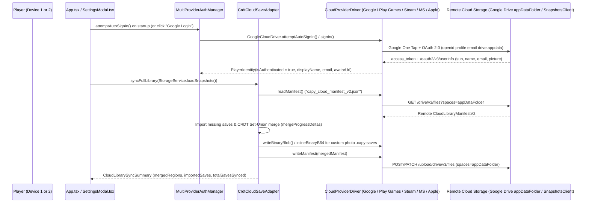
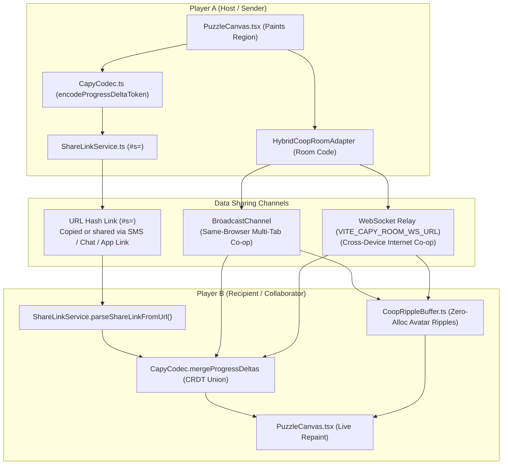

# Modular Cloud Sync, Google Account / Play Games v2 & Multiplayer Sharing (`CLOUD.md`)

This document explains how modular multi-platform cloud login (`Google`, `Google Play Games v2`, `Steam`, `Microsoft`, `Apple`), conflict-free cross-device Save Library sync, shareable progress links, and simultaneous Co-op multiplayer rooms work across the **Capy** monorepo (`web/` and `app/`).

**Related Guides**: [`README.md`](./README.md) | [`DEV.md`](./DEV.md) | [`AGENTS.md`](./AGENTS.md) | [`WEB.md`](./WEB.md) | [`PUZZLE.md`](./PUZZLE.md) | [`APP.md`](./APP.md) | [`TESTING.md`](./TESTING.md) | [`TODO.md`](./TODO.md) | [`CHANGELOG.md`](./CHANGELOG.md)

**Table of Contents**:
1. [Plain-English Overview: How Everything Works](#1-plain-english-overview-how-everything-works)
2. [End-to-End Architecture Diagrams](#2-end-to-end-architecture-diagrams)
3. [Step-by-Step Developer Guide: Provisioning Google Cloud OAuth 2.0 & Play Games v2](#3-step-by-step-developer-guide-provisioning-google-cloud-oauth-20--play-games-v2)

---

## 1. Plain-English Overview: How Everything Works

### A. Modular Cloud Provider Architecture (`CloudProviderDriver`)
Capy separates **CRDT save merging** (`CrdtCloudSaveAdapter` in [`ProviderRegistry.ts`](./web/src/services/providers/ProviderRegistry.ts)) from **platform-specific authentication and cloud storage** via the modular [`CloudProviderDriver`](./web/src/services/providers/types.ts) interface implemented in [`CloudProviderDrivers.ts`](./web/src/services/providers/CloudProviderDrivers.ts):

- **`'google'` (`GoogleCloudDriver`) -- Active on Web, PWA, Desktop, iOS & Android**:
  - *Auth*: Google Identity Services OAuth 2.0 (`https://accounts.google.com/gsi/client` via [`GoogleCloudSyncClient.ts`](./web/src/services/providers/GoogleCloudSyncClient.ts), scopes `openid profile email` + app-isolated `https://www.googleapis.com/auth/drive.appdata`).
  - *Storage*: Google Drive `appDataFolder` REST API v3 (`capy_cloud_manifest_v2.json` + per-puzzle `.capy` v2 binary archives).
- **`'play_games_v2'` (`PlayGamesAndroidDriver`) -- Active on Android (`:app`)**:
  - *Auth*: Native Google Play Games Services v2 SDK (`GamesSignInClient` + `PlayersClient` in [`MainActivity.kt`](./app/src/main/java/com/capypaint/capy/MainActivity.kt)).
  - *Storage*: `PlayGames.getSnapshotsClient(activity)` Saved Games API (`RESOLUTION_POLICY_MOST_RECENTLY_MODIFIED`) paired with local `filesDir/capy_cloud/` caching and `inlineBinaryB64` custom-save embedding.
- **`'steam'` (`SteamCloudDriver`) -- Modular Driver Ready (`P5-1`)**:
  - *Auth & Storage*: Steamworks Auth Session Ticket (`window.__capySteamBridge`) + `ISteamRemoteStorage` (`fileWriteAsync` / `fileReadAsync`), awaiting the Tauri desktop wrapper.
- **`'microsoft'` (`MicrosoftCloudDriver`) -- Modular Driver Ready (`P5-3`)**:
  - *Auth & Storage*: Microsoft Entra ID / MSA OAuth 2.0 PKCE (`Files.ReadWrite.AppFolder`) + OneDrive `special/approot` / Xbox Connected Storage.
- **`'apple'` (`AppleCloudDriver`) -- Modular Driver Ready (`P5-2`)**:
  - *Auth & Storage*: Sign in with Apple JS / Native GameKit (`GKLocalPlayer`) + CloudKit `privateCloudDatabase` / iCloud `GKSavedGame`.

### B. How Automatic Google Account & Play Games Login Works
1. **Instant Local Profile (Zero Friction)**:
   - Every player starts immediately with a local profile (for example, `Sunny Capy` with a chosen avatar color) stored in `localStorage` under `capy_player_identity_v1`. No account is required to play, save, or share links.
2. **Automatic Google Account Login & Silent Sync on Web / Desktop (`attemptAutoSignIn`)**:
   - On startup (`App.tsx`), `ProviderRegistry.auth.attemptAutoSignIn()` checks for a valid cached Google OAuth session (`capy_google_oauth_token_v1`) or invokes **Google Identity Services One Tap** (`google.accounts.id.initialize({ auto_select: true, cancel_on_tap_outside: false, use_fedcm_for_prompt: true })` + `google.accounts.id.prompt()`) and silent OAuth token refresh (`prompt: ''`) unless the player explicitly clicked **Sign Out** (`capy_cloud_explicit_signout_v1`).
   - Players are **never** asked to paste an OAuth Client ID inside the game; the Web OAuth 2.0 Client ID is baked into the build via `VITE_GOOGLE_CLIENT_ID` (developers testing custom sandboxes locally can optionally override `capy_google_oauth_client_id_v1` via `setGoogleClientId` in [`GoogleCloudSyncClient.ts`](./web/src/services/providers/GoogleCloudSyncClient.ts)).
   - When the user clicks **Google Login** in **Settings -> Saves** (or when silent sign-in succeeds on startup), [`GoogleCloudDriver`](./web/src/services/providers/CloudProviderDrivers.ts) fetches `/oauth2/v3/userinfo` (`sub`, `name`, `email`, `picture`) and runs `ProviderRegistry.cloudSave.syncFullLibrary(snapshots)` against their private Google Drive `appDataFolder`.
3. **Automatic Google Play Games Services v2 Login & Saved Games (`SnapshotsClient`) on Android**:
   - On Android (`app/`), [`MainActivity.kt`](./app/src/main/java/com/capypaint/capy/MainActivity.kt) calls `PlayGamesSdk.initialize(this)` on launch and checks `PlayGames.getGamesSignInClient(this).isAuthenticated`.
   - If unauthenticated on launch, `MainActivity.kt` automatically calls `requestPlayGamesSignIn()` so the native Google Play Games welcome banner signs the player in seamlessly.
   - Once authenticated, `MainActivity.kt` resolves `PlayGames.getPlayersClient(this).currentPlayer` (`displayName`, `playerId`), caches them in `capy_play_games_prefs`, pushes them to `window.__capyReceivePlayGamesProfile(...)`, and reconciles `capy_cloud_manifest_v2` via `PlayGames.getSnapshotsClient(this)` (`window.__capyReceiveCloudSnapshot`).

### C. Four Complementary Ways Data Is Shared Between Players

1. **Shareable Progress Link (`#s=<token>`)**:
   - *Transport*: Compresses painted region IDs, Free Colour overrides, `isFreeColor`, `updatedAt`, and `sourceRef` directly into the URL fragment (`https://shthed.github.io/capy/#s=...`) via `ShareLinkService.ts`.
   - *Size & Infrastructure*: `~100--400 bytes` (`< 2 KB` budget); **zero server required**; works across separate devices immediately for built-in Gallery artworks.
2. **Local / Same-Browser Co-op Room (`?room=<ROOM6>`)**:
   - *Transport*: Uses native `BroadcastChannel` (`capy_coop_room_<ROOM6>`) to stream real-time `HELLO`, `WELCOME_STATE`, `PAINT_EVENT`, `HEARTBEAT`, and `LEAVE` frames (`~120 bytes` per tap) between tabs/windows on the same device with **zero server required**.
3. **Internet Cross-Device Co-op Room (`?room=<ROOM6>`)**:
   - *Transport*: Uses `HybridCoopRoomAdapter` over WebSocket (`VITE_CAPY_ROOM_WS_URL`) to relay `HELLO`, `WELCOME_STATE`, `PAINT_EVENT`, `HEARTBEAT`, and `LEAVE` frames (`~120 bytes` per tap) across phones, tablets, and PCs when `VITE_CAPY_ROOM_WS_URL` is configured.
4. **Portable `.capy` v2 Binary File Export**:
   - *Transport*: Exports a self-contained `CAPY\x02<flags>` binary archive (`flags`: `0x01` `FLAG_GZIP` single save, `0x03` `FLAG_GZIP | FLAG_ARCHIVE` multi-save library bundle, `0x00` uncompressed) containing the source image, quantized RLE segmentation map, custom palette, and undo/replay chronology via OS Share Sheet or file download.
   - *Size & Infrastructure*: `~15--45 KB` for built-in/line-art saves and `~45--95 KB` for custom photographic saves; **zero server required**; works offline across all devices.

### D. How Full-Library Cloud Sync Merges Progress Without Losing Work (CRDT)
Traditional cloud saves overwrite File A with File B if you play on two devices offline. Capy instead syncs a unified `CloudLibraryManifestV2` (`capy_cloud_manifest_v2.json`, mirrored locally in `capy_cloud_library_manifest_v2`) and merges each puzzle's progress as a **Conflict-Free Replicated Data Type (CRDT)** (`mergeProgressDeltas` in [`CapyCodec.ts`](./web/src/services/CapyCodec.ts)):
- **Full Save Library Sync (`syncFullLibrary`)**:
  - Every built-in sample save stores its compact `ProgressDeltaV2` token (`< 2 KB`) inside `capy_cloud_manifest_v2.json`.
  - Every custom user-uploaded photo save exports a `.capy` v2 binary (`StorageService.exportSnapshotBinary(id)`):
    - Drivers with multi-file blob storage (`GoogleCloudDriver`) upload `capy_save_<snapshotId>.capy` to `appDataFolder` and store its `cloudBinaryRef` in `capy_cloud_manifest_v2.json`.
    - Drivers backed by single-envelope snapshot storage (`PlayGamesAndroidDriver` `SnapshotsClient`) also embed custom `.capy` binaries `<= 180 KB` directly inside the manifest entry via `inlineBinaryB64` (`ProviderRegistry.ts`), enabling seamless cross-device custom-photo sync on Android without separate blob files.
  - If Device B does not yet have a puzzle started on Device A, `syncFullLibrary` automatically imports it into `StorageService` on Device B.
- **Painted Regions (`filledRegionIds`) use a Grow-Only Set Union**:
  - Painting regions `[1, 2, 3]` on your phone and `[3, 4, 5]` on your laptop merges cleanly into `[1, 2, 3, 4, 5]`—neither device's work is ever lost.
- **Custom Free-Colour Overrides (`paintedRegionColors`) use Last-Writer-Wins (LWW)**:
  - Concurrent custom-color edits on the same region resolve deterministically in favor of the newer `updatedAt` timestamp.
- **Per-File Write Serialization & File-ID Caching (`BF-3`, `GoogleCloudDriver`)**:
  - `GoogleCloudDriver` in [`CloudProviderDrivers.ts`](./web/src/services/providers/CloudProviderDrivers.ts) maintains in-memory file-ID caches (`cachedManifestFileId`, `cachedSlotFileIds`, `cachedBlobFileIds`) and a per-filename async promise-queue mutex (`writeLocks` / `enqueueWrite`) across `writeManifest`, `writeSlotEnvelope`, and `writeBinaryBlob`. Concurrent or rapid back-to-back sync writes serialize deterministically and `PATCH` the existing Google Drive `fileId` instead of creating duplicate files in `appDataFolder`.

---

## 2. End-to-End Architecture Diagrams

### A. Modular Cloud Provider Driver & Cross-Device Save Library Sync

### B. Player-to-Player Progress Sharing & Simultaneous Co-op Flow

---

## 3. Step-by-Step Developer Guide: Provisioning Google Cloud OAuth 2.0 & Play Games v2

### Part A: Web / Cross-Device Google Login & Google Drive `appDataFolder` Sync (`VITE_GOOGLE_CLIENT_ID`)
1. **Create or select a project in Google Cloud Console**:
   - Open `https://console.cloud.google.com/` and create or select your project (for example, `Capy Paint`).
2. **Enable the Google Drive API**:
   - Navigate to **APIs & Services -> Library**, search for **Google Drive API**, and click **Enable**.
3. **Configure the Google Auth Platform / OAuth Consent Screen**:
   - Navigate to **APIs & Services -> OAuth consent screen** (or **Google Auth Platform -> Branding / Audience / Data Access**).
   - Set **User Type** to **External** and set the Privacy Policy URL to `https://shthed.github.io/capy/privacy-policy.html`.
   - Under **Data Access / Scopes**, add:
     - `openid`
     - `.../auth/userinfo.profile`
     - `.../auth/userinfo.email`
     - `https://www.googleapis.com/auth/drive.appdata` (*View and manage its own configuration data in your Google Drive* -- non-sensitive app-isolated scope).
   - Add test accounts under **Audience -> Test users** while in Testing mode, or click **Publish App** for public Google sign-in.
4. **Create the Web OAuth 2.0 Client ID**:
   - Navigate to **APIs & Services -> Credentials -> + Create Credentials -> OAuth client ID** (`Web application`).
   - Add **Authorized JavaScript origins**: `https://shthed.github.io`, `http://localhost:3000`, and `http://localhost:4173`.
   - Copy the generated Client ID (`1234567890-xxxxxxxx.apps.googleusercontent.com`).
5. **Save `VITE_GOOGLE_CLIENT_ID` in GitHub Repository Variables**:
   - Open `https://github.com/shthed/capy/settings/variables/actions` (**Settings -> Secrets and variables -> Actions -> Variables**) and create `VITE_GOOGLE_CLIENT_ID` (or set it in `web/.env.local` for local dev).

### Part B: Android Google Play Games Services v2 (`CAPY_PLAY_GAMES_APP_ID`)
1. **Enable Play Games Services & Saved Games in Google Play Console**:
   - Open `https://play.google.com/console/`, select `com.capypaint.capy`, and open **Grow users -> Play Games Services -> Setup and management -> Configuration**.
   - Link your Google Cloud Project from Part A, turn **Saved Games** (`SnapshotsClient`) **ON**, and copy your **12-digit Play Games Project ID (App ID)**.
2. **Register Android Signing Certificate SHA-1 Fingerprints**:
   - Under **Credentials -> Add credential** (`Android`, `com.capypaint.capy`), register the SHA-1 fingerprint for both your debug/upload keystore and your Play App Signing certificate.
3. **Save `CAPY_PLAY_GAMES_APP_ID` in GitHub Repository Variables**:
   - Add `CAPY_PLAY_GAMES_APP_ID` (`<your-12-digit-play-games-app-id>`) in `https://github.com/shthed/capy/settings/variables/actions`. [`.github/workflows/deploy-branch.yml`](./.github/workflows/deploy-branch.yml) automatically injects `VITE_GOOGLE_CLIENT_ID` and `CAPY_PLAY_GAMES_APP_ID` into Web and Android builds.
