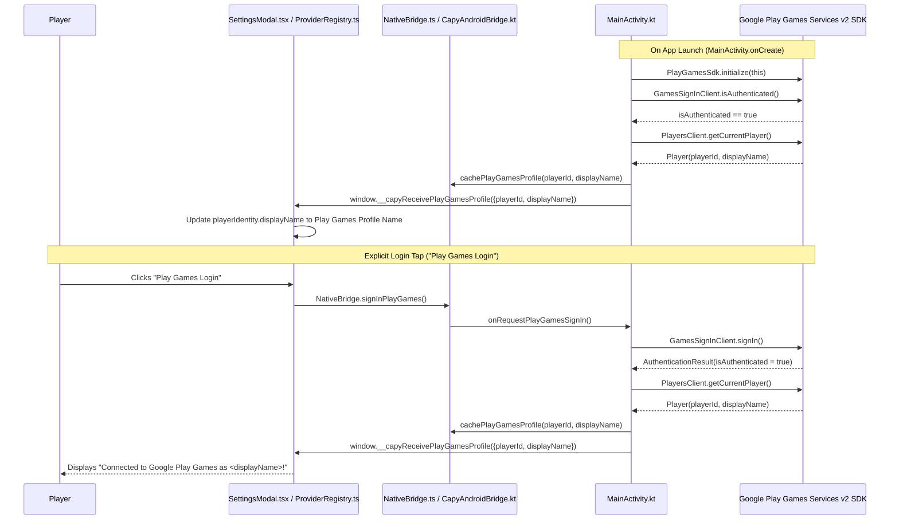
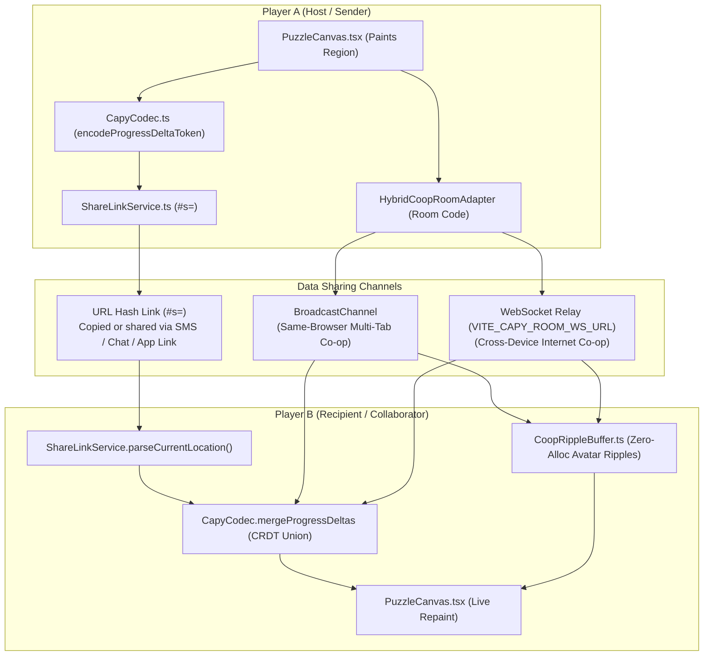

# Cloud Sync, Google Play Games Services v2 & Multiplayer Data Sharing (`CLOUD.md`)

This document explains how player identity, Google Play Games Services v2 login, conflict-free Cloud Sync, shareable progress links, and simultaneous Co-op multiplayer rooms work across the **Capy** monorepo (`web/` and `app/`).

---

## 1. Plain-English Overview: How Everything Works

### A. How Cloud Login Works
1. **Instant Guest Profile (Zero Friction)**:
   - Every player starts immediately with a local profile (for example, `Sunny Capy` with a chosen avatar color) stored in `localStorage` under `capy_player_identity_v1`. No account is required to play, save, or share links.
2. **Google Play Games Services v2 Login (Android)**:
   - On Android (`app/`), the native launcher integrates the official **Google Play Games Services v2 SDK** (`com.google.android.gms:play-services-games-v2`).
   - When a Google Play Console Game Project ID is configured (`@string/game_services_project_id` / `CAPY_PLAY_GAMES_APP_ID`), [`MainActivity.kt`](./app/src/main/java/com/capypaint/capy/MainActivity.kt) initializes `PlayGamesSdk.initialize(this)` on startup and checks `PlayGames.getGamesSignInClient(this).isAuthenticated`.
   - When authenticated (either automatically on launch or when the user taps **Play Games Login** in **Settings -> Saves**), `MainActivity.kt` calls `PlayGames.getPlayersClient(this).currentPlayer` to fetch the player's official **Google Play Games profile name (`player.displayName`)** and `player.playerId`.
   - The native bridge caches the profile in `SharedPreferences` (`capy_play_games_prefs`) and dispatches `window.__capyReceivePlayGamesProfile({"playerId":"...","displayName":"..."})` to [`NativeBridge.ts`](./web/src/services/NativeBridge.ts), which immediately updates [`ProviderRegistry.auth`](./web/src/services/providers/ProviderRegistry.ts) and displays the player's real Google Play Games gamer tag in the UI.
   - When running in a desktop web browser or an unconfigured debug APK without a Play Console Project ID, tapping **Play Games Login** falls back safely to a local Play Games profile link without crashing.

### B. How Data Is Shared Between Players
Capy supports **four complementary ways** to share puzzle data and paint together, ranging from zero-server URL tokens to real-time Co-op rooms:

| Sharing Method | How Data Travels Between Players | Payload Size | Server Required? | Works Across Separate Devices? |
| :--- | :--- | :--- | :--- | :--- |
| **1. Shareable Progress Link (`#s=<token>`)** | All painted region IDs, Free Colour overrides, and the artwork ID are compressed into the URL hash itself (`https://shthed.github.io/capy/#s=...`). You send the link via SMS, WhatsApp, Discord, or email; the recipient's browser/app decodes the progress directly from the link. | `~100 - 400 bytes` (`< 2 KB`) | **No server required** (data lives inside the URL) | **Yes** (instant for built-in Gallery artworks) |
| **2. Local / Same-Browser Co-op Room (`?room=<ROOM6>`)** | Uses the browser's native `BroadcastChannel` (`capy_coop_room_<ROOM6>`) to stream real-time `PAINT_EVENT` strokes and `WELCOME_STATE` progress seeds between open tabs or windows on the same device. | `~120 bytes` per tap | **No server required** | Same device / browser profile |
| **3. Internet Cross-Device Co-op Room (`?room=<ROOM6>`)** | Uses `HybridCoopRoomAdapter` over WebSocket (`VITE_CAPY_ROOM_WS_URL`) to relay `HELLO`, `WELCOME_STATE`, `PAINT_EVENT`, and `HEARTBEAT` frames between players on different phones, tablets, or PCs. | `~120 bytes` per tap | **Yes** (requires `VITE_CAPY_ROOM_WS_URL` WebSocket relay) | **Yes** (when `VITE_CAPY_ROOM_WS_URL` is configured) |
| **4. Portable `.capy` v2 Binary File Export** | Exports a self-contained `CAPY\x02\x00` binary archive containing the source image, quantized segmentation map, and full undo/replay history via OS Share Sheet or file download. | `~15 KB - 45 KB` per puzzle | **No server required** | **Yes** (works for both Gallery and custom user photos) |

### C. How Cloud Sync Merges Progress Without Losing Work (CRDT)
Traditional cloud saves overwrite File A with File B if you play on two devices offline ("conflict dialog"). Capy instead treats puzzle progress as a **Conflict-Free Replicated Data Type (CRDT)** implemented in [`CapyCodec.ts`](./web/src/services/CapyCodec.ts) (`mergeProgressDeltas`):
- **Painted Regions (`filledRegionIds`) use a Grow-Only Set Union**:
  - If you paint regions `[1, 2, 3]` on your phone and regions `[3, 4, 5]` on your tablet, syncing merges both sets into `[1, 2, 3, 4, 5]`. Neither device's painted regions are ever lost.
- **Custom Free-Colour Overrides (`customColors`) use Last-Writer-Wins (LWW)**:
  - If two devices paint the same region with different custom colors, the delta with the newer `updatedAt` timestamp wins deterministically.

---

## 2. End-to-End Architecture Diagrams

### A. Google Play Games Services v2 Sign-In & Profile Name Resolution

### B. Player-to-Player Progress Sharing & Simultaneous Co-op Flow

---

## 3. Binary Delta Wire Format (`ProgressDeltaV2`)

Both **Shareable Progress Links (`#s=<token>`)** and **Cloud Sync Envelopes (`CloudSaveEnvelope`)** use the `ProgressDeltaV2` binary format defined in [`web/src/services/CapyCodec.ts`](./web/src/services/CapyCodec.ts):

1. **Logical Structure**:
   - `sampleId`: Identifier of the gallery artwork (for example, `sample_capybara`) or custom image hash.
   - `configHash`: Deterministic FNV-1a 32-bit hash of `GeneratorConfig` (`k`, `algorithm`, `lineMode`, `regionColorMode`, `targetResolution`, `minRegionSize`) so deltas only apply to matching segmentation grids.
   - `updatedAt`: Millisecond epoch timestamp used for Last-Writer-Wins (LWW) tie-breaking on Free Colour overrides.
   - `filledRegionIds`: Sorted array of completed 1-based region IDs.
   - `customColors`: Map of `{ [regionId]: argbInt }` for Free Colour overrides.
2. **Binary Encoding & Compression (`encodeProgressDeltaToken`)**:
   - Regions are sorted in ascending order and delta-encoded (`id[i] - id[i - 1]`) using unsigned **LEB128 varints**, so adjacent region IDs consume 1 byte each.
   - The binary buffer is compressed with `CompressionStream('deflate-raw')` (with an automatic uncompressed flag fallback if raw bytes are smaller) and encoded as URL-safe **base64url** without padding.
   - A puzzle with 200 painted regions encodes into roughly **80 to 160 characters** in the URL hash (`#s=...`).

---

## 4. Google Play Games Services v2 Setup & Configuration (`app/`)

### A. Codebase Files Involved
- [`gradle/libs.versions.toml`](./gradle/libs.versions.toml) & [`app/build.gradle.kts`](./app/build.gradle.kts):
  - Bundles `com.google.android.gms:play-services-games-v2:20.1.2`.
  - Reads optional `CAPY_PLAY_GAMES_APP_ID` environment variable at build time and overrides `@string/game_services_project_id`.
- [`app/src/main/AndroidManifest.xml`](./app/src/main/AndroidManifest.xml):
  - Declares `<meta-data android:name="com.google.android.gms.games.APP_ID" android:value="@string/game_services_project_id" />`.
- [`app/src/main/java/com/capypaint/capy/MainActivity.kt`](./app/src/main/java/com/capypaint/capy/MainActivity.kt):
  - Calls `PlayGamesSdk.initialize(this)` and `PlayGames.getGamesSignInClient(this)` when `CapyAndroidBridge.isPlayGamesAppIdConfigured(appId)` is `true`.
  - Queries `PlayGames.getPlayersClient(this).currentPlayer` to read `player.playerId` and `player.displayName` (the user's Google Play Games profile name), caches them via `bridge.cachePlayGamesProfile(playerId, displayName)`, and evaluates `window.__capyReceivePlayGamesProfile(...)` in the WebView.
- [`app/src/main/java/com/capypaint/capy/CapyAndroidBridge.kt`](./app/src/main/java/com/capypaint/capy/CapyAndroidBridge.kt):
  - Exposes `@JavascriptInterface fun signInPlayGames(): String?`, `@JavascriptInterface fun saveCloudSnapshot(slotKey: String, payloadJson: String): Boolean`, and `@JavascriptInterface fun loadCloudSnapshot(slotKey: String): String?`.

### B. Provisioning Live Google Play Console Credentials
To activate live Google Play Games sign-in on production/internal-test Android builds:
1. In **Google Play Console**, open **Play Games Services -> Setup and management -> Configuration**.
2. Copy the 12-digit **Project ID** (App ID) and provide it via the `CAPY_PLAY_GAMES_APP_ID` environment variable during CI/release builds (or set `game_services_project_id` in [`app/src/main/res/values/strings.xml`](./app/src/main/res/values/strings.xml)).
3. Register both your **Upload Key SHA-1** and **Play App Signing SHA-1** certificate fingerprints under **Play Games Services -> Credentials** for package name `com.capypaint.capy`.
4. Publish `/.well-known/assetlinks.json` containing the Play App Signing **SHA-256** fingerprint so Android App Links (`https://shthed.github.io/capy/#s=...` and `?room=...`) open directly inside the installed Capy Android app.

---

## 5. Current Scope vs Production Backend Roadmap

> [!IMPORTANT]
> **What works immediately today with zero backend setup vs what requires hosted infrastructure:**
> - **Works Today (Serverless / Built-In)**:
>   - Shareable `#s=<token>` links across any device/chat app for all built-in Gallery artworks.
>   - Portable `.capy` v2 compact binary save export and import across all devices for both Gallery and custom user-uploaded photos.
>   - Real-time simultaneous Co-op rooms across tabs/windows on the same browser via `BroadcastChannel`.
>   - Google Play Games Services v2 SDK integration (`GamesSignInClient` + `PlayersClient.getCurrentPlayer()` profile display name resolution) and local/native CRDT snapshot persistence (`filesDir/capy_cloud/` + `capy_cloud_vault_v1`).
> - **Requires Hosted Endpoint / Play Console Provisioning (Tracked in [`TODO.md`](./TODO.md))**:
>   - **Cross-Device Internet Co-op Relay**: Requires deploying a public WebSocket room relay URL (`VITE_CAPY_ROOM_WS_URL`, e.g. Cloudflare Durable Objects or PartyKit) so `?room=ABC123` connects players across separate networks over the internet.
>   - **Cross-Device Custom Photo Sharing via Link**: Sharing a `#s=<token>` URL for a *custom user-uploaded photo* across two different devices requires uploading the encrypted custom image/pack to an ephemeral cloud blob store or transferring it peer-to-peer over a WebRTC DataChannel.
>   - **Cross-Device Cloud Vault Backend & Native `SnapshotsClient` Binding**: Syncing `CloudSaveEnvelope` across separate devices over the internet requires either binding Google Play Games `SnapshotsClient` (once the Play Console Game Project ID is active) or connecting a hosted REST/OIDC cloud vault endpoint in `CrdtCloudSaveAdapter`.
