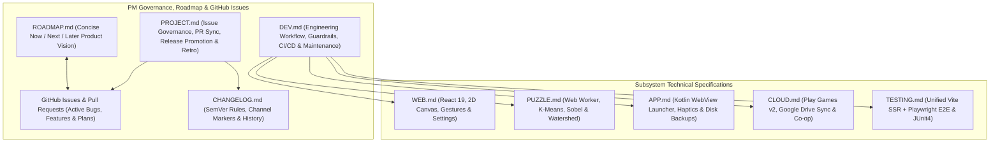

# Development & Maintenance Guide -- Capy Monorepo (`web/`, `app/`, `worker/`)

This guide defines the engineering workflow, shared architectural guardrails, CI/CD architecture, and ongoing maintenance playbooks for **Capy** ([`https://github.com/capyboop/paint`](https://github.com/capyboop/paint), live at [`https://capypaint.com/`](https://capypaint.com/)<!-- capy-dev-only:start -->; developed in [`https://github.com/shthed/capy`](https://github.com/shthed/capy) with PR previews at [`https://shthed.github.io/capy/`](https://shthed.github.io/capy/) and private AI operational guides in [`docs/ai/workflow-and-models.md`](./docs/ai/workflow-and-models.md)<!-- capy-dev-only:end -->).

**Related Guides**: [`README.md`](./README.md) | [`CONTRIBUTING.md`](./CONTRIBUTING.md) | [`SUPPORT.md`](./SUPPORT.md) | [`SECURITY.md`](./SECURITY.md) | [`PROJECT.md`](./PROJECT.md) | [`ROADMAP.md`](./ROADMAP.md) | [`WEB.md`](./WEB.md) | [`PUZZLE.md`](./PUZZLE.md) | [`APP.md`](./APP.md) | [`CLOUD.md`](./CLOUD.md) | [`TESTING.md`](./TESTING.md) | [`CHANGELOG.md`](./CHANGELOG.md) | [`LICENSE.md`](./LICENSE.md)

**Table of Contents**:
1. [Documentation Map & Architecture](#1-documentation-map--architecture)
2. [Core Technical Guardrails (`web/` & `app/`)](#2-core-technical-guardrails-web--app)
3. [Git Branching, Local Verification & Release Workflow (`Alpha -> Beta -> Production`)](#3-git-branching-local-verification--release-workflow-alpha---beta---production)
4. [CI/CD Pipeline & Automated Cleanup Architecture](#4-cicd-pipeline--automated-cleanup-architecture)
5. [Versioning, Dependency Maintenance & Asset Playbooks](#5-versioning-dependency-maintenance--asset-playbooks)
6. [Environment Self-Healing & Troubleshooting Recipes](#6-environment-self-healing--troubleshooting-recipes)

> [!IMPORTANT]
> **Division Between `PROJECT.md` and `DEV.md`**:
> - [`PROJECT.md`](./PROJECT.md) is the **canonical Project Management manual** owning GitHub Issues governance, PR sync, release promotion, `CHANGELOG.md` channel governance, and the retro log.
> - [`DEV.md`](./DEV.md) (this file) is the **engineering manual** covering shared technical guardrails, local build/test CLI, CI/CD architecture, SemVer/dependencies/assets, and troubleshooting.

---

## 1. Documentation Map & Architecture



### Repository Documentation Index

- **[`README.md`](./README.md)** (*Players & Contributors*): Product showcase, controls cheat sheet, play links, developer quick start, privacy policy link, and documentation index.
<!-- capy-dev-only:start -->
- **[`CAPYBOOP.md`](./CAPYBOOP.md)** (*Studio Structure & AI Onboarding*): CapyBoop Games organizational chart, standing AI chat roles, and cross-chat coordination rules.
- **[`AGENTS.md`](./AGENTS.md)** (*Auto-Loaded AI Playbook*): AI-specific guardrails, context discipline, task routing, and links to [`docs/ai/`](./docs/ai/workflow-and-models.md).
<!-- capy-dev-only:end -->
- **[`PROJECT.md`](./PROJECT.md)** (*Project Management & Maintainers*): Focused GitHub Issues governance, PR sync, release promotion, `CHANGELOG.md` channel governance, and continuous improvement retro log.
- **[`ROADMAP.md`](./ROADMAP.md)** (*Contributors & Maintainers*): Concise Now / Next / Later product vision linked to GitHub Issues and [`CHANGELOG.md`](./CHANGELOG.md).
- **[`DEV.md`](./DEV.md)** (*Contributors & Maintainers*): Engineering workflow, shared technical guardrails, 3-tier CI/CD, SemVer/dependencies/assets, and troubleshooting.
- **[`WEB.md`](./WEB.md)** (*Engineering Reference*): React 19 UI hierarchy, `PuzzleCanvas.tsx` 3-tier offscreen caching, 6-mode touch gesture engine, Worker IPC, `NativeBridge`, storage keys, and `UserSettings` dictionary.
- **[`PUZZLE.md`](./PUZZLE.md)** (*Engineering Reference*): `puzzle.worker.ts` 5-strategy computer-vision pipeline, Red-Mean K-Means++ clustering, adaptive Otsu/Sobel contours, watershed absorption, and 6-stage telemetry.
- **[`APP.md`](./APP.md)** (*Engineering Reference*): Unified Android `:app` launcher (`MainActivity.kt`, `CapyAndroidBridge.kt`), `WebViewAssetLoader`, Pixel API 33+ LRA touch haptics, `SnapshotsClient` sync, and disk backups.
- **[`CLOUD.md`](./CLOUD.md)** (*Engineering Reference*): Modular `CloudProviderDriver` backends, Google OAuth 2.0 `appDataFolder` & Play Games Services v2 sign-in, CRDT `mergeProgressDeltas`, `#s=<token>` share links, Co-op rooms, and Cloudflare Workers edge hosting (`capypaint.com`).
- **[`TESTING.md`](./TESTING.md)** (*Engineering Reference*): Unified `web/scripts/test.mjs` runner (Vite SSR unit/codec checks + Playwright multi-touch E2E suite) and Android JUnit4 verification.
- **[`CHANGELOG.md`](./CHANGELOG.md)** (*Release History*): Chronological `MAJOR.MINOR.PATCH` release history and `(Alpha)`/`(Beta)`/`(Production)` channel markers synchronized with `web/package.json` and Android `versionCode`.
- **[`LICENSE.md`](./LICENSE.md)** (*Contributors*): Capybara Chill Preamble and CC BY-NC-SA 4.0 licensing terms.
- **[`web/public/privacy-policy.html`](./web/public/privacy-policy.html)** (*Players & Storefronts*): Published Privacy Policy and Google Play Data Safety disclosures (`https://capypaint.com/privacy-policy.html`).

### Documentation Formatting Standards (Mobile-First & Zero-Clutter)

1. **Mobile-First Readability (No Wide Prose Tables)**: Contributors review documentation and pull requests on mobile devices. Never author wide multi-column Markdown tables or put multi-sentence prose inside table cells (which overflow horizontally and stretch narrow columns into tall blocks of empty whitespace). Use structured bullet lists instead; reserve Markdown tables strictly for 2 short-value columns that fit narrow mobile screens without scrolling.
2. **Zero Emojis & Zero ASCII Box-Drawing Art**: Never use unicode emojis or box-drawing characters (`U+2500`--`U+257F`, `+---+`) in `.md` files. Use GFM alerts (`> [!NOTE]`, `> [!TIP]`, `> [!IMPORTANT]`, `> [!WARNING]`), Mermaid diagrams, and structured bullet lists.
3. **Portable Relative Intra-Repo Links**: Always link repository files using relative paths (`./web/src/...`)—never machine-local `file:///...` URIs—avoid brittle unpinned `#L...` line numbers inside `.md` guides, and pin line-specific references in PR bodies and comments to immutable commit SHAs (`blob/<sha>/<path>#L<start>-L<end>`).

---

## 2. Core Technical Guardrails (`web/` & `app/`)

All contributors modifying Web (`web/`) or Android (`app/`) code must preserve these core architectural invariants:

### A. Web & Puzzle Engine Conventions (`web/`)

1. **Coordinates & Viewport Invariance ([`PuzzleCanvas.tsx`](./web/src/components/PuzzleCanvas.tsx))**:
   - Maintain explicit distinctions between Screen (DOM pointer), Container (CSS client bounds), Artwork (canvas pixel grid), and Segmentation (`regions[id]`) coordinates using `screenToCanvas` and `clampCanvasOffset`.
   - Preserve focal-point invariance under multi-touch pinch-to-zoom and Google Maps-style one-finger double-tap-and-drag zoom.
   - **Never** move, reset, or zoom the viewport automatically on puzzle completion or replay start/end (`startReplay`, `finishAutoResume`, `handleLoadSnapshot` on the already-active save). Move the camera only on explicit user gestures/buttons, switching to a different saved puzzle, or opt-in Follow Painting.
2. **Zero-Allocation Hot Paths**:
   - Never instantiate objects or arrays inside `requestAnimationFrame` loops, pan momentum gliding, canvas repaints, or high-frequency touch gesture handlers. Reuse typed arrays (`Uint8Array`, `Uint32Array`), typed-array ring buffers (`CoopRippleBuffer`), pre-allocated bounding box structs, and scratch vectors to avoid GC micro-stutter, and auto-sleep `requestAnimationFrame` at `0%` CPU when active animations finish.
3. **Direct Canvas Refs vs. React State**:
   - Mutate canvas/gesture refs directly and schedule repaints via `requestAnimationFrame` for 60--120fps dragging, gliding, and pinch zooming without triggering React virtual DOM reconciliation.
   - Reserve React state strictly for discrete UI transitions (active swatch selection, region completion counts, modal visibility, victory overlays).
4. **Web Worker Isolation & Cancellation ([`puzzle.worker.ts`](./web/src/engine/puzzle.worker.ts))**:
   - Execute all CPU-heavy image processing (K-Means clustering, Otsu/Sobel contour extraction, watershed region segmentation) exclusively inside `puzzle.worker.ts` using transferable `ArrayBuffer` payloads.
   - Support clean cancellation/termination whenever a new puzzle generation begins.
5. **Relative Asset Path Invariance**:
   - Never use root-relative `/assets/...` URLs in code or CSS. Always use `./assets/...` and keep `base: './'` in [`web/vite.config.ts`](./web/vite.config.ts) so assets resolve identically across GitHub Pages (`/`), PR previews (`/alpha/<number>/`), and Android WebView (`https://appassets.androidplatform.net/assets/www/`).
6. **Defensive `NativeBridge` Fallbacks ([`NativeBridge.ts`](./web/src/services/NativeBridge.ts))**:
   - Feature-detect host capabilities on every call (`haptic`, `saveBackup`, `loadBackup`, `saveCloudBinaryChunk`, `loadCloudBinaryChunk`, `setBackModalOpen`, `onSharedImage`, `shareImage`) and fall back safely to Web APIs (`navigator.vibrate`, IndexedDB, Web Share API) without uncaught exceptions.
7. **Storage Durability, Epoch-Scoped CRDT & IndexedDB Quota Safety ([`StorageService.ts`](./web/src/services/StorageService.ts), [`SafeLocalStore.ts`](./web/src/services/storage/SafeLocalStore.ts), [`IndexedDbStore.ts`](./web/src/services/storage/IndexedDbStore.ts), [`CapyCodec.ts`](./web/src/services/CapyCodec.ts))**:
   - Route all scoped `localStorage` access through `SafeLocalStore` + `StorageKeys` (only `SafeLocalStore.ts`, `StorageNamespace.ts`, and `debugEnvironment.ts` touch `localStorage` directly) and never store raw binary image Blobs or large base64 strings (including snapshot `previewDataUrl` thumbnails) in synchronous `localStorage` (5 MB cap, blocks main thread).
   - Offload `previewDataUrl` thumbnails into IndexedDB (`preview_${id}` in the `images` store) with a bounded LRU `previewCache` (`128` entries) + async `hydrateSnapshotPreviews`, evict and retry once on reclaimed `IDBDatabase` handles throwing `InvalidStateError`, fail closed on IndexedDB puzzle/image write quota errors (notifying `onQuotaWarning` and aborting before `localStorage` metadata commits), mirror `localStorage` writes through debounced `flushPendingBackups()` (`filesDir/capy_saves` on Android), request `navigator.storage.persist()` (`requestPersistentStorageOnce`), surface `QuotaExceededError` via `onQuotaWarning` (`storage-quota-toast`), code-split `PuzzleGenerator` dynamically on worker fallback (`PuzzleWorkerService.ts`), preserve monotonic `resetEpoch` across `ProgressDeltaV2`, `SavedSnapshot`, and `capy_active_session_v8` so stale pre-reset saves never resurrect cleared regions, and keep `.capy` v2 schema migrations backward-compatible (with `16 MiB` single-save and `256 MiB` `FLAG_ARCHIVE` ceilings validated at both encode and decode time).
8. **Touch Gesture Transitions & Hardware Back Navigation**:
   - Maintain `touch-action: none` ([`web/src/index.css`](./web/src/index.css)) on the interactive canvas container and dynamically re-anchor pan coordinates when releasing one finger out of a pinch-to-zoom gesture so the canvas never jumps.
   - Register open modals via `NativeBridge.pushBackHandler(onClose)` / `setBackModalOpen` (`window.__capyCloseModal()` from `MainActivity.kt`) alongside desktop `Escape` listeners.
9. **Modular Provider Domains & Telemetry Instrumentation ([`ProviderRegistry.ts`](./web/src/services/providers/ProviderRegistry.ts), [`AuthManager.ts`](./web/src/services/auth/AuthManager.ts), [`CloudLibrarySyncOrchestrator.ts`](./web/src/services/cloud/CloudLibrarySyncOrchestrator.ts), [`HybridCoopRoomClient.ts`](./web/src/services/coop/HybridCoopRoomClient.ts), [`CatalogIdeasService.ts`](./web/src/services/catalog/CatalogIdeasService.ts), [`ProviderContext.tsx`](./web/src/context/ProviderContext.tsx))**:
   - Keep `ProviderRegistry.ts` as a thin backward-compatible wiring facade over the domain modules (`auth/`, `cloud/`, `coop/`, `catalog/`) and expose DI-ready access via `ProviderContext`.
   - Instrument swallowed error paths in auth, cloud sync, cloud drivers, and Co-op transport with `reportSwallowed(...)` ([`telemetry.ts`](./web/src/services/telemetry.ts)), enforce strict Android Play Games `play_games_v2` isolation (zero GIS fallback in both `signInWithGoogle` and `attemptAutoSignIn`), and preserve per-slot deletion tombstones (`CLOUD_TOMBSTONES_STORAGE_KEY`) plus `signOut()` cross-account cache clearing.

### B. Native Android Style & Safety (`app/`)

1. **Trailing Commas & Clarifying Parentheses**: Use trailing commas in multiline parameter/data-class lists and explicit parentheses around compound logical or range sub-expressions.
2. **Android KTX Extensions**: Prefer `androidx.core.graphics.createBitmap(...)`, `bitmap.scale(width, height)`, and `sharedPreferences.edit { ... }`.
3. **Array-Holding Data Classes**: Explicitly override `equals()` and `hashCode()` using `contentEquals()` and `contentHashCode()` on any Kotlin `data class` holding `IntArray` or `BooleanArray`.
4. **Zero-Allocation Loops**: Use primitive array buffers rather than boxed allocations inside native image downsampling or rendering paths.
5. **Activity Lifecycle Forwarding (`MainActivity.kt`)**: Always forward `onPause()` -> `webView?.onPause()` and `onResume()` -> `webView?.onResume()` alongside `onDestroy()` cleanup so WebView rendering and Web Audio suspend cleanly at the OS layer when backgrounded.

---

## 3. Git Branching, Local Verification & Release Workflow (`Alpha -> Beta -> Production`)

### Step 1: Linear Branch Creation

Feature, bugfix, and documentation work branches cleanly from the target integration branch (`beta` for active development, `main` for release):

```bash
git fetch --all --prune
git checkout -b feature/<short-topic> origin/beta
# Allowed prefixes: feature/, fix/, docs/, ci/, deps/, chore/
```

If `origin/beta` advances while a PR is open, rebase cleanly:

```bash
git fetch origin beta
git rebase origin/beta
```

When a release cycle has been tested and approved for Production, follow the Release Promotion workflow in [`PROJECT.md` Section 5](./PROJECT.md#5-release-promotion-and-changelog-governance): compile [`CHANGELOG.md`](./CHANGELOG.md) channel headings cleanly, open a `beta -> main` PR so `Playwright E2E` runs in CI, tag `vX.Y.Z` on `origin/main` after merge, and re-align `origin/beta` to `origin/main` when appropriate.

### Step 2: Local Development & Verification

Run the mandatory checks matching your changed files before pushing:

#### Web Application (`web/`)
```bash
cd web
npm ci                   # Clean dependency install (first run or lockfile change)
npm run dev              # Local Vite dev server on http://localhost:3000
npm run lint             # Strict TypeScript + oxlint guardrails (tsc + oxlint) -- MANDATORY for code PRs
npm run build            # Production bundle (tsc && vite build -> web/dist/) -- MANDATORY for code PRs
npm run test:unit        # Fast Vite SSR engine, codec, version/changelog & workflow unit checks
npm run test:e2e:smoke   # Fast (~15-20s) critical-path Playwright smoke E2E (boot + gameplay)
npm run test:e2e         # Parallel Playwright E2E only (--suite=<csv>, --workers=<n>, --shard=i/n)
npm test                 # Unified engine, codec, version/changelog & parallel Playwright E2E suite
npm run changelog:compile # Batch .changelog/*.md fragments into CHANGELOG.md & sync package*.json (--promote for Production)
npm run gallery:capture  # Refresh docs/gallery/*.png when UI/theme visuals change
npm run generate:samples # Rebuild web/public/assets/sample_saves.capy when built-in samples change
```

#### Native Android Wrapper (`app/`, from repository root)
```bash
./gradlew app:buildWeb          # Compiles web/ into web/dist/
./gradlew app:testDebugUnitTest # JUnit4 unit tests (CapyAndroidBridgeTest.kt)
./gradlew app:assembleDebug     # Syncs web/dist/ into assets/www/ and builds debug APK
./gradlew app:bundleRelease     # Builds Play Store Android App Bundle (.aab)
```

### Step 3: PR Sync & Link Standards

All PR title, label, and milestone conventions live in [`PROJECT.md` Section 4](./PROJECT.md#4-pull-request-lifecycle-and-review-standards). Preserve these engineering conventions on every PR:

- **PR Preview Paths vs. GitHub PR URLs**: Alpha GitHub Pages previews deploy to `/alpha/<number>/` (and `/alpha/<number>/capy.apk`), whereas repository docs use relative links (`../../pull/<number>`, `../../issues/<number>`), GitHub diff links use `/pull/<number>/files#diff-...`, and git recovery refs (`refs/pull/<number>/head`) keep GitHub's native `/pull/` path. Pin code links in PR bodies and comments to exact commit SHAs (`blob/<40-char-sha>/<path>#L<start>-L<end>`).
- **PR Description Sync-on-Push**: Keep PR title, overview bullets, target version, SHA-pinned line links, labels, Milestone, and mergeability up to date whenever follow-up commits or rebases alter scope or state.
- **Clickable Link Standard**: Format PR references in repository docs as relative clickable `[#NNN](../../pull/NNN)` links and Epic references as `[EPIC-N](../../issues/<num>)` (never bare/backticked `#<epic-issue>` or `[#<epic-issue>](../../issues/...)`).

---

## 4. CI/CD Pipeline & Automated Cleanup Architecture

Capy runs five core GitHub Actions workflows in [`.github/workflows/`](./.github/workflows):
<!-- capy-dev-only:start -->
*(On `shthed/capy` `beta` and `main`, six additional repository-specific automation workflows—[`open-pr.yml`](./.github/workflows/open-pr.yml), [`open-issue.yml`](./.github/workflows/open-issue.yml), [`pr-review-gate.yml`](./.github/workflows/pr-review-gate.yml), [`publish-capyboop.yml`](./.github/workflows/publish-capyboop.yml), [`regenerate-puzzles.yml`](./.github/workflows/regenerate-puzzles.yml), and [`sync-beta-from-main.yml`](./.github/workflows/sync-beta-from-main.yml)—bring the total to **11** workflows (**5** core + **6** dev-only).)*
<!-- capy-dev-only:end -->

### 1. Unified 3-Tier Fast Build Gate, Async E2E/Android & Pages Deployment ([`deploy-branch.yml`](./.github/workflows/deploy-branch.yml))
- **Fast Blocking Gate + Async Heavy Jobs**: Required branch checks (`Build & Test`) use cached `web/node_modules`, `< 2s` sanity checks, TypeScript + `oxlint` lint, Web build, and headless `--unit` tests (`node scripts/test.mjs --unit`, zero Chromium). **`Android APK`**, **`Deploy Preview`** (unblocked Alpha/Beta deploys), and smart tiered 4-worker **`Playwright E2E`** run asynchronously without blocking feature PR checks or previews.
- **Fast Sanity Paths (`isDocsOnlyPr` & `is_main_sync`)**: Pull requests that exclusively touch `**.md`, `docs/**`, `notes/**`, `.gitignore`, or `LICENSE`, or verified `sync/beta-from-main -> beta` ancestry syncs whose `HEAD` tree is byte-identical to `origin/main`, run the `< 2s` `npm run test:sanity` check in `Build & Test` while skipping redundant Web/Android builds, E2E re-runs, and Alpha Pages deployment.
- **Job 0 -- `prepare` (`Target`, `contents: read`, `pull-requests: read`)**:
  - Resolves `target_dir` (`/alpha/<number>/`, `/beta/`, or `/`), `checkout_ref`, `is_docs_only`, `is_main_sync`, `is_draft`, `has_web_changes`, and `skip` flags once before downstream fan-out.
- **Job 1 -- `build` (`Build & Test`, `contents: read`, required)**:
  - Runs concurrently across open PRs (`main` and `beta` bases) with `cancel-in-progress: true` per PR/ref.
  - Injects `vars.VITE_GOOGLE_CLIENT_ID` and `vars.CAPY_ANDROID_SHA256_CERT_FINGERPRINTS`, restores cached `web/node_modules`, runs `npm run test:sanity && npm run lint && npm run build` plus `node scripts/test.mjs --unit`, and uploads `web-dist` (`web/dist/`).
- **Job 2 -- `android_build` (`Android APK`, `contents: read`, async)**:
  - Downloads `web-dist`, sets up JDK 17 + Gradle, executes `./gradlew app:testDebugUnitTest app:lintVitalRelease app:assembleDebug --build-cache` (release-variant `lintVitalRelease` catches release-only lint blockers before tagging), and uploads `build-artifacts` (`staging/web/` + `staging/apk/capy.apk`) for Pages without slowing down `Build & Test`.
- **Job 3 -- `e2e_release_gate` (`Playwright E2E`, `contents: read`, smart tiered async on `beta`, required for `main`)**:
  - Runs on ready non-docs/non-main-sync PRs targeting `main` (always) or `beta` (`has_web_changes == 'true'`), on `push` to `main` (`has_web_changes == 'true'`), and on `workflow_dispatch` targeting `main` (or `run_e2e == true`), skipping non-web-only changes and redundant post-merge `beta` pushes. Downloads `web-dist` + cached `~/.cache/ms-playwright`, skips `apt-get` `install-deps` via `ldd` check when shared libs are already satisfied, injects the matching `vars.VITE_*` / `vars.CAPY_ANDROID_SHA256_CERT_FINGERPRINTS` env vars, and runs `npm run test:e2e -- --workers=4` (zero duplicate Part 1 unit tests).
- **Job 4a -- `deploy_preview` (`Deploy Preview`, unblocked Alpha & Beta deploys)**:
  - Depends only on `needs: [prepare, build, android_build]` (`target_dir != '.'`), publishing Alpha PR builds (`/alpha/<number>/` + `/alpha/<number>/capy.apk` + PR comment) and `beta` branch pushes (`/beta/` + `/beta/capy.apk` + `--refresh-404`) immediately without waiting for `Playwright E2E`.
- **Job 4b -- `deploy` (`Deploy Pages`, E2E-gated Production deploys)**:
  - Depends on `needs: [prepare, build, android_build, e2e_release_gate]` (`target_dir == '.'`), strictly requiring `e2e_release_gate == 'success'` (or `skipped` only when `has_web_changes == 'false'`) before publishing `main` to `/` and `/capy.apk` (excluding `/alpha/` and `/beta/` during `rsync` and refreshing `404.html` via `--refresh-404`).
  - Both `deploy_preview` and `deploy` share `concurrency: { group: deploy-pages, cancel-in-progress: false }`, upload Pages artifacts with `include-hidden-files: true` (inspecting hidden directories via `ls -lah` so `.well-known/assetlinks.json` survives), and squash `gh-pages` into a single **orphan commit** on every push so binary `.apk` artifacts never bloat Git history.

### 2. Automated GitHub Release & Play Store Bundle Publisher ([`release.yml`](./.github/workflows/release.yml))
- Triggered automatically on `push: tags: ['v*.*.*']` (supporting both stable `v3.0.8` tags cut on `main` after each `beta -> main` Production promotion and `--prerelease` `v3.0.8-beta.1` tags on `beta`) or manually via `workflow_dispatch`.
- Injects `vars.VITE_GOOGLE_CLIENT_ID`, `vars.CAPY_PLAY_GAMES_APP_ID`, and `vars.CAPY_ANDROID_SHA256_CERT_FINGERPRINTS`, runs `npm run test:sanity && npm run lint && npm run build`, runs `./gradlew app:testDebugUnitTest`, builds `capy-<tag>.apk` (plus unversioned `capy.apk` on stable non-prerelease tags so `https://capypaint.com/capy.apk` always resolves) and the Google Play Store `capy-<tag>.aab` Android App Bundle (`bundleRelease`), packages `capy-web-<tag>.tgz`, extracts the matching `### X.Y.Z` / `### X.Y` notes from [`CHANGELOG.md`](./CHANGELOG.md) via [`.github/scripts/compile-changelog.mjs`](./.github/scripts/compile-changelog.mjs), and publishes the GitHub Release. Repositories without Android signing secrets (`CAPY_KEYSTORE_*`) skip cleanly on tag push so signed `capyboop/paint` Releases remain deferred until signing secrets are provisioned there.

### 3. Closed PR Preview & Branch Cleanup ([`cleanup-closed-pr.yml`](./.github/workflows/cleanup-closed-pr.yml))
- Triggered automatically on `pull_request: types: [closed]` (both merged and closed-unmerged PRs).
- Deletes ephemeral PR head branches from `origin` (explicitly protecting both `main` and `beta` so merging a `beta -> main` Release Promotion PR never deletes `origin/beta`), invokes `.github/scripts/cleanup-gh-pages-previews.mjs --target-pr <number> --ignore-recency` (preserving `/beta/`, `/alpha/` open PRs, `/assets/`, and `/web1/`), regenerates `/alpha/index.html` and `/alpha/manifest.json` via [`.github/scripts/generate-pr-manifest.mjs`](./.github/scripts/generate-pr-manifest.mjs), and uploads the Pages artifact with `include-hidden-files: true` so `.well-known/assetlinks.json` stays intact.

### 4. Scheduled Stale Branch & Orphan Sweep ([`cleanup-branches.yml`](./.github/workflows/cleanup-branches.yml))
- Runs daily at `06:00 UTC` (`cron: '0 6 * * *'`) or manually via `workflow_dispatch`.
- Invokes `.github/scripts/cleanup-branches.mjs` to prune merged/stale branches (`>= 1` day old) matching `feature/`, `fix/`, `chore/`, `ci/`, `deps/`, or `docs/` (never touching `main` or `beta`), followed by `cleanup-gh-pages-previews.mjs` to remove any orphaned `/alpha/` directories while preserving `/beta/` and re-uploading the Pages artifact with `include-hidden-files: true`.

### 5. Production Cloudflare Workers Deployment ([`deploy-cloudflare.yml`](./.github/workflows/deploy-cloudflare.yml))
- Triggered on `push` to `main` (touching `web/**`, `worker/**`, `wrangler.jsonc`, or the workflow file) and `workflow_dispatch`.
- When `CLOUDFLARE_API_TOKEN` and `CLOUDFLARE_ACCOUNT_ID` secrets are configured (or via Cloudflare Workers Builds native Git integration), runs `npm run test:sanity && npm run lint && npm run build`, deploys [`wrangler.jsonc`](./wrangler.jsonc) + [`worker/index.ts`](./worker/index.ts) (`CoopRoomDurableObject`) to `https://capypaint.com/` via `cloudflare/wrangler-action@v4` (`wranglerVersion: '4.160.1'`), and verifies `https://capypaint.com/api/health`. Repositories without Cloudflare secrets skip cleanly in `< 2s`.
<!-- capy-dev-only:start -->
- **Bot-Authored Draft PRs ([`open-pr.yml`](./.github/workflows/open-pr.yml)), Bot-Authored Issues ([`open-issue.yml`](./.github/workflows/open-issue.yml)) & CI Triggers**: Opens and updates idempotent `github-actions[bot]`-authored PRs and issues via `workflow_dispatch`, enforcing the cross-repo guardrail in [`docs/ai/cross-repo-guardrail.md`](./docs/ai/cross-repo-guardrail.md).
- **Strict `100%` AI Approval & Auto-Merge Gate ([`pr-review-gate.yml`](./.github/workflows/pr-review-gate.yml)) & Direct `main -> beta` Sync ([`sync-beta-from-main.yml`](./.github/workflows/sync-beta-from-main.yml))**: See [`docs/ai/pr-readiness.md`](./docs/ai/pr-readiness.md) for the full `$0` `workflow_dispatch` AI review protocol, fail-closed PR body validation, and auto-merge / `sync-beta-from-main.yml` ancestry sync rules.
- **Automated Clean-Room Public Mirror & Two-Way PR Sync ([`publish-capyboop.yml`](./.github/workflows/publish-capyboop.yml))**: Every merge to `shthed/capy` `main` exports a clean-room copy via [`web/scripts/rebrand-persona.mjs`](./web/scripts/rebrand-persona.mjs) (`--stage-dir`), verifies zero persona/AI-dev leaks across all files and commit messages (`--verify-log`), strips dev-only docs (`AGENTS.md`, `CAPYBOOP.md`, `docs/ai/`) and mirror/review/bot-PR workflows, pushes a linear commit authored solely by `capyboop` to `https://github.com/capyboop/paint`, and pushes tag `v<version>` only when a matching tag exists on `shthed/capy`.
- **On-Demand & Path-Filtered Pre-Baked Puzzle Regeneration ([`regenerate-puzzles.yml`](./.github/workflows/regenerate-puzzles.yml))**: Runs only on manual `workflow_dispatch` or `push` to `beta` touching puzzle source assets (`web/public/assets/**` excluding `.capy` archives, `presets/**`, and app icons), `web/scripts/generate-sample-saves.mjs`, `web/src/engine/**`, `CapyCodec.ts`, `DailyPuzzleService.ts`, `PuzzleWorkerService.ts`, `StorageService.ts`, `web/src/types/index.ts`, or the workflow file itself (never on a daily cron schedule), committing verified `.capy` updates directly to `beta` without opening PR noise.
<!-- capy-dev-only:end -->

---

## 5. Versioning, Dependency Maintenance & Asset Playbooks

### A. Single-Source-of-Truth Versioning (`MAJOR.MINOR.PATCH`) & Channel Markers

1. **Canonical Version**: [`web/package.json`](./web/package.json) `"version"` (`0 <= MINOR <= 99`, `0 <= PATCH <= 99`), kept in sync with `web/package-lock.json` by [`web/scripts/compile-changelog.mjs`](./web/scripts/compile-changelog.mjs).
2. **Automatic Propagation**:
   - [`web/src/version.ts`](./web/src/version.ts) derives `APP_VERSION`, `APP_VERSION_CODE = (MAJOR * 10000) + (MINOR * 100) + PATCH` (rendered in `SettingsModal.tsx` `data-testid="app-version-badge"`), and `resolveReleaseChannel()` (`'stable' | 'beta' | 'alpha' | 'dev'`).
   - [`app/build.gradle.kts`](./app/build.gradle.kts) parses `../web/package.json` at Gradle configuration time to set `versionName` and `versionCode` (strictly monotonic once published to Google Play Console).
3. **When to Bump & How to Format `CHANGELOG.md`** *(release promotion & channel rules live in [`PROJECT.md` Section 5](./PROJECT.md#5-release-promotion-and-changelog-governance))*:
   - **`MAJOR` (`X.0.0`)**: Breaking storage/codec epochs or major platform launches (`0.x` covers pre-monorepo Legacy Web1 milestones `#1`--`#430`; `1.0.0` begins at Unified Monorepo launch [#431](../../pull/431)).
   - **`MINOR` (`3.Y.0`)**: Backward-compatible gameplay features, replay modes, UI controls, cloud/multiplayer drivers, or new `UserSettings` keys.
   - **`PATCH` (`3.0.Z`)**: Backward-compatible bug fixes, gesture edge-case corrections, performance optimizations, test consolidation, documentation/changelog audits, or dependency updates.
   - **Compact Mobile-First `CHANGELOG.md` Contract & Active Channel Suffixes** (enforced automatically by `npm run test:sanity` in [`web/scripts/sanity.mjs`](./web/scripts/sanity.mjs) and `npm test` in [`web/scripts/test.mjs`](./web/scripts/test.mjs)):
     - **Zero Preamble**: Start [`CHANGELOG.md`](./CHANGELOG.md) directly on line 1 with the newest `###` version heading—no `#` title, introductory prose, or `---` dividers.
     - **Compact Headings With Active `(Alpha)` / `(Beta)` / `(Production)` Markers**: Format headings as `### MAJOR.MINOR - YYYY-MM-DD` (or `### MAJOR.MINOR.PATCH - YYYY-MM-DD` for standalone patches and `0.x.y` milestones), appending the live channel suffix on active release heads only (`npm run test:sanity` and `npm test` assert `exactly 1` `Production` heading, `<= 1` `Beta` heading, and `<= 1` `Alpha` heading; superseded releases carry no suffix).
     - **Daily / Promotion Release Batching & Channel Split Rule**: Prefer dropping a `.changelog/<slug>.md` fragment on feature/bugfix PRs targeting `beta` and compiling roughly once per day (or per `beta -> main` promotion) via `npm run changelog:compile` rather than bumping [`web/package.json`](./web/package.json) on every PR. Running `npm run changelog:compile` again on the same date appends into an existing same-day `(Beta)` heading without double-bumping the version. Whenever `main` and `beta` serve distinct patch versions under the same `MAJOR.MINOR`, use explicit `### MAJOR.MINOR.PATCH - YYYY-MM-DD` headings—keep `(Beta)` **only** on the single newest Beta head and drop `(Beta)` from superseded releases (`sanity.mjs` enforces `betaHeadingCount <= 1`).
     - **Single Concise Bullet Starting with Relative Clickable `[#NNN](../../pull/NNN)` PR Link**: Every item must be a single, flat bullet (`- [#NNN](../../pull/NNN) <1--2 concise sentences>`) starting with its relative clickable Markdown PR link and omitting trailing periods (no parentheses, no `"PR"` prefix, no unlinked `#NNN`, zero `Added`/`Changed`/`Fixed` category sub-headings, zero nested sub-bullets, and zero inline file/line links).
     - **Parallel-Safe `.changelog/` Fragments ([`.changelog/README.md`](./.changelog/README.md) & [`web/scripts/compile-changelog.mjs`](./web/scripts/compile-changelog.mjs))**: Feature PRs drop `.changelog/<slug>.md` fragments (`bump: patch|minor|major`, `<= 320` chars, optional `pr`, `epic`, `task`) validated by `sanity.mjs`, then compile atomically into one daily/promotion release with `npm run changelog:compile` (or `npm run changelog:compile -- --promote` for `beta -> main`). Note that [`.github/scripts/compile-changelog.mjs`](./.github/scripts/compile-changelog.mjs) is a separate release-notes extractor invoked by [`release.yml`](./.github/workflows/release.yml).

### B. Updating Dependencies (`web/` & `app/`)

#### Web Packages (`web/package.json`)
```bash
cd web
npm outdated          # Inspect available SemVer and major updates
npm update            # Upgrade within SemVer ranges and refresh package-lock.json
npm run test:sanity && npm run lint && npm run build && npm test
```

#### Android Version Catalog (`gradle/libs.versions.toml`)
1. Update library versions centrally in [`gradle/libs.versions.toml`](./gradle/libs.versions.toml).
2. Verify `compileSdk` compatibility in [`app/build.gradle.kts`](./app/build.gradle.kts) (currently `compileSdk = 37`). If a newer AndroidX artifact requires `compileSdk 38+`, either bump `compileSdk` alongside the dependency or pin to the latest stable release supporting API 37.
3. Run `./gradlew app:testDebugUnitTest && ./gradlew app:assembleDebug` to verify.

### C. Pre-Baked Samples & Visual Showcase Gallery
- **Built-in Sample Archive (`sample_saves.capy`)**: Whenever default generation parameters, `CapyCodec` binary framing, or `SAMPLE_GALLERY` entries change, run `npm run generate:samples` inside `web/` so first-time players get instant zero-worker startup.
- **README / Docs Showcase Screenshots (`docs/gallery/`)**: Whenever UI layout, theme colors, or modal styling changes significantly, run `npm run gallery:capture` inside `web/` to refresh deterministic high-DPI screenshots.

---

## 6. Environment Self-Healing & Troubleshooting Recipes

- **`tsc: not found` or missing `node_modules`**:
  - *Cause*: Fresh container or worktree without installed npm packages.
  - *Fix*: Run `npm ci` inside `web/` before running `test:sanity`, `lint`, `build`, or `test`.
- **`ERR_CONNECTION_REFUSED http://localhost:3000/` on standalone Playwright scripts**:
  - *Cause*: Standalone gallery/sample browser scripts expect a live server on port `3000` (whereas `npm test` automatically binds an ephemeral preview port when `CAPY_TEST_URL` is unset).
  - *Fix*: Start `npm run preview` as a background daemon (`IsDaemon: true`), run the check, and stop the daemon when finished—or run `npm test` directly.
- **`Executable doesn't exist at .../chromium`**:
  - *Cause*: Playwright Chromium binary not yet cached in container.
  - *Fix*: Run `npx playwright install chromium` inside `web/`.
- **Web/Android build steps skip on a documentation-only PR**:
  - *Cause*: PR exclusively modifies `.md`, `docs/**`, `notes/**`, `.gitignore`, or `LICENSE` (`isDocsOnlyPr` fast-path in `deploy-branch.yml`).
  - *Fix*: Expected behavior (`Build & Test` passes in `< 2s` while consuming zero Web/Android build minutes). Run `npm run test:sanity` locally to verify markdown links, zero emojis, zero ASCII art, and mobile-safe formatting.
- **Local Gradle fails with `SSLException: trustAnchors parameter must be non-empty`**:
  - *Cause*: Container JDK lacks a populated `/etc/ssl/certs/java/cacerts` truststore.
  - *Fix*: **Never** disable TLS verification or tamper with host trust roots. Verify `npm run test:sanity && npm run lint && npm run build` locally, push the branch, and rely on GitHub Actions `Android APK` (provisioned with Temurin JDK 17) to run `./gradlew app:testDebugUnitTest` and `./gradlew app:assembleDebug`.
