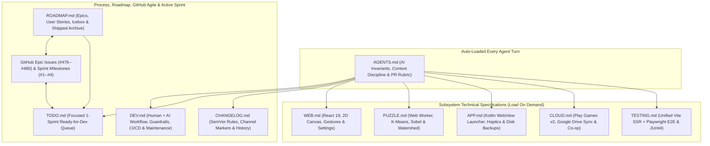

# Development & Maintenance Guide -- Capy Monorepo (`web/`, `app/`, `worker/`)

This guide defines the end-to-end human and AI co-development workflow, shared architectural guardrails, model selection strategy, session hygiene, CI/CD architecture, and ongoing maintenance playbooks for **Capy** ([`https://github.com/shthed/capy`](https://github.com/shthed/capy), live at [`https://capypaint.com/`](https://capypaint.com/) and PR previews at [`https://shthed.github.io/capy/`](https://shthed.github.io/capy/)).

**Related Guides**: [`README.md`](./README.md) | [`ROADMAP.md`](./ROADMAP.md) | [`AGENTS.md`](./AGENTS.md) | [`TODO.md`](./TODO.md) | [`WEB.md`](./WEB.md) | [`PUZZLE.md`](./PUZZLE.md) | [`APP.md`](./APP.md) | [`CLOUD.md`](./CLOUD.md) | [`TESTING.md`](./TESTING.md) | [`CHANGELOG.md`](./CHANGELOG.md)

**Table of Contents**:
1. [Documentation Map & Architecture](#1-documentation-map--architecture)
2. [Human + AI Co-Development Philosophy & Optimal Goals](#2-human--ai-co-development-philosophy--optimal-goals)
3. [Choosing the Right AI Model, Capability Tier & Workflow](#3-choosing-the-right-ai-model-capability-tier--workflow)
4. [Antigravity Session, Chat Naming & Pinning Hygiene](#4-antigravity-session-chat-naming--pinning-hygiene)
5. [Core Technical Guardrails (`web/` & `app/`)](#5-core-technical-guardrails-web--app)
6. [End-to-End 3-Tier Git, Pull Request & Release Promotion Workflow (`Alpha -> Beta -> Production`)](#6-end-to-end-3-tier-git-pull-request--release-promotion-workflow-alpha---beta---production)
7. [CI/CD Pipeline & Automated Cleanup Architecture](#7-cicd-pipeline--automated-cleanup-architecture)
8. [Versioning, Dependency Maintenance & Asset Playbooks](#8-versioning-dependency-maintenance--asset-playbooks)
9. [Environment Self-Healing & Troubleshooting Recipes](#9-environment-self-healing--troubleshooting-recipes)

> [!IMPORTANT]
> **Division Between `DEV.md` and `AGENTS.md`**:
> - [`AGENTS.md`](./AGENTS.md) is the **auto-loaded AI operational contract** injected into every agent turn. Keep `AGENTS.md` strictly AI-specific and free of human-only tutorials, while letting it grow to whatever size is needed for optimal agent performance and reliability over raw token savings.
> - [`DEV.md`](./DEV.md) (this file) is the **comprehensive Human + AI collaboration, Hybrid Agile sprint, coding guardrail, and maintenance manual**, consulted by human contributors and loaded on demand by AI agents when modifying code, planning sprints, choosing models, debugging CI, or updating dependencies.

---

## 1. Documentation Map & Architecture



### Repository Documentation Index

- **[`README.md`](./README.md)** (*Players & Contributors*): Product showcase, controls cheat sheet, Stable/Beta play links, developer quick start, privacy policy link, and documentation index.
- **[`ROADMAP.md`](./ROADMAP.md)** (*Humans & AI Agents*): Strategic product Epics (`EPIC-*` paired `1:1` with GitHub Epic Tracking Issues `#476`--`#480`), User Stories (`US-*`), external dependency readiness gates, Platform Icebox (`ICE-*`), and collapsed Shipped Epics & Stories.
- **[`TODO.md`](./TODO.md)** (*Humans & AI Agents*): Focused **1-Sprint Execution Queue** containing only unblocked, codebase-verified `BUG-*` and `TASK-*` `1-PR` slices ready for immediate dev work under the active GitHub Sprint Milestone.
- **[`DEV.md`](./DEV.md)** (*Humans & AI Agents*): Co-development philosophy, Hybrid Automated Sprints, GitHub Epic Issue CLI playbooks, Gemini 4 model selection, `#NNN` session hygiene, shared technical guardrails, 3-tier CI/CD, and maintenance playbooks.
- **[`AGENTS.md`](./AGENTS.md)** (*AI Agents — Auto-Loaded*): AI-specific guardrails, mobile-first formatting rule, context discipline, task routing, and PR readiness contract.
- **[`WEB.md`](./WEB.md)** (*Humans & AI Agents*): React 19 UI hierarchy, `PuzzleCanvas.tsx` 3-tier offscreen caching, 6-mode touch gesture engine, Worker IPC, `NativeBridge`, storage keys, and `UserSettings` dictionary.
- **[`PUZZLE.md`](./PUZZLE.md)** (*Humans & AI Agents*): `puzzle.worker.ts` 5-strategy computer-vision pipeline, Red-Mean K-Means++ clustering, adaptive Otsu/Sobel contours, watershed absorption, and 6-stage telemetry.
- **[`APP.md`](./APP.md)** (*Humans & AI Agents*): Unified Android `:app` launcher (`MainActivity.kt`, `CapyAndroidBridge.kt`), `WebViewAssetLoader`, Pixel API 33+ LRA touch haptics, `SnapshotsClient` sync, and disk backups.
- **[`CLOUD.md`](./CLOUD.md)** (*Humans & AI Agents*): Modular `CloudProviderDriver` backends, Google OAuth 2.0 `appDataFolder` & Play Games Services v2 sign-in, CRDT `mergeProgressDeltas`, `#s=<token>` share links, Co-op rooms, and Cloudflare Workers edge hosting (`capypaint.com`).
- **[`TESTING.md`](./TESTING.md)** (*Humans & AI Agents*): Unified `web/scripts/test.mjs` runner (Vite SSR unit/codec checks + Playwright multi-touch E2E suite) and Android JUnit4 verification.
- **[`CHANGELOG.md`](./CHANGELOG.md)** (*Humans & AI Agents*): Chronological `MAJOR.MINOR.PATCH` release history and `(Alpha)`/`(Beta)`/`(Production)` channel markers synchronized with `web/package.json` and Android `versionCode`.
- **[`web/public/privacy-policy.html`](./web/public/privacy-policy.html)** (*Players & Storefronts*): Published Privacy Policy and Google Play Data Safety disclosures (`https://capypaint.com/privacy-policy.html`).

### Documentation Formatting Standards (Mobile-First & Zero-Clutter)

1. **Mobile-First Readability (No Wide Prose Tables)**: Contributors review documentation, pull requests, and Antigravity chats on mobile devices. Never author wide multi-column Markdown tables or put multi-sentence prose inside table cells (which overflow horizontally and stretch narrow columns into tall blocks of empty whitespace). Use structured bullet lists instead; reserve Markdown tables strictly for 2 short-value columns that fit narrow mobile screens without scrolling.
2. **Zero Emojis & Zero ASCII Box-Drawing Art**: Never use unicode emojis or box-drawing characters (`U+2500`--`U+257F`, `+---+`) in `.md` files. Use GFM alerts (`> [!NOTE]`, `> [!TIP]`, `> [!IMPORTANT]`, `> [!WARNING]`), Mermaid diagrams, and structured bullet lists.
3. **Portable Relative Intra-Repo Links**: Always link repository files using relative paths (`./web/src/...`)—never machine-local `file:///...` URIs—avoid brittle unpinned `#L...` line numbers inside `.md` guides, and pin line-specific references in PR bodies and comments to immutable commit SHAs (`https://github.com/shthed/capy/blob/<sha>/<path>#L<start>-L<end>`).

---

## 2. Human + AI Co-Development Philosophy & Optimal Goals

Capy pairs real-time 60--120fps HTML5 Canvas interaction, off-thread computer vision, binary RLE/CRDT codecs, and a native Kotlin Android wrapper. Human developers and AI agents have complementary strengths across these layers.

### Optimal Goals for the Human Developer

1. **Product Vision & Sprint Pull Governance**: Curate Epics and Stories in [`ROADMAP.md`](./ROADMAP.md) (`#476`--`#480`) and promote only unblocked, high-impact tasks into [`TODO.md`](./TODO.md) for the active sprint.
2. **Subjective Aesthetic & Tactile Judgment**: Evaluate qualities automated headless assertions cannot judge alone—inertial pan glide feel, pinch-to-zoom responsiveness, palette contrast, procedural audio warmth, confetti pacing, and physical Android LRA haptic crispness on `/pull/<number>/` and `/capy/beta/`.
3. **Upfront Ambiguity Resolution (`/grill-me` & `/plan`)**: Answer focused design trade-off questions and approve `implementation_plan.md` artifacts *before* code generation begins. Five minutes spent aligning on a plan saves tens of thousands of tokens of rework.
4. **Session & Context Hygiene**: Keep each interactive chat scoped to one PR (or one cohesive Story/Sprint slice under `/goal` or `/teamwork`), prefix new chat prompts with `#NNN` for clean auto-titling, and pin/unpin threads to match open PR state.
5. **Final Merge Gatekeeping**: Verify the live preview link and the **5-Pillar PR Readiness & Perfection Confidence Score (`>= 95%`)** before approving any merge to `main`.

### Optimal Goals for the AI Agent

1. **Token-Efficient Precision**: Locate exact symbols via targeted search and line-sliced file reads rather than loading entire multi-thousand-line files, batch independent tool calls in parallel, and keep diffs minimal.
2. **Transparent Live Reasoning**: Continuously surface clear, high-level working status updates explaining *what* file or system is being inspected, *why* each step is being taken, and *what* was learned from the prior tool output.
3. **Invariant-First Engineering**: Enforce zero per-frame heap allocations in `requestAnimationFrame` hot paths, strict Web Worker isolation in `puzzle.worker.ts`, relative `./assets/...` paths, and defensive `NativeBridge` fallbacks without needing reminders.
4. **Thorough Local VM Verification (Fast-CI Partner)**: Run the complete verification suite (`npm run lint && npm run build && npm test`, plus `./gradlew app:testDebugUnitTest` when available) inside the Antigravity VM before pushing, keeping GitHub Actions ultra-fast and lightweight so PR preview deployments never bottleneck the dev/test/release loop.
5. **Zero-Drift Documentation & Traceability**: Synchronize subsystem `.md` files, [`CHANGELOG.md`](./CHANGELOG.md), [`TODO.md`](./TODO.md), and [`ROADMAP.md`](./ROADMAP.md) in the same PR as the code change, pinning every code reference to an immutable commit SHA (`blob/<sha>/<path>#L<start>-L<end>`).

### Capy Lean Agile Backlog & `TODO.md` Entry Standard

Capy separates strategic roadmap planning from sprint execution across [`ROADMAP.md`](./ROADMAP.md), [`TODO.md`](./TODO.md), and native GitHub Issues/Milestones/Labels for clean, high-velocity **Hybrid Automated Agile Sprints**:

#### Plain-English Agile & Release Terminology Glossary
- **Epic (`EPIC-1`..`EPIC-5`)**: A multi-week product theme grouping several related player capabilities (for example, *`EPIC-2`: Mobile Touch Precision & Tactile Sensory Polish*). Never create one long-lived mega-PR per Epic—instead, each Epic is planned in [`ROADMAP.md`](./ROADMAP.md), tracked at a glance via **one Parent GitHub Tracking Issue** (`#476`--`#480` with `- [x]` / `- [ ]` Story & Task checklists that render live progress bars and `Tracked in #<issue>` badges on linked PRs), and filtered with `epic:1`..`epic:5` GitHub Labels.
- **User Story (`US-2.1`)**: One cohesive, player-visible feature inside an Epic written around player value (for example, *Floating Precision Loupe Magnifier for Micro-Regions*).
- **Task / Subtask (`TASK-2.1a`, `TASK-2.1b`)**: A small, independently testable `1-PR` coding slice (`~10--30 min` agent effort) implementing part or all of a User Story. Active-sprint tasks live in [`TODO.md`](./TODO.md) and are deleted immediately upon merge.
- **Bug (`BUG-1`)**: A verified defect, lifecycle guard, or CI reliability fix scheduled at Priority 0 at the top of a Sprint.
- **Sprint (`Sprint 0`..`Sprint 3`)**: A focused batch of `~8--10` unblocked Tasks and Bugs pulled from `ROADMAP.md` into `TODO.md`, integrated on the `beta` branch, play-tested together on `/capy/beta/`, and promoted to `main` as a cohesive release.
- **GitHub Milestone (`Sprint 1: ...`)**: GitHub's native Sprint progress bar (`closed PRs / total PRs %`) assigned to every PR and Epic issue in that Sprint.
- **GitHub Label (`epic:2`, `web`, `android`, `feature`, `fix`, `ui`, `testing`, `ci`, `docs`, `deps`)**: Filterable taxonomy tags attached to Issues and PRs so PR titles remain clean, human-readable, and prefix-free.
- **Alpha Channel (`/capy/pull/<number>/`)**: Isolated sandbox deployment created automatically for every open Pull Request (`ALPHA #<number>` pill in the top bar; marked `(Alpha)` in `CHANGELOG.md` on standalone experimental branches).
- **Beta Channel (`beta` branch -> `/capy/beta/`)**: Medium-lived integration branch where merged Sprint PRs soak for real-world play-testing (`https://shthed.github.io/capy/beta/` and `/capy/beta/capy.apk`, `BETA` pill in the top bar, 1-tap opt-in switcher in Settings sharing browser save storage with Stable, marked `(Beta)` in `CHANGELOG.md`) without ever risking live production players.
- **Production Channel (`main` branch -> `/capy/`)**: Stable live game (`https://shthed.github.io/capy/`, marked `(Production)` in `CHANGELOG.md`), updated **only** via human-approved `beta -> main` Release Promotion PRs that pass the full Playwright Chromium E2E CI gate.
- **Git Tag (`v2.6.0`) & GitHub Release**: An immutable version bookmark on a `main` commit (`v2.6.0`, or `v2.6.0-beta.1` pre-release on `beta`) that triggers [`release.yml`](./.github/workflows/release.yml) to publish a GitHub Release with `CHANGELOG.md` notes, `capy-vX.Y.Z.apk`, and a Google Play Store `capy-vX.Y.Z.aab` Android App Bundle.

#### Core Backlog Governance Rules
1. **3-Artefact Agile Triad (`ROADMAP.md` <-> GitHub Epic Issues `#476`--`#480` & Milestones <-> `TODO.md`)**:
   - **[`ROADMAP.md`](./ROADMAP.md) (*Strategic Epics, Stories, Icebox & Shipped Archive*)**:
     - Owns all outcome-driven **Epics (`EPIC-2`..`EPIC-5`)**, **User Stories (`US-N.M`)**, readiness badges (`Active in Sprint N`, `Ready for Next Sprint`, or `Blocked -- External Credentials / Infra`), **Platform Icebox (`ICE-*`)**, and a single collapsed `<details>` **Shipped Epics & Stories** archive at the bottom.
     - Stories blocked on external credentials, OAuth/Play Console provisioning, WebSocket relays, or paid AI endpoints (`EPIC-5` [#480](https://github.com/shthed/capy/issues/480), `ICE-*`) stay in `ROADMAP.md` with an explicit **Unblock Prerequisite** until unblocked.
   - **GitHub Parent Epic Tracking Issues (`1 Issue = 1 Epic`, `#476`--`#480`) & Sprint Milestones (`#1`--`#4`)**:
     - Strictly **one GitHub Tracking Issue per chartered Epic**: [#476](https://github.com/shthed/capy/issues/476) (`EPIC-1`, `CLOSED`), [#477](https://github.com/shthed/capy/issues/477) (`EPIC-2`, Sprint 1), [#478](https://github.com/shthed/capy/issues/478) (`EPIC-3`, Sprint 2), [#479](https://github.com/shthed/capy/issues/479) (`EPIC-4`, Sprint 3), and [#480](https://github.com/shthed/capy/issues/480) (`EPIC-5`, Blocked / No Milestone).
     - **Zero Sub-Issue Sprawl**: Never open separate GitHub Issues for individual `TASK-*` slices, Sprint Priority 0 `BUG-*` items (tracked in `TODO.md` + the active Sprint Milestone), or unscheduled `ICE-1`--`ICE-3` wrappers unless explicitly requested by the user. Charter a new `EPIC-N` issue **only** when promoting an `ICE-*` item or new product theme into active roadmap scheduling.
   - **[`TODO.md`](./TODO.md) (*Focused 1-Sprint Ready Queue*)**:
     - Holds **only** the current sprint's unblocked, codebase-verified `BUG-*` and `TASK-*` `1-PR` slices (`~8--10` tasks at a time).
     - Tag `<= 15 min` (`1--3` file, zero-backend, `Gemini 3.8 Flash` or `Argon`-ready) slices with `[quick-win]` and index them in Section 1 (`Quick-Win Ready Queue`).
2. **Definition of Ready (Strict Sprint Entry & Anti-Busywork Gate)**:
   - A task enters [`TODO.md`](./TODO.md) **only** when: (a) it delivers concrete **Player Value** or **Reliability Value** with a clear **Why Now**, (b) all external prerequisites are met, and (c) every referenced file path, component, and type name has been verified against `beta`/`main`.
   - Reject zero-impact housekeeping chores (e.g., pruning unreferenced catalog keys that add `0 B` to builds, committing dummy config placeholders before credentials exist, or ad-SDK bloat).
3. **Definition of Done (`TODO.md` Deletion, Epic Issue Sync & `ROADMAP.md` Collapsed Archive)**:
   - **Delete from `TODO.md` Immediately**: Never leave `[x]` checkboxes in [`TODO.md`](./TODO.md). Delete completed `BUG-*` / `TASK-*` items (and their Quick-Win Ready Queue pointers) in the same PR that ships them, and check off `- [x] ... — #<pr>` on the parent GitHub Epic Tracking Issue (`#476`--`#480`).
   - **Archive Completed Stories in `ROADMAP.md`**: When a Story or Epic's final task ships, move that Story or Epic out of the active sections of [`ROADMAP.md`](./ROADMAP.md) into the single collapsed `<details>` **Shipped Epics & Stories** summary at the bottom of `ROADMAP.md` with clickable `#<PR>` links (closing the Parent Epic Tracking Issue once `100%` of its Stories reach Production `main`).
   - **Sprint Replenishment**: When `TODO.md` drains (or `<= 2` tasks remain), open a lightweight `docs/*` sprint-planning PR pulling the next ready Epic/Stories from `ROADMAP.md` into `TODO.md` and ensuring the next GitHub Sprint Milestone is open.
4. **Hybrid Automated Sprint Execution (`#NNN` Chats, `/goal` & `/teamwork` -> `beta`)**:
   - **Mode 1 -- Atomic Single-Task PRs (`1-Task = 1-PR` -> `beta`, Default)**: Open a fresh `#NNN` chat for a single `BUG-*` or `TASK-*` on `feature/*` or `fix/*` branched from `origin/beta`, verify locally, open the PR with `--base beta`, and wait for human merge approval.
   - **Mode 2 -- Story or Sprint-Slice PRs (`/goal` or `/teamwork` -> `beta`)**: When launching an autonomous multi-task run (`/goal` or `/teamwork`), execute a cohesive Story (`TASK-X.Ya` + `TASK-X.Yb`) or P0 bug batch (`BUG-1`..`BUG-3`) onto one `automation/sprint-*` or `feature/*` branch off `origin/beta` using clean atomic commits per task:
     - With parallel subagents or `/teamwork`, assign non-overlapping file ownership to named worker roles and run the full `npm run lint && npm run build && npm test` gate inside the VM before opening **one PR** targeting `beta` with **one live preview URL** and pausing at the human merge gate.
5. **Canonical Mobile-First Card & `<details>` Template**:
   - Keep **Description**, **Value**, **Why Now**, and **1-line `TASK-*` titles** visible on the card surface; wrap verbose **Tags, Priority, Model Tier, Token/Time Estimates, Target Files, and Acceptance Criteria** inside `<details><summary>...</summary></details>` (always keep a blank line after `</summary>` and before `</details>` so GitHub Flavored Markdown renders inner bullet lists):
   ````markdown
   ### US-X.Y: Concise Outcome-Focused Title

   - **Description**: Plain-English summary of what is built or fixed.
   - **Value**: Concrete benefit to player experience, accessibility, or reliability.
   - **Why Now**: Justification for why this item earns its current sprint priority.
   - **Tasks**:
     - **TASK-X.Ya** `[quick-win]`: Independently mergeable 1-PR slice summary.
     - **TASK-X.Yb**: Follow-up 1-PR slice summary.

   <details>
   <summary>Engineering Metadata, Estimates, Files & Acceptance Criteria</summary>

   - **Type & Priority**: `Story` | `EPIC-X` | `priority: high` | `domain: canvas, ui`
   - **Complexity & Model**: `medium` / `moderate` | **Recommended Model**: `Gemini 3.8 Flash` (`X.Ya`), `Gemini 4 Argon` (`X.Yb`)
   - **Effort Estimate**: `~35,000 tokens` | `~16--22 min agent` (`~4--6 hrs human`)
   - **Target Files**: `./web/src/...`
   - **Acceptance Criteria**:
     - Concrete, testable invariants verified by `npm test` or `./gradlew app:testDebugUnitTest`.

   </details>
   ````

#### GitHub Epic Tracking Issues, Sprint Milestones & CLI Playbook (`1 Issue = 1 Epic`)

- **Never Auto-Close an Incomplete Epic (`Tracked in #<epic>` vs. `Closes #<epic>`)**:
  - GitHub keywords `Closes #<num>`, `Fixes #<num>`, and `Resolves #<num>` automatically close the referenced issue when merged into `main`. **Never** use closing keywords on incremental `TASK-*` or Story PRs—always write `**Agile Scope**: Tracked in #<epic-issue> (EPIC-X / US-X.Y: TASK-X.Ya)` so GitHub renders the PR inside the Epic's tasklist/timeline while keeping the Epic `OPEN`.
  - **Sprint P0 `BUG-*` Attribution**: Standalone reliability/CI/lifecycle bugs (`BUG-1` & `BUG-3` in [`TODO.md`](./TODO.md)) attach the active Sprint Milestone (`--milestone "Sprint 1: ..."`) plus `fix` and subsystem labels (`web`, `android`, `ci`, `testing`) without attaching an unrelated `epic:N` label.
- **Standard `gh` CLI Commands for Agents & Maintainers** *(always announce GitHub write commands before running them)*:
  ```bash
  # 1. Inspect open Epic Tracking Issues (#477--#480) and Sprint Milestones (#2--#4)
  gh issue list -R shthed/capy --label epic --state open --json number,title,milestone,labels
  gh api repos/shthed/capy/milestones?state=open --jq '.[] | {number, title, open_issues, closed_issues}'

  # 2. Open a Draft Sprint PR targeting beta with Epic label + Sprint Milestone
  gh pr create -R shthed/capy --draft --base beta --head feature/<short-topic> \
    --title "<Clean Prefix-Free Action Title>" \
    --label "feature,epic:2,web" \
    --milestone "Sprint 1: P0 Reliability & EPIC-2 Touch/Audio Polish" \
    --body-file /tmp/pr_body.md

  # 3. Check off a shipped Story/Task (- [ ] -> - [x] ... — #<pr>) on its Parent Epic Issue
  gh issue view 477 -R shthed/capy --json body --jq .body > /tmp/epic_477.md
  # (Edit /tmp/epic_477.md to mark the shipped slice [x] with — #<pr-num>)
  gh issue edit 477 -R shthed/capy --body-file /tmp/epic_477.md

  # 4. Close a 100%-shipped Epic Issue & Sprint Milestone after beta -> main Release Promotion
  gh issue close 477 -R shthed/capy --comment "Completed in #<promo-pr> (v2.6.0 Production release)."
  gh api -X PATCH repos/shthed/capy/milestones/2 -f state=closed

  # 5. Charter a new Epic Issue when promoting an ICE-* item (e.g., ICE-1 -> EPIC-6)
  gh label create "epic:6" -R shthed/capy --color "0052cc" --description "EPIC-6: <Title>"
  gh issue create -R shthed/capy --title "EPIC-6: <Title>" --label "epic,epic:6,web" --body-file /tmp/epic_6.md
  ```

---

## 3. Choosing the Right AI Model, Capability Tier & Workflow

Selecting the right Gemini 4 / 3.8 capability tier and slash workflow maximizes code quality on hard algorithmic problems while preserving rolling Antigravity quota and keeping interactive turns fast.

### A. Capability Tiers & Named Frontier Models

- **Deep-Verification Frontier (`Carbon` -- ~15% of Capy PRs)**:
  - *Antigravity Selection / Subagent Tier*: **Gemini 4 Carbon** (`gemini-4-carbon`, default `medium` thinking; `high` only for hardest math/security specs) or **Claude Opus 5.5 (Thinking)** (`pro` subagent tier).
  - *Ideal Capy Use Cases*: `/grill-me` + `/plan` architecture interviews, zero-allocation 2D affine & circular-clip rendering math in `PuzzleCanvas.tsx` (`US-2.1`, `US-2.4`), `puzzle.worker.ts` segmentation invariants, CRDT/concurrency race audits, and `EPIC-5` OAuth/WebCrypto security specs.
  - *Token & Latency Profile*: Shares Argon's `1M` unified context window and per-token API rate, but spends `~2x--4x` more thinking tokens per turn to explore hypotheses and run extended verification loops (`0%` reward-hacking on Terminal-Bench 4.0). Reserve for high-complexity reasoning rather than routine UI edits.
- **Efficient Frontier Daily Driver (`Argon` -- ~65--70% of Capy PRs)**:
  - *Antigravity Selection / Subagent Tier*: **Gemini 4 Argon** (`gemini-4-argon`, `pro` / `inherit` subagent tier).
  - *Ideal Capy Use Cases*: Default daily driver for multi-file feature stories (`SoundService.ts` `US-2.3`, `ReplayVideoExporter.ts` `US-3.3`, Infinite Zoom `US-4.1`, `SvgPrintExporter.ts` `US-4.2`), `/goal` and `/teamwork` sprint execution, Co-op/IndexedDB bugfixes (`BUG-1`), and Android Kotlin + `NativeBridge.ts` integration.
  - *Token & Latency Profile*: Delivers Gemini 4 frontier coding and `1M`-context cross-repo synthesis with significantly faster responses and lower thinking-token spend per turn than Carbon.
- **Fast Frontier Workhorse (`Flash` -- ~15--20% of Capy PRs)**:
  - *Antigravity Selection / Subagent Tier*: **Gemini 3.8 Flash** (`gemini-3.8-flash`, `flash` subagent tier) or **Claude Sonnet / Haiku**.
  - *Ideal Capy Use Cases*: Executing `[quick-win]` tasks in [`TODO.md`](./TODO.md), React 19 modal/settings controls (`SettingsModal.tsx`), CI workflow wiring, parallel `research` subagent codebase sweeps, and `.md` / `ROADMAP.md` / `CHANGELOG.md` synchronization.
  - *Token & Latency Profile*: Low latency and minimal quota burn once architectural ambiguity is already resolved.
- **Ultra-Light (`Flash-Lite`)**:
  - *Antigravity Subagent Tier*: `flash_lite` (**Gemini 3.5 Flash-Lite**).
  - *Ideal Capy Use Cases*: Mechanical log extraction, PR label/title audits, link checks, and copy tweaks; never use for canvas math or concurrency logic.

#### Nuances Across Named Model Families on Capy Tasks
- **Gemini 4 Carbon (`gemini-4-carbon`)**: Built directly on Gemini 4 Argon with extended RL verification loops; strongest choice when subtle coordinate edge cases, memory-allocation invariants, or security boundaries must be proven right on the first pass.
- **Gemini 4 Argon (`gemini-4-argon`)**: Optimal everyday frontier coder—holds `App.tsx`, `PuzzleCanvas.tsx`, `NativeBridge.ts`, and `CapyAndroidBridge.kt` together across its `1M` context window without Carbon's extra thinking latency.
- **Claude Opus 5.5 / Sonnet (Thinking)**: Excels at surgical multi-hunk refactoring (`replace_file_content`), nuanced CSS/UI polish, and strict formatting compliance.
- **Gemini 3.8 Flash (`gemini-3.8-flash`)**: Fast workhorse for well-specified `[quick-win]` tasks, `research` subagent sweeps, and sprint backlog replenishment.

### B. Task-to-Model & Slash-Command Routing

- **Ambiguous New Feature, UX Redesign, or Sprint Charter**: Use **Gemini 4 Carbon** (or **Argon**) with `/grill-me` + `/plan` to resolve design trade-offs one question at a time and approve `implementation_plan.md` before coding.
- **Canvas Gestures, Zero-Alloc Ring Buffers, or Security/Crypto**: Use **Gemini 4 Carbon** (`medium` thinking) with `/plan` to protect coordinate invariants and zero-allocation `requestAnimationFrame` paths.
- **Cohesive Story or P0 Bug Batch (`2--4` Sprint Tasks)**: Use **Gemini 4 Argon** with `/goal` (sequential self-healing loop) or `/teamwork` (parallel file-scoped workers + verifier running `npm test`) onto one `automation/sprint-*` or `feature/*` PR branch.
- **Large Multi-Subsystem Campaign (`web/` + `app/` + `worker/`)**: Use **Gemini 4 Carbon** or **Argon** with `/teamwork` for milestone-gated proposer + adversarial verifier execution.
- **Single Ready `TASK-*` or `BUG-*` from `TODO.md`**: Use **Gemini 4 Argon** (or **Gemini 3.8 Flash** for `[quick-win]` items) in a fresh `#NNN` chat.
- **Documentation Sync, Sprint Replenishment, or Link Audit**: Use **Gemini 3.8 Flash** (or `Flash-Lite`) via `npm run test:sanity` and the `< 2s` docs-only CI fast-path.

### C. Subagent Delegation Rules

When working inside Antigravity:
- **Default Model Inheritance**: Always pass `Model: 'inherit'` when invoking subagents via `invoke_subagent` unless the human explicitly requests a specific tier (`pro`, `flash`, `flash_lite`).
- **Workspace Mode**: Always use `Workspace: 'inherit'` (branched/worktree subagent workspaces are unsupported in the container sandbox).
- **When to Spawn a `research` Subagent**: Delegate broad read-only codebase surveys (e.g., auditing `TODO.md` readiness across 10+ files) to `research` so raw search output stays out of the main implementation context window. Perform quick 1--3 file lookups directly in the main agent.

---

## 4. Antigravity Session, Chat Naming & Pinning Hygiene

### How Chat Titles & Bookmarks Work Under the Hood

1. **First-Prompt Auto-Titling**: Antigravity generates the left-sidebar conversation title **once** from your very first message in a new thread. Sidebar thread titles and pin states live in the host web application's database outside the Linux VM sandbox, so the agent inside the VM cannot rename or pin/unpin sidebar threads via shell commands.
2. **Shared Brain Storage (`/shared/user/.gemini/jetski/brain/`)**: Markdown artifacts (`implementation_plan.md`, `walkthrough.md`) and URL bookmark cards (`*.url.json`) live inside `/home/antigravity/.gemini/jetski/brain/v1/default/jetski_remote_agents_3p/<conversation-id>/` and *can* be created, updated, and cleaned up directly by the agent.

### Mandatory Human + AI Session Conventions

1. **Start Every New PR Chat With `#NNN` (`First-Prompt Rule`)**:
   - Check the latest PR number on GitHub and start your opening prompt in a new chat with the upcoming PR number:
     ```text
     #474 Fix Co-op welcome persistence and replay rewind UNFILL sync (BUG-1)
     ```
   - Because the auto-titler summarizes the opening prompt, your chat thread will automatically begin with `#474` without manual renaming.
2. **Pin While Open, Unpin When Merged (`Sidebar Pinning Policy`)**:
   - **Pin** any conversation whose pull request(s) are still **open** or actively under review so in-flight work stays anchored at the top of the sidebar.
   - **Unpin** the conversation as soon as its pull request is **merged** or **closed**.
3. **One PR (or Cohesive Story/Sprint Slice) Per Chat (`Quota & Context Freshness`)**:
   - Bundling 3--4 unrelated sequential PRs into a single chat forces frontier models to re-attend over tens of thousands of historical tool outputs on every turn, multiplying thinking-token spend. Start a fresh `#NNN` chat for each new PR so rolling 5-hour/weekly Antigravity quotas stretch much further.
4. **Canonical `.url.json` Bookmark Cards**:
   - When the agent opens a PR, it bookmarks the PR using `PR_<number>.url.json` (`UserFacing: true`) with `"title": "#<number> <Canonical GitHub PR Title>"`.
   - Once a PR is merged and its `/pull/<number>/` preview is cleaned up, stale preview `.url.json` cards should not be left pointing to `404` URLs.

---

## 5. Core Technical Guardrails (`web/` & `app/`)

All human and AI contributors modifying Web (`web/`) or Android (`app/`) code must preserve these core architectural invariants:

### A. Web & Puzzle Engine Conventions (`web/`)

1. **Coordinates & Viewport Invariance ([`PuzzleCanvas.tsx`](./web/src/components/PuzzleCanvas.tsx))**:
   - Maintain explicit distinctions between Screen (DOM pointer), Container (CSS client bounds), Artwork (canvas pixel grid), and Segmentation (`regions[id]`) coordinates using `screenToCanvas` and `clampCanvasOffset`.
   - Preserve focal-point invariance under multi-touch pinch-to-zoom and Google Maps-style one-finger double-tap-and-drag zoom.
   - **Never** move, reset, or zoom the viewport automatically on puzzle completion or replay start/end (`startReplay`, `finishAutoResume`, `handleLoadSnapshot` on the already-active save). Move the camera only on explicit user gestures/buttons, switching to a different saved puzzle, or opt-in Follow Painting.
2. **Zero-Allocation Hot Paths**:
   - Never instantiate objects or arrays inside `requestAnimationFrame` loops, pan momentum gliding, canvas repaints, or high-frequency touch gesture handlers. Reuse typed arrays (`Uint8Array`, `Uint32Array`), pre-allocated bounding box structs, and scratch vectors to avoid GC micro-stutter.
3. **Direct Canvas Refs vs. React State**:
   - Mutate canvas/gesture refs directly and schedule repaints via `requestAnimationFrame` for 60--120fps dragging, gliding, and pinch zooming without triggering React virtual DOM reconciliation.
   - Reserve React state strictly for discrete UI transitions (active swatch selection, region completion counts, modal visibility, victory overlays).
4. **Web Worker Isolation & Cancellation ([`puzzle.worker.ts`](./web/src/engine/puzzle.worker.ts))**:
   - Execute all CPU-heavy image processing (K-Means clustering, Otsu/Sobel contour extraction, watershed region segmentation) exclusively inside `puzzle.worker.ts` using transferable `ArrayBuffer` payloads.
   - Support clean cancellation/termination whenever a new puzzle generation begins.
5. **Relative Asset Path Invariance**:
   - Never use root-relative `/assets/...` URLs in code or CSS. Always use `./assets/...` and keep `base: './'` in [`web/vite.config.ts`](./web/vite.config.ts) so assets resolve identically across GitHub Pages (`/`), PR previews (`/pull/<number>/`), and Android WebView (`https://appassets.androidplatform.net/assets/www/`).
6. **Defensive `NativeBridge` Fallbacks ([`NativeBridge.ts`](./web/src/services/NativeBridge.ts))**:
   - Feature-detect host capabilities on every call (`haptic`, `saveBackup`, `loadBackup`, `setBackModalOpen`, `onSharedImage`, `shareImage`) and fall back safely to Web APIs (`navigator.vibrate`, IndexedDB, Web Share API) without uncaught exceptions.
7. **Storage Durability & IndexedDB Quota Safety ([`StorageService.ts`](./web/src/services/StorageService.ts))**:
   - Never store raw binary image Blobs or large base64 strings in synchronous `localStorage` (5 MB cap, blocks main thread).
   - Store bitmaps and puzzle maps in IndexedDB (`capy_game_storage_v8`: `puzzles` and `images` stores) paired with `filesDir/capy_saves` backups on Android, persist typed `UserSettings` under `capy_user_settings_v8`, and keep `.capy` v2 schema migrations backward-compatible.
8. **Touch Gesture Transitions & Hardware Back Navigation**:
   - Maintain `touch-action: none` ([`web/src/index.css`](./web/src/index.css)) on the interactive canvas container and dynamically re-anchor pan coordinates when releasing one finger out of a pinch-to-zoom gesture so the canvas never jumps.
   - Register open modals via `NativeBridge.pushBackHandler(onClose)` / `setBackModalOpen` (`window.__capyCloseModal()` from `MainActivity.kt`) alongside desktop `Escape` listeners.

### B. Native Android Style & Safety (`app/`)

1. **Trailing Commas & Clarifying Parentheses**: Use trailing commas in multiline parameter/data-class lists and explicit parentheses around compound logical or range sub-expressions.
2. **Android KTX Extensions**: Prefer `androidx.core.graphics.createBitmap(...)`, `bitmap.scale(width, height)`, and `sharedPreferences.edit { ... }`.
3. **Array-Holding Data Classes**: Explicitly override `equals()` and `hashCode()` using `contentEquals()` and `contentHashCode()` on any Kotlin `data class` holding `IntArray` or `BooleanArray`.
4. **Zero-Allocation Loops**: Use primitive array buffers rather than boxed allocations inside native image downsampling or rendering paths.

---

## 6. End-to-End 3-Tier Git, Pull Request & Release Promotion Workflow (`Alpha -> Beta -> Production`)

### Step 1: Session Kick-Off & Linear Branch Creation Off `origin/beta`

All daily AI feature, bugfix, and Sprint work branches off **`origin/beta`** and merges back into **`beta`** (`--base beta`) so live players on `https://shthed.github.io/capy/` (`main`) are protected from in-flight changes:

```bash
git fetch --all --prune
git checkout -b feature/<short-topic> origin/beta
# Allowed prefixes: feature/, automation/ (incl. automation/sprint-*), fix/, docs/, ci/, deps/, chore/
```

If `origin/beta` advances while a PR is open, rebase cleanly:

```bash
git fetch origin beta
git rebase origin/beta
```

When a Sprint or Beta cycle has been play-tested on `https://shthed.github.io/capy/beta/` and approved for Production + Play Store release, open a **Release Promotion PR (`beta -> main`)**:

```bash
# 1. Promote CHANGELOG.md top heading from (Beta) to (Production, Beta) and clear older (Production) suffix
gh pr create -R shthed/capy --base main --head beta --title "Promote v2.6 Sprint 1 release from Beta to Production"
# 2. After human merge sign-off + green Playwright E2E Release Gate, tag main and re-align origin/beta to origin/main
#    (prevents squash-merge history divergence on the next Sprint's feature/* -> beta PRs):
git fetch origin main
git tag -a v2.6.0 origin/main -m "v2.6.0 -- <Release Title>" && git push origin v2.6.0
git push --force-with-lease origin origin/main:refs/heads/beta
```

### Step 2: Local Development & Verification

Run the mandatory checks matching your changed files before pushing:

#### Web Application (`web/`)
```bash
cd web
npm ci                   # Clean dependency install (first run or lockfile change)
npm run dev              # Local Vite dev server on http://localhost:3000
npm run lint             # Strict TypeScript check (tsc --noEmit) -- MANDATORY for code PRs
npm run build            # Production bundle (tsc && vite build -> web/dist/) -- MANDATORY for code PRs
npm test                 # Unified engine, codec, version/changelog & Playwright E2E suite
npm run gallery:capture  # Refresh docs/gallery/*.png when UI/theme visuals change
npm run generate:samples # Rebuild web/public/assets/sample_saves.capy when built-in samples change
```

#### Native Android Wrapper (`app/`, from repository root)
```bash
./gradlew app:buildWeb          # Compiles web/ into web/dist/
./gradlew app:testDebugUnitTest # JUnit4 unit tests (CapyAndroidBridgeTest.kt)
./gradlew app:assembleDebug     # Syncs web/dist/ into assets/www/ and builds debug APK
./gradlew app:bundleRelease     # Builds Play Store Android App Bundle (.aab)
# NEVER run ./gradlew app:installDebug unless explicitly requested by the user.
```

### Step 3: Pull Request Standards, GitHub Agile Metadata, Overview Bullets & Live Previews

1. **Clean, Prefix-Free Action-Oriented PR Titles**: Write clear, high-level action-oriented titles focusing on the overall purpose of the PR (e.g., `Add floating precision loupe magnifier for micro-regions`, `Fix Co-op welcome persistence and replay rewind UNFILL sync`). Never put `feat(scope):`, `EPIC-*`, `US-*`, or comma-separated laundry lists in the PR title—put Agile taxonomy in GitHub Labels, Milestones, and the `**Agile Scope**` header line instead.
2. **GitHub Labels & Sprint Milestones**: Attach all relevant labels and the active Sprint Milestone (`--milestone "Sprint N: ..."`) when creating or editing a PR:
   - *Epic & Platform Scope*: `epic` (Parent Epic Tracking Issues `#476`--`#480`), `epic:1`..`epic:5`, `web`, `android`.
   - *Work Type*: `feature`, `fix`, `docs`, `ui`, `testing`, `ci`, `deps`.
3. **Top-of-PR Live Preview & `Agile Scope` Callout**: Whenever `deploy-branch.yml` deploys an Alpha PR preview, place the playable preview URL (`https://shthed.github.io/capy/pull/<number>/`), Android preview APK (`https://shthed.github.io/capy/pull/<number>/capy.apk`), and `**Agile Scope**: Tracked in #<epic-issue> (EPIC-X / US-X.Y: TASK-X.Ya) | **Builds on**: #<prev-pr> | **Sprint**: Sprint N` at the very top of the PR body.
4. **Scannable Plain-English Top Overview Bullets & "Why" Rationale**: Immediately below the live preview and Agile Scope callout (and above the commit-pinned change breakdown), summarize everything included in the PR and *why* it was needed using **concise, scannable bullet points** rather than a dense multi-sentence paragraph. If a PR bundles multiple unrelated bugfixes or cleanup chores together, state that candidly rather than inventing an artificial unifying theme, and explain the *why* behind each major work item.
5. **Commit-Pinned Line Links**: Whenever referencing code lines in PR bodies, PR comments, or chat summaries, **never** link to `blob/main/...` (which drifts over time) or `blob/<feature-branch>/...` (which `404`s after branch deletion). Always pin to the exact commit SHA or PR diff anchor:
   - `https://github.com/shthed/capy/blob/<commit-sha>/<path>#L<start>-L<end>`
   - `https://github.com/shthed/capy/pull/<number>/files#diff-<sha256(path)>R<start>-R<end>`

### Step 4: Pre-Merge Development Summary & End-of-PR 5-Pillar Readiness Score (`>= 95%`)

Before asking the human to merge a PR:
1. **Check for Merge Conflicts Against Target Base (`origin/beta` or `origin/main`)**: Run `git fetch origin beta main` and `gh pr view <number> --json mergeable,mergeStateStatus` to confirm `mergeable: "MERGEABLE"` (`mergeStateStatus: "CLEAN"`). If the base branch has advanced or any conflict exists, immediately rebase onto the target base, resolve conflicts cleanly, re-verify tests/links, and `git push --force-with-lease` before asking for review.
2. Post a mobile-friendly **Development Summary comment** on the PR (using structured bullet lists—never wide tables!) documenting user requirements, architectural decisions, commit-pinned implementation links, verification output, and visual checks (never include secrets, tokens, or raw chat transcripts).
3. Compute the **5-Pillar PR Readiness & Perfection Confidence Score (`0--100%`)**:
   - **Pillar 1 -- Functionality & Edge Cases (`20` pts)**: Touch/mouse gestures, persistence, modal back-stack, viewport clamping, and fallbacks verified.
   - **Pillar 2 -- Automated Tests (`20` pts)**: `npm test` (engine, codec, Playwright E2E) and Android JUnit4 tests pass deterministically inside the Antigravity VM.
   - **Pillar 3 -- Performance & Golden Invariants (`20` pts)**: Zero per-frame allocations, worker-only segmentation, relative `./assets/...` URLs, and safe `NativeBridge` fallbacks.
   - **Pillar 4 -- Docs & Changelog Sync (`20` pts)**: [`web/package.json`](./web/package.json) version bumped on code PRs, [`CHANGELOG.md`](./CHANGELOG.md) updated with an active `(Alpha)`/`(Beta)`/`(Production)` heading marker and a flat single brief bullet ending in a bare `#<number>` PR link, commit-pinned file/line links included in the PR description and summary comment, completed `BUG-*` / `TASK-*` items deleted from [`TODO.md`](./TODO.md), completed Stories/Epics archived in [`ROADMAP.md`](./ROADMAP.md) + checked off in `#476`--`#480`, and subsystem `.md` files synchronized (zero emojis/ASCII art, mobile-safe lists).
   - **Pillar 5 -- CI, Mergeability & Preview Verification (`20` pts)**: Zero merge conflicts (`MERGEABLE` / `CLEAN` atop target base), local lint/build and GitHub Actions pass on HEAD, and both the live preview URL and scannable plain-English overview bullets appear at the top of the PR description (or intentional `paths-ignore` skip verified for `.md`-only PRs).
4. **End-of-PR Placement, Collapsible `<details>` Rubric & Conditional In-PR Subtask Checklist**:
   - Require **`>= 95%`** before requesting merge approval. Self-correct technical/test/doc gaps automatically; use `/grill-me` if design ambiguity remains.
   - Place the **`### PR Readiness & Perfection Confidence Score: <N>% (<N> / 100)`** section at the **end** of the PR description (and at the end of the PR Development Summary comment):
     - Wrap the detailed 5-Pillar breakdown, test commands, and invariant checks inside a collapsible `<details><summary>Expand 5-Pillar Readiness Rubric & Verification Details (100 / 100)</summary> ... </details>` block (with blank lines immediately after `</summary>` and before `</details>`).
     - Immediately after `</details>`, finish the PR description with a **concise closing note** explaining in plain English why you believe the PR is complete/perfect (or noting the exact `-N` point reason if `< 100%`).
     - **Only list `TODO.md` subtasks if included in this PR and `< 100%` complete**: Append a `- [ ] ...` Markdown checklist **only** when the PR itself is not yet `100%` complete and still has remaining `TODO.md` subtasks scoped to ship inside *this* PR. Never list unrelated repository-wide backlog items at the bottom of a `100%` complete PR.
   - Also report the score concisely in the chat message requesting merge approval.
5. **Wait for Explicit Approval**: Never merge a PR or push directly to `main` or `beta` without explicit user confirmation.

### Reopening & Continuing Work on a Closed Pull Request

- **Closed Without Merging (`state: CLOSED`)**: Can be reopened on the **same PR number**, even after `cleanup-closed-pr.yml` deleted its remote branch, because GitHub retains `refs/pull/<number>/head`:
  ```bash
  # 1. Fetch the exact closing commit into the PR's original head branch name
  git fetch origin pull/<number>/head:<original-branch-name>
  # 2. Push that exact SHA to origin so GitHub unlocks reopening
  git push origin <original-branch-name>
  # 3. Reopen the pull request (automatically triggers a fresh preview deploy)
  gh pr reopen <number>
  # 4. Checkout, rebase onto target base (origin/beta or origin/main), and push follow-up commits
  git checkout <original-branch-name>
  git pull --rebase origin beta
  git push --force-with-lease origin <original-branch-name>
  ```
- **Already Merged (`state: MERGED`)**: Immutable on GitHub. Always create a new branch from `origin/beta` and open a new PR for follow-up work.

---

## 7. CI/CD Pipeline & Automated Cleanup Architecture

Capy runs five coordinated GitHub Actions workflows in [`.github/workflows/`](./.github/workflows):

### 1. Unified 3-Tier Build, E2E Release Gate & Pages Deployment ([`deploy-branch.yml`](./.github/workflows/deploy-branch.yml))
- **Fast Daily CI + Full E2E Production Gate**: Daily `feature/* -> beta` PRs run `< 2s` sanity checks, TypeScript lint, Web compilation, and Android JUnit4 checks without heavy Playwright Chromium downloads so Alpha `/pull/<number>/` previews deploy rapidly (while the AI agent runs `npm test` locally in the Antigravity VM). Marking a **Release Promotion PR (`beta -> main`)** ready for review (`draft == false`) automatically activates the **`Playwright E2E Release Gate`** job in GitHub Actions so live production `/` cannot be updated unless the full SSR + Chromium E2E suite passes in CI.
- **Sub-2s Documentation Fast-Path (`isDocsOnlyPr`)**: Pull requests that exclusively touch `**.md`, `docs/**`, `notes/**`, `.gitignore`, or `LICENSE` pass the `Build & Test` check run in `< 2s` (satisfying required branch ruleset checks) while skipping Web/Android compilation and Pages deployment.
- **Job 1 -- `build` (`Build & Test`, `contents: read`)**:
  - Runs concurrently across open PRs (`main` and `beta` bases) with `cancel-in-progress: true` per PR/ref.
  - Injects `vars.VITE_GOOGLE_CLIENT_ID`, `vars.CAPY_PLAY_GAMES_APP_ID`, and `vars.CAPY_ANDROID_SHA256_CERT_FINGERPRINTS`, executes `npm ci && npm run test:sanity && npm run lint && npm run build` in `web/`, runs Android JUnit4 tests (`./gradlew app:testDebugUnitTest`), and assembles the debug APK (`./gradlew app:assembleDebug`).
- **Job 2 -- `e2e_release_gate` (`Playwright E2E Release Gate`, `contents: read`)**:
  - Runs automatically when `github.event_name == 'pull_request' && github.base_ref == 'main' && github.event.pull_request.draft == false`, executing `npx playwright install --with-deps chromium && npm test` and gating `deploy`.
- **Job 3 -- `deploy` (`Deploy to GitHub Pages`, `contents: write`, `pages: write`, `id-token: write`, `pull-requests: write`)**:
  - Guarded by `github.event.repository.has_pages == true` and serialized under the `deploy-pages` concurrency lock (`cancel-in-progress: false`).
  - Publishes open Alpha PR builds to `/pull/<number>/` and `/pull/<number>/capy.apk`, then posts or updates the zero-emoji PR preview comment.
  - Publishes `beta` branch pushes to `/beta/` (`https://shthed.github.io/capy/beta/`) and `/beta/capy.apk` without modifying production `/`.
  - Publishes `main` branch pushes to `/` (`https://shthed.github.io/capy/`) and `/capy.apk` (excluding `/pull/` and `/beta/` during `rsync`).
  - Squashes `gh-pages` into a single **orphan commit** on every push so binary `.apk` artifacts never bloat Git history.

### 2. Automated GitHub Release & Play Store Bundle Publisher ([`release.yml`](./.github/workflows/release.yml))
- Triggered automatically on `push: tags: ['v*.*.*']` (supporting both stable `v2.6.0` tags on `main` and `--prerelease` `v2.6.0-beta.1` tags on `beta`) or manually via `workflow_dispatch`.
- Injects `vars.VITE_GOOGLE_CLIENT_ID`, `vars.CAPY_PLAY_GAMES_APP_ID`, and `vars.CAPY_ANDROID_SHA256_CERT_FINGERPRINTS`, runs `npm run test:sanity && npm run lint && npm run build`, runs `./gradlew app:testDebugUnitTest`, builds `capy-<tag>.apk` (plus unversioned `capy.apk` on stable non-prerelease tags so `https://capypaint.com/capy.apk` always resolves) and the Google Play Store `capy-<tag>.aab` Android App Bundle (`bundleRelease`), packages `capy-web-<tag>.tgz`, extracts the matching `### X.Y` notes from [`CHANGELOG.md`](./CHANGELOG.md), and publishes the GitHub Release.

### 3. Closed PR Preview & Branch Cleanup ([`cleanup-closed-pr.yml`](./.github/workflows/cleanup-closed-pr.yml))
- Triggered automatically on `pull_request: types: [closed]` (both merged and closed-unmerged PRs).
- Deletes ephemeral PR head branches from `origin` (explicitly protecting both `main` and `beta` so merging a `beta -> main` Release Promotion PR never deletes `origin/beta`) and invokes `.github/scripts/cleanup-gh-pages-previews.mjs --target-pr <number> --ignore-recency` (preserving `/beta/`, `/pull/` open PRs, `/assets/`, and `/web1/`).

### 4. Scheduled Stale Branch & Orphan Sweep ([`cleanup-branches.yml`](./.github/workflows/cleanup-branches.yml))
- Runs daily at `06:00 UTC` (`cron: '0 6 * * *'`) or manually via `workflow_dispatch`.
- Invokes `.github/scripts/cleanup-branches.mjs` to prune merged/stale branches (`>= 1` day old) matching `automation/`, `feature/`, `fix/`, `chore/`, `ci/`, `deps/`, `docs/`, or `codex/` (never touching `main` or `beta`), followed by `cleanup-gh-pages-previews.mjs` to remove any orphaned `/pull/` directories while preserving `/beta/`.

### 5. Production Cloudflare Workers Deployment ([`deploy-cloudflare.yml`](./.github/workflows/deploy-cloudflare.yml))
- Triggered on `push` to `main` (touching `web/**`, `worker/**`, `wrangler.jsonc`, or the workflow file) and `workflow_dispatch`.
- When `CLOUDFLARE_API_TOKEN` and `CLOUDFLARE_ACCOUNT_ID` secrets are configured (or via Cloudflare Workers Builds native Git integration), runs `npm run test:sanity && npm run lint && npm run build`, deploys [`wrangler.jsonc`](./wrangler.jsonc) + [`worker/index.ts`](./worker/index.ts) (`CoopRoomDurableObject`) to `https://capypaint.com/` via `cloudflare/wrangler-action@v4` (`wranglerVersion: '4.160.1'`), and verifies `https://capypaint.com/api/health`. Repositories without Cloudflare secrets skip cleanly in `< 2s`.
<!-- capy-dev-only:start -->
- **Dual AI & Owner PR Review Gate ([`pr-review-gate.yml`](./.github/workflows/pr-review-gate.yml))**: Enforces Draft-first PRs, independent AI Reviewer approval (`review:ai-approved` backed by `<!-- capy-review: actor=ai-agent verdict=APPROVED sha=<HEAD_SHA> score=<SCORE>% -->` with `score >= 95%`), and separate post-push Human Project Owner sign-off (`review:owner-approved` or `APPROVED`/`LGTM`) via the required `capy/review-gate` commit status on `HEAD` (paired with `github-actions[bot]` review dismissal on new pushes).
- **Automated Clean-Room Public Mirror ([`publish-capyboop.yml`](./.github/workflows/publish-capyboop.yml))**: Every merge to `shthed/capy` `main` exports a clean-room copy via [`web/scripts/rebrand-persona.mjs`](./web/scripts/rebrand-persona.mjs) (`--stage-dir`), verifies zero `shthed` byte leaks across all files and commit messages, strips dev-only mirror/review workflows, pushes a linear commit authored solely by `capyboop` to `https://github.com/capyboop/capy`, and syncs the `v<version>` release tag when `CAPYBOOP_SYNC_TOKEN` is configured.
<!-- capy-dev-only:end -->

---

## 8. Versioning, Dependency Maintenance & Asset Playbooks

### A. Single-Source-of-Truth Versioning (`MAJOR.MINOR.PATCH`) & Channel Markers

1. **Canonical Version**: [`web/package.json`](./web/package.json) `"version"` (`0 <= MINOR <= 99`, `0 <= PATCH <= 99`).
2. **Automatic Propagation**:
   - [`web/src/version.ts`](./web/src/version.ts) derives `APP_VERSION`, `APP_VERSION_CODE = (MAJOR * 10000) + (MINOR * 100) + PATCH` (rendered in `SettingsModal.tsx` `data-testid="app-version-badge"`), and `resolveReleaseChannel()` (`'stable' | 'beta' | 'alpha' | 'dev'`).
   - [`app/build.gradle.kts`](./app/build.gradle.kts) parses `../web/package.json` at Gradle configuration time to set `versionName` and monotonic `versionCode` for Google Play Console uploads.
3. **When to Bump & How to Format `CHANGELOG.md`**:
   - **`MAJOR` (`X.0.0`)**: Breaking storage/codec epochs or major platform launches (`0.x` covers pre-monorepo Legacy Web1 milestones `#1`--`#430`; `1.0.0` begins at Unified Monorepo launch `#431`).
   - **`MINOR` (`2.Y.0`)**: Backward-compatible gameplay features, replay modes, UI controls, cloud/multiplayer drivers, or new `UserSettings` keys.
   - **`PATCH` (`2.5.Z`)**: Backward-compatible bug fixes, gesture edge-case corrections, performance optimizations, test consolidation, documentation/changelog audits, or dependency updates.
   - **Compact Mobile-First `CHANGELOG.md` Contract & Active Channel Suffixes** (enforced automatically by `npm run test:sanity` in [`web/scripts/sanity.mjs`](./web/scripts/sanity.mjs) and `npm test` in [`web/scripts/test.mjs`](./web/scripts/test.mjs)):
     - **Zero Preamble**: Start [`CHANGELOG.md`](./CHANGELOG.md) directly on line 1 with the newest `###` version heading—no `#` title, introductory prose, or `---` dividers.
     - **Compact Headings With Active `(Alpha)` / `(Beta)` / `(Production)` Markers**: Format headings as `### MAJOR.MINOR - YYYY-MM-DD` (or `### MAJOR.MINOR.PATCH - YYYY-MM-DD` for standalone patches and `0.x.y` milestones), appending the live channel suffix on active release heads only:
       - `### 2.6 - YYYY-MM-DD (Beta)` when `beta` is ahead of `main` (`https://shthed.github.io/capy/beta/`), with `### 2.5 - 2026-11-11 (Production)` marking live `main` (`https://shthed.github.io/capy/`).
       - `### 2.5 - 2026-11-11 (Production, Beta)` immediately after a `beta -> main` Release Promotion when both `main` and `beta` serve the exact same version.
       - `### 2.7 - YYYY-MM-DD (Alpha)` on standalone experimental Alpha branches ahead of `beta`.
       - Superseded historical releases (`2.4` and older) carry **no suffix**; `npm run test:sanity` and `npm test` assert `exactly 1` `Production` heading, `<= 1` `Beta` heading, and `<= 1` `Alpha` heading across the entire file.
     - **Same-Day Patch Rollup**: Combine consecutive `+0.0.1` (`PATCH`) releases on the same day under their `### MAJOR.MINOR - YYYY-MM-DD (...)` heading while still incrementing `"version"` in [`web/package.json`](./web/package.json) on each PR for monotonic Android `versionCode` builds.
     - **Single Brief Bullet Ending in Bare `#<number>` PR Link**: Every item must be a single, flat, brief bullet ending with its merged PR link formatted as bare `#<number>` (no parentheses or `"PR"` prefix, zero `Added`/`Changed`/`Fixed` category sub-headings, zero nested sub-bullets, and zero inline file/line links).

### B. Updating Dependencies (`web/` & `app/`)

#### Web Packages (`web/package.json`)
```bash
cd web
npm outdated          # Inspect available SemVer and major updates
npm update            # Upgrade within SemVer ranges and refresh package-lock.json
npm run test:sanity && npm run lint && npm run build && npm test
```

#### Android Version Catalog (`gradle/libs.versions.toml`)
1. Update library versions centrally in [`gradle/libs.versions.toml`](./gradle/libs.versions.toml).
2. Verify `compileSdk` compatibility in [`app/build.gradle.kts`](./app/build.gradle.kts) (currently `compileSdk = 35`). If a newer AndroidX artifact requires `compileSdk 36+`, either bump `compileSdk` alongside the dependency or pin to the latest stable release supporting API 35.
3. Run `./gradlew app:testDebugUnitTest && ./gradlew app:assembleDebug` to verify.

### C. Pre-Baked Samples & Visual Showcase Gallery
- **Built-in Sample Archive (`sample_saves.capy`)**: Whenever default generation parameters, `CapyCodec` binary framing, or `SAMPLE_GALLERY` entries change, run `npm run generate:samples` inside `web/` so first-time players get instant zero-worker startup.
- **README / Docs Showcase Screenshots (`docs/gallery/`)**: Whenever UI layout, theme colors, or modal styling changes significantly, run `npm run gallery:capture` inside `web/` to refresh deterministic high-DPI screenshots.

---

## 9. Environment Self-Healing & Troubleshooting Recipes

- **`tsc: not found` or missing `node_modules`**:
  - *Cause*: Fresh container or worktree without installed npm packages.
  - *Fix*: Run `npm ci` inside `web/` before running `test:sanity`, `lint`, `build`, or `test`.
- **`ERR_CONNECTION_REFUSED http://localhost:3000/` on standalone Playwright scripts**:
  - *Cause*: Standalone gallery/sample browser scripts expect a live server on port `3000` (whereas `npm test` automatically binds an ephemeral preview port when `CAPY_TEST_URL` is unset).
  - *Fix*: Start `npm run preview` as a background daemon (`IsDaemon: true`), run the check, and stop the daemon when finished—or run `npm test` directly.
- **`Executable doesn't exist at .../chromium`**:
  - *Cause*: Playwright Chromium binary not yet cached in container.
  - *Fix*: Run `npx playwright install chromium` inside `web/`.
- **Web/Android build steps skip on a documentation-only PR**:
  - *Cause*: PR exclusively modifies `.md`, `docs/**`, `notes/**`, `.gitignore`, or `LICENSE` (`isDocsOnlyPr` fast-path in `deploy-branch.yml`).
  - *Fix*: Expected behavior (`Build & Test` passes in `< 2s` while consuming zero Web/Android build minutes). Run `npm run test:sanity` locally to verify markdown links, zero emojis, zero ASCII art, and mobile-safe formatting.
- **Local Gradle fails with `SSLException: trustAnchors parameter must be non-empty`**:
  - *Cause*: Container JDK lacks a populated `/etc/ssl/certs/java/cacerts` truststore.
  - *Fix*: **Never** disable TLS verification or tamper with host trust roots. Verify `npm run test:sanity && npm run lint && npm run build` locally, push the branch, and rely on GitHub Actions `Build & Test` (provisioned with Temurin JDK 17) to run `./gradlew app:testDebugUnitTest` and `./gradlew app:assembleDebug`.
