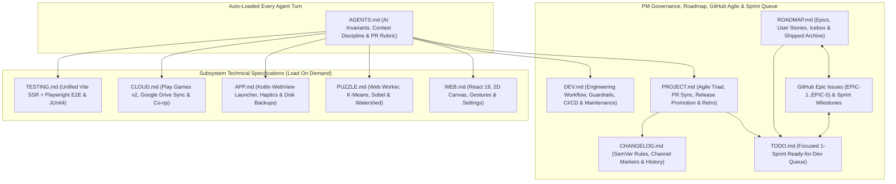

# Development & Maintenance Guide -- Capy Monorepo (`web/`, `app/`, `worker/`)

This guide defines the end-to-end human and AI co-development workflow, shared architectural guardrails, model selection strategy, session hygiene, CI/CD architecture, and ongoing maintenance playbooks for **Capy** ([`https://github.com/shthed/capy`](https://github.com/shthed/capy), live at [`https://capypaint.com/`](https://capypaint.com/) and PR previews at [`https://shthed.github.io/capy/`](https://shthed.github.io/capy/)).

**Related Guides**: [`README.md`](./README.md) | [`PROJECT.md`](./PROJECT.md) | [`ROADMAP.md`](./ROADMAP.md) | [`AGENTS.md`](./AGENTS.md) | [`TODO.md`](./TODO.md) | [`WEB.md`](./WEB.md) | [`PUZZLE.md`](./PUZZLE.md) | [`APP.md`](./APP.md) | [`CLOUD.md`](./CLOUD.md) | [`TESTING.md`](./TESTING.md) | [`CHANGELOG.md`](./CHANGELOG.md) | [`LICENSE.md`](./LICENSE.md)

**Table of Contents**:
1. [Documentation Map & Architecture](#1-documentation-map--architecture)
2. [Human + AI Co-Development Philosophy & PM Handoff](#2-human--ai-co-development-philosophy--pm-handoff)
3. [Choosing the Right AI Model, Capability Tier & Workflow](#3-choosing-the-right-ai-model-capability-tier--workflow)
4. [Antigravity Session, Chat Naming & Pinning Hygiene](#4-antigravity-session-chat-naming--pinning-hygiene)
5. [Core Technical Guardrails (`web/` & `app/`)](#5-core-technical-guardrails-web--app)
6. [Git Branching, Local Verification & Release Workflow (`Alpha -> Beta -> Production`)](#6-git-branching-local-verification--release-workflow-alpha---beta---production)
7. [CI/CD Pipeline & Automated Cleanup Architecture](#7-cicd-pipeline--automated-cleanup-architecture)
8. [Versioning, Dependency Maintenance & Asset Playbooks](#8-versioning-dependency-maintenance--asset-playbooks)
9. [Environment Self-Healing & Troubleshooting Recipes](#9-environment-self-healing--troubleshooting-recipes)

> [!IMPORTANT]
> **Division Between `PROJECT.md`, `DEV.md`, and `AGENTS.md`**:
> - [`AGENTS.md`](./AGENTS.md) is the **auto-loaded AI operational contract** injected into every agent turn. Keep `AGENTS.md` strictly AI-specific and free of human-only tutorials, while letting it grow to whatever size is needed for optimal agent performance and reliability over raw token savings.
> - [`PROJECT.md`](./PROJECT.md) is the **canonical Project Management manual** owning backlog governance, Epic triage, PR sync and readiness gates, release promotion, `CHANGELOG.md` channel governance, and the retro log.
> - [`DEV.md`](./DEV.md) (this file) is the **engineering & co-development manual** consulted by humans and agents for Gemini model selection, session hygiene, shared technical guardrails, local build/test CLI, CI/CD architecture, and troubleshooting.

---

## 1. Documentation Map & Architecture



### Repository Documentation Index

- **[`README.md`](./README.md)** (*Players & Contributors*): Product showcase, controls cheat sheet, Stable/Beta play links, developer quick start, privacy policy link, and documentation index.
- **[`PROJECT.md`](./PROJECT.md)** (*Project Management & Maintainers*): Canonical Lean Agile triad ([EPIC-1](https://github.com/shthed/capy/issues/476)--[EPIC-5](https://github.com/shthed/capy/issues/480)), sprint cadence, Epic triage, PR sync and readiness gates, release promotion, `CHANGELOG.md` channel governance, and continuous improvement retro log.
- **[`ROADMAP.md`](./ROADMAP.md)** (*Humans & AI Agents*): Strategic product Epics ([EPIC-1](https://github.com/shthed/capy/issues/476)--[EPIC-5](https://github.com/shthed/capy/issues/480)), User Stories (`US-*`), external dependency readiness gates, Platform Icebox (`ICE-*`), and collapsed Shipped Epics & Stories.
- **[`TODO.md`](./TODO.md)** (*Humans & AI Agents*): Focused **1-Sprint Execution Queue** containing only active sprint `BUG-*` and `TASK-*` items under the active GitHub Sprint Milestone.
- **[`DEV.md`](./DEV.md)** (*Humans & AI Agents*): Co-development workflow, Gemini 4 model selection, `#NNN` session hygiene, shared technical guardrails, 3-tier CI/CD, SemVer/dependencies/assets, and troubleshooting.
- **[`AGENTS.md`](./AGENTS.md)** (*AI Agents — Auto-Loaded*): AI-specific guardrails, mobile-first formatting rule, context discipline, task routing, and PR readiness contract.
- **[`WEB.md`](./WEB.md)** (*Humans & AI Agents*): React 19 UI hierarchy, `PuzzleCanvas.tsx` 3-tier offscreen caching, 6-mode touch gesture engine, Worker IPC, `NativeBridge`, storage keys, and `UserSettings` dictionary.
- **[`PUZZLE.md`](./PUZZLE.md)** (*Humans & AI Agents*): `puzzle.worker.ts` 5-strategy computer-vision pipeline, Red-Mean K-Means++ clustering, adaptive Otsu/Sobel contours, watershed absorption, and 6-stage telemetry.
- **[`APP.md`](./APP.md)** (*Humans & AI Agents*): Unified Android `:app` launcher (`MainActivity.kt`, `CapyAndroidBridge.kt`), `WebViewAssetLoader`, Pixel API 33+ LRA touch haptics, `SnapshotsClient` sync, and disk backups.
- **[`CLOUD.md`](./CLOUD.md)** (*Humans & AI Agents*): Modular `CloudProviderDriver` backends, Google OAuth 2.0 `appDataFolder` & Play Games Services v2 sign-in, CRDT `mergeProgressDeltas`, `#s=<token>` share links, Co-op rooms, and Cloudflare Workers edge hosting (`capypaint.com`).
- **[`TESTING.md`](./TESTING.md)** (*Humans & AI Agents*): Unified `web/scripts/test.mjs` runner (Vite SSR unit/codec checks + Playwright multi-touch E2E suite) and Android JUnit4 verification.
- **[`CHANGELOG.md`](./CHANGELOG.md)** (*Humans & AI Agents*): Chronological `MAJOR.MINOR.PATCH` release history and `(Alpha)`/`(Beta)`/`(Production)` channel markers synchronized with `web/package.json` and Android `versionCode`.
- **[`LICENSE.md`](./LICENSE.md)** (*Contributors*): Capybara Chill Preamble and CC BY-NC-SA 4.0 licensing terms.
- **[`web/public/privacy-policy.html`](./web/public/privacy-policy.html)** (*Players & Storefronts*): Published Privacy Policy and Google Play Data Safety disclosures (`https://capypaint.com/privacy-policy.html`).

### Documentation Formatting Standards (Mobile-First & Zero-Clutter)

1. **Mobile-First Readability (No Wide Prose Tables)**: Contributors review documentation, pull requests, and Antigravity chats on mobile devices. Never author wide multi-column Markdown tables or put multi-sentence prose inside table cells (which overflow horizontally and stretch narrow columns into tall blocks of empty whitespace). Use structured bullet lists instead; reserve Markdown tables strictly for 2 short-value columns that fit narrow mobile screens without scrolling.
2. **Zero Emojis & Zero ASCII Box-Drawing Art**: Never use unicode emojis or box-drawing characters (`U+2500`--`U+257F`, `+---+`) in `.md` files. Use GFM alerts (`> [!NOTE]`, `> [!TIP]`, `> [!IMPORTANT]`, `> [!WARNING]`), Mermaid diagrams, and structured bullet lists.
3. **Portable Relative Intra-Repo Links**: Always link repository files using relative paths (`./web/src/...`)—never machine-local `file:///...` URIs—avoid brittle unpinned `#L...` line numbers inside `.md` guides, and pin line-specific references in PR bodies and comments to immutable commit SHAs (`https://github.com/shthed/capy/blob/<sha>/<path>#L<start>-L<end>`).

---

## 2. Human + AI Co-Development Philosophy & PM Handoff

Capy pairs real-time 60--120fps HTML5 Canvas interaction, off-thread computer vision, binary RLE/CRDT codecs, and a native Kotlin Android wrapper. Human developers and AI agents have complementary strengths across these layers.

### Optimal Goals for the Human Developer

1. **Product Vision & Sprint Pull Governance**: Curate Epics and Stories in [`ROADMAP.md`](./ROADMAP.md) ([EPIC-1](https://github.com/shthed/capy/issues/476)--[EPIC-5](https://github.com/shthed/capy/issues/480); governance in [`PROJECT.md`](./PROJECT.md)) and promote only unblocked, high-impact tasks into [`TODO.md`](./TODO.md) for the active sprint.
2. **Subjective Aesthetic & Tactile Judgment**: Evaluate qualities automated headless assertions cannot judge alone—inertial pan glide feel, pinch-to-zoom responsiveness, palette contrast, procedural audio warmth, confetti pacing, and physical Android LRA haptic crispness on `/capy/alpha/<number>/` and `/capy/beta/`.
3. **Upfront Ambiguity Resolution (`/grill-me` & `/plan`)**: Answer focused design trade-off questions and approve `implementation_plan.md` artifacts *before* code generation begins. Five minutes spent aligning on a plan saves tens of thousands of tokens of rework.
4. **Session & Context Hygiene**: Keep each interactive chat scoped to one PR (or one cohesive Story/Sprint slice under `/goal` or `/teamwork`), prefix new chat prompts with `#NNN` for clean auto-titling, and pin/unpin threads to match open PR state.
5. **Final Merge Gatekeeping**: Verify the live preview link and the **5-Pillar PR Readiness & Perfection Confidence Score (`>= 95%`)** before approving any merge to `main`.

### Optimal Goals for the AI Agent

1. **Token-Efficient Precision**: Locate exact symbols via targeted search and line-sliced file reads rather than loading entire multi-thousand-line files, batch independent tool calls in parallel, and keep diffs minimal.
2. **Transparent Live Reasoning**: Continuously surface clear, high-level working status updates explaining *what* file or system is being inspected, *why* each step is being taken, and *what* was learned from the prior tool output.
3. **Invariant-First Engineering**: Enforce zero per-frame heap allocations in `requestAnimationFrame` hot paths, strict Web Worker isolation in `puzzle.worker.ts`, relative `./assets/...` paths, and defensive `NativeBridge` fallbacks without needing reminders.
4. **Thorough Local VM Verification (Fast-CI Partner)**: Run the complete verification suite (`npm run lint && npm run build && npm test`, plus `./gradlew app:testDebugUnitTest` when available) inside the Antigravity VM before pushing, keeping GitHub Actions ultra-fast and lightweight so PR preview deployments never bottleneck the dev/test/release loop.
5. **Zero-Drift Documentation & Traceability**: Synchronize subsystem `.md` files, [`CHANGELOG.md`](./CHANGELOG.md), [`TODO.md`](./TODO.md), and [`ROADMAP.md`](./ROADMAP.md) in the same PR as the code change, pinning every code reference to an immutable commit SHA (`blob/<sha>/<path>#L<start>-L<end>`).

### Project Management, Agile Triad & Backlog Governance

All Lean Agile backlog rules, terminology glossary, the 3-artefact triad ([`ROADMAP.md`](./ROADMAP.md) <-> [EPIC-1](https://github.com/shthed/capy/issues/476)--[EPIC-5](https://github.com/shthed/capy/issues/480) & Milestones <-> [`TODO.md`](./TODO.md)), Definition of Ready/Done, Epic triage (`EPIC-2` vs. `EPIC-3`--`EPIC-5`), clickable `[#NNN](https://github.com/shthed/capy/pull/NNN)` / `[EPIC-N](https://github.com/shthed/capy/issues/<num>)` link conventions, mobile-first `<details>` card templates, and `gh` CLI playbooks live canonically in [`PROJECT.md` Section 2](./PROJECT.md#2-lean-agile-lifecycle-and-backlog-governance) (with Sprint Cadence in [`PROJECT.md` Section 3](./PROJECT.md#3-sprint-cadence-and-hybrid-automated-execution) and Multi-Session Coordination in [`PROJECT.md` Section 1](./PROJECT.md#1-roles-ownership-and-multi-session-coordination)).

---

## 3. Choosing the Right AI Model, Capability Tier & Workflow

Selecting the right Gemini 4 / 3.8 capability tier and slash workflow maximizes code quality on hard algorithmic problems while preserving rolling Antigravity quota and keeping interactive turns fast.

### A. Capability Tiers & Named Frontier Models

- **Deep-Verification Frontier (`Carbon` -- ~15% of Capy PRs)**:
  - *Antigravity Selection / Subagent Tier*: **Gemini 4 Carbon** (`gemini-4-carbon`, default `medium` thinking; `high` only for hardest math/security specs) or **Claude Opus 5.5 (Thinking)** (`pro` subagent tier).
  - *Ideal Capy Use Cases*: `/grill-me` + `/plan` architecture interviews, zero-allocation 2D affine & circular-clip rendering math in `PuzzleCanvas.tsx` (`US-2.1`), `puzzle.worker.ts` segmentation invariants, CRDT/concurrency race audits, and `EPIC-5` OAuth/WebCrypto security specs.
  - *Token & Latency Profile*: Shares Argon's `1M` unified context window and per-token API rate, but spends `~2x--4x` more thinking tokens per turn to explore hypotheses and run extended verification loops (`0%` reward-hacking on Terminal-Bench 4.0). Reserve for high-complexity reasoning rather than routine UI edits.
- **Efficient Frontier Daily Driver (`Argon` -- ~65--70% of Capy PRs)**:
  - *Antigravity Selection / Subagent Tier*: **Gemini 4 Argon** (`gemini-4-argon`, `pro` / `inherit` subagent tier).
  - *Ideal Capy Use Cases*: Default daily driver for multi-file feature stories (`SoundService.ts` `US-2.3`, `ReplayVideoExporter.ts` `US-3.3`, Infinite Zoom `US-4.1`, `SvgPrintExporter.ts` `US-4.2`), `/goal` and `/teamwork` sprint execution, Co-op/IndexedDB bugfixes (`BUG-1`), and Android Kotlin + `NativeBridge.ts` integration.
  - *Token & Latency Profile*: Delivers Gemini 4 frontier coding and `1M`-context cross-repo synthesis with significantly faster responses and lower thinking-token spend per turn than Carbon.
- **Fast Frontier Workhorse (`Flash` -- ~15--20% of Capy PRs)**:
  - *Antigravity Selection / Subagent Tier*: **Gemini 3.8 Flash** (`gemini-3.8-flash`, `flash` subagent tier) or **Claude Sonnet / Haiku**.
  - *Ideal Capy Use Cases*: Executing `[quick-win]` tasks in [`TODO.md`](./TODO.md), React 19 modal/settings controls (`SettingsModal.tsx`), CI workflow wiring, parallel `research` subagent codebase sweeps, and `.md` / `ROADMAP.md` / `CHANGELOG.md` synchronization.
  - *Token & Latency Profile*: Low latency and minimal quota burn once architectural ambiguity is already resolved.
- **Ultra-Light (`Flash-Lite`)**:
  - *Antigravity Subagent Tier*: `flash_lite` (**Gemini 3.5 Flash-Lite**).
  - *Ideal Capy Use Cases*: Mechanical log extraction, PR label/title audits, link checks, and copy tweaks; never use for canvas math or concurrency logic.

#### Nuances Across Named Model Families on Capy Tasks
- **Gemini 4 Carbon (`gemini-4-carbon`)**: Built directly on Gemini 4 Argon with extended RL verification loops; strongest choice when subtle coordinate edge cases, memory-allocation invariants, or security boundaries must be proven right on the first pass.
- **Gemini 4 Argon (`gemini-4-argon`)**: Optimal everyday frontier coder—holds `App.tsx`, `PuzzleCanvas.tsx`, `NativeBridge.ts`, and `CapyAndroidBridge.kt` together across its `1M` context window without Carbon's extra thinking latency.
- **Claude Opus 5.5 / Sonnet (Thinking)**: Excels at surgical multi-hunk refactoring (`replace_file_content`), nuanced CSS/UI polish, and strict formatting compliance.
- **Gemini 3.8 Flash (`gemini-3.8-flash`)**: Fast workhorse for well-specified `[quick-win]` tasks, `research` subagent sweeps, and sprint backlog replenishment.

### B. Task-to-Model & Slash-Command Routing

- **Ambiguous New Feature, UX Redesign, or Sprint Charter**: Use **Gemini 4 Carbon** (or **Argon**) with `/grill-me` + `/plan` to resolve design trade-offs one question at a time and approve `implementation_plan.md` before coding.
- **Canvas Gestures, Zero-Alloc Ring Buffers, or Security/Crypto**: Use **Gemini 4 Carbon** (`medium` thinking) with `/plan` to protect coordinate invariants and zero-allocation `requestAnimationFrame` paths.
- **Cohesive Story or P0 Bug Batch (`2--4` Sprint Tasks)**: Use **Gemini 4 Argon** with `/goal` (sequential self-healing loop) or `/teamwork` (parallel file-scoped workers + verifier running `npm test`) onto one `automation/sprint-*` or `feature/*` PR branch.
- **Large Multi-Subsystem Campaign (`web/` + `app/` + `worker/`)**: Use **Gemini 4 Carbon** or **Argon** with `/teamwork` for milestone-gated proposer + adversarial verifier execution.
- **Single Ready `TASK-*` or `BUG-*` from `TODO.md`**: Use **Gemini 4 Argon** (or **Gemini 3.8 Flash** for `[quick-win]` items) in a fresh `#NNN` chat.
- **Documentation Sync, Sprint Replenishment, or Link Audit**: Use **Gemini 3.8 Flash** (or `Flash-Lite`) via `npm run test:sanity` and the `< 2s` docs-only CI fast-path.

### C. Subagent Delegation Rules

When working inside Antigravity:
- **Default Model Inheritance**: Always pass `Model: 'inherit'` when invoking subagents via `invoke_subagent` unless the human explicitly requests a specific tier (`pro`, `flash`, `flash_lite`).
- **Workspace Mode**: Always use `Workspace: 'inherit'` (branched/worktree subagent workspaces are unsupported in the container sandbox).
- **When to Spawn a `research` Subagent**: Delegate broad read-only codebase surveys (e.g., auditing `TODO.md` readiness across 10+ files) to `research` so raw search output stays out of the main implementation context window. Perform quick 1--3 file lookups directly in the main agent.

---

## 4. Antigravity Session, Chat Naming & Pinning Hygiene

### How Chat Titles & Bookmarks Work Under the Hood

1. **First-Prompt Auto-Titling**: Antigravity generates the left-sidebar conversation title **once** from your very first message in a new thread. Sidebar thread titles and pin states live in the host web application's database outside the Linux VM sandbox, so the agent inside the VM cannot rename or pin/unpin sidebar threads via shell commands.
2. **Shared Brain Storage (`/shared/user/.gemini/jetski/brain/`)**: Markdown artifacts (`implementation_plan.md`, `walkthrough.md`) and URL bookmark cards (`*.url.json`) live inside `/home/antigravity/.gemini/jetski/brain/v1/default/jetski_remote_agents_3p/<conversation-id>/` and *can* be created, updated, and cleaned up directly by the agent.

### Mandatory Human + AI Session Conventions

1. **Start Every New PR Chat With `#NNN` (`First-Prompt Rule`)**:
   - Check the latest PR number on GitHub and start your opening prompt in a new chat with the upcoming PR number:
     ```text
     #474 Fix Co-op welcome persistence and replay rewind UNFILL sync (BUG-1)
     ```
   - Because the auto-titler summarizes the opening prompt, your chat thread will automatically begin with `#474` without manual renaming.
2. **Pin While Open, Unpin When Merged (`Sidebar Pinning Policy`)**:
   - **Pin** any conversation whose pull request(s) are still **open** or actively under review so in-flight work stays anchored at the top of the sidebar.
   - **Unpin** the conversation as soon as its pull request is **merged** or **closed**.
3. **One PR (or Cohesive Story/Sprint Slice) Per Chat (`Quota & Context Freshness`)**:
   - Bundling 3--4 unrelated sequential PRs into a single chat forces frontier models to re-attend over tens of thousands of historical tool outputs on every turn, multiplying thinking-token spend. Start a fresh `#NNN` chat for each new PR so rolling 5-hour/weekly Antigravity quotas stretch much further.
4. **Canonical `.url.json` Bookmark Cards**:
   - When the agent opens a PR, it bookmarks the PR using `PR_<number>.url.json` (`UserFacing: true`) with `"title": "#<number> <Canonical GitHub PR Title>"`.
   - Once a PR is merged and its `/alpha/<number>/` preview is cleaned up, stale preview `.url.json` cards should not be left pointing to `404` URLs.

---

## 5. Core Technical Guardrails (`web/` & `app/`)

All human and AI contributors modifying Web (`web/`) or Android (`app/`) code must preserve these core architectural invariants:

### A. Web & Puzzle Engine Conventions (`web/`)

1. **Coordinates & Viewport Invariance ([`PuzzleCanvas.tsx`](./web/src/components/PuzzleCanvas.tsx))**:
   - Maintain explicit distinctions between Screen (DOM pointer), Container (CSS client bounds), Artwork (canvas pixel grid), and Segmentation (`regions[id]`) coordinates using `screenToCanvas` and `clampCanvasOffset`.
   - Preserve focal-point invariance under multi-touch pinch-to-zoom and Google Maps-style one-finger double-tap-and-drag zoom.
   - **Never** move, reset, or zoom the viewport automatically on puzzle completion or replay start/end (`startReplay`, `finishAutoResume`, `handleLoadSnapshot` on the already-active save). Move the camera only on explicit user gestures/buttons, switching to a different saved puzzle, or opt-in Follow Painting.
2. **Zero-Allocation Hot Paths**:
   - Never instantiate objects or arrays inside `requestAnimationFrame` loops, pan momentum gliding, canvas repaints, or high-frequency touch gesture handlers. Reuse typed arrays (`Uint8Array`, `Uint32Array`), typed-array ring buffers (`CoopRippleBuffer`), pre-allocated bounding box structs, and scratch vectors to avoid GC micro-stutter, and auto-sleep `requestAnimationFrame` at `0%` CPU when active animations finish.
3. **Direct Canvas Refs vs. React State**:
   - Mutate canvas/gesture refs directly and schedule repaints via `requestAnimationFrame` for 60--120fps dragging, gliding, and pinch zooming without triggering React virtual DOM reconciliation.
   - Reserve React state strictly for discrete UI transitions (active swatch selection, region completion counts, modal visibility, victory overlays).
4. **Web Worker Isolation & Cancellation ([`puzzle.worker.ts`](./web/src/engine/puzzle.worker.ts))**:
   - Execute all CPU-heavy image processing (K-Means clustering, Otsu/Sobel contour extraction, watershed region segmentation) exclusively inside `puzzle.worker.ts` using transferable `ArrayBuffer` payloads.
   - Support clean cancellation/termination whenever a new puzzle generation begins.
5. **Relative Asset Path Invariance**:
   - Never use root-relative `/assets/...` URLs in code or CSS. Always use `./assets/...` and keep `base: './'` in [`web/vite.config.ts`](./web/vite.config.ts) so assets resolve identically across GitHub Pages (`/`), PR previews (`/alpha/<number>/`), and Android WebView (`https://appassets.androidplatform.net/assets/www/`).
6. **Defensive `NativeBridge` Fallbacks ([`NativeBridge.ts`](./web/src/services/NativeBridge.ts))**:
   - Feature-detect host capabilities on every call (`haptic`, `saveBackup`, `loadBackup`, `saveCloudBinaryChunk`, `loadCloudBinaryChunk`, `setBackModalOpen`, `onSharedImage`, `shareImage`) and fall back safely to Web APIs (`navigator.vibrate`, IndexedDB, Web Share API) without uncaught exceptions.
7. **Storage Durability, Epoch-Scoped CRDT & IndexedDB Quota Safety ([`StorageService.ts`](./web/src/services/StorageService.ts), [`CapyCodec.ts`](./web/src/services/CapyCodec.ts))**:
   - Never store raw binary image Blobs or large base64 strings in synchronous `localStorage` (5 MB cap, blocks main thread).
   - Store bitmaps and puzzle maps in IndexedDB (`capy_game_storage_v8`: `puzzles` and `images` stores) paired with `filesDir/capy_saves` backups on Android, preserve monotonic `resetEpoch` across `ProgressDeltaV2`, `SavedSnapshot`, and `capy_active_session_v8` so stale pre-reset saves never resurrect cleared regions, persist typed `UserSettings` under `capy_user_settings_v8`, and keep `.capy` v2 schema migrations backward-compatible.
8. **Touch Gesture Transitions & Hardware Back Navigation**:
   - Maintain `touch-action: none` ([`web/src/index.css`](./web/src/index.css)) on the interactive canvas container and dynamically re-anchor pan coordinates when releasing one finger out of a pinch-to-zoom gesture so the canvas never jumps.
   - Register open modals via `NativeBridge.pushBackHandler(onClose)` / `setBackModalOpen` (`window.__capyCloseModal()` from `MainActivity.kt`) alongside desktop `Escape` listeners.

### B. Native Android Style & Safety (`app/`)

1. **Trailing Commas & Clarifying Parentheses**: Use trailing commas in multiline parameter/data-class lists and explicit parentheses around compound logical or range sub-expressions.
2. **Android KTX Extensions**: Prefer `androidx.core.graphics.createBitmap(...)`, `bitmap.scale(width, height)`, and `sharedPreferences.edit { ... }`.
3. **Array-Holding Data Classes**: Explicitly override `equals()` and `hashCode()` using `contentEquals()` and `contentHashCode()` on any Kotlin `data class` holding `IntArray` or `BooleanArray`.
4. **Zero-Allocation Loops**: Use primitive array buffers rather than boxed allocations inside native image downsampling or rendering paths.
5. **Activity Lifecycle Forwarding (`MainActivity.kt`)**: Always forward `onPause()` -> `webView?.onPause()` and `onResume()` -> `webView?.onResume()` alongside `onDestroy()` cleanup so WebView rendering and Web Audio suspend cleanly at the OS layer when backgrounded.

---

## 6. Git Branching, Local Verification & Release Workflow (`Alpha -> Beta -> Production`)

### Step 1: Session Kick-Off & Linear Branch Creation Off `origin/beta`

All daily AI feature, bugfix, and Sprint work branches off **`origin/beta`** and merges back into **`beta`** (`--base beta`) so live players on `https://shthed.github.io/capy/` (`main`) are protected from in-flight changes:

```bash
git fetch --all --prune
git checkout -b feature/<short-topic> origin/beta
# Allowed prefixes: feature/, automation/ (incl. automation/sprint-*), fix/, docs/, ci/, deps/, chore/
```

If `origin/beta` advances while a PR is open, rebase cleanly:

```bash
git fetch origin beta
git rebase origin/beta
```

When a Sprint or Beta cycle has been play-tested on `https://shthed.github.io/capy/beta/` and approved for Production + Play Store release, follow the complete Release Promotion workflow in [`PROJECT.md` Section 5](./PROJECT.md#5-release-promotion-and-changelog-governance): split/promote [`CHANGELOG.md`](./CHANGELOG.md) channel headings cleanly, open a `beta -> main` PR and mark ready so `Playwright E2E Release Gate` runs in CI, tag `vX.Y.Z` on `origin/main` after Owner-approved merge, and re-align `origin/beta` to `origin/main` when appropriate.

### Step 2: Local Development & Verification

Run the mandatory checks matching your changed files before pushing:

#### Web Application (`web/`)
```bash
cd web
npm ci                   # Clean dependency install (first run or lockfile change)
npm run dev              # Local Vite dev server on http://localhost:3000
npm run lint             # Strict TypeScript check (tsc --noEmit) -- MANDATORY for code PRs
npm run build            # Production bundle (tsc && vite build -> web/dist/) -- MANDATORY for code PRs
npm test                 # Unified engine, codec, version/changelog & Playwright E2E suite
npm run gallery:capture  # Refresh docs/gallery/*.png when UI/theme visuals change
npm run generate:samples # Rebuild web/public/assets/sample_saves.capy when built-in samples change
```

#### Native Android Wrapper (`app/`, from repository root)
```bash
./gradlew app:buildWeb          # Compiles web/ into web/dist/
./gradlew app:testDebugUnitTest # JUnit4 unit tests (CapyAndroidBridgeTest.kt)
./gradlew app:assembleDebug     # Syncs web/dist/ into assets/www/ and builds debug APK
./gradlew app:bundleRelease     # Builds Play Store Android App Bundle (.aab)
# NEVER run ./gradlew app:installDebug unless explicitly requested by the user.
```

### Step 3: PR Sync-on-Push, Link Standards & Merge Readiness

All PR title/label/Milestone rules, top-of-PR live preview templates, 5-Pillar Readiness Rubric (`>= 95%`), and closed-PR recovery commands live canonically in [`PROJECT.md` Section 4](./PROJECT.md#4-pull-request-lifecycle-and-readiness-gates). Preserve these engineering invariants on every PR:

- **PR Preview Paths vs. GitHub PR URLs**: Alpha GitHub Pages previews deploy to `https://shthed.github.io/capy/alpha/<number>/` (and `/alpha/<number>/capy.apk`), whereas GitHub repository diff links (`https://github.com/shthed/capy/pull/<number>/files#diff-...`) and git recovery refs (`refs/pull/<number>/head`) keep GitHub's native `/pull/` path. Pin code links in PR bodies and comments to exact commit SHAs (`blob/<40-char-sha>/<path>#L<start>-L<end>`).
- **PR Description Sync-on-Push Rule**: Immediately update PR title, overview bullets, target version, SHA-pinned line links, labels, Milestone, and `gh pr view <num> --json mergeable,mergeStateStatus` (`MERGEABLE` / `CLEAN`) whenever follow-up commits or rebases alter scope or state.
- **Clickable Link Standard**: Format PR references as clickable `[#NNN](https://github.com/shthed/capy/pull/NNN)` links and Epic references as `[EPIC-N](https://github.com/shthed/capy/issues/<num>)` (never bare/backticked `#<epic-issue>` or `[#<epic-issue>](.../issues/...)`).
- **Wait for Explicit Approval**: Never merge a PR or push directly to `main` or `beta` without explicit Owner confirmation.

---

## 7. CI/CD Pipeline & Automated Cleanup Architecture

Capy runs five core GitHub Actions workflows in [`.github/workflows/`](./.github/workflows):
<!-- capy-dev-only:start -->
*(On `shthed/capy` `beta`, three additional repository-specific automation workflows—[`open-pr.yml`](./.github/workflows/open-pr.yml), [`pr-review-gate.yml`](./.github/workflows/pr-review-gate.yml), and [`publish-capyboop.yml`](./.github/workflows/publish-capyboop.yml)—bring the total to **8** workflows on `beta`, vs. **7** on `main` prior to `open-pr.yml` promotion.)*
<!-- capy-dev-only:end -->

### 1. Unified 3-Tier Build, E2E Release Gate & Pages Deployment ([`deploy-branch.yml`](./.github/workflows/deploy-branch.yml))
- **Fast Daily CI + Full E2E Production Gate**: Daily `feature/* -> beta` PRs run `< 2s` sanity checks, TypeScript lint, Web compilation, and Android JUnit4 checks without heavy Playwright Chromium downloads so Alpha `/alpha/<number>/` previews deploy rapidly (while the AI agent runs `npm test` locally in the Antigravity VM). Marking a **Release Promotion PR (`beta -> main`)** ready for review (`draft == false`) automatically activates the **`Playwright E2E Release Gate`** job in GitHub Actions so live production `/` cannot be updated unless the full SSR + Chromium E2E suite passes in CI.
- **Sub-2s Documentation Fast-Path (`isDocsOnlyPr`)**: Pull requests that exclusively touch `**.md`, `docs/**`, `notes/**`, `.gitignore`, or `LICENSE` pass the `Build & Test` check run in `< 2s` (satisfying required branch ruleset checks) while skipping Web/Android compilation and Pages deployment.
- **Job 1 -- `build` (`Build & Test`, `contents: read`)**:
  - Runs concurrently across open PRs (`main` and `beta` bases) with `cancel-in-progress: true` per PR/ref.
  - Injects `vars.VITE_GOOGLE_CLIENT_ID`, `vars.CAPY_PLAY_GAMES_APP_ID`, and `vars.CAPY_ANDROID_SHA256_CERT_FINGERPRINTS`, executes `npm ci && npm run test:sanity && npm run lint && npm run build` in `web/`, runs Android JUnit4 tests (`./gradlew app:testDebugUnitTest`), and assembles the debug APK (`./gradlew app:assembleDebug`).
- **Job 2 -- `e2e_release_gate` (`Playwright E2E Release Gate`, `contents: read`)**:
  - Runs automatically when `github.event_name == 'pull_request' && github.base_ref == 'main' && github.event.pull_request.draft == false`, executing `npx playwright install --with-deps chromium && npm test` and gating `deploy`.
- **Job 3 -- `deploy` (`Deploy to GitHub Pages`, `contents: write`, `pages: write`, `id-token: write`, `pull-requests: write`)**:
  - Guarded by `github.event.repository.has_pages == true` and serialized under the `deploy-pages` concurrency lock (`cancel-in-progress: false`).
  - Publishes open Alpha PR builds to `/alpha/<number>/` and `/alpha/<number>/capy.apk`, then posts or updates the zero-emoji PR preview comment.
  - Publishes `beta` branch pushes to `/beta/` (`https://shthed.github.io/capy/beta/`) and `/beta/capy.apk` without modifying production `/`.
  - Publishes `main` branch pushes to `/` (`https://shthed.github.io/capy/`) and `/capy.apk` (excluding `/alpha/` and `/beta/` during `rsync`).
  - Squashes `gh-pages` into a single **orphan commit** on every push so binary `.apk` artifacts never bloat Git history.

### 2. Automated GitHub Release & Play Store Bundle Publisher ([`release.yml`](./.github/workflows/release.yml))
- Triggered automatically on `push: tags: ['v*.*.*']` (supporting both stable `v2.6.0` tags on `main` and `--prerelease` `v2.6.0-beta.1` tags on `beta`) or manually via `workflow_dispatch`.
- Injects `vars.VITE_GOOGLE_CLIENT_ID`, `vars.CAPY_PLAY_GAMES_APP_ID`, and `vars.CAPY_ANDROID_SHA256_CERT_FINGERPRINTS`, runs `npm run test:sanity && npm run lint && npm run build`, runs `./gradlew app:testDebugUnitTest`, builds `capy-<tag>.apk` (plus unversioned `capy.apk` on stable non-prerelease tags so `https://capypaint.com/capy.apk` always resolves) and the Google Play Store `capy-<tag>.aab` Android App Bundle (`bundleRelease`), packages `capy-web-<tag>.tgz`, extracts the matching `### X.Y` notes from [`CHANGELOG.md`](./CHANGELOG.md), and publishes the GitHub Release.

### 3. Closed PR Preview & Branch Cleanup ([`cleanup-closed-pr.yml`](./.github/workflows/cleanup-closed-pr.yml))
- Triggered automatically on `pull_request: types: [closed]` (both merged and closed-unmerged PRs).
- Deletes ephemeral PR head branches from `origin` (explicitly protecting both `main` and `beta` so merging a `beta -> main` Release Promotion PR never deletes `origin/beta`) and invokes `.github/scripts/cleanup-gh-pages-previews.mjs --target-pr <number> --ignore-recency` (preserving `/beta/`, `/alpha/` open PRs, `/assets/`, and `/web1/`).

### 4. Scheduled Stale Branch & Orphan Sweep ([`cleanup-branches.yml`](./.github/workflows/cleanup-branches.yml))
- Runs daily at `06:00 UTC` (`cron: '0 6 * * *'`) or manually via `workflow_dispatch`.
- Invokes `.github/scripts/cleanup-branches.mjs` to prune merged/stale branches (`>= 1` day old) matching `automation/`, `feature/`, `fix/`, `chore/`, `ci/`, `deps/`, `docs/`, or `codex/` (never touching `main` or `beta`), followed by `cleanup-gh-pages-previews.mjs` to remove any orphaned `/alpha/` directories while preserving `/beta/`.

### 5. Production Cloudflare Workers Deployment ([`deploy-cloudflare.yml`](./.github/workflows/deploy-cloudflare.yml))
- Triggered on `push` to `main` (touching `web/**`, `worker/**`, `wrangler.jsonc`, or the workflow file) and `workflow_dispatch`.
- When `CLOUDFLARE_API_TOKEN` and `CLOUDFLARE_ACCOUNT_ID` secrets are configured (or via Cloudflare Workers Builds native Git integration), runs `npm run test:sanity && npm run lint && npm run build`, deploys [`wrangler.jsonc`](./wrangler.jsonc) + [`worker/index.ts`](./worker/index.ts) (`CoopRoomDurableObject`) to `https://capypaint.com/` via `cloudflare/wrangler-action@v4` (`wranglerVersion: '4.160.1'`), and verifies `https://capypaint.com/api/health`. Repositories without Cloudflare secrets skip cleanly in `< 2s`.
<!-- capy-dev-only:start -->
- **Bot-Authored Draft PRs ([`open-pr.yml`](./.github/workflows/open-pr.yml)) & CI Triggers**: Opens idempotent `github-actions[bot]`-authored PRs targeting `beta` or `main` via `workflow_dispatch` (`gh workflow run open-pr.yml`, falling back to `gh pr create` only if `open-pr.yml` has not yet landed on `main`) so `shthed` can use GitHub's native 1-click **Approve** button. Opening with `draft=true` pairs with `gh pr ready <num>` (`pull_request: ready_for_review`), follow-up pushes (`synchronize`), or `gh workflow run deploy-branch.yml` to trigger `Build & Test`, Pages previews, and `Playwright E2E Release Gate` on `main`.
- **Dual AI & Owner PR Review Gate ([`pr-review-gate.yml`](./.github/workflows/pr-review-gate.yml))**: Enforces Draft-first PRs, independent AI Reviewer approval (`review:ai-approved` backed by `<!-- capy-review: actor=ai-agent verdict=APPROVED sha=<HEAD_SHA> score=<SCORE>% -->` with `score >= 95%`), and separate post-push Human Project Owner sign-off via the required `capy/review-gate` commit status on `HEAD`. On `github-actions[bot]`-opened PRs, requires a native GitHub **Approve** review matching exact `HEAD` SHA (empty body allowed, tolerant of commit-clock skew relative to `latestForcePushMs`), leaves legacy labels/comments `pending` until native Approve, and skips `github-actions[bot]` self-approval to avoid HTTP 422; manual owner-authored PRs preserve legacy `review:owner-approved` / `APPROVED` / `LGTM` fallback.
- **Automated Clean-Room Public Mirror ([`publish-capyboop.yml`](./.github/workflows/publish-capyboop.yml))**: Every merge to `shthed/capy` `main` exports a clean-room copy via [`web/scripts/rebrand-persona.mjs`](./web/scripts/rebrand-persona.mjs) (`--stage-dir`), verifies zero `shthed` byte leaks across all files and commit messages, strips dev-only mirror/review/bot-PR workflows, pushes a linear commit authored solely by `capyboop` to `https://github.com/capyboop/capy`, and syncs the `v<version>` release tag when `CAPYBOOP_SYNC_TOKEN` is configured.
<!-- capy-dev-only:end -->

---

## 8. Versioning, Dependency Maintenance & Asset Playbooks

### A. Single-Source-of-Truth Versioning (`MAJOR.MINOR.PATCH`) & Channel Markers

1. **Canonical Version**: [`web/package.json`](./web/package.json) `"version"` (`0 <= MINOR <= 99`, `0 <= PATCH <= 99`).
2. **Automatic Propagation**:
   - [`web/src/version.ts`](./web/src/version.ts) derives `APP_VERSION`, `APP_VERSION_CODE = (MAJOR * 10000) + (MINOR * 100) + PATCH` (rendered in `SettingsModal.tsx` `data-testid="app-version-badge"`), and `resolveReleaseChannel()` (`'stable' | 'beta' | 'alpha' | 'dev'`).
   - [`app/build.gradle.kts`](./app/build.gradle.kts) parses `../web/package.json` at Gradle configuration time to set `versionName` and monotonic `versionCode` for Google Play Console uploads.
3. **When to Bump & How to Format `CHANGELOG.md`** *(release promotion & channel rules live in [`PROJECT.md` Section 5](./PROJECT.md#5-release-promotion-and-changelog-governance))*:
   - **`MAJOR` (`X.0.0`)**: Breaking storage/codec epochs or major platform launches (`0.x` covers pre-monorepo Legacy Web1 milestones `#1`--`#430`; `1.0.0` begins at Unified Monorepo launch [#431](https://github.com/shthed/capy/pull/431)).
   - **`MINOR` (`2.Y.0`)**: Backward-compatible gameplay features, replay modes, UI controls, cloud/multiplayer drivers, or new `UserSettings` keys.
   - **`PATCH` (`2.5.Z`)**: Backward-compatible bug fixes, gesture edge-case corrections, performance optimizations, test consolidation, documentation/changelog audits, or dependency updates.
   - **Compact Mobile-First `CHANGELOG.md` Contract & Active Channel Suffixes** (enforced automatically by `npm run test:sanity` in [`web/scripts/sanity.mjs`](./web/scripts/sanity.mjs) and `npm test` in [`web/scripts/test.mjs`](./web/scripts/test.mjs)):
     - **Zero Preamble**: Start [`CHANGELOG.md`](./CHANGELOG.md) directly on line 1 with the newest `###` version heading—no `#` title, introductory prose, or `---` dividers.
     - **Compact Headings With Active `(Alpha)` / `(Beta)` / `(Production)` Markers**: Format headings as `### MAJOR.MINOR - YYYY-MM-DD` (or `### MAJOR.MINOR.PATCH - YYYY-MM-DD` for standalone patches and `0.x.y` milestones), appending the live channel suffix on active release heads only (`npm run test:sanity` and `npm test` assert `exactly 1` `Production` heading, `<= 1` `Beta` heading, and `<= 1` `Alpha` heading; superseded releases carry no suffix).
     - **Same-Day Patch Rollup & Heading Split Rule**: Consecutive `+0.0.1` (`PATCH`) releases on the same UTC date may roll under `### MAJOR.MINOR - YYYY-MM-DD (Beta)` ONLY while `main` and `beta` do not carry distinct patch versions under that `MAJOR.MINOR`. Whenever `main` and `beta` serve distinct patch versions under the same `MAJOR.MINOR` (e.g., `main` serves `3.0.1` while `beta` advances through `3.0.2` -> `3.0.3`), split into explicit `### MAJOR.MINOR.PATCH - YYYY-MM-DD` headings (`### 3.0.1 - YYYY-MM-DD (Production)`, `### 3.0.2 - YYYY-MM-DD` untagged once superseded, and `### 3.0.3 - YYYY-MM-DD (Beta)` as the single newest Beta head) while incrementing `"version"` in [`web/package.json`](./web/package.json) on every code PR—keep `(Beta)` **only** on the single newest Beta patch heading and drop `(Beta)` from superseded same-day Beta patch headings (`sanity.mjs` enforces `betaHeadingCount <= 1`).
     - **Single Brief Bullet Ending in Clickable `[#NNN](https://github.com/shthed/capy/pull/NNN)` PR Link**: Every item must be a single, flat, brief bullet ending with its clickable Markdown PR link `[#NNN](https://github.com/shthed/capy/pull/NNN)` (no parentheses, no `"PR"` prefix, no unlinked `#NNN`, zero `Added`/`Changed`/`Fixed` category sub-headings, zero nested sub-bullets, and zero inline file/line links).

### B. Updating Dependencies (`web/` & `app/`)

#### Web Packages (`web/package.json`)
```bash
cd web
npm outdated          # Inspect available SemVer and major updates
npm update            # Upgrade within SemVer ranges and refresh package-lock.json
npm run test:sanity && npm run lint && npm run build && npm test
```

#### Android Version Catalog (`gradle/libs.versions.toml`)
1. Update library versions centrally in [`gradle/libs.versions.toml`](./gradle/libs.versions.toml).
2. Verify `compileSdk` compatibility in [`app/build.gradle.kts`](./app/build.gradle.kts) (currently `compileSdk = 35`). If a newer AndroidX artifact requires `compileSdk 36+`, either bump `compileSdk` alongside the dependency or pin to the latest stable release supporting API 35.
3. Run `./gradlew app:testDebugUnitTest && ./gradlew app:assembleDebug` to verify.

### C. Pre-Baked Samples & Visual Showcase Gallery
- **Built-in Sample Archive (`sample_saves.capy`)**: Whenever default generation parameters, `CapyCodec` binary framing, or `SAMPLE_GALLERY` entries change, run `npm run generate:samples` inside `web/` so first-time players get instant zero-worker startup.
- **README / Docs Showcase Screenshots (`docs/gallery/`)**: Whenever UI layout, theme colors, or modal styling changes significantly, run `npm run gallery:capture` inside `web/` to refresh deterministic high-DPI screenshots.

---

## 9. Environment Self-Healing & Troubleshooting Recipes

- **`tsc: not found` or missing `node_modules`**:
  - *Cause*: Fresh container or worktree without installed npm packages.
  - *Fix*: Run `npm ci` inside `web/` before running `test:sanity`, `lint`, `build`, or `test`.
- **`ERR_CONNECTION_REFUSED http://localhost:3000/` on standalone Playwright scripts**:
  - *Cause*: Standalone gallery/sample browser scripts expect a live server on port `3000` (whereas `npm test` automatically binds an ephemeral preview port when `CAPY_TEST_URL` is unset).
  - *Fix*: Start `npm run preview` as a background daemon (`IsDaemon: true`), run the check, and stop the daemon when finished—or run `npm test` directly.
- **`Executable doesn't exist at .../chromium`**:
  - *Cause*: Playwright Chromium binary not yet cached in container.
  - *Fix*: Run `npx playwright install chromium` inside `web/`.
- **Web/Android build steps skip on a documentation-only PR**:
  - *Cause*: PR exclusively modifies `.md`, `docs/**`, `notes/**`, `.gitignore`, or `LICENSE` (`isDocsOnlyPr` fast-path in `deploy-branch.yml`).
  - *Fix*: Expected behavior (`Build & Test` passes in `< 2s` while consuming zero Web/Android build minutes). Run `npm run test:sanity` locally to verify markdown links, zero emojis, zero ASCII art, and mobile-safe formatting.
- **Local Gradle fails with `SSLException: trustAnchors parameter must be non-empty`**:
  - *Cause*: Container JDK lacks a populated `/etc/ssl/certs/java/cacerts` truststore.
  - *Fix*: **Never** disable TLS verification or tamper with host trust roots. Verify `npm run test:sanity && npm run lint && npm run build` locally, push the branch, and rely on GitHub Actions `Build & Test` (provisioned with Temurin JDK 17) to run `./gradlew app:testDebugUnitTest` and `./gradlew app:assembleDebug`.
