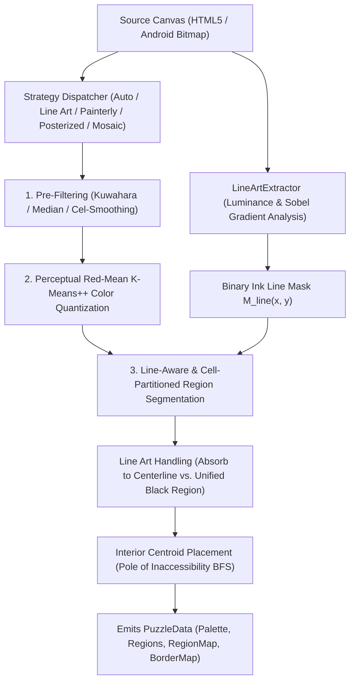

# Capy Vector Color-by-Number -- Puzzle Generation Engine (`PUZZLE.md`)

This document provides the complete technical reference for Capy's adaptive multi-strategy vector quantization and region segmentation engine in [`web/src/engine/`](./web/src/engine/).

**Related Guides**: [`README.md`](./README.md) | [`ROADMAP.md`](./ROADMAP.md) | [`DEV.md`](./DEV.md) | [`AGENTS.md`](./AGENTS.md) | [`TODO.md`](./TODO.md) | [`WEB.md`](./WEB.md) | [`APP.md`](./APP.md) | [`CLOUD.md`](./CLOUD.md) | [`TESTING.md`](./TESTING.md) | [`CHANGELOG.md`](./CHANGELOG.md)

**Table of Contents**:
1. [Architectural Overview](#1-architectural-overview)
2. [Available Generation Algorithms](#2-available-generation-algorithms)
3. [Black Border & Outline Handling Modes](#3-black-border--outline-handling-modes)
4. [Mathematical Foundations](#4-mathematical-foundations)
5. [Web Worker Execution & 6-Stage Pipeline Telemetry](#5-web-worker-execution--6-stage-pipeline-telemetry)
6. [Configuration Reference (`GeneratorConfig`)](#6-configuration-reference-generatorconfig)

---

## 1. Architectural Overview

Traditional paint-by-numbers algorithms rely on naive color quantization (such as uniform octree or basic K-Means) followed by simple 4-connected flood fills. When applied to real-world artwork with drawn ink outlines or photographic textures, naive approaches suffer from severe visual defects:

* **Line Art Fragmentation**: Anti-aliased black outlines get fractured into random color clusters or smudged into adjacent regions.
* **Border Bleed**: Region boundaries zig-zag haphazardly across black lines instead of following the drawn strokes.
* **Jagged Pixel Staircases & Sliver Regions**: High-frequency gradient noise produces hundreds of 1-pixel slivers and spiderweb tendrils.
* **Centroid Occlusion**: Numbers are placed at bounding box centers rather than the deepest interior point of concave regions.

Capy solves these challenges using a **strategy-pattern pipeline** with dedicated computer-vision extractors:

---

## 2. Available Generation Algorithms

Capy provides 5 distinct segmentation algorithms in [`PuzzleGenerator.ts`](./web/src/engine/PuzzleGenerator.ts) tailored for different visual styles:

### 1. `AUTO` -- Adaptive Multi-Strategy Classifier
* **Best for**: General use, automated pipelines, mixed artwork galleries.
* **How it works**:
  1. Samples a downscaled proxy (`<= 512px` longest edge) of the source artwork so classification executes in milliseconds even on 4K photos.
  2. Analyzes continuous ink line presence via [`LineArtExtractor.ts`](./web/src/engine/LineArtExtractor.ts).
  3. Evaluates local vs. global variance ratio ($\text{Var}_{\text{local}} / \text{Var}_{\text{global}}$) and color cluster diversity via [`ImageAnalyzer.ts`](./web/src/engine/ImageAnalyzer.ts).
  4. Automatically delegates to `LINE_ART` for drawings/cartoons/coloring pages, `PAINTERLY` for photos, or `POSTERIZED` for flat vector graphics.

---

### 2. `LINE_ART` -- Contour & Ink Line Art Tracer
* **Best for**: Drawings, manga, cartoons, coloring book pages, comic art, and vector illustrations with black outlines.
* **Key Innovation**:
  * Extracts the crisp line mask $M_{\text{line}}$ directly from raw unblurred pixels before any spatial filtering.
  * Treats drawn outlines as rigid barrier walls during interior cel clustering, preventing colors from bleeding across lines.
  * Symmetrically expands regions into black borders using a multi-source watershed distance transform so region borders align with the exact centerline of the artwork's ink lines.

---

### 3. `PAINTERLY` -- Edge-Preserving Kuwahara Cel-Shading
* **Best for**: Photographs, realistic oil/acrylic paintings, landscapes, and portraits.
* **Key Innovation**:
  * Evaluates variance across 4 overlapping quadrants in a $5\times 5$ window ($R=2$).
  * Assigns the mean color of the quadrant with the minimum variance:
    $$Q^* = \arg\min_{i \in \{1,2,3,4\}} \sigma_i^2$$
  * Flattens micro-textures (fur, grass, skin pores) into smooth, painterly cel patches while keeping silhouette edges razor-sharp.
  * Employs two-stage circular majority smoothing (`deltaE <= 50` hue guard in [`ColorQuantizer.ts`](./web/src/engine/ColorQuantizer.ts)) to eliminate 1-pixel pinch necks without smudging contrasting features.

---

### 4. `POSTERIZED` -- High-Precision Geometric Posterization
* **Best for**: Logos, typography, graphic art, pop art, and high-contrast illustrations.
* **Key Innovation**:
  * Uses $3\times 3$ median filtering to remove raster noise without rounding angular corners.
  * Runs deterministic K-Means++ (`0xca91ba7a` seed) with strict centroid convergence and minimal spatial blur, preserving geometric shapes and flat color transitions.

---

### 5. `MOSAIC_CEL` -- Cellular Superpixel Tessellation
* **Best for**: Stained-glass artwork, geometric mosaics, and relaxing casual puzzles.
* **Key Innovation**:
  * Seeds a deterministic uniform spatial grid (`halfStep + gy * step`) across the canvas and refines superpixel cells against their local neighborhood using a combined spatial-perceptual distance metric (SLIC-style superpixels):
    $$D(p, S_i) = \|x_p - x_{S_i}\|^2 + \|y_p - y_{S_i}\|^2 + w_c \Delta E_{\text{color}}(p, S_i)$$
  * Assigns each superpixel cell its dominant perceptual palette cluster and passes the resulting `cellPartitionMap` into [`RegionSegmenter.ts`](./web/src/engine/RegionSegmenter.ts) so adjacent stained-glass tiles of the same palette color remain distinct, convex regions rather than coalescing into flat blobs.

---

## 3. Black Border & Outline Handling Modes

When generating puzzles from artwork with black outlines, users can choose between two modes:

### Mode A: `ABSORB_LINES` (Boundaries Follow Artwork Lines)
* **Objective**: Region boundaries accurately follow the lines from the artwork with zero gaps.
* **Implementation**:
  1. Non-line pixels are clustered and segmented strictly within the boundaries of the black strokes.
  2. A multi-source Breadth-First Search (watershed distance transform) is initialized at all boundary pixels touching the line mask.
  3. Colored regions expand outwards into the black line pixels simultaneously.
  4. Where two opposing color regions meet inside the stroke, expansion halts.
  5. **Result**: The final vector boundary runs down the medial axis (centerline) of the artwork's line, giving 100% spatial coverage.

### Mode B: `UNIFIED_BLACK_REGION` (Continuous Black Outline Region)
* **Objective**: The black outlines themselves form playable line-art region(s).
* **Implementation**:
  1. Continuous line strokes ($L \le 55$ or high local edge contrast) are grouped into dedicated ink regions.
  2. The palette allocates a dedicated dark ink swatch (`#111827` or `#000000`).
  3. Players can color the black outline network directly, mirroring traditional comic inking.

---

## 4. Mathematical Foundations

### 4.1 Perceptual Color Distance (Red-Mean Metric)
Standard Euclidean distance in RGB space fails to match human vision. Capy uses the Red-Mean perceptual approximation ($\Delta E$) in [`ColorQuantizer.ts`](./web/src/engine/ColorQuantizer.ts):

$$\bar{r} = \frac{R_1 + R_2}{2}$$
$$\Delta R = R_1 - R_2, \quad \Delta G = G_1 - G_2, \quad \Delta B = B_1 - B_2$$
$$\Delta E^2 = \left(2 + \frac{\bar{r}}{256}\right)\Delta R^2 + 4\Delta G^2 + \left(2 + \frac{255 - \bar{r}}{256}\right)\Delta B^2$$

This closely approximates CIE Lab $\Delta E_{76}$ while executing in pure integer/float arithmetic with zero heap allocations in inner loops.

### 4.2 Perimeter-to-Area Sliver & Filament Prevention
To prevent narrow, 1-pixel serpentine filaments and jagged staircases along gradients, [`RegionSegmenter.ts`](./web/src/engine/RegionSegmenter.ts) evaluates the 4-connected boundary perimeter-to-area ratio ($P / A$) on candidate small/medium regions ($A \le \max(4 \cdot A_{\min}, 160)$):

$$\frac{P}{A} > \tau_{\text{ratio}}$$

* Strategy thresholds (`maxPerimeterToAreaRatio`): `1.8` for `PAINTERLY`, `2.0` for `LINE_ART` and `POSTERIZED`, and `2.2` for `MOSAIC_CEL`.
* Any region below `minRegionArea`, exceeding `maxPerimeterToAreaRatio`, or pruned to satisfy `maxRegions` is merged into its most harmonious neighboring region in $O(\text{area})$ amortized time via Disjoint-Set Union-Find root tracking.

### 4.3 Interior Centroid Placement (Pole of Inaccessibility)
Number labels are never placed at bounding box centers (which often fall outside crescent or concave shapes):
1. A distance transform queue is seeded at all region perimeter pixels.
2. Multi-source BFS measures the shortest Manhattan/chamfer distance $d(p)$ from every interior pixel to the region boundary.
3. The pixel achieving $\max d(p)$ is selected as `centroidX`, `centroidY`:
   $$\text{Centroid} = \arg\max_{p \in R} d(p)$$
4. The maximum inscribed distance $d_{\max}$ is stored as `region.maxRadius`, dynamically constraining label font sizes inside [`PuzzleCanvas.tsx`](./web/src/components/PuzzleCanvas.tsx) so numbers never touch region borders.

### 4.4 Hue-Preserving Neighbor Harmony & Source Recalibration
When small regions (such as red mushrooms, bright berries, or flowers) sit inside large contrasting backgrounds:
1. **Continuous Neighbor Harmony Scoring (`pickBestMergeNeighbor`)**: When an undersized sliver must be absorbed into a neighbor, [`RegionSegmenter.ts`](./web/src/engine/RegionSegmenter.ts) scores every adjacent region continuously by balancing shared border length ($B_{\text{shared}}$) against Red-Mean perceptual color distance ($\Delta E$):
   $$\text{Score}(N) = \frac{B_{\text{shared}}^{1.25}}{\Delta E + 8}$$
   Neighbors with matching or harmonious hues are strongly preferred over high-contrast neighbors, while spatial majority smoothing in [`ColorQuantizer.ts`](./web/src/engine/ColorQuantizer.ts) skips swaps whenever $\Delta E > 50$.
2. **True Source Pixel Recalibration**: Each surviving region's final palette color is recomputed from the true average RGB of the original source artwork pixels inside that region:
   $$R_{\text{avg}} = \frac{1}{|R|}\sum_{p \in R} R_p, \quad G_{\text{avg}} = \frac{1}{|R|}\sum_{p \in R} G_p, \quad B_{\text{avg}} = \frac{1}{|R|}\sum_{p \in R} B_p$$
   The region is then mapped to the closest palette swatch in Red-Mean perceptual space so vibrant focal details retain their authentic hue.

### 4.5 Free Colour Mode & Black-and-White Coloring Book Segmentation
When opening black-and-white line art or hybrid coloring book pages:
1. **Black & White Detection**: [`ImageAnalyzer.ts`](./web/src/engine/ImageAnalyzer.ts) evaluates pixel saturation and color diversity; if chromatic pixels make up $< 8\%$ of the image, `isBlackAndWhite` is flagged.
2. **Adaptive Otsu Line Extraction for Paper Drawings**:
   * Evaluates paper background luminance ratio ($\ge 45\%$ pixels with luminance $\ge 190$).
   * Computes Otsu's optimal inter-class variance threshold ($\tau_{\text{eff}} = \min(125, \max(85, \text{round}(0.75 \times \text{Otsu})))$ in [`LineArtExtractor.ts`](./web/src/engine/LineArtExtractor.ts)) and expands gradient edge luminance limits to capture faint pencil or anti-aliased ink strokes without clipping.
   * Accommodates high-density line drawings (up to $35\%$ line pixels) so intricate coloring pages classify cleanly as `LINE_ART`.
3. **Natural Cell Preservation**:
   * Relaxes region caps (`maxRegions` up to `2,000`, `minRegionArea = 10`) so intricate closed cells (mushroom spots, leaf veins, grass blades) survive as distinct paintable regions.
4. **Two-Pass Source Accent Locking & Graph Coloring Cell Assignment (`BF-4`)**: When `isBwColoring` is active, `LineArtPuzzleGenerator.generateFromRgba` performs a two-pass coloring assignment:
   * **Pass 1 (Explicit Source Accent Fill Preservation)**: Inspects each segmented region's interior source pixels (`lineMask[pIdx] === 0`). If $> 25\%$ of a region's interior pixels are explicitly chromatic ($\max(R, G, B) - \min(R, G, B) > 35$ and $\max(R, G, B) > 50$, such as pre-colored eyes, berries, or spot accents on a hybrid coloring page), the engine computes the mean RGB of those chromatic pixels and locks `reg.colorId` to the closest perceptual palette color (`lockedSourceColor`).
   * **Pass 2 (Balanced Greedy Graph Coloring)**: Generates a vibrant 20-color curated starter palette and assigns distinct, non-clashing palette colors to all remaining uncolored paper regions while treating locked source-colored neighbor regions (`lockedSourceColor`) as fixed boundary constraints.
5. **Free Colour Painting Engine**: When Free Colour Mode is active:
   * Players can tap or drag with any selected color swatch to fill or repaint any region freely while preserving first-fill chronological replay order (`BF-1`).
   * Custom colors can be added on the fly via the palette color picker (`+` button) or swapped with curated theme presets (Vibrant Classic, Mushroom Fantasy, Pastel Dreams, Earthy Nature, Neon Pop).
   * Region number labels are hidden by default for a clean coloring-page aesthetic.
6. **Multiply Composite Canvas Rendering**:
   * During active gameplay ([`PuzzleCanvas.tsx`](./web/src/components/PuzzleCanvas.tsx)) and high-resolution PNG export, the authentic source image is composited over painted fills with `ctx.globalCompositeOperation = 'multiply'` so white paper stays vibrant while artist ink outlines and cross-hatching remain razor-sharp.

---

## 5. Web Worker Execution & 6-Stage Pipeline Telemetry

To guarantee **zero UI frame drops and smooth touch responsiveness**:
* Puzzle generation runs inside a dedicated **Web Worker** ([`puzzle.worker.ts`](./web/src/engine/puzzle.worker.ts)) managed by [`PuzzleWorkerService.ts`](./web/src/services/PuzzleWorkerService.ts).
* Pixel arrays and region buffers cross thread boundaries via **zero-copy `Transferable` `ArrayBuffer` payloads** (`rgbaBuffer` inbound; `regionMap`, `borderMap`, and `regions[].pixelsBuffer` outbound).
* Progress updates stream back via `onProgress(pct, status, payload)` with a **strictly monotonic high-water mark** (`0.00` $\rightarrow$ `1.00`). In default **Simple Progress (Fast Mode)** (`detailedProgress = false`), progress IPC is throttled and diagnostic swatch cloning is skipped for maximum generation throughput; toggling **Detailed Progress** sends `{ type: 'SET_DETAILED_PROGRESS', detailed: true }` live to the running worker.

### 5.1 Canonical 6-Stage Pipeline (`GENERATION_PIPELINE_STEPS`)

Defined in [`web/src/types/index.ts`](./web/src/types/index.ts) and rendered in [`LoadingOverlay.tsx`](./web/src/components/LoadingOverlay.tsx):

- **Step `1/6` (`0%` -- `14%`) -- Artwork Analysis & Style Detection**: Inspecting edge density, local/global variance, and color diversity on a `<= 512px` proxy to classify whether the image is line art, a B&W coloring page, flat graphic art, or a detailed photograph.
- **Step `2/6` (`14%` -- `22%`) -- Strategy Selection & Auto-Calibration**: Selecting the optimal segmentation algorithm (`LINE_ART`, `PAINTERLY`, `POSTERIZED`, or `MOSAIC_CEL`) and auto-calibrating palette detail, region limits, and working resolution.
- **Step `3/6` (`22%` -- `31%`) -- Pre-Filtering & Edge Preparation**: Extracting crisp Otsu/Sobel ink barriers or applying edge-preserving Kuwahara/Median smoothing to remove sensor noise while keeping contours sharp.
- **Step `4/6` (`31%` -- `64%`) -- Perceptual Color Palette Clustering**: Grouping pixels into harmonious perceptual colors in Red-Mean space via deterministic K-Means++ and circular majority smoothing.
- **Step `5/6` (`64%` -- `85%`) -- Connected Region Segmentation & Merging**: Tracing 4-connected cells (and `cellPartitionMap` superpixels), absorbing tiny sliver islands into harmonious neighbors, and enforcing `minRegionArea` and `maxRegions` bounds.
- **Step `6/6` (`85%` -- `100%`) -- Boundary Alignment & Label Placement**: Expanding regions symmetrically to ink centerlines (`ABSORB_LINES`) or uniting ink outlines (`UNIFIED_BLACK_REGION`), computing Pole of Inaccessibility centroids (`maxRadius`), and estimating compressed `.capy` save size.

### 5.2 Live Auto-Detection Telemetry (`GenerationInspectionDetails`)

When `detailedProgress` is enabled, `GenerationProgressPayload.inspection` (`GenerationInspectionDetails` in [`web/src/types/index.ts`](./web/src/types/index.ts)) exposes live diagnostic fields:
* **Style & Heuristics**: `detectedType` (`'Line Art / Illustration' | 'Photograph / Realism' | 'Flat Vector / Graphic'`), `isLineArt`, `isBlackAndWhite`, `edgeRatio`, `localVariance`, `globalVariance`, `colorClusterCount`, and `strategyRationale`.
* **Palette & Region Metrics**: `paletteDetail`, `colorCount`, `paletteColors` (live emerging hex swatches), `maxRegions`, `finalRegionCount`, `minActualArea`, and `maxActualArea`.
* **Canvas & Footprint Metrics**: `sourceWidth`, `sourceHeight`, `targetWidth`, `targetHeight`, `resolution`, and `estimatedSaveSizeKb`.

---

## 6. Configuration Reference (`GeneratorConfig`)

All fields of `GeneratorConfig` ([`web/src/types/index.ts`](./web/src/types/index.ts), `DEFAULT_SETTINGS.generatorConfig` in [`StorageService.ts`](./web/src/services/StorageService.ts)):

- **`imageType`**: `'AUTO' | 'DRAWING' | 'PHOTO'` (default `'AUTO'`) -- High-level artwork hint guiding style classification.
- **`preset`**: `'LOW' | 'MEDIUM' | 'HIGH' | 'CUSTOM'` (default `'MEDIUM'`) -- Difficulty preset controlling default region density and minimum cell size.
- **`algorithm`**: `'AUTO' | 'LINE_ART' | 'PAINTERLY' | 'POSTERIZED' | 'MOSAIC_CEL'` (default `'AUTO'`) -- Segmentation strategy selector.
- **`lineHandling`**: `'ABSORB_LINES' | 'UNIFIED_BLACK_REGION'` (default `'ABSORB_LINES'`) -- Medial-axis centerline absorption vs. playable black ink outline region(s).
- **`paletteDetail`**: `'AUTO' | 'LOW' | 'MEDIUM' | 'HIGH' | 'CUSTOM'` (default `'AUTO'`) -- Automatic perceptual cluster sizing vs. manual swatch count.
- **`colorCount`**: `number` (default `16`, supported range `4`--`200`) -- Target quantized palette size when `paletteDetail` is customized or auto-calibrated.
- **`minRegionArea`**: `number` (default `48`, range `10`--`300` $\text{px}^2$) -- Minimum pixel area enforced per surviving region.
- **`maxRegions`**: `number` (default `200`, range `40`--`2000`) -- Upper bound on total puzzle regions.
- **`resolution`**: `number` (default `1024`) -- Working longest-edge canvas dimension in pixels (or percentage-scaled artwork target).
- **`smoothingPasses`**: `number` (default `2`) -- Circular morphological majority smoothing iterations.
- **`isFreeColor`** *(optional)*: `boolean` -- Flags puzzles created directly for Free Colour / Coloring Page mode.
