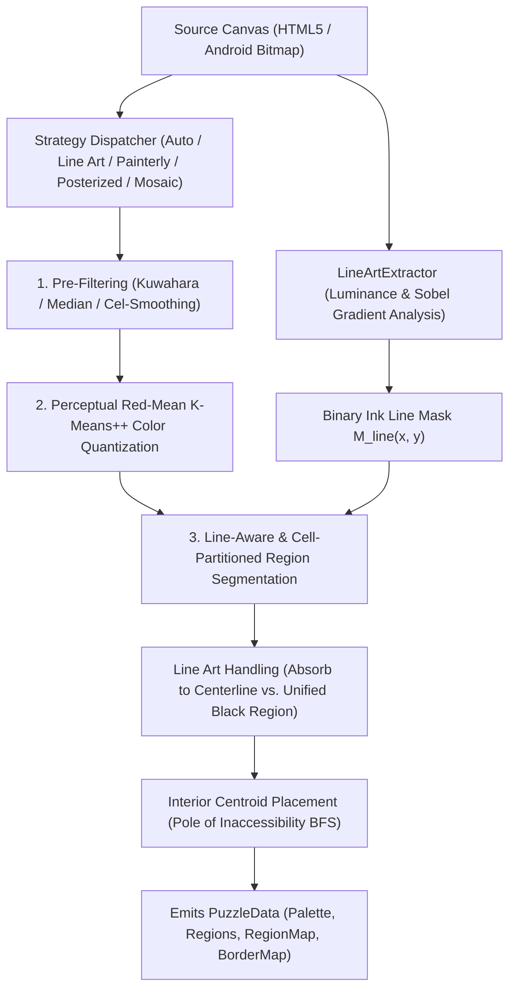

# Capy Vector Color-by-Number — Puzzle Generation Engine

This document provides a comprehensive technical reference for Capy's adaptive multi-strategy vector quantization and segmentation engine.

---

## 1. Architectural Overview

Traditional paint-by-numbers algorithms rely on naive color quantization (such as uniform octree or basic K-Means) followed by simple 4-connected flood fills. When applied to real-world artwork with drawn ink outlines or photographic textures, naive approaches suffer from severe visual defects:

* **Line Art Fragmentation**: Anti-aliased black outlines get fractured into random color clusters or smudged into adjacent regions.
* **Border Bleed**: Region boundaries zig-zag haphazardly across black lines instead of following the drawn strokes.
* **Jagged Pixel Staircases & Sliver Regions**: High-frequency gradient noise produces hundreds of 1-pixel slivers and spiderweb tendrils.
* **Centroid Occlusion**: Numbers are placed at bounding box centers rather than the deepest interior point of concave regions.

Capy solves these challenges using a **strategy-pattern pipeline** with dedicated computer-vision extractors:

---

## 2. Available Generation Algorithms

Capy provides 5 distinct segmentation algorithms tailored for different visual styles:

### 1. `AUTO` — Adaptive Multi-Strategy Classifier
* **Best for**: General use, automated pipelines, mixed artwork galleries.
* **How it works**:
  1. Samples a downscaled proxy (`<= 512px` longest edge) of the source artwork so classification executes in milliseconds even on 4K photos.
  2. Analyzes continuous ink line presence via `LineArtExtractor`.
  3. Evaluates global vs. local variance ratio ($\text{Var}_{\text{local}} / \text{Var}_{\text{global}}$) and color cluster diversity.
  4. Automatically delegates to `LINE_ART` for drawings/cartoons, `PAINTERLY` for photos, or `POSTERIZED` for flat vector graphics.

---

### 2. `LINE_ART` — Contour & Ink Line Art Tracer
* **Best for**: Drawings, manga, cartoons, coloring book pages, comic art, and vector illustrations with black outlines.
* **Key Innovation**:
  * Extracts the crisp line mask $M_{\text{line}}$ directly from raw unblurred pixels before any spatial filtering.
  * Treats drawn outlines as rigid barrier walls during interior cel clustering, preventing colors from bleeding across lines.
  * Symmetrically expands regions into black borders using a multi-source watershed distance transform so that region borders align with the exact centerline of the artwork's ink lines.

---

### 3. `PAINTERLY` — Edge-Preserving Kuwahara Cel-Shading
* **Best for**: Photographs, realistic oil/acrylic paintings, landscapes, and portraits.
* **Key Innovation**:
  * Evaluates variance across 4 overlapping quadrants in a $5\times 5$ window ($R=2$).
  * Assigns the mean color of the quadrant with the minimum variance:
    $$Q^* = \arg\min_{i \in \{1,2,3,4\}} \sigma_i^2$$
  * Flattens micro-textures (fur, grass, skin pores) into smooth, painterly cel patches while keeping silhouette edges razor-sharp.
  * Employs two-stage circular majority smoothing to eliminate 1-pixel pinch necks.

---

### 4. `POSTERIZED` — High-Precision Geometric Posterization
* **Best for**: Logos, typography, graphic art, pop art, and high-contrast illustrations.
* **Key Innovation**:
  * Uses 3x3 median filtering to remove raster noise without rounding angular corners.
  * Runs K-Means++ with strict centroid convergence and zero spatial majority blur, preserving geometric shapes and flat color transitions.

---

### 5. `MOSAIC_CEL` — Cellular Superpixel Tessellation
* **Best for**: Stained-glass artwork, geometric mosaics, and relaxing casual puzzles.
* **Key Innovation**:
  * Seeds a jittered spatial grid across the canvas and evaluates each pixel against its local $5\times 5$ seed neighborhood using a combined spatial-perceptual distance metric (SLIC-style superpixels):
    $$D(p, S_i) = \|x_p - x_{S_i}\|^2 + \|y_p - y_{S_i}\|^2 + w_c \Delta E_{\text{color}}(p, S_i)$$
  * Assigns each superpixel cell its dominant perceptual palette cluster and passes the resulting `cellPartitionMap` into `RegionSegmenter` so adjacent stained-glass tiles of the same palette color remain distinct, convex regions rather than coalescing into flat blobs.

---

## 3. Black Border & Outline Handling Modes

When generating puzzles from artwork with black outlines, users can choose between two modes:

### Mode A: `ABSORB_LINES` (Boundaries Follow Artwork Lines)
* **Objective**: The region boundaries must accurately follow the lines from the artwork, with zero gaps.
* **Implementation**:
  1. Non-line pixels are clustered and segmented strictly within the boundaries of the black strokes.
  2. A multi-source Breadth-First Search (watershed distance transform) is initialized at all boundary pixels touching the line mask.
  3. Colored regions expand outwards into the black line pixels simultaneously.
  4. Where two opposing color regions meet inside the stroke, expansion halts.
  5. **Result**: The final vector boundary runs right down the medial axis (centerline) of the artwork's line. Both regions fit together with 100% spatial coverage.

### Mode B: `UNIFIED_BLACK_REGION` (Continuous Black Outline Region)
* **Objective**: The black outlines themselves form a single unified, playable line-art region.
* **Implementation**:
  1. Continuous line strokes ($L \le 55$ or high local edge contrast) are grouped into a single unified region.
  2. The palette allocates a dedicated pure ink swatch (`#111827` or `#000000`).
  3. Players can color the entire black outline network as a single satisfying action, mirroring traditional inking.

---

## 4. Mathematical Foundations

### 4.1 Perceptual Color Distance (Red-Mean Metric)
Standard Euclidean distance in RGB space fails to match human vision. Capy uses the Red-Mean perceptual approximation ($\Delta E$):

$$\bar{r} = \frac{R_1 + R_2}{2}$$
$$\Delta R = R_1 - R_2, \quad \Delta G = G_1 - G_2, \quad \Delta B = B_1 - B_2$$
$$\Delta E^2 = \left(2 + \frac{\bar{r}}{256}\right)\Delta R^2 + 4\Delta G^2 + \left(2 + \frac{255 - \bar{r}}{256}\right)\Delta B^2$$

This closely approximates CIE Lab $\Delta E_{76}$ while executing in pure integer/float arithmetic with zero heap allocations in inner loops.

### 4.2 Isoperimetric Compactness Ratio & Sliver Prevention
To prevent narrow, serpentine filaments that wrap around other regions:

$$\text{Compactness} = \frac{P^2}{A}$$

Where $P$ is the 4-connected boundary perimeter and $A$ is pixel area.
* A circle scores $\approx 12.6$.
* A square scores $16$.
* A smooth convex patch scores $15 \dots 35$.
* Spindly tentacles score $> 65$. Regions scoring above `maxCompactness` (default $65$) or exceeding `maxPerimeterToAreaRatio` ($P / A \ge 2.0$ default, $2.5$ for `MOSAIC_CEL`) are flagged and merged into their most harmonious neighboring region in $O(\text{area})$ time via union-find root component tracking.

### 4.3 Interior Centroid Placement (Pole of Inaccessibility)
Number labels are never placed at bounding box centers (which often fall outside crescent or concave shapes).
1. A distance transform queue is seeded at all region perimeter pixels.
2. BFS measures the shortest distance $d(p)$ from every interior pixel to the region boundary.
3. The pixel with $\max d(p)$ is selected as the centroid:
   $$\text{Centroid} = \arg\max_{p \in R} d(p)$$
4. The maximum distance $d_{\max}$ is saved as `region.maxRadius`, dynamically scaling font size and badge radius to fit cleanly inside the region without touching borders.

---

### 4.4 Hue-Preserving Region Color Recalibration
When small regions (such as red mushrooms, bright berries, or flowers) sit inside large contrasting backgrounds (such as deep green grass or dark brown forest floors):
1. **Hue Protection in Region Merging**: The merge pass enforces a strict perceptual delta boundary ($\Delta E \le 48$). High-contrast regions are never dissolved into their surroundings.
2. **True Source Pixel Recalibration**: Each region's final palette color is not assumed from arbitrary cluster IDs. Instead, the true average RGB of the source artwork pixels inside that region is computed:
   $$R_{\text{avg}} = \frac{1}{|R|}\sum_{p \in R} R_p, \quad G_{\text{avg}} = \frac{1}{|R|}\sum_{p \in R} G_p, \quad B_{\text{avg}} = \frac{1}{|R|}\sum_{p \in R} B_p$$
   The region is then mapped to the closest palette color in perceptual space. A red mushroom region containing red source pixels will always be assigned to the red palette color, preventing it from ever appearing green.

---

### 4.5 Free Colour Mode & Black & White Coloring Book Segmentation
When opening black and white line art or coloring book pages (such as coloring sheets, ink sketches, or line drawings):
1. **Black & White Detection**: `ImageAnalyzer` evaluates pixel saturation and color diversity. If colored pixels make up $< 8\%$ of the image, `isBlackAndWhite` is flagged.
2. **Adaptive Otsu Line Extraction for Paper Drawings**:
   * Evaluates paper background luminance ratio ($\ge 45\%$ pixels with luminance $\ge 190$).
   * For paper drawings, computes Otsu's optimal inter-class variance threshold ($\tau_{\text{eff}} = \min(125, \max(85, \lfloor 0.75 \times \text{Otsu} \rfloor))$) and expands gradient edge luminance limits. This reliably captures faint, pencil, or anti-aliased ink strokes across the entire canvas (including lighter upper regions) without clipping strokes.
   * Accommodates high-density line drawings with an expanded line coverage threshold (up to 35% line pixels) so detailed coloring book drawings are cleanly categorized as `LINE_ART`.
3. **Natural Cell Preservation**:
   * For coloring pages, region count caps are relaxed (`maxRegs` up to 2,000, `minArea = 10`) so intricate closed cells (e.g. mushroom spots, leaf veins, grass blades) are preserved as distinct paintable regions rather than being merged into adjacent background areas.
4. **Two-Pass Source Accent Locking & Graph Coloring Cell Assignment (`BF-4`)**: When `isBwColoring` is active, `LineArtPuzzleGenerator.generateFromRgba` performs a two-pass coloring assignment:
   * **Pass 1 (Explicit Source Accent Fill Preservation)**: Inspects each segmented region's interior source pixels (`lineMask[idx] === 0`). If $> 25\%$ of a region's interior pixels are explicitly chromatic (`max(R, G, B) - min(R, G, B) > 35` and `max(R, G, B) > 50`, such as pre-colored eyes, berries, or spot accents on a hybrid coloring page), the engine computes the mean RGB of those chromatic pixels and locks `reg.colorId` to the closest perceptual palette color (`lockedSourceColorRegionIds`).
   * **Pass 2 (Balanced Greedy Graph Coloring)**: Generates a vibrant 20-color curated starter palette and assigns distinct, non-clashing palette colors to all remaining uncolored paper regions while treating locked source-colored neighbor regions (`lockedSourceColorRegionIds`) as fixed boundary constraints.
5. **Free Colour Painting Engine**: When Free Colour Mode is active:
   * Players can tap or drag with any selected color swatch to fill any region freely.
   * Regions can be repainted at any time with different colors without penalty.
   * Custom colors can be added on the fly via the palette color picker (`+` button).
   * Color swatches can be individually edited or swapped using curated theme presets (Vibrant Classic, Mushroom Fantasy, Pastel Dreams, Earthy Nature, Neon Pop).
   * Region number labels are hidden by default for a clean coloring book experience.
6. **Multiply Composite Canvas Rendering**:
   * During both active gameplay (`PuzzleCanvas.tsx`) and high-resolution export, the authentic source image is composited on top of the user's painted fills using `ctx.globalCompositeOperation = 'multiply'`.
   * White paper in the source image leaves underlying colors 100% vibrant, while ink outlines, pen textures, and cross-hatching multiply to produce perfectly sharp, continuous, original artist black outlines over the entire canvas.

---

## 5. Web Worker Background Thread Execution & 6-Stage Pipeline Telemetry

Puzzle generation involves computationally intensive computer-vision operations (Kuwahara filtering, K-Means++ clustering, BFS flood fills, and distance transform watershed expansions).

To guarantee **zero UI frame drops, smooth animations, and no browser freezes**:
* Puzzle generation executes entirely inside a dedicated **Web Worker thread** (`puzzle.worker.ts`).
* Pixel arrays and region buffers are transferred between the main thread and the worker using **zero-copy `Transferable` `ArrayBuffer` objects**.
* Progress updates are streamed continuously back to the UI thread via `onProgress(pct, status, payload)` with a **strictly monotonic high-water mark** (`0.00` $\rightarrow$ `1.00`) so the progress bar never jumps backward across sub-routines.
* If Web Workers are unavailable or restricted by browser security policies, the engine automatically falls back to synchronous main-thread execution.

### 5.1 User-Friendly 6-Stage Pipeline (`GENERATION_PIPELINE_STEPS`)

Every progress emission maps to one of 6 deterministic stages exposed in [`LoadingOverlay.tsx`](./web/src/components/LoadingOverlay.tsx):

| Step | Progress Range | Stage Name | Description |
| :--- | :--- | :--- | :--- |
| `1/6` | `0%` – `12%` | **Image Analysis & Strategy Selection** | Inspecting luminance variance, edge density, and color diversity to classify the artwork style (`Line Art / Drawing`, `Photographic / Painterly`, `Flat / Posterized`, or `B&W Coloring Book`) and select the optimal segmentation strategy. |
| `2/6` | `12%` – `30%` | **Contour & Edge Filtering** | Extracting continuous ink outlines via Otsu/Sobel analysis or applying edge-preserving Kuwahara/Median smoothing to flatten micro-texture noise while keeping borders sharp. |
| `3/6` | `30%` – `62%` | **Perceptual Palette Quantization** | Clustering pixels in Red-Mean perceptual color space using K-Means++ (`0.32` $\rightarrow$ `0.58`) and spatial majority smoothing (`0.60`) to build a balanced palette of distinct colors. |
| `4/6` | `62%` – `84%` | **Region Segmentation & Small-Cell Merging** | Tracing 4-connected regions, absorbing tiny sliver islands into harmonious neighbors, and enforcing minimum/maximum region size bounds. |
| `5/6` | `84%` – `95%` | **Line Art & Boundary Alignment** | Expanding adjacent regions symmetrically to the centerline of drawn ink strokes (`ABSORB_LINES`) or uniting continuous black outlines (`UNIFIED_BLACK_REGION`) with zero gaps. |
| `6/6` | `95%` – `100%` | **Interior Number Placement & Finalizing** | Computing the Pole of Inaccessibility via multi-source BFS for every region to place number labels cleanly inside concave shapes and estimating the compressed save footprint. |

### 5.2 Live Auto-Detection Telemetry (`GenerationInspectionDetails`)

During Step 1 and Step 6, `AutoPuzzleGenerator` populates structured inspection telemetry returned in `GenerationProgressPayload.details`:
* `detectedStyle`: Classified visual style (`Line Art / Drawing`, `Photographic / Painterly`, `Flat / Posterized`, or `B&W Coloring Book`).
* `chosenStrategy` & `strategyReason`: Selected algorithm and human-readable explanation of the variance/line-coverage heuristics that triggered it.
* `detailLevel` & `targetColors`: Effective palette detail mode and auto-calibrated color count ($4 \dots 64$).
* `targetMaxRegions`, `minRegionArea` & `maxRegionArea`: Target region bounds and final segmented min/max region areas in $\text{px}^2$.
* `workingResolution`: Active canvas dimensions (`width x height`).
* `estimatedSaveKb`: Estimated storage footprint in kilobytes (`KB`) combining region metadata, pixel maps, and preview thumbnail.

---

## 6. Configuration Reference

| Parameter | Type | Default | Description |
| :--- | :--- | :--- | :--- |
| `algorithm` | `GeneratorAlgorithm` | `'AUTO'` | `'AUTO'`, `'LINE_ART'`, `'PAINTERLY'`, `'POSTERIZED'`, `'MOSAIC_CEL'` |
| `lineHandling` | `LineHandlingMode` | `'ABSORB_LINES'` | `'ABSORB_LINES'` (centerline alignment) or `'UNIFIED_BLACK_REGION'` |
| `paletteDetail` | `PaletteDetail` | `'AUTO'` | `'AUTO'`, `'LOW'`, `'MEDIUM'`, `'HIGH'`, `'CUSTOM'` |
| `colorCount` | `number` | `16` | Target palette size ($4 \dots 64$) |
| `minRegionArea` | `number` | `48` | Strictly enforced minimum pixel area per region ($15 \dots 300\text{ px}^2$) |
| `maxRegions` | `number` | `200` | Strict upper bound on total puzzle pieces ($40 \dots 2000$) |
| `resolution` | `number` | `1024` | Canvas dimension, snaps to standards or artwork percentages ($25\% \dots 100\%$) |
| `smoothingPasses` | `number` | `2` | Morphological smoothing iterations |
