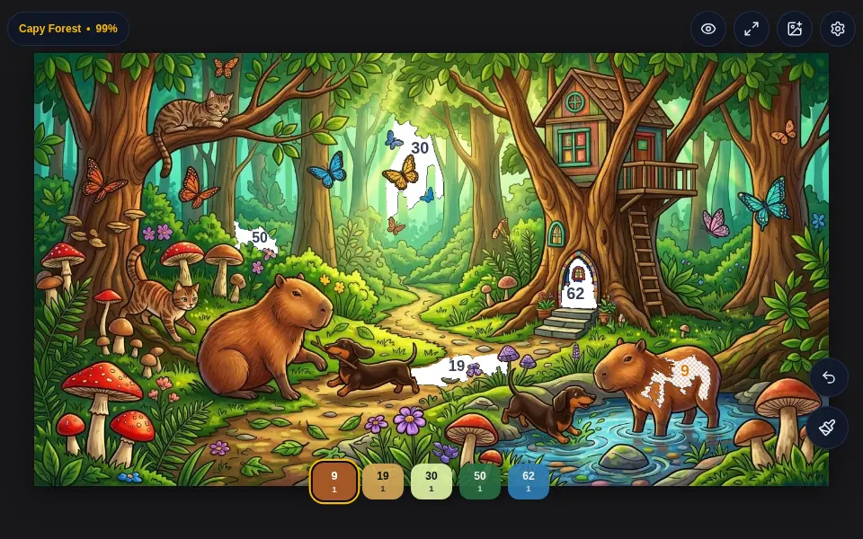
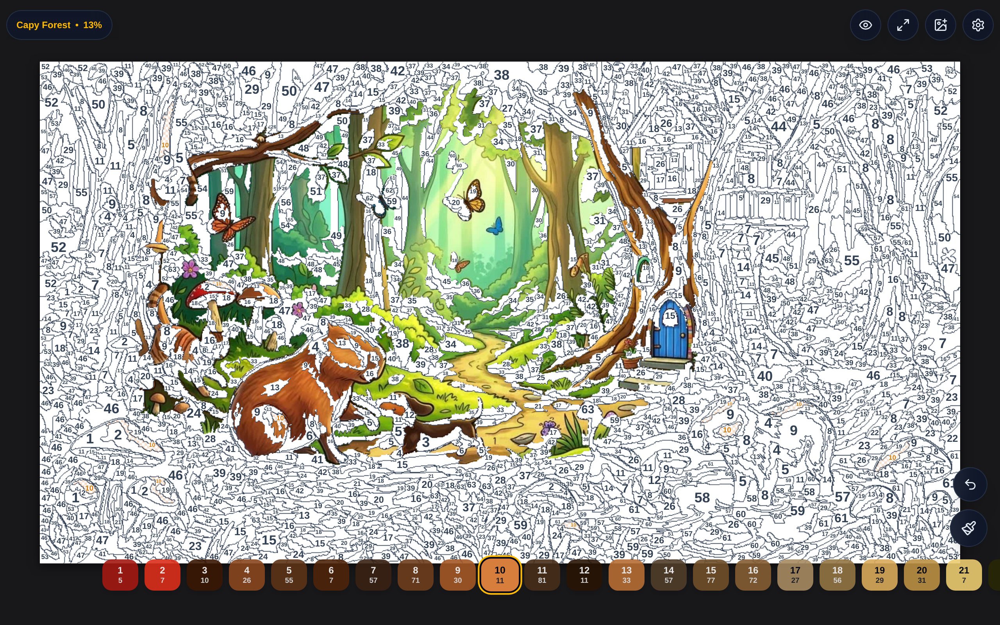
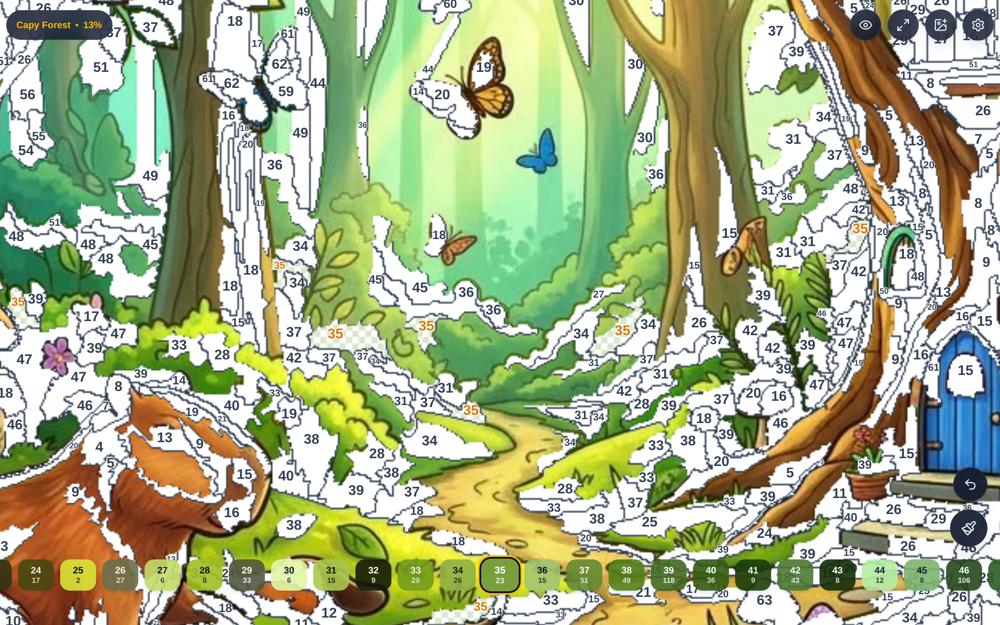
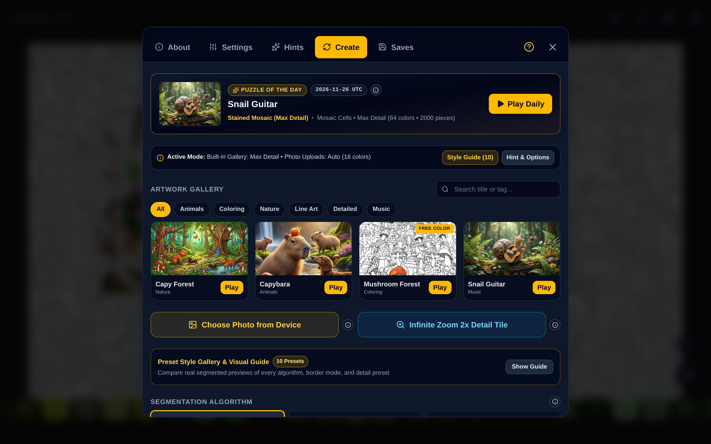
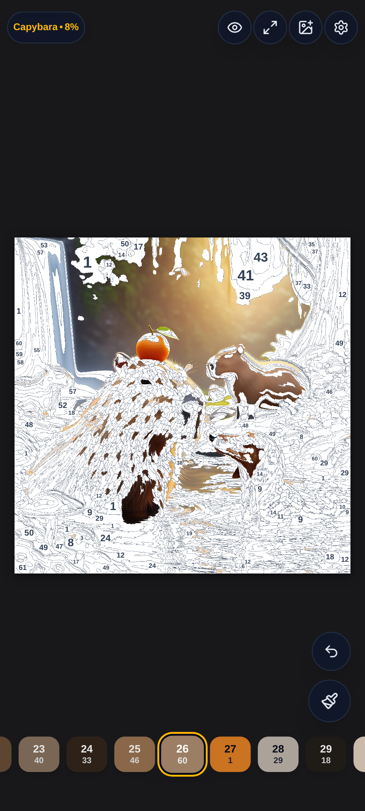

# Capy Paint

[](https://capypaint.com/)
[](https://capypaint.com/capy.apk)
[](./LICENSE.md)

**Capy** is a serene, delightful color-by-number game you can play directly in your web browser or on Android. Transform any photo or artwork into a crisp, playable color puzzle with smart number guides, or relax with Free Color coloring pages.

- **[Play Capy in Your Browser (`capypaint.com`)](https://capypaint.com/)**
- **[Download the Android APK (Stable)](https://capypaint.com/capy.apk)** ([Official GitHub Releases](https://github.com/shthed/capy/releases))
<!-- capy-dev-only:start -->
- **[Try Upcoming Features on the Beta Channel](https://shthed.github.io/capy/beta/)** ([Beta Android APK](https://shthed.github.io/capy/beta/capy.apk))
<!-- capy-dev-only:end -->
- **[Public Issue Tracker & Feedback](https://github.com/capyboop/paint/issues)** ([Report a Bug, Request a Feature, or Share a Puzzle Idea](https://github.com/capyboop/paint/issues/new/choose))
- **[Read the Privacy Policy](https://capypaint.com/privacy-policy.html)**

---

## Visual Showcase and Gallery

<p align="center">
  
  <br>
  <em>Tap in the final pieces to complete the artwork and watch your painting come to life in a chronological timelapse replay.</em>
</p>

| **Desktop Gameplay** | **Fine Zoom and Active Highlighting** |
| :---: | :---: |
|  |  |
| *Color-by-number canvas with the Palette Dock, live progress tracking, and crisp painted regions* | *Zoom in closely for tiny details with legible numbers and highlighted matching shapes* |

| **Free Color / Coloring Page Mode** | **Daily Puzzle and Artwork Gallery** |
| :---: | :---: |
|  |  |
| *Mushroom Forest in Free Color mode with the custom color picker and quick swatches* | *Puzzle of the Day, searchable built-in artwork gallery, and one-tap photo import* |

| **Settings and Accessibility** | **Mobile Portrait Experience** |
| :---: | :---: |
|  |  |
| *Grouped settings for text and UI sizing, Fat-Finger Tap Assist, canvas themes, and gameplay* | *Edge-to-edge touch UI with smooth one-finger zoom and thumb-friendly swatches* |

---

## Why You'll Love Capy

- **Two Ways to Play**: Relax with classic **Color by Number** or choose your own shades in **Free Color** mode.
- **Turn Any Photo into Art**: Import your favorite photos of pets, trips, or drawings to create instant playable puzzles—or export clean coloring pages to print on paper.
- **Unified Single-Canvas Infinite Zoom**: Zoom up to `256x` to add seamless nested detail layers inside any section or extend artwork borders outward while keeping `100%` of painted progress in one `.capy` v2 save—powered by optional Puter.js (Web), OpenRouter (1-click OAuth PKCE & multi-model routing), Free Guided Handoff (Gemini, ChatGPT, or Grok apps), or device-local Gemini / ChatGPT (OpenAI) / Grok (xAI) API keys.
- **Share Progress or Paint Together**: Send a quick link to share your puzzle with friends, or opt in to live **Co-op Rooms** to color side by side.
- **Smooth, Effortless Painting**: Drag with **Paint Mode** to fill matching spaces fast, zoom in cleanly for tiny details, and watch a timelapse replay of your finished artwork.
- **Daily Puzzle and Built-In Gallery**: Enjoy a fresh **Puzzle of the Day**, browse ready-to-play illustrations by theme, and celebrate milestones in your **Lifetime Stats**.
- **Built for Everyone**: Includes forgiving **Fat-Finger Tap Assist**, independent **Text Size** and **UI Size** sliders, keyboard shortcuts, and a **Reduced Motion** option.
- **Offline, Private, and Ad-Free**: Play anywhere without an internet connection, ads, or a required account—with built-in storage cleanup in **Saves** and optional opt-in cross-device sync through Google Drive, OneDrive, Apple iCloud, or Google Play Games.

---

## How to Play

1. **Pick an Artwork**: Start playing instantly with pre-generated built-in favorites (*Capy Forest*, *Capybara*, *Mushroom Forest*, and *Snail Guitar*), launch the **Puzzle of the Day** in the **Create** tab, or import your own photo.
2. **Choose a Color**: Tap any numbered swatch in the bottom **Palette Dock** (or simply tap any shape directly in default **Auto-Select Color (Easy)** mode). Matching shapes highlight right away.
3. **Tap or Drag to Paint**: Tap numbered shapes on the canvas to fill them, or turn on **Paint Mode** (brush button) to color continuously by dragging.
4. **Zoom and Pan**: Double-tap and drag (down to zoom in, up to zoom out), or pinch with two fingers to inspect tiny details.
5. **Celebrate**: Complete all colors to watch your chronological timelapse replay and download your finished masterpiece.

---

## Controls and Gestures Cheat Sheet

- **Tap Shape**: In **Auto-Select Color (Easy)** (default), selects and fills the tapped shape's color automatically; in **Precise (Standard)**, fills shapes matching your active swatch; in **Free Color Mode**, paints with any selected color.
- **Drag Canvas**: Pans smoothly across the artwork.
- **Double-Tap and Drag**: One-finger zoom—drag down to zoom in, drag up to zoom out (reversible and adjustable in **Settings**).
- **Pinch / Mouse Wheel**: Zoom smoothly between `0.5x` and `12x` (with optional snap stops in **Settings**).
- **Paint Mode (Brush Button)**: Toggles continuous drag-to-paint mode.
- **Active Swatch Second Tap**: Finds and centers the next unpainted shape for your current color.
- **Undo / Redo (`Ctrl+Z` / `Cmd+Z`, `Ctrl+Y` / `Cmd+Shift+Z`)**: Enabled by default in all modes (configurable in **Settings**).
- **Long-Press Undo**: Opens the interactive **Replay** timeline scrubber (`0.5x`--`20x`) to scrub history or resume from any step.
- **Preview Eye Button**: Peeks at the original source artwork.
- **Desktop Keyboard Shortcuts**: `1`--`9` select swatches, `+`/`=` and `-`/`_` zoom, `0` resets the view, Arrow keys or `WASD` pan, and `Escape` closes the active modal or popover. *(Full gesture thresholds and settings live in [`WEB.md`](./WEB.md).)*

---

## Developer Quick Start

To run Capy locally in development mode:

```bash
cd web
npm ci
npm run dev
```
Open `http://localhost:3000` in your browser.

Verify repository hygiene, strict TypeScript types, production bundling, and automated tests (binary codec, engine, gestures, settings, and Playwright E2E gameplay):
```bash
npm run test:sanity && npm run lint && npm run build && npm test
```

---

## Contributing, Issues & Support

Contributions, bug reports, feature requests, and puzzle ideas are welcome on [`capyboop/paint`](https://github.com/capyboop/paint):

- **Report a Bug, Request a Feature, or Share a Puzzle Idea**: Use the [GitHub Issue Templates](https://github.com/capyboop/paint/issues/new/choose) or tap **About -> Send Feedback** inside the app.
- **Submit a Pull Request**: Follow [`CONTRIBUTING.md`](./CONTRIBUTING.md) for local setup, required checks, and PR guidelines.
- **Help and Troubleshooting**: See [`SUPPORT.md`](./SUPPORT.md) for player support, storage cleanup tips, downloads, and privacy FAQ.
- **Security Vulnerabilities**: Report security issues privately via [`SECURITY.md`](./SECURITY.md).

---

## Technical Documentation and Architecture

All detailed architectural guides, computer vision algorithms, and native bridge specifications live in dedicated documentation files:

- **Web Architecture and UI Reference**: [`WEB.md`](./WEB.md) -- React 19, Vite 8, TypeScript 7, 3-tier offscreen canvas rendering, 6-mode gesture engine, Worker IPC, storage keys, and `UserSettings` dictionary.
- **Android Native Launcher**: [`APP.md`](./APP.md) -- Kotlin launcher, AndroidX `WebViewAssetLoader`, Google Play Games Services v2 `SnapshotsClient` sync, Pixel API 33+ haptics, and disk backups.
- **Cloud Sync, Accounts and Multiplayer Sharing**: [`CLOUD.md`](./CLOUD.md) -- Google Drive, OneDrive, Apple CloudKit, and Play Games CRDT sync, `< 2 KB` shareable URL links, opt-in Co-op rooms, and Cloudflare Workers edge hosting (`capypaint.com` / `paint.capyboop.com`).
- **Puzzle Generation Engine**: [`PUZZLE.md`](./PUZZLE.md) -- Web Worker 5-strategy segmentation, adaptive Otsu/Sobel line extraction, Red-Mean K-Means++ clustering, and watershed border alignment.
- **Testing Architecture**: [`TESTING.md`](./TESTING.md) -- Unified Vite SSR unit + parallel Playwright E2E verification suite and CI pipelines.
- **Release History**: [`CHANGELOG.md`](./CHANGELOG.md) -- Chronological release history and active channel markers.
- **Product Roadmap**: [`ROADMAP.md`](./ROADMAP.md) -- Concise high-level Now / Next / Later vision linked to [GitHub Issues](https://github.com/capyboop/paint/issues) and [`CHANGELOG.md`](./CHANGELOG.md).
- **Project Management and Release Governance**: [`PROJECT.md`](./PROJECT.md) -- Lightweight issue/PR governance, release promotion, `CHANGELOG.md` channel markers, and continuous improvement retro log.
- **Development and Maintenance Guide**: [`DEV.md`](./DEV.md) -- Engineering workflow, shared technical guardrails, 3-tier CI/CD architecture, SemVer & `versionCode` versioning, and troubleshooting.
<!-- capy-dev-only:start -->
- **AI Agent Operational Playbook**: [`AGENTS.md`](./AGENTS.md) -- Auto-loaded AI guardrails, mobile-first formatting rules, and PR readiness contract for AI coding agents.
- **Company Structure and AI Agent Handbook**: [`CAPYBOOP.md`](./CAPYBOOP.md) -- CapyBoop Games organizational chart, standing AI agent chat roles, startup kickoff prompts for instance recovery, and cross-chat coordination protocols.
<!-- capy-dev-only:end -->
- **Privacy Policy and Data Safety**: [`web/public/privacy-policy.html`](./web/public/privacy-policy.html) -- Local-first photo processing and optional cloud/feedback disclosures.
- **License**: [`LICENSE.md`](./LICENSE.md) -- Capybara Chill Preamble and CC BY-NC-SA 4.0 terms.
