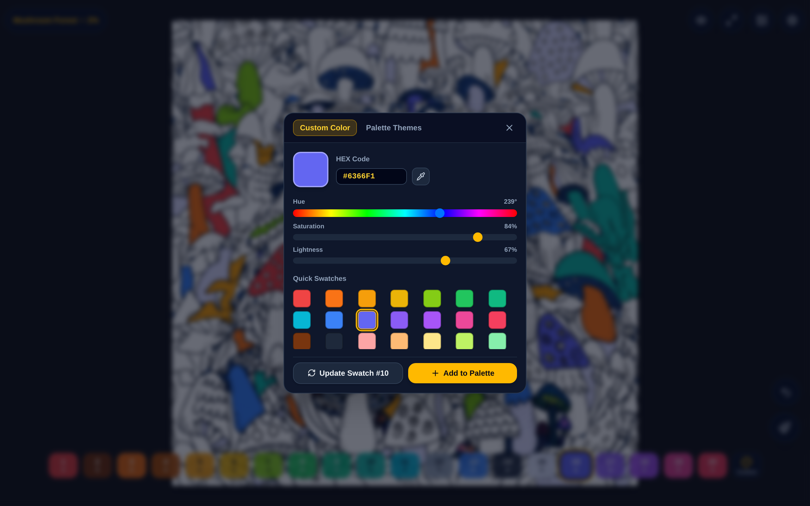
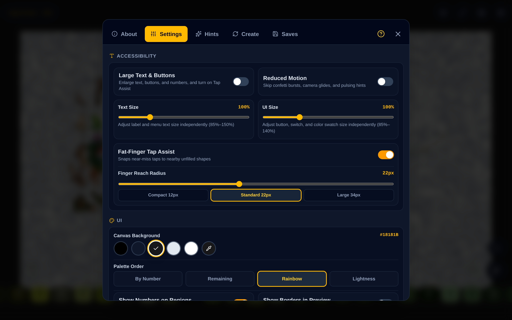

# Capy Paint

[](https://capypaint.com/)
[](https://capypaint.com/capy.apk)
[](./LICENSE.md)

**Capy** is a serene, delightful color-by-number game you can play directly in your web browser or on Android. Transform any photo or artwork into a crisp, playable color puzzle with smart number guides, or relax with Free Color coloring pages.

- **[Play Capy in Your Browser (`capypaint.com`)](https://capypaint.com/)**
- **[Download the Android APK (Stable)](https://capypaint.com/capy.apk)** ([Official GitHub Releases](https://github.com/shthed/capy/releases))
<!-- capy-dev-only:start -->
- **[Try Upcoming Features on the Beta Channel](https://shthed.github.io/capy/beta/)** ([Beta Android APK](https://shthed.github.io/capy/beta/capy.apk))
<!-- capy-dev-only:end -->
- **[Public Issue Tracker & Feedback](https://github.com/capyboop/paint/issues)** ([Report a Bug, Request a Feature, or Share a Puzzle Idea](https://github.com/capyboop/paint/issues/new/choose))
- **[Read the Privacy Policy](https://capypaint.com/privacy-policy.html)**

---

## Visual Showcase and Gallery

<p align="center">
  
  <br>
  <em>Tap in the final pieces to trigger the victory confetti burst and watch your finished artwork come to life in a chronological timelapse replay.</em>
</p>

| **Desktop Gameplay** | **Fine Zoom and Active Highlighting** |
| :---: | :---: |
|  |  |
| *Color-by-number canvas with the Palette Dock, live progress tracking, and crisp painted regions* | *Zoom in closely for tiny details with legible numbers and highlighted matching shapes* |

| **Free Color / Coloring Page Mode** | **Daily Puzzle and Artwork Gallery** |
| :---: | :---: |
|  |  |
| *Mushroom Forest in Free Color mode with the custom color picker and quick swatches* | *Puzzle of the Day, searchable built-in artwork gallery, and one-tap photo import* |

| **Settings and Accessibility** | **Mobile Portrait Experience** |
| :---: | :---: |
|  |  |
| *Grouped settings for text and UI sizing, Fat-Finger Tap Assist, canvas themes, and gameplay* | *Edge-to-edge touch UI with smooth one-finger zoom and thumb-friendly swatches* |

---

## Why You'll Love Capy

- **Two Ways to Play**: Relax with classic **Color by Number** or choose your own shades in **Free Color** mode.
- **Turn Any Photo into Art**: Import your favorite photos of pets, trips, or drawings to create instant playable puzzles—or export clean coloring pages to print on paper.
- **Color Together or Share Progress**: Send a quick link to share your puzzle with friends, or paint side by side in live **Co-op Rooms**.
- **Smooth, Effortless Painting**: Drag with the **Paint Brush** to fill matching spaces fast, zoom in cleanly for tiny details, and watch a timelapse replay of your finished artwork.
- **Daily Puzzle and Built-In Gallery**: Enjoy a fresh **Puzzle of the Day**, browse ready-to-play illustrations by theme, and celebrate milestones in your **Lifetime Stats**.
- **Built for Everyone**: Includes forgiving **Fat-Finger Tap Assist**, adjustable text and button sizes, keyboard shortcuts, and a **Reduced Motion** option.
- **Offline, Private, and Ad-Free**: Play anywhere without an internet connection, ads, or a required account—with optional cross-device save sync through Google Drive, OneDrive, iCloud, or Google Play Games.

---

## How to Play

1. **Pick an Artwork**: Start playing instantly with pre-generated built-in favorites (*Capy Forest*, *Capybara*, *Mushroom Forest*, and *Snail Guitar*) with zero generation wait, launch the **Puzzle of the Day** in the **Create** tab, or import your own photo.
2. **Choose a Color**: Tap any numbered swatch in the bottom **Palette Dock** (or simply tap any region directly in default **Easy Mode** to auto-select its color). Matching puzzle shapes highlight instantly.
3. **Tap or Drag to Paint**: Tap numbered shapes on the canvas to fill them, or turn on the **Paint Brush** tool to color continuously by dragging.
4. **Zoom and Pan**: Double-tap and drag (down to zoom in, up to zoom out, configurable in Settings), or pinch with two fingers to inspect fine micro-regions.
5. **Celebrate**: Complete all colors to trigger the victory confetti burst, watch your chronological replay, and download your finished masterpiece.

---

## Controls and Gestures Cheat Sheet

- **Tap Region**: In **Easy Mode** (default), auto-selects the tapped region's color and fills it immediately; in **Normal Mode**, fills the region when it matches the active swatch; in **Free Color Mode**, paints with any selected color.
- **Drag Canvas**: Pans the artwork smoothly across the screen with inertial gliding momentum.
- **Double-Tap and Drag Down / Up**: Google Maps-style one-finger focal zoom—drag down to zoom in, drag up to zoom out (reversible and sensitivity-scalable via Settings).
- **Pinch / Mouse Wheel**: Multi-touch focal zoom in or out between `0.5x` and `12x`, with optional magnetic zoom detents (`1x`, `2x`, `4x`, `8x`, `12x`) in Settings.
- **Desktop Keyboard Shortcuts**: Keys `1`--`9` select the corresponding palette swatch, `+` / `=` zoom in, `-` / `_` zoom out, `0` resets the viewport to `1x` fit view, and `ArrowUp`/`W`, `ArrowDown`/`S`, `ArrowLeft`/`A`, `ArrowRight`/`D` pan the canvas by `64px` steps (automatically ignored when modals or text inputs are active or browser modifiers are held).
- **Paint Brush Button**: Toggles continuous drag-to-paint stroke mode.
- **Undo Button (`Ctrl+Z` / `Cmd+Z`)**: Undoes the last painted region (enabled automatically in Free Color mode or via Settings toggle).
- **Long-Press Undo Button (`>= 450ms`)**: Opens the interactive YouTube-style Replay timeline scrubber (`0.5x`–`20x`) to scrub history and resume play from any step.
- **Redo Button (`Ctrl+Y` / `Ctrl+Shift+Z`)**: Steps forward to re-apply previously undone regions.
- **Preview Eye Button**: Toggles unmasked preview of the original source artwork.
- **Lightbulb / Active Swatch Second Tap**: Targets and animates the next unpainted region for the active color.
- **`Escape` Key**: Cancels inline save renaming first, or closes the topmost open popover, modal, or replay bar (`Enter` saves an inline save rename).

---

## Developer Quick Start

To run Capy locally in development mode:

```bash
cd web
npm ci
npm run dev
```
Open `http://localhost:3000` in your browser.

Verify repository hygiene, strict TypeScript types, production bundling, and the unified automated test suite (binary codec, engine, gestures, settings, and Playwright E2E gameplay):
```bash
npm run test:sanity && npm run lint && npm run build && npm test
```

---

## Contributing, Issues & Support

Contributions, bug reports, feature requests, and puzzle ideas are welcome on [`capyboop/paint`](https://github.com/capyboop/paint):

- **Report a Bug, Request a Feature, or Share a Puzzle Idea**: Use the [GitHub Issue Templates](https://github.com/capyboop/paint/issues/new/choose).
- **Submit a Pull Request**: Follow [`CONTRIBUTING.md`](./CONTRIBUTING.md) for local setup, required checks (`npm run test:sanity && npm run lint && npm run build && npm test`), and PR guidelines.
- **Help and Troubleshooting**: See [`SUPPORT.md`](./SUPPORT.md) for player support, download links, and offline/privacy FAQ.
- **Security Vulnerabilities**: Report security issues privately via [`SECURITY.md`](./SECURITY.md).

---

## Technical Documentation and Architecture

All detailed architectural guides, computer vision algorithms, and native bridge specifications live in dedicated documentation files:

- **Contributing Guide**: [`CONTRIBUTING.md`](./CONTRIBUTING.md) -- Public contributor setup, required checks, PR guidelines, and license terms.
- **Support and FAQ**: [`SUPPORT.md`](./SUPPORT.md) -- Player help, official downloads, issue routing, and privacy notes.
- **Security Policy**: [`SECURITY.md`](./SECURITY.md) -- Supported versions and private vulnerability reporting instructions.
- **Web Architecture and UI Reference**: [`WEB.md`](./WEB.md) -- React 19, Vite 6, 3-tier offscreen canvas rendering, 6-mode gesture engine, Worker IPC, storage keys, and `UserSettings` dictionary.
- **Android Native Launcher**: [`APP.md`](./APP.md) -- Kotlin launcher, AndroidX `WebViewAssetLoader`, Google Play Games Services v2 `SnapshotsClient` sync, Pixel API 33+ haptics, and disk backups.
- **Cloud Sync, Google Account / Play Games and Multiplayer Sharing**: [`CLOUD.md`](./CLOUD.md) -- Google Identity Services OAuth 2.0 (`drive.appdata`), Play Games v2 login, CRDT Cloud Sync, `< 2 KB` shareable URL links, simultaneous Co-op rooms, and Cloudflare Workers edge hosting (`capypaint.com`).
- **Puzzle Generation Engine**: [`PUZZLE.md`](./PUZZLE.md) -- Web Worker 5-strategy segmentation, adaptive Otsu/Sobel line extraction, Red-Mean K-Means++ clustering, and watershed border alignment.
- **Testing Architecture**: [`TESTING.md`](./TESTING.md) -- Unified Vite SSR + Playwright E2E verification suite, multi-touch gesture patterns, and CI pipelines.
- **Versioning Scheme and Changelog**: [`CHANGELOG.md`](./CHANGELOG.md) -- Semantic Versioning (`MAJOR.MINOR.PATCH`), Android `versionCode` mapping, and chronological release history.
- **Product Roadmap**: [`ROADMAP.md`](./ROADMAP.md) -- Concise high-level Now / Next / Later vision linked to [GitHub Issues](https://github.com/capyboop/paint/issues) and [`CHANGELOG.md`](./CHANGELOG.md).
- **Project Management and Release Governance**: [`PROJECT.md`](./PROJECT.md) -- Lightweight issue/PR governance, PR sync and readiness gates, release promotion, `CHANGELOG.md` channel markers, and continuous improvement retro log.
- **Development and Maintenance Guide**: [`DEV.md`](./DEV.md) -- Engineering workflow, shared technical guardrails, 3-tier CI/CD architecture, SemVer versioning, and troubleshooting.
<!-- capy-dev-only:start -->
- **AI Agent Operational Playbook**: [`AGENTS.md`](./AGENTS.md) -- Auto-loaded AI guardrails, mobile-first formatting rules, and PR readiness contract for AI coding agents.
- **Company Structure and AI Agent Handbook**: [`CAPYBOOP.md`](./CAPYBOOP.md) -- CapyBoop Games organizational chart, standing AI agent chat roles, startup kickoff prompts for instance recovery, and cross-chat coordination protocols.
<!-- capy-dev-only:end -->
- **Privacy Policy and Data Safety**: [`web/public/privacy-policy.html`](./web/public/privacy-policy.html) -- Local-first photo processing and optional Google Drive `appDataFolder` / Play Games Cloud Sync disclosures.
- **License**: [`LICENSE.md`](./LICENSE.md) -- Capybara Chill Preamble and CC BY-NC-SA 4.0 terms.
