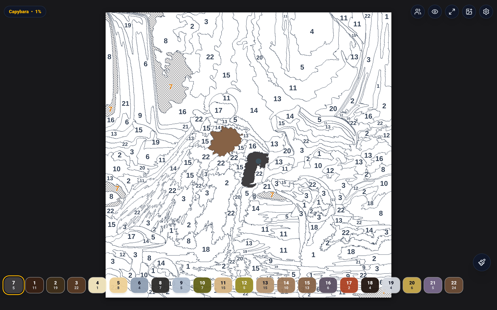
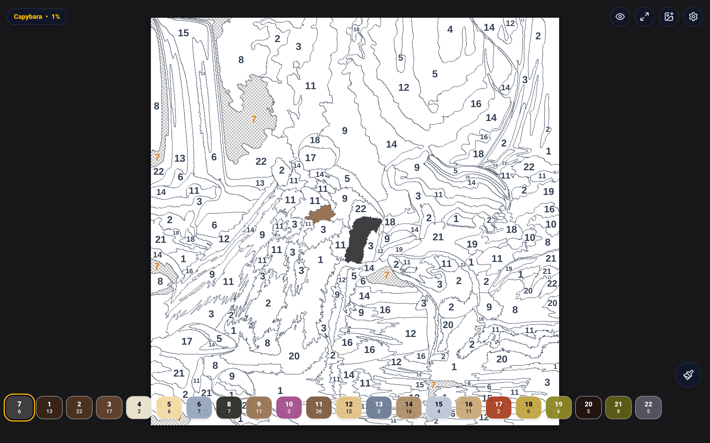
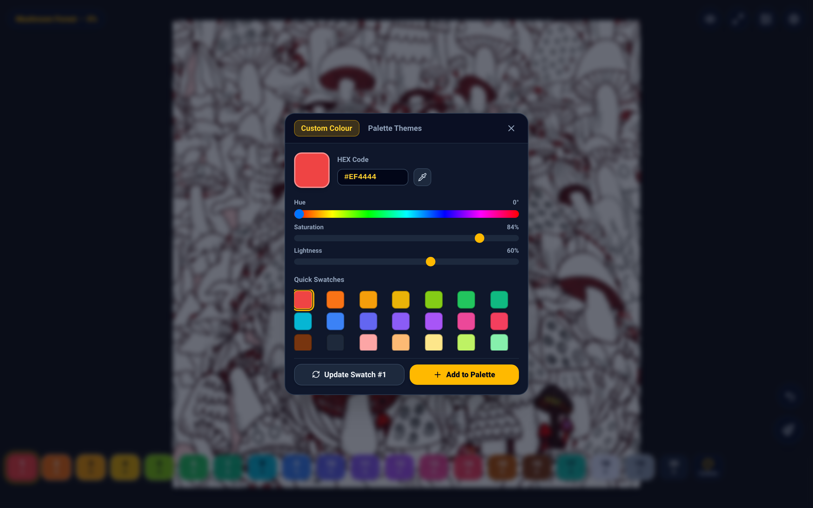
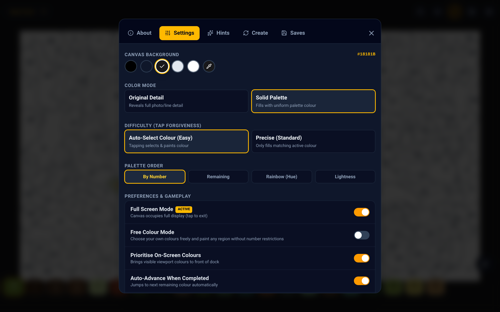
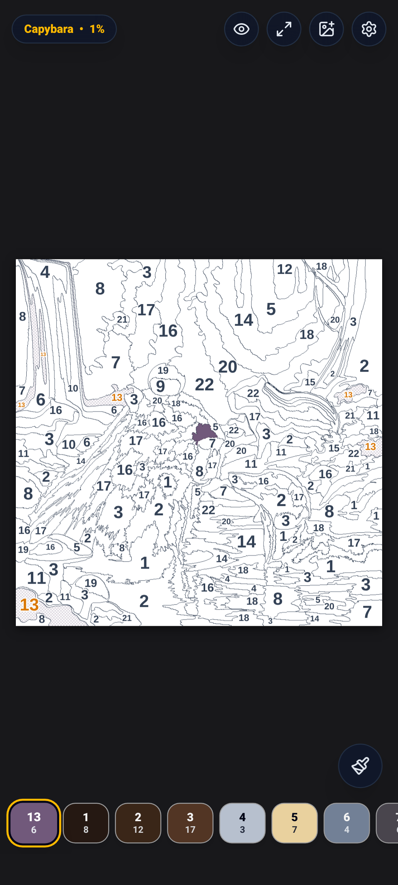

# Capy: Color-by-Number Suite

[](https://shthed.github.io/capy/)
[](https://shthed.github.io/capy/capy.apk)
[](LICENSE.md)

**Capy** is a serene, delightful color-by-number game you can play directly in your web browser or on Android. Transform any photo or artwork into a crisp, playable color puzzle with smart number guides, or relax with Free Colour coloring pages.

- **[Play Capy in Your Browser](https://shthed.github.io/capy/)**
- **[Download the Android APK](https://shthed.github.io/capy/capy.apk)**

---

## Visual Showcase and Gallery

<p align="center">
  
  <br>
  <em>Interactive color-by-number canvas with responsive Palette Dock, dynamic active region highlighting, and centroid glow badges.</em>
</p>

| **Fine Zoom and Active Highlighting** | **Free Colour / Coloring Page Mode** |
| :---: | :---: |
|  |  |
| *Continuous zoom up to 12x with poles-of-inaccessibility labels and active region fills* | *Mushroom Forest with custom HSL/Hex palette picker and quick presets* |

| **Settings and Appearance Customizer** | **Mobile Portrait Experience** |
| :---: | :---: |
|  |  |
| *Circular background swatches, custom pipette color pickers, and smooth pan momentum* | *Full edge-to-edge touch UI with Google Maps-style one-finger drag zoom* |

---

## Why You'll Love Capy

- **Two Ways to Play**: Classic **Color by Number** guided coloring or relaxed **Free Colour** creative mode.
- **Turn Any Photo into a Puzzle**: Tap the photo upload button to convert your favorite pictures, pets, landscapes, or drawings into instant playable puzzles.
- **Smooth Navigation**: One-finger double-tap-and-drag zoom, fluid pinch-to-zoom up to 12x, and inertial gliding pan momentum just like Google Maps.
- **Continuous Paint Mode**: Drag your finger across the screen to quickly fill connected matching regions without tapping each one individually.
- **Smart Hints and Assistance**: Tap a color swatch again to highlight elusive tiny regions with an animated glow ring.
- **Custom Themes and Haptics**: Choose from Deep Black, Charcoal, Slate, or custom background colors, and enjoy satisfying tactile vibration on mobile.
- **100% Offline and Private**: All image processing and coloring run entirely inside your browser. No accounts, no data tracking, and no servers required.

---

## How to Play

1. **Pick an Artwork**: Start with built-in favorites like *Capybara*, *Capy Forest*, or *Mushroom Forest*, or import your own photo.
2. **Choose a Color**: Tap any numbered swatch in the bottom **Palette Dock**. Matching puzzle shapes highlight instantly in that color.
3. **Tap or Drag to Paint**: Tap the numbered shapes on the canvas to fill them. Turn on the **Paint Brush** tool to color continuously by dragging.
4. **Zoom and Pan**: Double-tap and drag (up to zoom in, down to zoom out), or pinch with two fingers to inspect fine micro-regions.
5. **Celebrate**: Complete all colors to trigger the victory confetti burst and download your finished masterpiece.

---

## Controls and Gestures Cheat Sheet

| Gesture / Control | Action |
| :--- | :--- |
| **Tap Region** | Paints the region if it matches the selected active color. |
| **Drag Canvas** | Pans the artwork smoothly across the screen with inertial gliding momentum. |
| **Double-Tap and Drag Up / Down** | Google Maps-style one-finger zoom: drag up to zoom in, drag down to zoom out. |
| **Pinch / Mouse Wheel** | Multi-touch focal zoom in / zoom out up to 12x. |
| **Paint Brush Button** | Toggles continuous drag-to-paint mode. |
| **Undo Button (`Ctrl+Z`)** | Undoes the last painted region. |
| **Long-Press Undo Button** | Opens the interactive Replay timeline scrubber to inspect history and resume play from any point. |
| **Redo Button (`Ctrl+Y` / `Ctrl+Shift+Z`)** | Steps forward to re-apply previously undone regions. |
| **Preview Eye Button** | Toggles unmasked preview of the original source artwork. |
| **Lightbulb / Swatch Double-Tap** | Targets and animates the next unpainted region for the active color. |

---

## Developer Quick Start

To run Capy locally in development mode:

```bash
cd web
npm install
npm run dev
```
Open [http://localhost:3000](http://localhost:3000) in your browser.

Run the automated browser test suite (tests gestures, settings, canvas):
```bash
npm run test:game
```

---

## Technical Documentation and Architecture

All detailed architectural guides, computer vision algorithms, and native bridge specifications live in dedicated documentation files:

- **Web Architecture and UI Reference**: [`WEB.md`](./WEB.md) -- Comprehensive guide to React 19, Vite, 3-tier offscreen canvas rendering, gesture engine, and settings dictionary.
- **Android Native Launcher**: [`APP.md`](./APP.md) -- Kotlin launcher, AndroidX `WebViewAssetLoader`, native haptics bridge, and backup specifications.
- **Puzzle Generation Engine**: [`PUZZLE.md`](./PUZZLE.md) -- Web Worker segmentation, Sobel line extraction, Red-Mean K-Means clustering, and watershed absorption.
- **Testing Architecture**: [`TESTING.md`](./TESTING.md) -- Playwright E2E testing guide, multi-touch gesture verification, and CI pipelines.
- **Project Roadmap and Tasks**: [`TODO.md`](./TODO.md) -- Active milestones and post-merge cleanup tracking.
- **Agent and Contributor Playbook**: [`AGENTS.md`](./AGENTS.md) -- Monorepo workflows, development rules, and PR standards.
