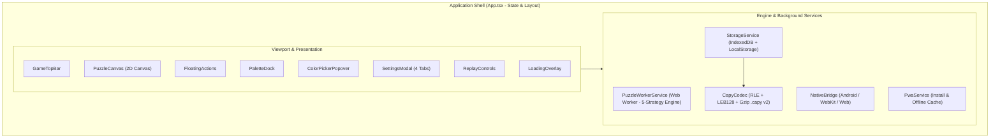
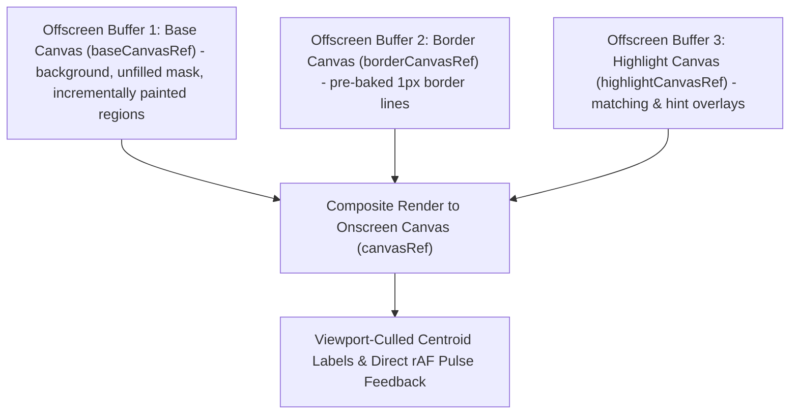
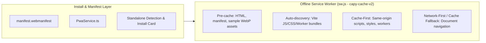

# Web Architecture & Technical Design: Capy Web (`web/`)

This document provides a comprehensive technical reference for the updated Capy Web application located in [`web/`](./web/). It covers the architectural design, component hierarchy, rendering pipeline, gesture handling, state management, background worker engine, native Android bridge, and persistence systems.

---

## 1. Architectural Overview & Design Principles

Capy Web is a high-performance, client-side, color-by-number generator and interactive canvas player built with **React 19**, **TypeScript**, **Vite 6**, and **Tailwind CSS 4**.



### Core Tenets
1. **Zero Server Dependency**: All image processing, quantization, vector segmentation, and progress storage run 100% on the client. Puzzles can be generated and played completely offline.
2. **60 FPS Canvas Rendering**: Instead of rendering thousands of individual DOM or SVG elements, Capy utilizes an **offscreen-cached HTML5 2D Canvas pipeline** that selectively repaints only modified regions without 60 FPS React state churn.
3. **Responsive Non-Blocking UI**: Compute-intensive computer-vision algorithms run inside a dedicated **Web Worker**, providing continuous progress feedback without dropping frames or freezing UI threads.
4. **Single Source of Truth**: The code in `web/` powers both the web deployment ([`https://shthed.github.io/capy/`](https://shthed.github.io/capy/)) and the native Android app ([`app/`](./app/)) via an extensible, low-overhead native bridge.
5. **Edge-to-Edge Responsive Layout**: Full hardware safe area inset management (`--sat`, `--sab`, `--sal`, `--sar`) ensures seamless layouts across mobile notches, tablets, foldable devices, and widescreen desktops.

---

## 2. Directory & Module Structure

| Path | Responsibility |
| :--- | :--- |
| `web/index.html` | HTML host document with mobile viewport and safe-area metadata |
| `web/package.json` | React 19, Vite 6, Tailwind CSS 4, Lucide icons, `canvas-confetti`, test scripts |
| `web/tsconfig.json` | Strict TypeScript configuration |
| `web/vite.config.ts` | Vite configuration with relative asset base (`'./'`) |
| `web/public/sw.js` | Same-origin offline Service Worker (`capy-cache-v2`) |
| `web/public/privacy-policy.html` | Google Play Store Privacy Policy and Data Safety summary page |
| `web/src/main.tsx` | React DOM bootstrap |
| `web/src/App.tsx` | Master container, state orchestration, `#s=<token>` / Co-op room sync, keyboard shortcuts |
| `web/src/index.css` | Tailwind CSS 4 imports, safe area utilities, touch reset |
| `web/src/types/index.ts` | Central TypeScript interfaces, `PuzzleSourceRef`, defaults, sample gallery |
| `web/src/components/PuzzleCanvas.tsx` | Offscreen cached 2D canvas, pan/zoom gestures, hit testing, rAF hint & Co-op ripple rendering |
| `web/src/components/GameTopBar.tsx` | Progress indicator, title, live Co-op room badge & shortcut, preview, fullscreen, settings |
| `web/src/components/PaletteDock.tsx` | Scrollable color palette, remaining count, sort modes |
| `web/src/components/FloatingActions.tsx` | Undo, Redo, Replay, continuous Paint Mode toggle, zoom +/-, view reset |
| `web/src/components/SettingsModal.tsx` | 4-tab configuration sheet (Settings, Hints, Create, Saves & Co-op Hub) |
| `web/src/components/ReplayControls.tsx` | Floating playback HUD for chronological region completion replays |
| `web/src/components/ColorPickerPopover.tsx` | Custom color picker and palette presets for Free Colour mode |
| `web/src/components/LoadingOverlay.tsx` | Bottom-anchored progress HUD with expandable 6-stage pipeline inspector |
| `web/src/services/CapyCodec.ts` | Compact Binary Storage v2 (RLE + LEB128 varints, `.capy` v2 Gzip framing, CRDT deltas) |
| `web/src/services/ShareLinkService.ts` | `< 2 KB` `#s=<token>` progress links, `?room=<ROOM6>` invites, and URL resolution |
| `web/src/services/providers/types.ts` | Hexagonal ports (`AuthProvider`, `CloudSaveProvider`, `RealtimeRoomProvider`, `CatalogStorageProvider`, `AiArtworkProvider`, `MonetizationProvider`) |
| `web/src/services/providers/ProviderRegistry.ts` | Local-first + Play Games v2 auth, CRDT cloud vault, `BroadcastChannel`/WS Co-op room adapter, moderated community ideas, opt-in AI credit ledger |
| `web/src/services/StorageService.ts` | IndexedDB (`CompactPuzzleRecordV2` + `STORE_IMAGES` blobs) + LocalStorage |
| `web/src/services/NativeBridge.ts` | Android `@JavascriptInterface` & WebKit bridge (haptics, LIFO back stack, cloud/deep-link/share hooks) |
| `web/src/services/PwaService.ts` | PWA install prompt, standalone detection, and Service Worker update lifecycle |
| `web/src/services/PuzzleWorkerService.ts` | Worker lifecycle, job cancellation, promise dispatch |
| `web/src/engine/CoopRippleBuffer.ts` | Zero-allocation typed ring buffer (`Float32Array`/`Float64Array`) for 60-120 FPS collaborator ripples |
| `web/src/engine/puzzle.worker.ts` | Web Worker message handler |
| `web/src/engine/PuzzleGenerator.ts` | Multi-strategy coordinator, `<= 512px` proxy analyzer, monotonic progress emitter |
| `web/src/engine/ImageAnalyzer.ts` | Heuristic classifier (variance ratio, line art presence, B&W coloring detection) |
| `web/src/engine/LineArtExtractor.ts` | Luminance, adaptive Otsu, and Sobel gradient ink outline extractor |
| `web/src/engine/ColorQuantizer.ts` | Perceptual Red-Mean K-Means++ color clustering |
| `web/src/engine/RegionSegmenter.ts` | 4-connected flood fill, `cellPartitionMap`, sliver merging, watershed border absorption |

---

## 3. Component Hierarchy & Layering

The UI uses a fixed, layered viewport stack where pointer events pass through empty spaces to the canvas below (`pointer-events-none` on overlay containers, `pointer-events-auto` on interactive controls):

| Z-Index Layer | Component(s) | Viewport Placement & Behavior |
| :--- | :--- | :--- |
| `z-0` | `PuzzleCanvas` | Full-bleed interactive pan/zoom 2D canvas |
| `z-20` | `FloatingActions`, `PaletteDock` | Bottom-right tool stack and bottom horizontal swatch dock |
| `z-30` | `GameTopBar`, `ReplayControls` | Top safe-area status bar and floating bottom replay scrubber HUD |
| `z-40` | `LoadingOverlay` | Non-blocking bottom-anchored generation HUD and expandable pipeline drawer |
| `z-50` | `SettingsModal`, `ColorPickerPopover` | Modal configuration sheet and nested custom color popover |

### Component Breakdown

| Component | Responsibility | Key Interactions |
| :--- | :--- | :--- |
| [**`PuzzleCanvas`**](file:///home/antigravity/shthed/capy/web/src/components/PuzzleCanvas.tsx) | Renders the puzzle with 3-tier offscreen caching, handles gestures, hit-tests pixel taps, renders zero-allocation Co-op collaborator paint ripples, and cleanly displays artwork during generation. | Single-finger drag (pan), pinch (zoom), Google Maps-style one-finger double-tap-and-drag zoom, smooth pan momentum gliding, tap (color region), drag (continuous paint mode), animated fit-to-screen zoom-out, demand-driven rAF Co-op ripple decay, and clean zero-overhead artwork stage during puzzle generation. |
| [**`GameTopBar`**](file:///home/antigravity/shthed/capy/web/src/components/GameTopBar.tsx) | Displays puzzle title, overall completion percentage, live Co-op room presence pill, and quick actions. | Tap title to open Saves tab; tap Co-op button or live collaborator pill (`topbar-active-coop-pill`) to manage simultaneous multiplayer rooms and shareable links; toggle preview mode; enter/exit fullscreen; import image; open settings. |
| [**`PaletteDock`**](file:///home/antigravity/shthed/capy/web/src/components/PaletteDock.tsx) | Horizontal scrolling list of numbered color swatches with completion badges. | Tap swatch to select active color; tap active swatch again to trigger hint; tap custom color button to open picker. Guarantees persistent active color selection even when 0 matching regions remain on-screen. Supports dynamic sorting (Number, Remaining, Hue, Lightness) and viewport culling. |
| [**`FloatingActions`**](file:///home/antigravity/shthed/capy/web/src/components/FloatingActions.tsx) | Secondary floating action buttons positioned above the palette dock. | Undo last completed region (`Ctrl+Z` / `Cmd+Z`, disabled by default for standard puzzles, enabled automatically for free colour puzzles or via Settings toggle); long-press Undo (>=450ms) to open Replay timeline scrubber; conditional Redo button positioned above Undo (`Ctrl+Y` / `Ctrl+Shift+Z`) to re-apply undone regions (hidden until an action is undone); trigger Replay when completed; toggle continuous Paint Mode; zoom in/out; reset view to fit screen. |
| [**`SettingsModal`**](file:///home/antigravity/shthed/capy/web/src/components/SettingsModal.tsx) | Full modal sheet with 4 tabbed sections and automatic active tab persistence. | Automatically restores the last active tab index from `localStorage` (`capy_last_settings_tab`).<br>**Settings**: Preferences, difficulty, auto-advance, replay speed (`0.5x`–`10x`), minimal `Replay on Load`, `Follow Painting During Replay` (`toggle-replay-follow-btn`), and `Auto-Loop Replay` (`toggle-replay-loop-btn`) toggles, pan momentum toggle, canvas background (preset circular swatches + `<Pipette>` custom hex/color picker), dock elevation, label sizing controls (Minimum Label Size, Maximum Label Size, and Overall Scale), and Android APK direct download link.<br>**Hints**: Highlight styles (`CENTROID_GLOW`, `NUMBER_ONLY` [changes label text colour without circles], `FULL_REGION`, `BOUNDARY_ONLY`), hint highlight colour (circular swatches + `<Pipette>`), hint intensity, animated hint pulse.<br>**Create**: Real-time gallery search (`gallery-search-input`), category filter chips (`All`, `Animals`, `Coloring`, `Nature`, `Line Art`, `Detailed`, `Music`), **Infinite Zoom 2x Detail Tile** generator (`infinite-zoom-subtile-btn`), moderated **Community Puzzle Ideas** submission & upvoting feed (`community-ideas-section`), algorithm selection, color counts, min region area, line handling, and device photo upload.<br>**Saves**: Cloud Sync & Simultaneous Co-op Hub (`cloud-coop-hub` with display name/avatar color editor, Play Games sign-in, CRDT `Cloud Sync`, `< 2 KB` `Share Progress Link`, and 6-char `Host Co-op Room` / `Join` controls), plus unified sticky save library actions (Sort, `Replay on Load`, Detail/Thumbnails switcher, Pin/Unpin, Load/Resume, Replay, Rename, Export `.capy`, Delete, Import, Export All, Delete All Saves). |
| [**`ReplayControls`**](file:///home/antigravity/shthed/capy/web/src/components/ReplayControls.tsx) | Non-blocking bottom HUD shown during chronological puzzle replays and upon 100% completion. | Opens minimised by default (`data-minimized="true"`) as a compact floating pill with Play/Pause/Replay, progress bar, speed selector (`0.5x`, `1x`, `2x`, `5x`, `10x`), **Follow Painting** toggle (`replay-follow-btn`), **Auto-Loop** toggle (`replay-loop-btn`), Skip-to-End, expand toggle (`replay-toggle-minimize-btn`), and Exit. Expanding (`data-minimized="false"`) reveals the full interactive timeline range scrubber, "Resume Here" button to rewind active gameplay to any scrubbed step, and post-completion `Save PNG` and `Next` puzzle quick actions. |
| [**`ColorPickerPopover`**](file:///home/antigravity/shthed/capy/web/src/components/ColorPickerPopover.tsx) | Palette customization panel for Free Colour / Coloring Page mode. | Select from 5 preset palettes (Vibrant, Mushroom, Pastels, Earthy, Neon); pick custom HSL/Hex swatches; update palette colors in real time. |
| [**`LoadingOverlay`**](file:///home/antigravity/shthed/capy/web/src/components/LoadingOverlay.tsx) | Non-blocking bottom-anchored HUD card keeping the background canvas visible during puzzle creation. | Supports two generation progress modes with live toggle control directly on the HUD:<br>1. **Simple Progress (Fast Mode, Default)**: Minimalist, ultra-low-overhead progress HUD showing an amber-to-yellow gradient progress bar and percentage. In Simple mode, the high-frequency canvas animation loop is completely disabled on the main thread, and worker IPC progress events are throttled with payload construction skipped, dedicating maximum CPU and memory bandwidth to the puzzle generation engine for the fastest possible load times.<br>2. **Detailed Progress**: Displays strictly monotonic progress (`0%` to `100%`), `Step X/6` badge, live sub-status, real-time pipeline parameters (detected style, chosen strategy, target regions), live K-Means clustered palette swatches, and an expandable **Generation Details** drawer listing all 6 stages alongside auto-detected style, chosen strategy rationale, color count, region targets, working resolution, and estimated save file size (`KB`). |


---

## 4. State Management & Lifecycle (`App.tsx`)

`App.tsx` serves as the centralized state orchestrator. State is divided into five main domains:

### 1. Active Session, Undo & Redo State
- `puzzle: PuzzleData | null`: The current puzzle model containing dimensions, palette, region array, region map, and border map.
- `sourceImage: HTMLImageElement | null`: Cached HTML image element of the original artwork, set immediately before worker execution begins so the background canvas displays the artwork during generation.
- `activeColorId: number`: The ID of the currently selected palette color.
- `filledRegionIds: Set<number>`: Set of region IDs that have been colored, preserving exact chronological insertion order across saves and reloads.
- `paintedRegionColors: Map<number, number>`: Region ID $\rightarrow$ Color ID mapping for Free Colour Mode.
- `undoStack: UndoHistoryEntry[]`: History stack recording each region completion (`regionId`, `paintedColorId`, `prevColorId`, `wasAlreadyFilled`) so players can undo completions one by one via the Undo button or `Ctrl+Z` / `Cmd+Z`. Long-pressing the Undo button (>=450ms) opens the interactive Replay timeline scrubber.
- `redoStack: UndoHistoryEntry[]`: Redo stack storing undone paint actions. Stepped forward sequentially using the Redo button stacked above Undo (`FloatingActions.tsx`) or keyboard shortcuts (`Ctrl+Y` / `Ctrl+Shift+Z`). Hidden unless actions have been undone and redo is enabled. Cleared when a new region is actively painted.
- `hintRegionId: number | null`: Region ID currently targeted by hint guidance.
- `isPreviewMode: boolean`: Toggles display between the interactive puzzle and the unmasked original artwork.

### 2. Chronological Replay & Historical Resumption State
- `isReplaying: boolean`, `isReplayPlaying: boolean`, `replayStep: number`, `replaySequence: number[]`: Controls chronological playback of `filledRegionIds` in [`App.tsx#L121-L125`](./web/src/App.tsx#L121-L125).
- **YouTube-Style Scrubber Control Bar ([`ReplayControls.tsx#L136-L586`](./web/src/components/ReplayControls.tsx#L136-L586))**: Both the default compact bottom bar ([`ReplayControls.tsx#L216-L366`](./web/src/components/ReplayControls.tsx#L216-L366), `data-minimized="true"`, `w-full max-w-2xl`) and the expanded two-row deck ([`ReplayControls.tsx#L368-L586`](./web/src/components/ReplayControls.tsx#L368-L586), `data-minimized="false"`, `w-full max-w-2xl`) feature a dominant `flex-1` interactive progress slider ([`renderYouTubeScrubber`](./web/src/components/ReplayControls.tsx#L136-L214), `data-testid="replay-scrubber-track"` / `data-testid="replay-scrubber"`) that takes up most of the horizontal space and can be clicked or dragged at any time with zero-latency pointer capture ([`computeStepFromPointer` / `handleTrackPointerDown` / `handleTrackPointerMove`](./web/src/components/ReplayControls.tsx#L91-L134)), a `transition-none` progress fill bar ([`ReplayControls.tsx#L172-L176`](./web/src/components/ReplayControls.tsx#L172-L176)), an interactive thumb handle ([`ReplayControls.tsx#L180-L185`](./web/src/components/ReplayControls.tsx#L180-L185)), a live hover/scrub step preview tooltip ([`ReplayControls.tsx#L152-L162`](./web/src/components/ReplayControls.tsx#L152-L162)), and playback speeds from `0.5x` up to `20x` ([`REPLAY_SPEED_OPTIONS`](./web/src/components/ReplayControls.tsx#L18) `= [0.5, 1, 2, 5, 10, 20]`).
- **Zero-Allocation Incremental Scrubbing ([`displayedFilledRegionIds`](./web/src/App.tsx#L2319-L2327), [`PuzzleCanvas.tsx#L814-L876`](./web/src/components/PuzzleCanvas.tsx#L814-L876))**: During replay and slider dragging, [`PuzzleCanvas.tsx`](./web/src/components/PuzzleCanvas.tsx#L814-L876) mutates `paintedCacheRef.current` and `prevColorsRef.current` in place (zero per-step `Set`/`Map` cloning or `.slice()` array allocation) and performs incremental dirty-rect `putImageData` updates on `baseCanvasRef` for instant forward and backward scrubbing.
- **Automatic Offscreen Step Fast-Forward ([`isRegionVisibleInViewport`](./web/src/App.tsx#L343-L381))**: When `settings.replayFollow` is `false`, the `requestAnimationFrame` accumulator loop performs a zero-allocation O(1) bounding-box frustum check (`regionByIdRef.current`, `viewportRef.current`, and `canvasContainerSizeRef.current`) for each step and immediately fast-forwards past consecutive regions outside the visible viewport.
- **Follow Painting Camera Tracking (`settings.replayFollow`, [`stepFollow`](./web/src/components/PuzzleCanvas.tsx#L401-L591), [`isViewportCaughtUpToRegion`](./web/src/App.tsx#L385-L436))**: When `settings.replayFollow` is `true` (toggled via `replay-follow-btn` or Settings), offscreen fast-forwarding is disabled; when zoomed in (`scale > 1.05`), [`PuzzleCanvas.tsx`](./web/src/components/PuzzleCanvas.tsx#L401-L591) runs a zero-allocation 60 FPS [`stepFollow`](./web/src/components/PuzzleCanvas.tsx#L401-L591) camera loop with an inner **Safe-Frame Dead-Zone** ([`PuzzleCanvas.tsx#L461-L479`](./web/src/components/PuzzleCanvas.tsx#L461-L479), `[18% w, 82% w]` x `[max(68px, 18% h), h - max(92px, 22% h)]`), **10-step Predictive Lookahead** ([`replayFollowSequence` / `replayFollowStep`](./web/src/components/PuzzleCanvas.tsx#L60-L63), [`PuzzleCanvas.tsx#L480-L551`](./web/src/components/PuzzleCanvas.tsx#L480-L551)), and a **Critically-Damped 2D Velocity Spring-Damper (`SmoothDamp`)** ([`followAnchorOffsetRef` / `followVelRef`](./web/src/components/PuzzleCanvas.tsx#L553-L584)). The camera remains completely stationary while upcoming regions stay inside the safe frame, anticipates when the next few completions approach the screen edge, computes a horizon-weighted cluster centroid ([`PuzzleCanvas.tsx#L502-L547`](./web/src/components/PuzzleCanvas.tsx#L502-L547)) to frame the upcoming region group in a single glide, and never alters the user's zoom scale. Manually panning/dragging the canvas during replay (`onManualPanStart`) automatically disengages `settings.replayFollow` so the player has full manual viewport control.
- **Auto-Loop Replay (`settings.replayLoop`)**: When `settings.replayLoop` is `true` (toggled via `replay-loop-btn` or Settings), reaching the end of `replaySequence` holds at `100%` for 350ms (`loopPauseUntil`) and automatically restarts playback from `replayStep = 0`.
- **Live Panning, Zooming & Strict Viewport Invariance**: Players can freely pan and zoom the canvas while a replay is playing or paused. Starting a replay (whether automatically upon completing the final region in [`attemptFillRegion`](./web/src/App.tsx#L1659-L1661) / [`attemptBatchFillRegions`](./web/src/App.tsx#L1786-L1869), pressing the **Watch Puzzle Replay** button `data-testid="replay-btn"` in [`FloatingActions.tsx#L125-L141`](./web/src/components/FloatingActions.tsx#L125-L141) invoking [`startReplay`](./web/src/App.tsx#L439-L455), long-pressing Undo, or clicking Replay on the currently active puzzle in Saves via [`handleLoadSnapshot`](./web/src/App.tsx#L2165-L2189)) and finishing a replay ([`finishAutoResume`](./web/src/App.tsx#L459-L468)) never reset, zoom out, or move the viewport — playback always runs directly from where the player already is.
- **Resume Play From Step**: Expanding the Replay HUD (`replay-toggle-minimize-btn`) and clicking "Resume Here" restores active gameplay to step $K$, updating `filledRegionIds` to match the scrubbed point and placing the rewound actions into `redoStack` in reverse order so players can immediately redo actions forward or diverge with new colors.

### 3. Viewport & Spatial Culling
- `visibleColorIds: Set<number>` / `visibleRegionIds: Set<number>`: Calculated by [`PuzzleCanvas.tsx`](./web/src/components/PuzzleCanvas.tsx) on each pan/zoom change. Allows [`PaletteDock.tsx`](./web/src/components/PaletteDock.tsx) to dynamically prioritize swatches currently on-screen (`prioritizeOnScreen`).

### 4. Generation Sequence Tracking (`generationSeqRef`)
To prevent asynchronous race conditions when switching sample artwork or uploading files while a generator worker is running:
- Every generation request increments a sequence counter (`generationSeqRef.current`).
- If a newer request begins, any earlier in-flight worker execution is terminated via `PuzzleWorkerService.cancelActive()`.
- Responses from stale sequence IDs are discarded automatically.

### 5. Auto-Advance, Completion & Auto-Replay Flow
- When `filledRegionIds` completes all regions for `activeColorId`, and `settings.autoAdvance` is enabled, the game automatically advances to the next incomplete color (with a light haptic tick).
- When `filledRegionIds.size === puzzle.regions.length`, completion is triggered without any blocking modal popup or forced viewport movement:
  - Victory haptic sequence fired and confetti burst dispatched via `canvas-confetti`.
  - Preview thumbnail and save file size (`fileSizeBytes`) calculated and persisted in [`StorageService.ts`](./web/src/services/StorageService.ts).
  - Chronological puzzle replay starts automatically via the minimised [`ReplayControls.tsx`](./web/src/components/ReplayControls.tsx#L216-L366) bar directly at the player's current zoom and pan viewport without zooming out ([`startReplay(orderedList)`](./web/src/App.tsx#L439-L455)).
- When loading a different saved puzzle with completed regions (`filledRegionIds.length > 0`), the save's previous zoom and pan extent (`zoomScale`, `panOffsetX`, `panOffsetY`) is restored on the canvas **before** starting the replay (`restoreViewTrigger` in [`App.tsx#L2165-L2189`](./web/src/App.tsx#L2165-L2189)). Triggering Replay on the already-active puzzle in Saves preserves the live canvas viewport in place. When `settings.autoReplayOnLoad` is enabled (or when manually clicking Replay), the replay plays directly within the current viewport, automatically fast-forwards any offscreen steps, and resumes active gameplay in place once playback finishes ([`finishAutoResume`](./web/src/App.tsx#L459-L468)).

---

## 5. Rendering Pipeline & Gesture Engine (`PuzzleCanvas.tsx`)

Rendering thousands of intricate vector regions at 60 FPS during continuous touch-drag or high-speed replay requires avoiding full canvas redraws. `PuzzleCanvas` employs a **three-tier offscreen caching strategy**:



### Live Background Artwork Display & Real Generation Metrics
When `isGenerating` is `true` and `sourceImage` is loaded:
- `PuzzleCanvas` immediately centers and renders the clean `sourceImage` with shadow framing on the stage, completely avoiding artificial geometric animations (such as scanlines, circles, or synthetic wireframes) so the artwork remains unobscured.
- `LoadingOverlay` presents real data directly from the active generation pipeline:
  - **Live Pipeline Metadata Badges**: Style classification (`Photograph / Realism`, `Line Art / Illustration`, `Flat Vector / Graphic`), selected strategy (`LINE_ART`, `PAINTERLY`, `POSTERIZED`, `MOSAIC_CEL`), color count target, and max region target.
  - **Live Clustered Palette Swatches**: During Step 4 (`Perceptual Color Palette Clustering`), renders the authentic color swatches extracted at each iteration of K-Means clustering.
  - **Detailed Drawer**: Expandable inspection of variance, edge coverage, target resolution, and estimated file size.

### Incremental Base Layer Painting (Fill, Undo & Replay Scrubbing)
When regions are filled or unfilled (via gameplay, Undo, or Replay scrubbing), `baseCanvas` does not repaint the entire canvas. Instead:
- It compares the new `filledRegionIds` set against `paintedCacheRef.current`.
- For both newly filled and newly unfilled regions, it retrieves the region's `pixels: Int32Array` containing exact 1D pixel coordinates, updates `baseImageDataRef`, and calls `baseCtx.putImageData(..., minX, minY, ...)` restricted strictly to the combined dirty bounding box.

### Dynamic Active Colour & Highlight Overlays
`PuzzleCanvas` dynamically renders visual cues for active and hinted regions without redrawing base layers:
- **Active Colour Highlighting**: When `highlightStyle` is set to `FULL_REGION` (default) or `BOUNDARY_ONLY`, unfilled regions matching `activeColorId` are filled directly with the **active palette colour** (extracted from `palette[activeColorId].rgb`). This creates an immediate visual connection between the selected palette swatch and the target puzzle shapes.
- **Hint Highlighting**: When a hint is triggered, the target region is highlighted using `settings.hintColorArgb` (default gold `#FBBF24`), rendering a distinct checkerboard, pulse, or border pattern to avoid visual confusion with the active colour.
- **Label Hint & Highlight Effect (`NUMBER_ONLY`)**: Rather than drawing distracting circles or pills around numbers, the label hint effect changes the label text colour directly to the vibrant hint colour (pulsing when `animateHint` is enabled) or active colour `#D97706` with a crisp white stroke halo for contrast. Centroid circles are reserved strictly for `CENTROID_GLOW` mode.

### Centroid Label Placement & Bounds Guarantee
Labels are drawn at each region's **Pole of Inaccessibility** (deepest interior point computed via BFS distance transform in the engine), avoiding thin concave edges:
- **Spatial Culling**: Labels outside the visible viewport bounding box are discarded before font measurement.
- **Inscribed Circle Geometry Fitting**: Label font sizes are calculated from the region's inscribed circle radius (`maxRadius`) divided by a character-count corner factor `sqrt((0.3 * charCount)^2 + 0.1444)` with a 10% safety cushion. This guarantees that 1-digit, 2-digit, and 3-digit label bounding boxes always fit inside the region.
- **Minimum and Maximum Size Constraints**: Labels are constrained between `minLabelSize` (range 2–14px, default 6px) and `maxLabelSize` (range 10–36px, default 18px). Lowering `minLabelSize` allows very tiny, crisp numbers to remain visible on high-resolution displays before zooming in, while `maxLabelSize` prevents numbers in large open regions from becoming oversized.
- **Clean Stroke Contrast**: Label text is rendered with a proportional semi-transparent white stroke outline (`strokeText`) scaled down for tiny fonts, providing high contrast against dark artwork lines without drawing background circle badges.

### Viewport Pan & Zoom Clamping (`clampCanvasOffset`)
[`clampCanvasOffset`](file:///home/antigravity/shthed/capy/web/src/components/PuzzleCanvas.tsx) keeps the artwork bounded while providing full viewport navigation:
- **Zoom Range**: Smooth clamping between **0.5×** and **12.0×**.
- **Animated Fit-to-Screen Reset**: When `resetViewTrigger` increments explicitly via the user's Fit-to-Screen button (`data-testid="reset-view-btn"`), `PuzzleCanvas` smoothly interpolates `scale` to `1` and `offset` to `{x: 0, y: 0}` over 280ms using a cubic ease-out curve.
- **Dynamic Corner Panning Margins**: When zoomed in (`effScale >= fitScale`), margin caps scale dynamically with viewport size (`containerWidth * 0.72` horizontally and `containerHeight * 0.72` vertically) rather than fixed pixel offsets. This ensures players can pan all four corners of the puzzle comfortably past the center of the viewport, well clear of the bottom `PaletteDock` (~120px) and top `GameTopBar` (~60px).
- **Centering Elasticity**: When the artwork is smaller than the container, it smoothly snaps to center.
- **Container Resize & Orientation Change Clamping (`ResizeObserver`)**: `PuzzleCanvas` observes `containerRef` via `ResizeObserver` (with a `window` `resize` listener fallback). Whenever the container dimensions change (e.g., mobile portrait/landscape rotation, split-screen resize, or browser DevTools toggling), `PuzzleCanvas` immediately clamps `offsetRef.current` via `clampCanvasOffset`, updates `containerSize` state to recompute visible on-screen regions/colors, notifies `onViewExtentChanged`, and synchronously resizes and repaints the high-DPI `<canvas>` via `drawCompositeFrame`.

### Gesture Engine & Interaction Paradigms
`PuzzleCanvas` orchestrates 5 distinct touch, mouse, and gesture interactions:

1. **Tap Hit-Testing**:
   - Converts client screen $(x, y)$ to canvas coordinates using the inverse transform matrix: `puzzleX = (clientX - rect.left - panX) / effScale`.
   - Looks up `regionId = regionMap[y * width + x]` directly in the `Int32Array` region map.
   - If `isFreeColorMode`: paints the region with `activeColorId`.
   - If matching `activeColorId`: marks region filled and triggers light haptic feedback.
   - If mismatch: triggers subtle error haptic and tap ripple feedback dot.
   - In **Easy Mode**: automatically selects the tapped region's color and fills it immediately.

2. **Google Maps-Style One-Finger Double-Tap-and-Drag Zoom & Pan**:
   - Quick tap followed by a second tap-and-hold within 350ms (`timeSinceTapUp < 350ms`, `distFromLastTap < 40px`).
   - **Zooming (Vertical Drag)**: By default, dragging **DOWN** (`dy > 0`) zooms **IN**; dragging **UP** (`dy < 0`) zooms **OUT**. Reversible via `settings.reverseDoubleTapZoom` (`Invert Double-Tap Zoom Direction`).
   - Continuous exponential scale tracking: `zoomFactor = Math.pow(Math.E, (directionMultiplier * dy) / 220)`.
   - Centers zoom smoothly on the double-tap anchor point on the canvas without step-jumps.
   - **One-Finger Panning in Paint Mode (Horizontal Drag)**: Dragging left or right (`Math.abs(dx) >= Math.abs(dy)`) while in continuous Paint Mode seamlessly pans the canvas without painting any strokes or requiring two-finger pinches.

3. **Background Touch Drag Panning**:
   - Touching the canvas background outside the artwork bounds (`x < 0`, `y < 0`, `x >= width`, or `y >= height`) always pans the canvas, even when continuous Paint Mode is toggled on, allowing effortless viewport repositioning from anywhere on the screen.

4. **Smooth Pan Momentum (Inertial Gliding)**:
   - Tracks pointer movement history over a sliding 100ms window (`pointerHistoryRef`).
   - On pointer release, calculates the flick velocity vector $(v_x, v_y)$ in pixels per millisecond.
   - If velocity magnitude $\ge 0.18\text{ px/ms}$, kicks off an inertial animation loop via `requestAnimationFrame`.
   - Applies exponential friction decay: $v_{t} = v_0 \cdot 0.92^{\Delta t / 16}$.
   - Clamps offsets on every glide tick via `clampCanvasOffset`.
   - Halts animation once glide velocity drops below $0.02\text{ px/ms}$ or reaches boundaries.
   - **Zero-Latency Touch Cancellation**: Any subsequent pointer touch immediately cancels active momentum gliding with zero lag, ensuring instant tactile control.
   - Toggleable via `settings.panMomentum` (enabled by default).

5. **Multi-Touch Pinch-to-Zoom**:
   - Two-finger touch tracking with real-time midpoint focal tracking and scale clamping between $0.5\times$ and $12.0\times$.

6. **Drag-to-Color (Continuous Paint Mode)**:
   - When `isPaintMode` is active and touch begins inside the image, pointer drag samples points along the interpolated stroke path and batch-fills intersecting matching regions via `onBatchRegionsClicked`.
   - Automatically disabled while watching chronological replays.


---

## 6. Background Engine & Worker Protocol

Image quantization and segmentation are handled in [`puzzle.worker.ts`](file:///home/antigravity/shthed/capy/web/src/engine/puzzle.worker.ts) via [`PuzzleWorkerService.ts`](file:///home/antigravity/shthed/capy/web/src/services/PuzzleWorkerService.ts):

### Message Passing Protocol

```typescript
// Main -> Worker (Request)
interface WorkerGenerateRequest {
  type: 'GENERATE';
  id: string;
  width: number;
  height: number;
  rgbaBuffer: ArrayBuffer; // Transferred zero-copy
  config: GeneratorConfig;
}

// Worker -> Main (Progress Updates)
interface WorkerProgressMessage {
  type: 'PROGRESS';
  id: string;
  progress: number; // Strictly monotonic 0.0 to 1.0
  status: string;   // e.g. "Clustering perceptual color palette (2/4)..."
  payload: GenerationProgressPayload; // 6-stage step index, description & inspection telemetry
}

// Worker -> Main (Completion)
interface WorkerSuccessMessage {
  type: 'SUCCESS';
  id: string;
  puzzleData: SerializedPuzzleData; // ArrayBuffers for region pixels
}
```

Detailed documentation of the 5 segmentation strategies (`AUTO`, `LINE_ART`, `PAINTERLY`, `POSTERIZED`, `MOSAIC_CEL`) and line absorption mechanics is maintained in [**`PUZZLE.md`**](./PUZZLE.md).

---

## 7. Native Android Bridge (`NativeBridge.ts`)

When running inside the Android wrapper (`app/`), `NativeBridge` connects the web runtime to native hardware features exposed by `CapyAndroidBridge.kt` via `@JavascriptInterface`:

| Bridge Method | Web Fallback | Native Android Implementation |
| :--- | :--- | :--- |
| `haptic(type)` | `navigator.vibrate(...)` | Native `Vibrator` / `VibrationEffect` with pre-baked feedback constants (`tick`, `success`, `warning`, `error`). |
| `pushBackHandler(onClose)` | LIFO overlay stack | Maintains a LIFO stack of modal/popover close callbacks synced to Android's `OnBackPressedCallback`, closing child popovers before parent modals. |
| `saveBackup(key, data)` | No-op (localStorage only) | Persists JSON snapshots directly to private internal disk (`context.filesDir/capy_saves`). |
| `loadBackup(key)` | Returns `null` | Reads persisted backup from internal disk if localStorage is cleared or fresh install. |
| `applySafeAreaInsets()` | CSS `env(safe-area-inset-*)` | Queries `WindowInsetsCompat` and injects exact pixel values into `--safe-area-top`, `--safe-area-bottom`, etc. |
| `consumePendingSharedImage()` | File `<input>` upload | Consumes incoming images sent to Capy via Android's `Intent.ACTION_SEND` (Share menu). |
| `onDeepLink(handler)` | URL hash / `hashchange` listener | Consumes verified Android HTTPS App Links (`https://shthed.github.io/capy/...`) via `CapyAndroid.consumePendingDeepLink` and `window.__capyReceiveDeepLink`. |
| `signInPlayGames()` | Local profile fallback | Invokes Google Play Games Services v2 sign-in (`CapyAndroid.signInPlayGames`), returning cached `{ playerId, displayName }` and triggering `PlayGames.getPlayersClient(activity).currentPlayer` resolution. |
| `onPlayGamesProfile(handler)` | No-op on web | Receives async `window.__capyReceivePlayGamesProfile({ playerId, displayName })` callbacks when Android resolves the user's real Google Play Games profile name (`player.displayName`). |
| `saveCloudSnapshot(slotKey, json)` | `localStorage` (`capy_cloud_vault_v1`) | Persists CRDT `CloudSaveEnvelope` payloads to `filesDir/capy_cloud/<slotKey>.json`. |
| `loadCloudSnapshot(slotKey)` | `localStorage` (`capy_cloud_vault_v1`) | Loads CRDT `CloudSaveEnvelope` payloads from `filesDir/capy_cloud/<slotKey>.json`. |
| `showRewardedAd()` | Returns `false` (100% ad-free) | Triggers strictly opt-in rewarded AI credit video hook on Play Store builds when configured. |
| `shareTextLink(title, url)` | `navigator.share` / `navigator.clipboard` | Launches Android `Intent.ACTION_SEND` (`text/plain`) chooser for `< 2 KB` progress URLs and Co-op room invites. |
| `exportOrShareFile(options)` | Deferred-revoke `<a download>` | Encodes binary/text exports and invokes `CapyAndroid.shareFile` via AndroidX `FileProvider` Share Sheet. |

---

## 8. Persistence & Compact Binary Storage v2 (`StorageService.ts`, `CapyCodec.ts`, `ProviderRegistry.ts`)

Capy uses a compact hybrid storage model engineered for instant gallery rendering, minimal browser quota usage, and tiny cloud sync payloads:

1. **IndexedDB (`capy_game_storage_v8`) with Transaction Completion Guarantees & Cache Eviction Recovery**:
   - All IndexedDB mutations await `tx.oncomplete` / `tx.onerror` / `tx.onabort` (`runTransaction`) rather than optimistic `IDBRequest.onsuccess`.
   - `STORE_PUZZLES`: Stores `CompactPuzzleRecordV2` (`CapyCodec.compressPuzzleRecord`) — scanline Run-Length Encoding (RLE) + unsigned LEB128 varints for `regionMap` (`~20-45 KB` instead of `~9.4 MB` raw `Int32Array` maps, an `~140x` reduction). On load, `CapyCodec.decompressPuzzleRecord` reconstructs `regionMap`, `borderMap`, bounding boxes, `area`, and scanline-ordered `Region.pixels` in `< 3ms` in two linear passes. Legacy v1 `PuzzleData` records in IndexedDB are transparently migrated on load.
   - `STORE_IMAGES`: Stores full-resolution source image `Blob` records for custom uploaded or shared photos (referenced via `SavedSnapshot.sourceRef = { kind: 'blob', uri: snapId }`), while built-in samples use zero-copy `{ kind: 'sample', uri: assetPath }`.
   - **Cache Eviction Recovery (`mergeCustomPalette`)**: If the browser evicts IndexedDB `STORE_PUZZLES` while `localStorage` (`capy_snapshots_v8`) remains intact, both `handleLoadSnapshot` and cold-start `restoreSession` in [`App.tsx`](./web/src/App.tsx) fall back to regenerating the puzzle via `loadArtworkFromImage` and merge `snapshot.customPalette` (both edited swatches and user-added custom swatches) and `snapshot.isFreeColor` onto the regenerated palette.
2. **LocalStorage (`capy_snapshots_v8`) + Native Disk**:
   - Stores lightweight snapshot metadata (`SavedSnapshot`): ordered `filledRegionIds` array (preserving chronological completion sequence), active color, persisted `zoomScale` / `panOffsetX` / `panOffsetY`, compact storage footprint (`fileSizeBytes`), `sourceRef`, and an aspect-ratio preserved JPEG preview data URL (max 320px).
3. **Settings Persistence (`capy_user_settings_v8`) & Tab Memory**:
   - User preferences survive app updates and browser restarts via functional atomic state updates.
   - Reopening `SettingsModal` remembers the last active tab index via `localStorage.getItem('capy_last_settings_tab')` (`'0'` [Settings], `'1'` [Hints], `'2'` [Create], or `'3'` [Saves]).
4. **Binary `.capy` v2 Save Export, JSON RLE v2 Compatibility & CRDT Progress Deltas**:
   - `StorageService.exportSnapshotBinary(id)` and `StorageService.exportAllSnapshotsBinary()` emit Gzip-compressed `.capy` v2 binary archives (`CAPY\x02` magic header) embedding `SavedSnapshot` metadata, `CompactPuzzleRecordV2` RLE geometry, and any custom source image `Blob`.
   - `StorageService.exportSnapshot(id)` and `StorageService.exportAllSnapshots()` emit UTF-8 JSON `version: 2` bundles using `regionMapRleB64` (`uint16` `regionId` + `uint16` `runLength` pairs) for programmatic inspection and backward compatibility.
   - `StorageService.importSnapshotData(input, options)` and `StorageService.importSnapshotBundle(jsonString, options)` transparently import `.capy` v2 binary archives, JSON `version: 2` RLE bundles, and legacy JSON `version: 1` saves while batch-committing `CompactPuzzleRecordV2` records in a single `IndexedDB` transaction.
   - `CapyCodec.encodeProgressDeltaToken` / `mergeProgressDeltas` encode pure player progress (`filledRegionIds`, `paintedRegionColors`, `customPalette`) into `< 2 KB` URL-safe tokens (`#s=<token>`) with conflict-free Set-Union + Last-Writer-Wins merge semantics for cloud sync and simultaneous Co-op rooms.
5. **Instant Sample Bootstrap & Runtime Resolution (`./assets/sample_saves.capy`)**:
   - Pre-generated archive of all 4 built-in `SAMPLE_GALLERY` artworks (`Capybara`, `Mushroom Forest`, `Capy Forest`, `Snail Guitar`), generated via `npm run generate:samples` (`web/scripts/generate-sample-saves.mjs`) as a `225 KB` `CAPY\x02` compact binary archive and precached in `web/public/sw.js`.
   - When the game is opened for the first time (`existingSnapshots.length === 0`), `App.tsx` (`restoreSession`) fetches `./assets/sample_saves.capy` concurrently with sample artwork, imports all 4 sample saves into `localStorage` and `IndexedDB`, and mounts gameplay immediately without spawning the Web Worker.
   - At runtime (`loadSampleFromPrebakedOrGenerate`), incoming `#s=<token>` share links, Co-op `WELCOME_STATE` puzzle switches, and Create tab sample selections under default generator settings (`isDefaultGeneratorConfig`) resolve directly against the pre-baked `IndexedDB` puzzle records so region IDs match 100% and samples mount instantaneously without creating duplicate saves. Passive viewport pan/zoom updates use `StorageService.updateSnapshotViewport` so `lastOpened` sort order is preserved.
6. **Hexagonal Provider Persistence Keys (`ProviderRegistry.ts`, see [`CLOUD.md`](./CLOUD.md))**:
   - `capy_player_identity_v1` (`localStorage`): Stores `PlayerIdentity` (`playerId`, `displayName`, `avatarColorHex`, `provider`), automatically updated with the user's Google Account or Google Play Games profile name (`window.__capyReceivePlayGamesProfile`).
   - `capy_tab_peer_suffix_v1` (`sessionStorage`): Per-tab peer suffix so multi-tab local `BroadcastChannel` Co-op rooms distinguish simultaneous tabs cleanly.
   - `capy_cloud_vault_v1` (`localStorage` / `filesDir/capy_cloud`): Stores CRDT `CloudSaveEnvelope` records keyed by puzzle slot.
   - `capy_community_ideas_v1` (`localStorage`): Stores moderated `CommunityPuzzleIdea` submissions and per-player vote toggles.
   - `capy_ai_credits_v1` (`localStorage`): Stores opt-in `AiCreditLedger` balances (`availableCredits`, `lifetimeEarned`, `adFreePlatform`).

### 8.1 Comprehensive User Settings Reference (`UserSettings`)

| Setting Key | Type | Default | Description |
| :--- | :--- | :--- | :--- |
| `autoAdvance` | `boolean` | `true` | Automatically switches to the next incomplete color when all regions for the active color are filled. |
| `difficulty` | `'EASY' \| 'NORMAL'` | `'EASY'` | **EASY**: Auto-selects color upon clicking any region.<br>**NORMAL**: Requires matching active color. |
| `isPaintMode` | `boolean` | `false` | Enables drag-to-color continuous stroke painting. |
| `isFreeColorMode` | `boolean` | `false` | Enables Coloring Page / Free Color mode allowing arbitrary color assignment. |
| `raisePaletteDock` | `boolean` | `true` | Lifts the floating palette dock above navigation bars and Android gestures. |
| `regionColorMode` | `'SOLID' \| 'DETAIL'` | `'SOLID'` | Renders filled regions with flat quantized palette color (`SOLID`) or sampled photographic detail (`DETAIL`). |
| `canvasBgColor` | `'BLACK' \| 'DARK_SLATE' \| 'CHARCOAL' \| 'LIGHT_GRAY' \| 'PURE_WHITE' \| 'CUSTOM'` | `'CHARCOAL'` | Background fill color for the canvas viewport surrounding the artwork. |
| `canvasBgArgb` | `number` (32-bit ARGB) | `0xff18181b` (`#18181B`) | Custom background color when `canvasBgColor` is set to `'CUSTOM'` (configured via `<Pipette>` picker). |
| `saveSortOrder` | `'LAST_ACTIVE' \| 'DATE' \| 'PERCENT_COMPLETE'` | `'LAST_ACTIVE'` | Sorting order for saved game snapshots in the Saves tab. |
| `showSavePreviews` | `boolean` | `true` | Displays preview thumbnails in the Saves gallery tab. |
| `highlightStyle` | `'CENTROID_GLOW' \| 'NUMBER_ONLY' \| 'FULL_REGION' \| 'BOUNDARY_ONLY'` | `'FULL_REGION'` | Visual overlay style for matching active regions. `FULL_REGION` and `BOUNDARY_ONLY` fill regions in the active palette colour; `NUMBER_ONLY` highlights label text colour directly without drawing circles; `CENTROID_GLOW` draws a pulsing circle at the region centroid. |
| `hintFillStyle` | `'SOLID' \| 'CHECKER' \| 'STRIPES'` | `'CHECKER'` | Texture pattern applied to the active hint target region. |
| `hintColorArgb` | `number` (32-bit ARGB) | `0xfffbbf24` (`#FBBF24`) | Custom highlight color for hint targets (configured via `<Pipette>` picker). |
| `showRegionLabels` | `boolean` | `true` | Displays number labels at interior poles of inaccessibility. |
| `showPreviewLabels` | `boolean` | `false` | Shows number labels even when in artwork preview mode. |
| `showPreviewBorders` | `boolean` | `false` | Shows border lines when in artwork preview mode. |
| `highlightMatching` | `boolean` | `true` | Toggles dynamic glow and fill overlays for matching active regions. |
| `animateHint` | `boolean` | `true` | Enables zero-React-re-render `requestAnimationFrame` pulsing animation for hinted region. |
| `showNextRegionHint` | `boolean` | `true` | Highlights the next closest matching region when requesting hints. |
| `hintIntensity` | `number` (0.0 – 1.0) | `0.65` | Opacity of hint overlays and glow animations. |
| `minLabelSize` | `number` (2 – 14 px) | `6` | Minimum label font size on screen; regions where labels cannot fit at this size are suppressed until zoomed in. Configured in Settings under Label Sizing & Bounds. |
| `maxLabelSize` | `number` (10 – 36 px) | `18` | Maximum label font size on screen; prevents numbers in large open regions from becoming oversized. Configured in Settings under Label Sizing & Bounds. |
| `labelScale` | `number` (0.5 – 2.0) | `1.0` | Global scaling multiplier for number label font size. Configured in Settings under Label Sizing & Bounds. |
| `showZoomButtons` | `boolean` | `false` | Displays onscreen `+` / `-` floating zoom buttons. |
| `showResetViewButton` | `boolean` | `false` | Displays onscreen fit-to-screen view reset button. |
| `paletteSort` | `'NUMBER' \| 'REMAINING' \| 'HUE' \| 'LIGHTNESS'` | `'NUMBER'` | Dynamic sorting order for palette swatches in `PaletteDock`. |
| `prioritizeOnScreen`| `boolean` | `true` | Dynamically floats colors visible in current viewport to front of `PaletteDock`. |
| `hapticsEnabled` | `boolean` | `true` | Enables native Android vibration / web vibration feedback on taps and victory. |
| `panMomentum` | `boolean` | `true` | Enables Google Maps-style inertial gliding with friction decay on canvas pan flicks. |
| `enableCustomColorForAllPuzzles` | `boolean` | `false` | Unlocks the palette color editor across all standard puzzle modes. |
| `enableUndo` | `boolean` | `false` | Enables the Undo action button above the palette dock and keyboard shortcuts (`Ctrl+Z`). Disabled by default for standard puzzles and enabled automatically for free colour puzzles. |
| `replaySpeed` | `number` (`0.5`, `1`, `2`, `5`, `10`) | `1` | Playback speed multiplier for chronological puzzle completion replays (`1x` $\approx$ 5.5s baseline duration). |
| `replayLoop` | `boolean` | `false` | Automatically loops chronological replay back to step `0` after holding at `100%` for 350ms when playback finishes. Configured in `ReplayControls` (`replay-loop-btn`) or `SettingsModal` (`toggle-replay-loop-btn`, persisted in `capy_user_settings_v8`). |
| `replayFollow` | `boolean` | `false` | Smoothly pans the camera viewport to follow the next region being painted during chronological replay (`replaySequence[replayStep]`), disabling offscreen fast-forwarding and waiting for the viewport to catch up so every region is onscreen before painting. Configured in `ReplayControls` (`replay-follow-btn`) or `SettingsModal` (`toggle-replay-follow-btn`, persisted in `capy_user_settings_v8`). |
| `autoReplayOnLoad` | `boolean` | `true` | Automatically restores the saved zoom/pan extent (`zoomScale`, `panOffsetX`, `panOffsetY`), replays completed regions chronologically (fast-forwarding consecutive offscreen steps unless `replayFollow` is enabled), and resumes active gameplay when opening a saved puzzle. |
| `reverseDoubleTapZoom` | `boolean` | `false` | Inverts one-finger double-tap zoom direction. By default (`false`), dragging down zooms in and dragging up zooms out. When `true`, dragging up zooms in and dragging down zooms out. |
| `detailedLoadingProgress` | `boolean` | `false` | Toggles between Simple Progress (Fast Mode, default: minimalist, low-overhead progress bar with worker IPC throttled for maximum generation speed) and Detailed Generation Progress (real-time 6-stage pipeline inspector, auto-detected metrics, and live emerging palette swatches). |
| `generatorConfig` | `GeneratorConfig` | *(See PUZZLE.md)* | Engine tuning: algorithm, color count, min region area, max regions, resolution. |

---

## 9. Styling & Design Tokens (`index.css`)

Capy Web uses **Tailwind CSS 4** with CSS custom properties for hardware insets:

```css
:root {
  --sat: max(env(safe-area-inset-top, 0px), var(--safe-area-top, 0px));
  --sab: max(env(safe-area-inset-bottom, 0px), var(--safe-area-bottom, 0px));
  --sal: max(env(safe-area-inset-left, 0px), var(--safe-area-left, 0px));
  --sar: max(env(safe-area-inset-right, 0px), var(--safe-area-right, 0px));
}
```

- **Touch Prevention**: `touch-action: none; overscroll-behavior: none; user-select: none;` prevents accidental page zooming, pull-to-refresh gestures, or text selection during gameplay.
- **Theme Tokens**: Dark slate base (`#0f172a`, `#1e293b`) accented with bright amber (`#fbbf24`, `#f59e0b`) for active swatches, completion badges, and victory highlights.

---

## 10. Progressive Web App (PWA) & Offline Caching Architecture

Capy is an installable, 100% offline-first Progressive Web App. It operates without an internet connection after the initial visit, delivering native-like standalone desktop and mobile experiences.



1. **Web App Manifest (`manifest.webmanifest`)**:
   - Configures standalone display mode (`display: "standalone"`, `display_override: ["standalone", "minimal-ui"]`) and zero-margin immersion with `#000000` theme and background colors.
   - Provides responsive application icons (192x192, 512x512, and 512x512 maskable for adaptive Android icons) and Apple touch icons.
   - Uses relative scoping (`start_url: "./"`, `scope: "./"`) to preserve host independence across GitHub Pages root (`/capy/`), PR branch previews (`/capy/pull/<number>/`), and local environments.

2. **Offline Service Worker (`web/public/sw.js`)**:
   - Pre-caches core application shell (`./`, `./index.html`, `./manifest.webmanifest`), sample puzzle images (`capybara.webp`, `mushrooms.webp`, `capy_forest.webp`, `snail_guitar.webp`), and application icons.
   - Dynamically parses `index.html` during the `install` phase to discover and pre-cache hashed Vite script and CSS bundles (`assets/index-*.js`, `assets/index-*.css`) and Web Worker scripts (`assets/puzzle.worker-*.js`).
   - Strictly scopes `fetch` interception to same-origin static assets (`url.origin === self.location.origin` and non-`/api/` paths) so cross-origin catalog, cloud sync, and auth requests are never polluted by Cache Storage.
   - Implements cache-first strategy for static assets and network-first with offline cache fallback for document navigation.

3. **Application Lifecycle Bridge (`PwaService.ts`)**:
   - Detects standalone execution via `display-mode: standalone` media query and `navigator.standalone`.
   - Captures `beforeinstallprompt` events and surfaces a direct "Install Web App" action card in the Settings modal under Platforms & Applications.
   - Waits for `navigator.serviceWorker` `controllerchange` before reloading during `applyUpdate()` so updated caches activate deterministically without double-reloads.
   - Bypasses service worker registration when running inside the native Android launcher wrapper (`NativeBridge.isAndroid`), allowing AndroidX `WebViewAssetLoader` to manage APK assets directly.

---

## 11. Development & Build Verification

From the `web/` directory:

```bash
# Install dependencies
npm ci

# Type-check TypeScript without emitting output
npm run lint

# Compile production bundle into web/dist/
npm run build

# Run unified engine, binary codec v2, and Playwright E2E browser test suite
npm test

# Capture showcase screenshots for docs/gallery/
npm run gallery:capture

# Launch Vite development server on http://localhost:3000
npm run dev
```

From the repository root:

```bash
# Compile web/ bundle and sync into Android assets (app/src/main/assets/www)
./gradlew app:buildWeb

# Build complete Android debug APK using the web bundle
./gradlew app:assembleDebug
```
