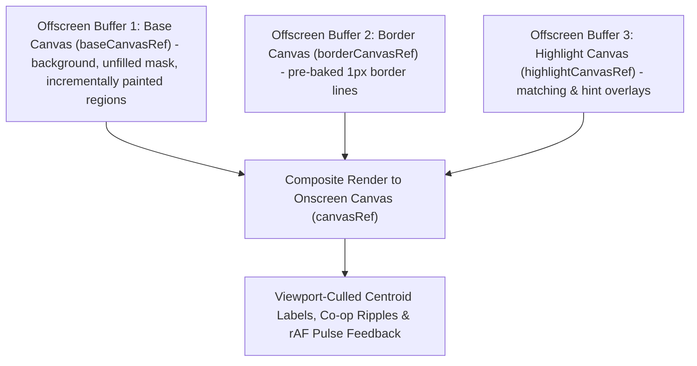
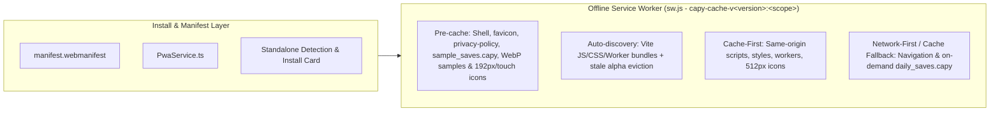

# Web Architecture & Technical Design -- Capy Web (`WEB.md`)

This document provides the complete technical reference for the Capy Web application in [`web/`](./web/), covering component layering, 3-tier offscreen canvas rendering, 6-mode touch gestures, state orchestration, Web Worker IPC, the native Android bridge, persistence schemas, and all `UserSettings` keys.

**Related Guides**: [`README.md`](./README.md) | [`ROADMAP.md`](./ROADMAP.md) | [`DEV.md`](./DEV.md) | [`AGENTS.md`](./AGENTS.md) | [`PUZZLE.md`](./PUZZLE.md) | [`APP.md`](./APP.md) | [`CLOUD.md`](./CLOUD.md) | [`TESTING.md`](./TESTING.md) | [`CHANGELOG.md`](./CHANGELOG.md)

**Table of Contents**:
1. [Architectural Overview & Design Principles](#1-architectural-overview--design-principles)
2. [Directory & Module Structure](#2-directory--module-structure)
3. [Component Hierarchy & Layering](#3-component-hierarchy--layering)
4. [State Management & Lifecycle (`App.tsx`)](#4-state-management--lifecycle-apptsx)
5. [Rendering Pipeline & Gesture Engine (`PuzzleCanvas.tsx`)](#5-rendering-pipeline--gesture-engine-puzzlecanvastsx)
6. [Background Engine & Worker Protocol](#6-background-engine--worker-protocol)
7. [Native Android Bridge (`NativeBridge.ts`)](#7-native-android-bridge-nativebridgets)
8. [Persistence, Storage Keys & `UserSettings` Dictionary](#8-persistence-storage-keys--usersettings-dictionary)
9. [Styling & Design Tokens (`index.css`)](#9-styling--design-tokens-indexcss)
10. [Progressive Web App (PWA) & Offline Caching](#10-progressive-web-app-pwa--offline-caching)
11. [Development & Build Verification](#11-development--build-verification)

---

## 1. Architectural Overview & Design Principles

Capy Web is a client-side color-by-number generator and interactive canvas player built with **React 19**, **TypeScript 7**, **Vite 8**, **Tailwind CSS 4**, and **oxlint**.

```mermaid
flowchart TB
  subgraph Shell["Application Shell (App.tsx - State & Layout)"]
    subgraph UI["Viewport & Presentation"]
      TopBar["GameTopBar"]
      Canvas["PuzzleCanvas (2D Canvas)"]
      Actions["FloatingActions"]
      Dock["PaletteDock"]
      Picker["ColorPickerPopover"]
      Settings["SettingsModal (5 Tabs)"]
      Tutorial["OnboardingTutorial (12 Steps + Topics)"]
      OfferBanner["FeatureOfferBanner (9 Contextual Tips)"]
      Spotlight["TargetSpotlightOverlay (Non-Blocking Ring + Arrow)"]
      Replay["ReplayControls"]
      Loading["LoadingOverlay"]
    end
    subgraph Engine["Engine & Background Services"]
      Worker["PuzzleWorkerService (Web Worker - 5-Strategy Engine)"]
      Codec["CapyCodec (RLE + LEB128 + Gzip .capy v2)"]
      Storage["StorageService (IndexedDB + SafeLocalStore)"]
      Offers["FeatureOffersService (Scoped + Backup)"]
      Cloud["ProviderRegistry & CloudProviderDrivers"]
      Bridge["NativeBridge (Android / WebKit / Web)"]
      Sound["SoundService (Procedural Web Audio)"]
      Daily["DailyPuzzleService (UTC Featured Rotation)"]
      Stats["PlayerStatsService (Lifetime Stats)"]
      Pwa["PwaService (Install & Offline Cache)"]
    end
  end
  UI --> Engine
  Storage --> Codec
  Cloud --> Codec
```



### Core Tenets
1. **Zero Forced Server Dependency**: Image quantization, vector segmentation, and save storage run 100% locally in the browser or WebView. Puzzles generate and play offline without mandatory accounts.
2. **60--120 FPS Canvas Rendering**: Instead of mutating thousands of DOM or SVG nodes, Capy uses a **3-tier offscreen-cached HTML5 2D Canvas pipeline** with dirty-rect updates and zero React state churn during pan/zoom/scrubbing.
3. **Responsive Non-Blocking UI**: CPU-heavy computer vision runs inside a dedicated **Web Worker** (`puzzle.worker.ts`) using transferable `ArrayBuffer` buffers.
4. **Single Source of Truth**: `web/` powers the production Cloudflare Workers PWA ([capypaint.com](https://capypaint.com/)), GitHub Pages previews ([shthed.github.io/capy](https://shthed.github.io/capy/)), and the native Android app ([`app/`](./app/)) via [`NativeBridge.ts`](./web/src/services/NativeBridge.ts).
5. **Edge-to-Edge Safe-Area Layout**: Hardware inset custom properties (`--sat`, `--sab`, `--sal`, `--sar`) keep controls clear of notches, cutouts, and gesture bars across phones, tablets, and desktops.

---

## 2. Directory & Module Structure

### Entry, Build & Public Assets
- **[`web/index.html`](./web/index.html)**: Host HTML with synchronous pre-React `www.capypaint.com -> https://capypaint.com` redirect, metadata, and safe-area viewport tags.
- **[`web/package.json`](./web/package.json)** & **[`web/tsconfig.json`](./web/tsconfig.json)**: Single source of truth for `"version"`, dependencies (`react ^19.0.0`, `vite ^8.3.8`, `typescript ^7.0.2`, `tailwindcss ^4.3.5`, `oxlint 1.94.0`), strict TS settings, and CLI scripts.
- **[`web/vite.config.ts`](./web/vite.config.ts)**: Enforces `base: './'`, lazy modal splitting, build-only SHA-256 `<meta http-equiv="Content-Security-Policy">` injection, `dist/sw.js` version + `SW_ASSETS_DIGEST` stamping, and `CAPY_ANDROID_SHA256_CERT_FINGERPRINTS` injection into `dist/.well-known/assetlinks.json`.
- **[`web/public/sw.js`](./web/public/sw.js)** & **[`web/public/manifest.webmanifest`](./web/public/manifest.webmanifest)**: Scope-isolated offline Service Worker and standalone PWA manifest (detailed in [Section 10](#10-progressive-web-app-pwa--offline-caching)).
- **[`web/public/_headers`](./web/public/_headers)** & **[`web/public/_redirects`](./web/public/_redirects)**: Cloudflare Static Assets security headers (SHA-256 CSP, HSTS, COOP, `X-Frame-Options`, `Permissions-Policy`, immutable `/assets/*` caching with unhashed overrides) and `/capy.apk` `302` redirect.
- **[`web/public/.well-known/assetlinks.json`](./web/public/.well-known/assetlinks.json)**, **[`web/public/privacy-policy.html`](./web/public/privacy-policy.html)** & **[`web/public/404.html`](./web/public/404.html)**: Android Digital Asset Links manifest, script-less Privacy Policy, and GitHub Pages expired-preview redirect page.
- **[`web/public/assets/sample_saves.capy`](./web/public/assets/sample_saves.capy)** & **[`web/public/assets/daily_saves.capy`](./web/public/assets/daily_saves.capy)**: Pre-baked Max-Detail `.capy` v2 archives for all 4 built-in gallery samples and all 20 UTC Daily Puzzle combinations.

### Core Shell, Context, Types & Styling (`web/src/`)
- **[`web/src/main.tsx`](./web/src/main.tsx)**: React 19 root mount, debug-gated `window.capyStorage`, single-shot `vite:preloadError` reload guard, and Service Worker bootstrap.
- **[`web/src/version.ts`](./web/src/version.ts)**: Exports `APP_VERSION`, `APP_VERSION_CODE`, `parseSemVer`, and `resolveReleaseChannel` (`stable | beta | alpha | dev`).
- **[`web/src/App.tsx`](./web/src/App.tsx)**: Lean composition shell wiring core state, release channel metadata, and feature hooks under `web/src/hooks/`.
- **[`web/src/context/ProviderContext.tsx`](./web/src/context/ProviderContext.tsx)**: React context injecting the auth, cloud-save, Co-op room, and catalog adapters into hooks and modals.
- **[`web/src/types/index.ts`](./web/src/types/index.ts)** & **[`web/src/index.css`](./web/src/index.css)**: Central TypeScript domain types (`PuzzleData`, `UserSettings`, `SavedSnapshot`, `GeneratorConfig`, `DEFAULT_GENERATOR_CONFIG`, `SAMPLE_GALLERY`), Tailwind CSS 4 imports, and safe-area utilities.

### Feature Hooks (`web/src/hooks/`)
- **[`useLatest.ts`](./web/src/hooks/useLatest.ts)**: SSR-safe `useIsomorphicLayoutEffect` and `useLatest<T>` ref mirror helper.
- **[`useSessionRestore.ts`](./web/src/hooks/useSessionRestore.ts)**: Launch session restoration running [`sessionRestorePipeline.ts`](./web/src/services/sessionRestorePipeline.ts) for `#s=<token>`, `?room=`, active saves, and starter sample bootstrap with cancellation guards.
- **[`useUndoRedo.ts`](./web/src/hooks/useUndoRedo.ts)**: Synchronous ref-backed undo/redo history stacks with Co-op `PAINT_EVENT`/`UNFILL_EVENT` sync.
- **[`useReplayController.ts`](./web/src/hooks/useReplayController.ts)**: Chronological replay playback, timeline scrubbing, offscreen fast-forward, and Follow Painting coordination.
- **[`useCoopSession.ts`](./web/src/hooks/useCoopSession.ts)**: Co-op room hosting/joining, `#s=` share links, and `CoopRippleBuffer` peer event emission.
- **[`useCloudSyncController.ts`](./web/src/hooks/useCloudSyncController.ts)**: Coalesced cloud library sync orchestration atop [`cloudSyncCoordinator.ts`](./web/src/services/cloudSyncCoordinator.ts) and [`ProviderContext.tsx`](./web/src/context/ProviderContext.tsx).
- **[`useTutorialAndOffers.ts`](./web/src/hooks/useTutorialAndOffers.ts)**: 12-step tutorial progression, FIFO 9-offer banner queue, backup persistence, and `TargetSpotlightOverlay` state derivation.
- **[`useViewportAndShortcuts.ts`](./web/src/hooks/useViewportAndShortcuts.ts)**: Visible region/color culling sets, fullscreen state, `350ms` debounced viewport persistence with unload flush, and desktop keyboard shortcuts.
- **[`usePaintController.ts`](./web/src/hooks/usePaintController.ts)**: Single/batch region painting (using [`paintStrokeHelper.ts`](./web/src/services/paintStrokeHelper.ts)), custom palette CRUD/presets, smart on-screen hint selection, and active session stats.
- **[`useSnapshotLibrary.ts`](./web/src/hooks/useSnapshotLibrary.ts)**: Worker puzzle generation (`generationSeqRef`), snapshot transitions, safe `blob:`-only URL revocation, prebaked sample loading, 2x detail-tile extraction, monotonic `resetEpoch` reset, and export/import callbacks.

### UI Components (`web/src/components/`)
- **Canvas & HUD**: [`PuzzleCanvas.tsx`](./web/src/components/PuzzleCanvas.tsx), [`GameTopBar.tsx`](./web/src/components/GameTopBar.tsx), [`PaletteDock.tsx`](./web/src/components/PaletteDock.tsx), [`FloatingActions.tsx`](./web/src/components/FloatingActions.tsx), [`ReplayControls.tsx`](./web/src/components/ReplayControls.tsx), [`LoadingOverlay.tsx`](./web/src/components/LoadingOverlay.tsx).
- **Modals & Overlays**: [`SettingsModal.tsx`](./web/src/components/SettingsModal.tsx) + modular tabs/controls in [`web/src/components/settings/`](./web/src/components/settings/types.ts) (`SettingsTabBar`, `SettingToggleRow`, `SettingSliderRow`, `SnapshotCard`, `AboutTab`, `FeedbackSection`, `SettingsTab`, `HintsTab`, `CreateTab`, `SavesTab`, `CloudAccountSection`), [`SettingsControls.tsx`](./web/src/components/SettingsControls.tsx), [`BrowserStorageModal.tsx`](./web/src/components/BrowserStorageModal.tsx), [`CloudAccountCard.tsx`](./web/src/components/CloudAccountCard.tsx), [`ColorPickerPopover.tsx`](./web/src/components/ColorPickerPopover.tsx), [`OnboardingTutorial.tsx`](./web/src/components/OnboardingTutorial.tsx), [`FeatureOfferBanner.tsx`](./web/src/components/FeatureOfferBanner.tsx), [`TargetSpotlightOverlay.tsx`](./web/src/components/TargetSpotlightOverlay.tsx), [`ErrorBoundary.tsx`](./web/src/components/ErrorBoundary.tsx).

### Services, Utilities & Engine (`web/src/services/`, `web/src/utils/`, `web/src/engine/`)
- **Storage & Codec**:
  - [`StorageService.ts`](./web/src/services/StorageService.ts) (thin static facade over 11 acyclic modules in [`web/src/services/storage/`](./web/src/services/storage/StorageKeys.ts): `StorageKeys`, `SafeLocalStore`, `IndexedDbStore`, `BackupEngine`, `SettingsStorage`, `ActiveSessionStorage`, `SnapshotStorage`, `SnapshotArchiveCodec`, `PuzzleSerializer`, `StorageAnalyzer`, `ImageCompression`) + [`StorageNamespace.ts`](./web/src/services/StorageNamespace.ts).
  - [`CapyCodec.ts`](./web/src/services/CapyCodec.ts) (RLE + LEB128 `.capy` v2 archives & CRDT `ProgressDeltaV2` tokens).
- **Cloud, Auth, Co-op & Catalog**:
  - [`providers/ProviderRegistry.ts`](./web/src/services/providers/ProviderRegistry.ts) (thin backward-compatible facade re-exporting domain services below).
  - [`auth/AuthManager.ts`](./web/src/services/auth/AuthManager.ts): Multi-provider identity, `attemptAutoSignIn`, `401` invalidation, and `signOut` cache clearing.
  - [`cloud/CloudLibrarySyncOrchestrator.ts`](./web/src/services/cloud/CloudLibrarySyncOrchestrator.ts) & [`cloud/slotKey.ts`](./web/src/services/cloud/slotKey.ts): Full-library CRDT manifest/blob sync and per-slot deletion tombstones.
  - [`coop/HybridCoopRoomClient.ts`](./web/src/services/coop/HybridCoopRoomClient.ts): WebSocket + `BroadcastChannel` real-time Co-op room client.
  - [`catalog/CatalogIdeasService.ts`](./web/src/services/catalog/CatalogIdeasService.ts): Local moderated `Puzzle Idea Notebook` store.
  - [`cloudSyncCoordinator.ts`](./web/src/services/cloudSyncCoordinator.ts): Coalesced sync controller and automatic background sync scheduler (`15s` debounce / `30s` visibility / `online` reconnect).
  - [`providers/types.ts`](./web/src/services/providers/types.ts), [`providers/CloudProviderDrivers.ts`](./web/src/services/providers/CloudProviderDrivers.ts), [`providers/OAuthPkceHelper.ts`](./web/src/services/providers/OAuthPkceHelper.ts), [`providers/GoogleCloudSyncClient.ts`](./web/src/services/providers/GoogleCloudSyncClient.ts), [`providers/MicrosoftCloudSyncClient.ts`](./web/src/services/providers/MicrosoftCloudSyncClient.ts), [`providers/AppleCloudSyncClient.ts`](./web/src/services/providers/AppleCloudSyncClient.ts).
- **Gameplay, Export, Bridge & Telemetry**:
  - [`paintStrokeHelper.ts`](./web/src/services/paintStrokeHelper.ts), [`DailyPuzzleService.ts`](./web/src/services/DailyPuzzleService.ts), [`PlayerStatsService.ts`](./web/src/services/PlayerStatsService.ts), [`FeatureOffersService.ts`](./web/src/services/FeatureOffersService.ts), [`SoundService.ts`](./web/src/services/SoundService.ts).
  - [`ShareLinkService.ts`](./web/src/services/ShareLinkService.ts), [`SvgPrintExporter.ts`](./web/src/services/SvgPrintExporter.ts), [`artworkExporter.ts`](./web/src/services/artworkExporter.ts), [`FeedbackService.ts`](./web/src/services/FeedbackService.ts).
  - [`NativeBridge.ts`](./web/src/services/NativeBridge.ts), [`PwaService.ts`](./web/src/services/PwaService.ts), [`PuzzleWorkerService.ts`](./web/src/services/PuzzleWorkerService.ts), [`telemetry.ts`](./web/src/services/telemetry.ts) (bounded 50-entry non-PII `reportSwallowed` ring buffer).
  - [`web/src/utils/`](./web/src/utils/base64.ts): `base64.ts`, `debugEnvironment.ts`, `snapshotPaths.ts`; [`web/src/data/presetGallery.ts`](./web/src/data/presetGallery.ts).
- **Engine (`web/src/engine/`)**:
  - [`CoopRippleBuffer.ts`](./web/src/engine/CoopRippleBuffer.ts) (zero-GC typed-array collaborator paint ripples), plus [`puzzle.worker.ts`](./web/src/engine/puzzle.worker.ts), [`PuzzleGenerator.ts`](./web/src/engine/PuzzleGenerator.ts), [`ImageAnalyzer.ts`](./web/src/engine/ImageAnalyzer.ts), [`LineArtExtractor.ts`](./web/src/engine/LineArtExtractor.ts), [`ColorQuantizer.ts`](./web/src/engine/ColorQuantizer.ts), and [`RegionSegmenter.ts`](./web/src/engine/RegionSegmenter.ts) (detailed in [`PUZZLE.md`](./PUZZLE.md)).

---

## 3. Component Hierarchy & Layering

Pointer events pass through empty overlay containers (`pointer-events-none`) directly to `PuzzleCanvas` while interactive buttons opt in with `pointer-events-auto`:

- **`z-0` (`PuzzleCanvas`)**: Full-bleed interactive pan/zoom 2D canvas.
- **`z-20` (`FloatingActions`, `PaletteDock`)**: Bottom-right tool stack and bottom horizontal swatch dock.
- **`z-30` (`GameTopBar`, `ReplayControls`)**: Top safe-area status bar and floating bottom YouTube-style replay scrubber HUD.
- **`z-[38]` (`TargetSpotlightOverlay`)**: Non-blocking spotlight highlight ring(s) and curved pointer arrow behind tutorial/offer cards.
- **`z-[39]` (`FeatureOfferBanner`)**: Contextual non-blocking quick-tip banner.
- **`z-40` (`LoadingOverlay`, `OnboardingTutorial`)**: Bottom generation HUD and top-anchored 12-step tutorial card.
- **`z-50` (`SettingsModal`, `ColorPickerPopover`)**: Modal configuration sheet and nested custom color popover.
- **`z-[60]` (`storage-quota-toast`, modal-docked `OnboardingTutorial`)**: Dismissible `QuotaExceededError` alert above modals and modal-docked tutorial guide bar across Settings Steps 8--12.
- **`z-[65]` (`BrowserStorageModal`)**: Standalone Browser Storage Analyzer & Cleaner modal rendered outside `SettingsModal`'s stacking context.

### Component Responsibilities & Key Interactions

- **[`PuzzleCanvas.tsx`](./web/src/components/PuzzleCanvas.tsx)**: Renders the puzzle via 3-tier offscreen canvas caching, hit-tests taps via `regionMap`, renders Co-op ripples, and centers `sourceImage` previews while `puzzle.worker.ts` runs.
- **[`GameTopBar.tsx`](./web/src/components/GameTopBar.tsx)**:
  - Uses a two-lane flex layout (`topbar-left-lane` scrollable pill strip + `topbar-right-lane` fixed-shrink actions) so narrow `360px` mobile screens never clip or overlap in Normal or Large Text modes.
  - Displays puzzle title, `computeProgressPercentage` badge (capped at `99%` until `100%` complete), non-production `BETA` / `ALPHA #<num>` pill, sub-tile parent breadcrumb pill (`topbar-parent-puzzle-btn`), opt-in Co-op button/presence pill (`isCloudCoopUiEnabled()`), preview eye toggle, web-only fullscreen toggle (hidden on `NativeBridge.isAndroid`), upload shortcut, and Settings button—all `>= 38px` mobile touch targets with `aria-label`s.
- **[`PaletteDock.tsx`](./web/src/components/PaletteDock.tsx)**:
  - Always visible on incomplete puzzles (including during replay). Tapping any swatch during replay immediately dismisses `ReplayControls` and selects that color without triggering a hint; tapping an already-active swatch outside Step 1 requests a directional region hint.
  - Strictly preserves sorted swatch order (`NUMBER | REMAINING | HUE | LIGHTNESS`), centers active swatches at `50%` on scrollable docks (preserving short-dock `mx-auto` centering), and exposes `+` for `ColorPickerPopover`.
- **[`FloatingActions.tsx`](./web/src/components/FloatingActions.tsx) & Global Keyboard Shortcuts**:
  - Hosts Undo (`Ctrl+Z`, enabled by default; long-press `>= 450ms` opens `ReplayControls`), conditional Redo (`Ctrl+Y` / `Ctrl+Shift+Z`), Watch Puzzle Replay, Paint Mode brush toggle, optional zoom `+/-`, and fit-to-screen reset (`>= 44px` touch targets).
  - Desktop shortcuts (ignored when modals are open or focus is in text inputs): `1`--`9` select swatches, `+/-` zoom, `0` resets view, Arrow/WASD pan `64px` clamped via `clampCanvasOffset`, and `Escape` pops the topmost overlay (`BrowserStorageModal` / inline rename -> `ColorPickerPopover` -> `SettingsModal` -> `ReplayControls`).
- **[`SettingsModal.tsx`](./web/src/components/SettingsModal.tsx) (`<= 8` grouped prop contracts, `role="dialog"`, restores `capy_last_settings_tab`, defaults first-time opens to Tab 1)**:
  - **Tab 0 -- About**: App overview, primary **Send Feedback** CTA (inline anonymous form), **Replay Interactive Tutorial**, **Privacy Policy** (external browser on Android), collapsible **Open Source Licenses**, footer **Report Bug / Ideas**, 2-column **Lifetime Stats**, version badge, PWA install / APK download, and web-only **Release Channel** switcher (`Co-op` copy gated behind `showCloudCoopUi`).
  - **Tab 1 -- Settings**: 6 grouped cards (*Accessibility* first with `Large Text & Buttons`, independent `Text Size` `85%`--`150%` and `UI Size` `85%`--`140%` sliders, `Fat-Finger Tap Assist` + `Finger Reach Radius`, and `Reduced Motion`; *UI*; *Gameplay*; *Controls & On-Screen Buttons*; *Navigation & Zoom*; *Sound & Haptics*) plus 2 collapsed sections (*Replay* and *Number Label Sizing*).
  - **Tab 2 -- Hints**: *Hint Appearance* (`highlightStyle`, `hintFillStyle`, `hintColorArgb` defaulting to Amber `#f59e0b`, `hintIntensity`), *Assistance & Animation* (`highlightMatching`, `animateHint`, `showNextRegionHint`), and *Coloring Mode & Difficulty* (`difficulty`, `regionColorMode`).
  - **Tab 3 -- Create**: Resyncs `localConfig` on open; shows UTC **Puzzle of the Day** hero card (prebaked `daily_saves.capy`), Style & Hint quick-jump bar, gallery search & category chips, **Choose Photo from Device**, **Infinite Zoom 2x Detail Tile**, collapsible Preset Style Gallery, `GeneratorConfig` controls with `(i)` tooltips and **Detailed Generation Progress**, and the local **Puzzle Idea Notebook**.
  - **Tab 4 -- Saves**: Saved puzzles grid (`Thumbnails` default / `Detail` toggle), sort/pin/load/replay/rename/export `.svg`/`.capy`/import/`Reset Progress` controls, **Browser Storage** button opening `BrowserStorageModal`, and a clean local share/print bar by default (expanding the **Cloud Sync & Simultaneous Co-op Hub** when `showCloudCoopUi` is enabled).
- **[`OnboardingTutorial.tsx`](./web/src/components/OnboardingTutorial.tsx), [`FeatureOfferBanner.tsx`](./web/src/components/FeatureOfferBanner.tsx) & [`TargetSpotlightOverlay.tsx`](./web/src/components/TargetSpotlightOverlay.tsx)**:
  - **Tutorial**: 12 interactive US-English steps (`Pick a Color` through `Customize Hints`) with `[All Topics]` jump drawer, live-try auto-advance (`750ms`, paused while modals/loading/topics are open), header `Large Text` toggle, and bottom-docked modal-aware bar (`z-[60]`) across Settings/Hints Steps 8--12.
  - **Feature Offers**: 9 contextual quick tips (`paint_mode`, `undo_replay`, `replay_scrubber`, `free_color`, `create_gallery`, `photo_upload`, `infinite_zoom`, `saves_export`, plus one-time `settings_hints_tip` for returning tutorial completers) queued FIFO with `Jump to Guide` and backup persistence.
  - **Spotlight**: Non-blocking glowing rings (`preventRingOverlap`) and curved SVG arrow tracking targets via `ResizeObserver`/`MutationObserver` (including modal-aware spotlighting inside `SettingsModal`), disabling pulse animations under `reducedMotion`.
- **[`ReplayControls.tsx`](./web/src/components/ReplayControls.tsx), [`ColorPickerPopover.tsx`](./web/src/components/ColorPickerPopover.tsx), [`LoadingOverlay.tsx`](./web/src/components/LoadingOverlay.tsx) & [`ErrorBoundary.tsx`](./web/src/components/ErrorBoundary.tsx)**:
  - `ReplayControls`: Compact mobile-safe YouTube-style scrubber (`0.5x`--`20x`, Follow Painting, Auto-Loop, Skip-to-End, Exit) stacked above `PaletteDock` on incomplete puzzles.
  - `ColorPickerPopover`: 5 curated Free Color theme palettes and live HSL/Hex swatch editor.
  - `LoadingOverlay`: Fast Simple Progress default with live toggle to Detailed 6-Stage Inspector.
  - `ErrorBoundary`: Non-destructive emergency `.capy`/`.json` backup download, redacted error display, and retry recovery.

---

## 4. State Management & Lifecycle (`App.tsx`)

### 1. Active Session, Undo & Redo State
- `puzzle: PuzzleData | null`: Active dimensions, `PaletteColor[]`, `Region[]`, `regionMap: Int32Array`, and `borderMap: Uint8Array`.
- `sourceImage: HTMLImageElement | null`: Decoded source image displayed cleanly on canvas while `puzzle.worker.ts` runs and used for `DETAIL` / B&W `multiply` compositing.
- `activeColorId: number`: Selected 1-based palette color ID.
- `filledRegionIds: Set<number>`: Colored region IDs preserving exact first-fill chronological insertion order across saves, reloads, and Free Color repaints (repainting updates `paintedRegionColors` without moving the region ID to the tail).
- `paintedRegionColors: Map<number, number>`: Region ID $\rightarrow$ 1-based palette Color ID overrides in Free Color mode.
- `undoStack: UndoHistoryEntry[]` & `redoStack: UndoHistoryEntry[]`: Synchronous ref-backed stacks recording `{ regionId, wasPreviouslyFilled, previousPaintedColorId, paintedColorId }`, broadcasting `'PAINT_EVENT'` for Free Color repaints or `'UNFILL_EVENT'` when undoing a first-time fill across Co-op peers.
- `hintRegionId: number | null` & `isPreviewMode: boolean`: Active hint target and unmasked source-artwork preview state.

### 2. Chronological Replay & Historical Resumption State
- **Zero-Allocation Incremental Scrubbing**: During playback and pointer scrubbing, [`PuzzleCanvas.tsx`](./web/src/components/PuzzleCanvas.tsx) mutates `paintedCacheRef.current` and `prevColorsRef.current` in place and repaints only the dirty bounding box via `putImageData`.
- **Automatic Offscreen Step Fast-Forward**: When `settings.replayFollow` is `false`, `isRegionVisibleInViewport` skips consecutive offscreen regions in $O(1)$.
- **Follow Painting Camera Controller (`settings.replayFollow`)**: When `true` and zoomed in (`scale > 1.05`), `stepFollow` runs a zero-allocation 60 FPS loop with a Safe-Frame Dead-Zone, 10-step Predictive Lookahead, and Critically-Damped 2D Velocity Spring-Damper (`SmoothDamp`) without mutating zoom, disengaging automatically on manual pan.
- **Strict Viewport Invariance**: Starting or ending a replay never resets or teleports the camera; loading a *different* saved puzzle restores its persisted `zoomScale`, `panOffsetX`, and `panOffsetY` before replay begins.

### 3. Viewport Culling & Generation Sequence Safety
- **Spatial Culling**: `PuzzleCanvas` emits `visibleColorIds` and `visibleRegionIds` on pan/zoom/resize changes to power on-screen Smart Hint region targeting while `PaletteDock` strictly preserves sorted order.
- **Sequence Cancellation (`generationSeqRef`)**: Every worker generation increments `generationSeqRef.current`, cancels any in-flight worker, and discards stale responses.

---

## 5. Rendering Pipeline & Gesture Engine (`PuzzleCanvas.tsx`)



### Dynamic Active Color, Hints & Inscribed-Circle Labels
- **Borderless Completed Regions (`writeBaseCanvasPixels` / `writeRegionPixelsToImageData`)**: Completed regions render seamlessly with their Detail source pixels or Flat/Free Color palette fill and omit region boundary lines, while unpainted regions retain 1px slate (`rgb(51, 65, 85)`) boundaries in standard mode.
- **Active Color Highlighting**: When `highlightStyle` is `FULL_REGION` (default) or `BOUNDARY_ONLY`, unfilled regions matching `activeColorId` highlight using the selected `PaletteColor` (`{ id, r, g, b, argb, hex }`, 1-based `id`).
- **Hint Highlighting (`hintColorArgb`) & `NUMBER_ONLY`**: Hints render `SOLID`, `CHECKER`, or `STRIPES` overlays in `settings.hintColorArgb` (`#F59E0B` default). `NUMBER_ONLY` tints label text with a crisp white stroke halo rather than drawing centroid circles (reserved for `CENTROID_GLOW`).
- **Inscribed-Circle Label Fitting**: Labels render at each region's Pole of Inaccessibility (`centroidX`, `centroidY`), sized from `region.maxRadius / sqrt((0.3 * charCount)^2 + 0.1444)` with a 10% margin and clamped to `[minLabelSize, maxLabelSize]`.

### Viewport Clamping (`clampCanvasOffset`), Magnetic Detents & Zero-Alloc Rendering
- **Zoom Range, Sensitivity & Magnetic Detents**: Clamped between **`0.5x`** and **`12.0x`**. Wheel, pinch (`Math.pow(rawRatio, zoomSensitivity)`), and double-tap drag deltas scale smoothly in log-space by `zoomSensitivity` (`0.5`--`2.0`). When `snapZoomLevels` is enabled, `applyZoomSnapDetent` snaps within `+-4%` onto stops `[1, 2, 4, 8, 12]` around the active focal point.
- **Dynamic Corner Margins**: Scales pan bounds with `containerWidth * 0.72` and `containerHeight * 0.72` when zoomed in so all four corners pan past screen center cleanly.
- **Resize Clamping & Zero-Alloc Hot Paths**:
  - `ResizeObserver` on `containerRef` (with `window` `resize` fallback) immediately re-clamps `offsetRef.current`, refreshes `canvasRectRef`, resizes the high-DPI `<canvas>`, and repaints synchronously on rotation or split-screen resize.
  - `PuzzleCanvas`, `GameTopBar`, `FloatingActions`, `PaletteDock`, and `ReplayControls` are memoized via `React.memo`.
  - `drawCompositeFrame` reads refs directly without effect churn; `highlightImageDataRef` reuses its buffer via `fill(0)`; wheel zoom uses `{ passive: false }`; idle hint pulse throttles to `~20fps` (`>= 50ms`); and `App.tsx` maintains an $O(1)$ `regionByIdRef` map.

### 6-Mode Touch, Mouse & Gesture Engine
`PuzzleCanvas` orchestrates **6 distinct** interaction modes:
1. **Tap Hit-Testing (`resolveNearTapRegionId`)**:
   - Direct hits resolve in $O(1)$ via `regionMap[y * width + x]`.
   - When `fatFingerAssist` is `true`, near-miss taps scan integer offsets within `Math.min(64, touchReachRadiusPx / totalScreenScale)` with zero heap allocations: Normal mode snaps strictly to unfilled `activeColorId`; Easy or Free Color mode prefers `activeColorId` first, then the closest unfilled micro-region.
   - Easy mode auto-selects and fills tapped unpainted regions; Normal mode requires matching `activeColorId`; Free Color mode fills or repaints with `activeColorId`.
2. **One-Finger Double-Tap-and-Drag Zoom & Horizontal Pan**: Second tap-and-hold within `350ms` and `40px` zooms focal-point-invariantly on vertical drag (`Math.exp(((dir * dy) / 220) * zoomSensitivity)`), while horizontal drag (`|dx| >= |dy|`) pans cleanly even in Paint Mode.
3. **Background Margin Drag Panning**: Touching outside artwork bounds always pans the viewport even when Paint Mode is active.
4. **Smooth Pan Momentum (Inertial Gliding)**: Samples pointer velocity over `100ms` via a pre-allocated 16-slot circular `pointerRingRef` buffer; flicks $\ge 0.18\text{ px/ms}$ glide with $0.92^{\Delta t / 16}$ exponential friction decay and cancel instantly on the next `pointerdown`.
5. **Multi-Touch Pinch-to-Zoom**: Two-finger midpoint focal tracking (`0.5x`--`12.0x`) scaled by `Math.pow(rawRatio, zoomSensitivity)`, re-anchoring single-finger pan when one finger lifts.
6. **Drag-to-Color (Continuous Paint Mode)**: Interpolates stroke segments across pointer moves inside the artwork and batch-fills matching regions via `onBatchRegionsClicked` (disabled automatically during replay).

---

## 6. Background Engine & Worker Protocol

Image quantization and segmentation execute in [`puzzle.worker.ts`](./web/src/engine/puzzle.worker.ts) via [`PuzzleWorkerService.ts`](./web/src/services/PuzzleWorkerService.ts) (code-split so [`PuzzleGenerator.ts`](./web/src/engine/PuzzleGenerator.ts) is imported dynamically only when a main-thread fallback is needed):

```typescript
// Main -> Worker Requests
type WorkerRequest =
  | {
      type: 'GENERATE';
      id: string;
      width: number;
      height: number;
      rgbaBuffer: ArrayBuffer; // Transferred zero-copy
      config: GeneratorConfig;
      detailedProgress?: boolean;
    }
  | {
      type: 'SET_DETAILED_PROGRESS';
      detailed: boolean; // Live HUD toggle without restarting worker
    };

// Worker -> Main Responses
type WorkerResponse =
  | {
      type: 'PROGRESS';
      id: string;
      progress: number; // Strictly monotonic 0.0 to 1.0
      status: string;
      payload?: GenerationProgressPayload; // Step 1..6 + GenerationInspectionDetails
    }
  | {
      type: 'SUCCESS';
      id: string;
      puzzleData: {
        width: number;
        height: number;
        palette: PaletteColor[];
        regions: Array<Omit<Region, 'pixels'> & { pixelsOffset: number; pixelsLength: number }>;
        packedPixelsBuffer: ArrayBuffer; // Single contiguous Int32Array sliced via subarray on main thread
        regionMap: ArrayBuffer; // Reconstructed to Int32Array on main thread
        borderMap: ArrayBuffer; // Reconstructed to Uint8Array on main thread
        isFreeColor?: boolean;
      };
    }
  | {
      type: 'ERROR';
      id: string;
      error: string;
    };
```

---

## 7. Native Android Bridge (`NativeBridge.ts`)

[`NativeBridge.ts`](./web/src/services/NativeBridge.ts) is the defensive TypeScript wrapper over Android `window.CapyAndroid` and WebKit `window.webkit.messageHandlers.CapyIOS`, providing transparent web fallbacks when running in browsers (see [`APP.md` Section 2](./APP.md#2-component--javascriptinterface-reference) for the complete 19-method Kotlin `@JavascriptInterface` specification and security guards):

- **UI & Hardware**: `haptic(type)` (falls back to `navigator.vibrate`), `applySafeAreaInsets()` (mirrors `--safe-area-*` CSS variables), `pushBackHandler` / `setBackModalOpen` (LIFO modal stack synced with Android's `OnBackPressedCallback`), and `getAppVersion()`.
- **Storage & Cloud Sync**: `saveBackup` / `loadBackup` (`filesDir/capy_saves/`), `isPlayGamesConfigured` / `signInPlayGames` / `onPlayGamesProfile`, `saveCloudSnapshot` / `loadCloudSnapshot` / `saveCloudBinaryChunk` / `loadCloudBinaryChunk` / `requestCloudSnapshotPull` / `onCloudSnapshot` / `onCloudSnapshotError` (web fallback uses `capy_cloud_vault_v1`), and `openExternalOAuth(authUrl)` (external-browser PKCE handoff via `window.__capyReceiveOAuthCallback`).
- **Sharing & Incoming Intents**: `onSharedImage` and `onDeepLink` (consuming cold-start queues plus live callbacks), and `shareTextLink` / `shareImage` / `exportOrShareFile` (falling back to `navigator.share`, clipboard copy, or deferred-revoke `<a download>` on web).

---

## 8. Persistence, Storage Keys & `UserSettings` Dictionary

### Hybrid Storage Architecture
1. **IndexedDB (`capy_game_storage_v8` in [`IndexedDbStore.ts`](./web/src/services/storage/IndexedDbStore.ts) via [`StorageService.ts`](./web/src/services/StorageService.ts))**:
   - Awaits full `IDBTransaction` completion with `onblocked`, `onversionchange`, and `onclose` recovery, evicts and retries once on reclaimed `InvalidStateError` handles across reads and writes, fails closed on quota errors (firing `onQuotaWarning` before `localStorage` commits), calls `navigator.storage.persist()` once, and debounces Android `NativeBridge.saveBackup` disk flushes.
   - **`puzzles` store (`STORE_PUZZLES`)**: Stores `CompactPuzzleRecordV2` (scanline RLE + LEB128 varints, `~20--45 KB` vs. `~9.4 MB` raw `Int32Array`, reconstructing in `< 3ms`). If storage pressure evicts `puzzles` while `localStorage` survives, `App.tsx` regenerates from `sourceRef` and reapplies `snapshot.customPalette` and `snapshot.isFreeColor` via `mergeCustomPalette`.
   - **`images` store (`STORE_IMAGES`)**: Stores custom uploaded/shared photo `Blob`s (`sourceRef = { kind: 'blob', uri: snapId }`) and offloaded save thumbnails (`preview_${id}`, attached from a bounded `128`-entry LRU `previewCache`). Built-in samples reference `{ kind: 'sample', uri: 'assets/capy_forest.webp' }` (and `assets/capybara.webp`, `assets/mushrooms.webp`, `assets/snail_guitar.webp`) with zero blob duplication. Oversized custom photos (`> 350 KB` or `> 2048px`) are downscaled to `<= 2048px` and encoded to WebP (`quality: 0.85`, with `#ffffff`-matted JPEG fallback) via [`ImageCompression.ts`](./web/src/services/storage/ImageCompression.ts), keeping the original blob if compression is not smaller.
   - **Browser Storage Analyzer & Safe Cleanup ([`StorageAnalyzer.ts`](./web/src/services/storage/StorageAnalyzer.ts) & [`BrowserStorageModal.tsx`](./web/src/components/BrowserStorageModal.tsx))**: Opened from `Settings -> Saves -> Browser Storage`, reports `navigator.storage.estimate()` totals, `CacheStorage`, `IndexedDB` (`puzzles`, `images`, `preview_*`, **Orphaned Records**, sibling channel DBs), and `SafeLocalStore` keys. All 4 cleanup actions strictly scope deletions to Capy Paint keys/caches/DBs so sibling apps on shared origins remain untouched.
2. **Binary `.capy` v2 Archives & CRDT Progress Deltas ([`CapyCodec.ts`](./web/src/services/CapyCodec.ts))**:
   - `StorageService.exportSnapshotBinary` / `exportAllSnapshotsBinary` emit `CAPY\x02<flags>` Gzip archives embedding `SavedSnapshot` metadata, `CompactPuzzleRecordV2` geometry, and custom blobs (`16 MiB` single-save ceiling; `256 MiB` multi-save archive ceiling gated on `FLAG_ARCHIVE`).
   - `CapyCodec.encodeProgressDeltaToken` / `mergeProgressDeltas` encode `< 2 KB` `#s=<token>` URL fragments with epoch-scoped CRDT Set-Union (`filledRegionIds`) + Last-Writer-Wins (`paintedRegionColors`) merging.
3. **Instant First-Launch Sample & Daily Archives (`./assets/sample_saves.capy`, `./assets/daily_saves.capy`) & Atomic `.capy` Imports**:
   - On cold start with zero saves, `restoreSession` imports all 4 pre-baked Max-Detail `SAMPLE_GALLERY` puzzles (`2048p`, `2000` max regions, `64` colors or `20` colors in Free Color mode, `24 px²` min region area) from `./assets/sample_saves.capy` with zero worker spawn (`Capy Forest` default index `0`).
   - Clicking **Play Daily** selectively imports the matching `daily-<sampleId>-<presetId>` puzzle from `./assets/daily_saves.capy` via `filterSnapshotId`.
   - `StorageService.importSnapshotData` validates and decompresses all records and blobs in memory before mutating storage, while `quarantineCorruptLocalPayload` isolates malformed `localStorage` payloads (`<key>__corrupt_quarantine`) and recovers native backups without clobbering them.

### Complete Browser Storage Key Inventory (`localStorage` & `sessionStorage`)
Centralized in [`web/src/services/storage/StorageKeys.ts`](./web/src/services/storage/StorageKeys.ts) (accessed via [`SafeLocalStore.ts`](./web/src/services/storage/SafeLocalStore.ts)):

- **Core Gameplay & UI State (`localStorage`)**:
  - `capy_snapshots_v8` (backed up to Android): `SavedSnapshot[]` metadata with `previewDataUrl` offloaded to IndexedDB (`preview_${id}`).
  - `capy_active_session_v8`: Active `SavedSnapshot.id`.
  - `capy_user_settings_v8`: Persisted `UserSettings` JSON.
  - `capy_last_settings_tab`: Last active `SettingsModal` tab index (`'0'`--`'4'`).
  - `capy_saves_view_mode`: Saves tab layout (`'DETAIL' | 'THUMBNAILS'`, defaults to `'THUMBNAILS'`).
  - `capy_tutorial_completed_v1` (backed up): `'1'` once the first-run `OnboardingTutorial` is finished or skipped.
  - `capy_feature_offers_v1` (backed up): JSON array of seen `FeatureOfferId` keys (`paint_mode`, `undo_replay`, `replay_scrubber`, `free_color`, `create_gallery`, `photo_upload`, `infinite_zoom`, `saves_export`, `settings_hints_tip`).
  - `capy_undo_default_migrated_v1`: One-time migration marker enabling `enableUndo: true` for pre-existing installs.
  - `capy_player_stats_v1` (backed up): `PlayerLifetimeStats` counters.
  - `capy_community_ideas_v1`: Local moderated `CommunityPuzzleIdea` notebook entries.
  - `capy_ai_credits_v1`: `AiCreditLedger` (`adFreePlatform: true`, `personalizedAdsConsent: false`).
- **Identity, Cloud Sync & BYOC Auth (`localStorage` & `sessionStorage`)**:
  - `capy_player_identity_v1` (`localStorage`): Local or authenticated `PlayerIdentity`.
  - `capy_cloud_vault_v1` (`localStorage`): Local fallback key-value vault for `CloudSaveEnvelope` slots.
  - `capy_cloud_library_manifest_v2` (`localStorage`): Local mirror of `CloudLibraryManifestV2`.
  - `capy_cloud_tombstones_v1` (`localStorage`): Per-slot deletion timestamps preventing stale cloud save resurrection.
  - `capy_cloud_explicit_signout_v1` (`localStorage`): Suppresses silent auto-sign-in after explicit sign-out.
  - `capy_google_oauth_token_v1` (`sessionStorage`) & `capy_google_oauth_client_id_v1` (`localStorage` dev override).
  - `capy_microsoft_oauth_token_v1` (`sessionStorage`) & `capy_microsoft_oauth_client_id_v1` (`localStorage` dev override).
  - `capy_apple_cloud_session_v1` (`sessionStorage`), plus `capy_apple_client_id_v1`, `capy_apple_cloudkit_container_v1`, and `capy_apple_cloudkit_api_token_v1` (`localStorage` dev overrides).
  - `capy_tab_peer_suffix_v1` (`sessionStorage`): Per-tab unique suffix isolating multi-tab `BroadcastChannel` Co-op peers.
- **Diagnostics, Recovery & Feature Flags**:
  - `capy_preload_reload_v1` (`sessionStorage`): Single-shot Vite dynamic-import preload-error reload guard in [`main.tsx`](./web/src/main.tsx).
  - `capy_dev_debug` (`localStorage`): Opt-in `'1'` flag exposing `window.capyStorage` and debug console telemetry in production builds ([`debugEnvironment.ts`](./web/src/utils/debugEnvironment.ts)).
  - `capy_dev_cloud_coop_ui` (`localStorage`): Opt-in `'1'` flag revealing the Cloud Sync & Co-op UI without `?coop=1` / `?room=` ([`StorageNamespace.ts`](./web/src/services/StorageNamespace.ts)).
- **Channel Sandbox Isolation ([`StorageNamespace.ts`](./web/src/services/StorageNamespace.ts))**: On `alpha` (`/capy/alpha/<num>/`) and `beta` (`/capy/beta/`) channels (unless overridden via `?capy_sandbox=0`), all scoped storage/backup keys suffix `__sandbox_${channel}`, IndexedDB uses `capy_game_storage_v8_${channel}`, and `BroadcastChannel` Co-op rooms isolate by channel so previews never mutate Production saves.

### 8.1 Comprehensive `UserSettings` Reference (`capy_user_settings_v8`)

Interface defined in [`web/src/types/index.ts`](./web/src/types/index.ts); canonical `DEFAULT_SETTINGS` defined in [`web/src/services/storage/SettingsStorage.ts`](./web/src/services/storage/SettingsStorage.ts):

- **`autoAdvance`**: `boolean` (default `true`) -- Advances automatically to the next incomplete palette color when all regions of the active swatch are completed.
- **`difficulty`**: `'EASY' | 'NORMAL'` (default `'EASY'`) -- `'EASY'` auto-selects a tapped region's color and fills it; `'NORMAL'` requires matching `activeColorId`.
- **`fatFingerAssist`**: `boolean` (default `true`; auto-enabled when turning on `largeText` or adjusting reach controls; explicit `false` opt-outs preserved) -- Zero-allocation radial near-tap snapping onto adjacent unfilled micro-regions while preserving exact-region repainting in Free Color mode and preventing single-tap double-painting in Paint Mode.
- **`touchReachRadiusPx`**: `number` (default `22`, range `8`--`40` CSS px, presets `12` / `22` / `34`) -- Screen-space finger reach radius scaled by `Math.min(64, touchReachRadiusPx / totalScreenScale)`; dynamically boosted to `>= 34px` while `largeText` / `uiScale > 1.0` is active without mutating the saved value.
- **`isPaintMode`**: `boolean` (default `false`) -- Enables continuous drag-to-color brush painting.
- **`isFreeColorMode`**: `boolean` (default `false`) -- Enables Free Color / Coloring Page mode allowing arbitrary swatch assignment and repainting.
- **`raisePaletteDock`**: `boolean` (default `true`) -- Floats `PaletteDock` comfortably above mobile gesture bars.
- **`regionColorMode`**: `'SOLID' | 'DETAIL'` (default `'DETAIL'`) -- Renders filled regions in flat quantized swatch color (`SOLID`) or original photographic texture (`DETAIL`).
- **`canvasBgColor`**: `'BLACK' | 'DARK_SLATE' | 'CHARCOAL' | 'LIGHT_GRAY' | 'PURE_WHITE' | 'CUSTOM'` (default `'CHARCOAL'`) -- Viewport background preset around the artwork.
- **`canvasBgArgb`**: `number` (default `0xff18181b` / `#18181B`) -- 32-bit ARGB color used when `canvasBgColor === 'CUSTOM'`.
- **`saveSortOrder`**: `'LAST_ACTIVE' | 'DATE' | 'PERCENT_COMPLETE'` (default `'LAST_ACTIVE'`) -- Sort order in the Saves tab (pinned saves stay grouped at top).
- **`highlightStyle`**: `'CENTROID_GLOW' | 'NUMBER_ONLY' | 'FULL_REGION' | 'BOUNDARY_ONLY'` (default `'FULL_REGION'`) -- Visual cue style for unpainted regions matching `activeColorId`.
- **`hintFillStyle`**: `'SOLID' | 'CHECKER' | 'STRIPES'` (default `'CHECKER'`) -- Pattern rendered over the targeted hint region.
- **`hintColorArgb`**: `number` (default `0xfff59e0b` / `#F59E0B`) -- 32-bit ARGB highlight color for active hints (matches the first Amber preset swatch).
- **`showRegionLabels`**: `boolean` (default `true`) -- Shows Pole-of-Inaccessibility region numbers on unpainted regions.
- **`showPreviewLabels`**: `boolean` (default `false`) -- Keeps region numbers visible while holding/toggling Preview mode.
- **`showPreviewBorders`**: `boolean` (default `false`) -- Keeps 1px region borders visible in Preview mode.
- **`highlightMatching`**: `boolean` (default `true`) -- Toggles active-swatch region highlighting on the canvas.
- **`animateHint`**: `boolean` (default `true`) -- Drives a zero-React-re-render `requestAnimationFrame` pulse on hinted regions (when `reducedMotion` is `false`).
- **`showNextRegionHint`**: `boolean` (default `true`) -- Targets and highlights the nearest unpainted matching region when requesting a hint.
- **`hintIntensity`**: `number` (default `0.65`, range `0.0`--`1.0`) -- Opacity multiplier for hint and active-color overlays.
- **`minLabelSize`**: `number` (default `6`, range `2`--`14` px) -- Minimum rendered label font size before tiny labels hide until zoomed in.
- **`maxLabelSize`**: `number` (default `18`, range `10`--`36` px) -- Maximum rendered label font size in large open regions.
- **`labelScale`**: `number` (default `1.0`, range `0.5`--`2.0`) -- Global multiplier applied to region number font sizes.
- **`showZoomButtons`**: `boolean` (default `false`) -- Shows onscreen `+` / `-` zoom buttons in `FloatingActions`.
- **`showResetViewButton`**: `boolean` (default `false`) -- Shows onscreen fit-to-screen reset button in `FloatingActions`.
- **`paletteSort`**: `'NUMBER' | 'REMAINING' | 'HUE' | 'LIGHTNESS'` (default `'HUE'`) -- Swatch ordering in `PaletteDock`.
- **`prioritizeOnScreen`**: `boolean` (default `false`) -- Legacy compatibility flag; `PaletteDock` strictly preserves sorted order and centers active swatches at `50%` on scrollable docks.
- **`hapticsEnabled`**: `boolean` (default `true`) -- Enables native Android / `navigator.vibrate` tactile feedback.
- **`panMomentum`**: `boolean` (default `true`) -- Enables smooth inertial gliding on canvas pan flicks (skipped when `reducedMotion` is `true`).
- **`enableCustomColorForAllPuzzles`**: `boolean` (default `false`) -- Unlocks custom swatch editing in standard Color-by-Number puzzles as well as Free Color puzzles.
- **`enableUndo`**: `boolean` (default `true`) -- Shows Undo/Redo controls on standard puzzles (migrated on once for existing installs; always enabled in Free Color mode).
- **`replaySpeed`**: `number` (default `1`, options `0.5 | 1 | 2 | 5 | 10 | 20`) -- Playback speed multiplier for chronological puzzle replays.
- **`replayLoop`**: `boolean` (default `false`) -- Holds completed replays at `100%` for `350ms` and restarts from step `0` when manually enabled during replay (reset to `false` on save load).
- **`replayFollow`**: `boolean` (default `false`) -- Enables predictive safe-frame camera tracking during replay when zoomed in (`scale > 1.05`).
- **`autoReplayOnLoad`**: `boolean` (default `false`) -- Replays completed regions chronologically upon loading a saved puzzle before resuming live gameplay in place.
- **`reverseDoubleTapZoom`**: `boolean` (default `false`) -- Inverts one-finger double-tap drag zoom direction (`false`: down = zoom in; `true`: up = zoom in).
- **`zoomSensitivity`**: `number` (default `1.0`, range `0.5`--`2.0`) -- Log-space multiplier scaling wheel, pinch, double-tap drag, and `+/-` zoom speed.
- **`snapZoomLevels`**: `boolean` (default `false`) -- Snaps relative zoom onto magnetic stops (`1x`, `2x`, `4x`, `8x`, `12x`) within `+-4%`.
- **`soundEnabled`**: `boolean` (default `true`) -- Enables zero-asset procedural Web Audio tap synthesis (`SoundService.ts`).
- **`soundVolume`**: `number` (default `0.7`, range `0.0`--`1.0`) -- Master gain scalar for Web Audio effects.
- **`reducedMotion`**: `boolean` (seeded from `prefers-reduced-motion: reduce`, fallback `false`) -- Skips camera glides, pan momentum, and hint-pulse oscillations.
- **`largeText`**: `boolean` (default `false`) -- Preset toggle synced with `textScale > 1.0 || uiScale > 1.0` (`>= 1.25` when enabled, plus `fatFingerAssist: true`; resets both to `1.0` when disabled).
- **`textScale`**: `number` (default `1.0`, range `0.85`--`1.50`, step `0.05`) -- Independent typography scale multiplier (`--capy-text-scale`) boosting UI text and `PuzzleCanvas` `maxLabelSize`.
- **`uiScale`**: `number` (default `1.0`, range `0.85`--`1.40`, step `0.05`) -- Independent control scale multiplier (`--capy-ui-scale`) scaling HUD pills, buttons, switches, sliders, swatches, and applying a non-destructive `>= 34px` reach boost when `> 1.0`.
- **`detailedLoadingProgress`**: `boolean` (default `false`) -- Switches `LoadingOverlay` between Simple Fast Mode (`false`) and Detailed 6-Stage Inspector Mode (`true`).
- **`generatorConfig`**: `GeneratorConfig` (default `DEFAULT_GENERATOR_CONFIG` in [`web/src/types/index.ts`](./web/src/types/index.ts)) -- Persisted puzzle segmentation parameters (documented in [`PUZZLE.md`](./PUZZLE.md)).

---

## 9. Styling & Design Tokens (`index.css`)

Capy Web uses **Tailwind CSS 4** paired with hardware safe-area CSS variables:

```css
:root {
  --sat: max(env(safe-area-inset-top, 0px), var(--safe-area-top, 0px));
  --sab: max(env(safe-area-inset-bottom, 0px), var(--safe-area-bottom, 0px));
  --sal: max(env(safe-area-inset-left, 0px), var(--safe-area-left, 0px));
  --sar: max(env(safe-area-inset-right, 0px), var(--safe-area-right, 0px));
}
```

- **Gesture Isolation**: `touch-action: none; overscroll-behavior: none; user-select: none;` prevents browser pinch-zooming, pull-to-refresh, or text selection over the canvas.
- **Palette**: Dark slate surfaces (`#0f172a`, `#1e293b`) paired with warm amber accents (`#fbbf24`, `#f59e0b`).

---

## 10. Progressive Web App (PWA) & Offline Caching



1. **Web App Manifest ([`manifest.webmanifest`](./web/public/manifest.webmanifest))**: Standalone display mode (`display: "standalone"`), `#000000` theme/background colors, maskable adaptive icons, and relative `./` start URL/scope so root (`/capy/`) and PR previews (`/capy/alpha/<number>/`) work identically.
2. **Offline Service Worker ([`web/public/sw.js`](./web/public/sw.js))**:
   - Pre-caches the app shell (`./`, `./index.html`, `./favicon.ico`, `./privacy-policy.html`, `./manifest.webmanifest`), `./assets/sample_saves.capy`, all 4 built-in WebP sample images (`capybara.webp`, `capy_forest.webp`, `mushrooms.webp`, `snail_guitar.webp`), and compact icons (`icon-192.png`, `apple-touch-icon.png`), keyed by version, `SW_ASSETS_DIGEST`, and scope (`capy-cache-v<version>:<scopePath>`). Heavy optional assets (`daily_saves.capy`, `icon-512.png`, `icon-maskable-512.png`) cache on demand.
   - On `activate`, evicts older versions of the active scope, legacy `capy-cache-v2`, and stale sibling `/alpha/*`, `/PR/*`, and `/pull/*` preview caches while preserving the active `CACHE_NAME`, sibling Beta/Production caches, and non-Capy origin caches.
   - Parses `index.html` on `install` to pre-cache hashed Vite JS/CSS/Worker bundles when unstamped in dev.
   - Scopes `fetch` strictly to same-origin non-`/api/`, non-`/.well-known/`, non-`.apk` GET requests with exact-query cache matching (no `ignoreSearch`), Network-First (`cache: 'no-cache'`) `.capy` handling, and `isCacheableAssetResponse` anti-HTML-poisoning guards.
3. **PWA Lifecycle ([`PwaService.ts`](./web/src/services/PwaService.ts))**: Captures `beforeinstallprompt` for the Settings install card, awaits `controllerchange` on `applyUpdate()`, and skips SW registration inside Android `WebViewAssetLoader` (`NativeBridge.isAndroid`).

---

## 11. Development & Build Verification

From `web/`:

```bash
npm ci                     # Clean dependency install
npm run test:sanity        # Sub-2s version, changelog, bridge-parity & markdown gate
npm run lint               # Strict TypeScript (web + worker) + oxlint guardrails
npm run build              # Production Vite bundle -> web/dist/
npm run test:unit          # Fast headless Part 1 unit/codec/security suites (zero Chromium)
npm run test:e2e:smoke     # Fast (~15-20s) critical-path Playwright E2E smoke subset
npm run test:e2e           # Full 10-suite parallel Playwright E2E runner (--suite=, --workers=)
npm test                   # Unified Part 1 unit + Part 2 parallel Browser E2E suite
npm run changelog:compile  # Compile .changelog/*.md fragments into CHANGELOG.md
npm run gallery:capture    # Refresh docs/gallery/* showcase screenshots & completion WebP
npm run generate:samples   # Rebuild Max-settings sample_saves.capy & daily_saves.capy
npm run dev                # Local dev server on http://localhost:3000
npm run preview            # Serve production web/dist/ locally
```

From repository root:

```bash
./gradlew app:buildWeb          # Build web/dist/ via Gradle
./gradlew app:testDebugUnitTest # Run Android JUnit4 bridge unit tests
./gradlew app:assembleDebug     # Sync web/dist/ into assets/www/ and assemble debug APK
```
