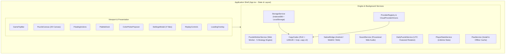
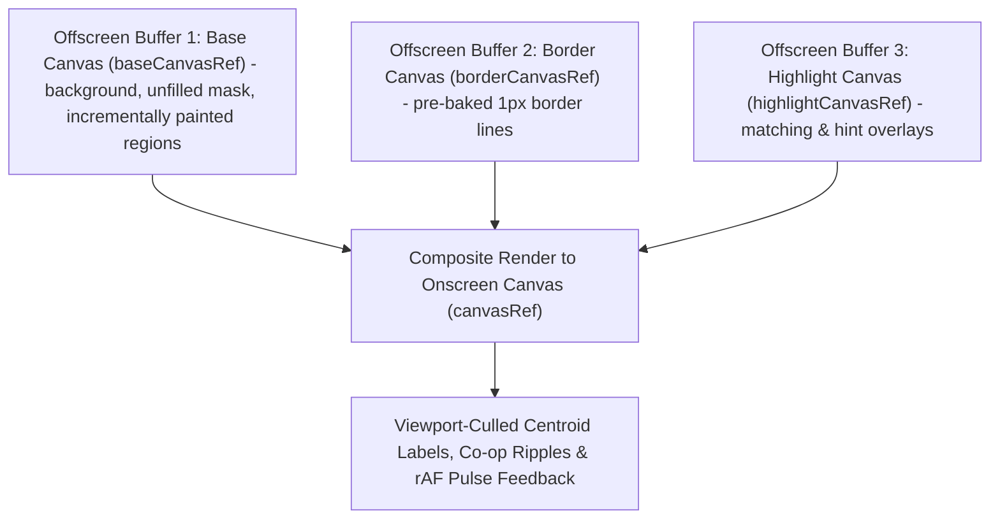
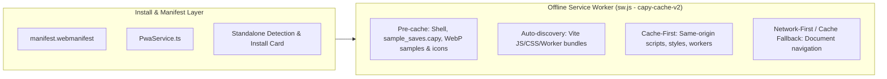

# Web Architecture & Technical Design -- Capy Web (`WEB.md`)

This document provides the complete technical reference for the Capy Web application in [`web/`](./web/), covering component layering, 3-tier offscreen canvas rendering, 6-mode touch gestures, state orchestration, Web Worker IPC, the native Android bridge, persistence schemas, and all `UserSettings` keys.

**Related Guides**: [`README.md`](./README.md) | [`ROADMAP.md`](./ROADMAP.md) | [`DEV.md`](./DEV.md) | [`AGENTS.md`](./AGENTS.md) | [`TODO.md`](./TODO.md) | [`PUZZLE.md`](./PUZZLE.md) | [`APP.md`](./APP.md) | [`CLOUD.md`](./CLOUD.md) | [`TESTING.md`](./TESTING.md) | [`CHANGELOG.md`](./CHANGELOG.md)

**Table of Contents**:
1. [Architectural Overview & Design Principles](#1-architectural-overview--design-principles)
2. [Directory & Module Structure](#2-directory--module-structure)
3. [Component Hierarchy & Layering](#3-component-hierarchy--layering)
4. [State Management & Lifecycle (`App.tsx`)](#4-state-management--lifecycle-apptsx)
5. [Rendering Pipeline & Gesture Engine (`PuzzleCanvas.tsx`)](#5-rendering-pipeline--gesture-engine-puzzlecanvastsx)
6. [Background Engine & Worker Protocol](#6-background-engine--worker-protocol)
7. [Native Android Bridge (`NativeBridge.ts`)](#7-native-android-bridge-nativebridgets)
8. [Persistence, Storage Keys & `UserSettings` Dictionary](#8-persistence-storage-keys--usersettings-dictionary)
9. [Styling & Design Tokens (`index.css`)](#9-styling--design-tokens-indexcss)
10. [Progressive Web App (PWA) & Offline Caching](#10-progressive-web-app-pwa--offline-caching)
11. [Development & Build Verification](#11-development--build-verification)

---

## 1. Architectural Overview & Design Principles

Capy Web is a client-side color-by-number generator and interactive canvas player built with **React 19**, **TypeScript**, **Vite 6**, and **Tailwind CSS 4**.



### Core Tenets
1. **Zero Forced Server Dependency**: Image quantization, vector segmentation, and save storage run 100% locally in the browser or WebView. Puzzles generate and play offline without mandatory accounts.
2. **60--120 FPS Canvas Rendering**: Instead of mutating thousands of DOM or SVG nodes, Capy uses a **3-tier offscreen-cached HTML5 2D Canvas pipeline** with dirty-rect updates and zero React state churn during pan/zoom/scrubbing.
3. **Responsive Non-Blocking UI**: CPU-heavy computer vision runs inside a dedicated **Web Worker** (`puzzle.worker.ts`) using transferable `ArrayBuffer` buffers.
4. **Single Source of Truth**: `web/` powers the production Cloudflare Workers PWA (`https://capypaint.com/`), GitHub Pages previews (`https://shthed.github.io/capy/`), and the native Android app ([`app/`](./app/)) via [`NativeBridge.ts`](./web/src/services/NativeBridge.ts).
5. **Edge-to-Edge Safe-Area Layout**: Hardware inset custom properties (`--sat`, `--sab`, `--sal`, `--sar`) keep controls clear of notches, cutouts, and gesture bars across phones, tablets, and desktops.

---

## 2. Directory & Module Structure

### Entry, Build & Public Assets
- **[`web/index.html`](./web/index.html)**: Host HTML document with synchronous pre-React `www.capypaint.com -> https://capypaint.com` canonical redirect, `https://capypaint.com/` metadata, mobile viewport, and safe-area tags.
- **[`web/package.json`](./web/package.json)**: Single source of truth for `"version"`, dependencies (React 19, Vite 6, Tailwind CSS 4, Lucide, `canvas-confetti`), and CLI scripts (`test:sanity`, `lint`, `build`, `test`, `preview`).
- **[`web/tsconfig.json`](./web/tsconfig.json)**: Strict TypeScript compiler configuration.
- **[`web/vite.config.ts`](./web/vite.config.ts)**: Vite bundler configuration enforcing relative asset base (`base: './'`), lazy modal chunk splitting, post-build `dist/sw.js` version/asset stamping, and `CAPY_ANDROID_SHA256_CERT_FINGERPRINTS` injection into `dist/.well-known/assetlinks.json`.
- **[`web/public/sw.js`](./web/public/sw.js)**: Same-origin offline Service Worker isolating caches by version and deployment scope (`capy-cache-v<version>:<scopePath>`) with `.apk` download bypass.
- **[`web/public/manifest.webmanifest`](./web/public/manifest.webmanifest)**: Standalone PWA manifest with relative `./` scope.
- **[`web/public/_headers`](./web/public/_headers)** & **[`web/public/_redirects`](./web/public/_redirects)**: Cloudflare Workers Static Assets security headers, immutable `/assets/*` caching with `! Cache-Control` overrides for unhashed sample/icon assets, `/capy.apk` `302` release redirect, and SPA fallback rules.
- **[`web/public/.well-known/assetlinks.json`](./web/public/.well-known/assetlinks.json)**: Root-domain Android Digital Asset Links manifest served at `https://capypaint.com/.well-known/assetlinks.json` for `com.capypaint.capy` (populated at build time from `CAPY_ANDROID_SHA256_CERT_FINGERPRINTS`).
- **[`web/public/privacy-policy.html`](./web/public/privacy-policy.html)**: Published Privacy Policy and Google Play / Google Auth Data Safety summary (`https://capypaint.com/privacy-policy.html`).
- **[`web/public/assets/sample_saves.capy`](./web/public/assets/sample_saves.capy)**: Pre-baked 4-artwork `.capy` v2 Gzip archive for instant zero-worker first boot.

### Core Shell, Types & Styling (`web/src/`)
- **[`web/src/main.tsx`](./web/src/main.tsx)**: React 19 root mount, one-shot `sessionStorage`-guarded `vite:preloadError` reload recovery, and Service Worker bootstrap.
- **[`web/src/version.ts`](./web/src/version.ts)**: Exports `APP_VERSION`, `APP_VERSION_CODE = MAJOR*10000 + MINOR*100 + PATCH`, `parseSemVer`, and `resolveReleaseChannel` (`'stable' | 'beta' | 'alpha' | 'dev'` channel detection for `capypaint.com` with `showChannelSwitcher: false`, `/capy/`, `/capy/beta/`, `/capy/pull/<num>/`, and `?capy_channel=` overrides).
- **[`web/src/App.tsx`](./web/src/App.tsx)**: Top-level state orchestrator, `#s=<token>` share resolution, Co-op room sync, replay loop, lifetime stats tracking, release channel wiring, and desktop keyboard gameplay shortcuts.
- **[`web/src/index.css`](./web/src/index.css)**: Tailwind CSS 4 imports, safe-area utility classes, and `touch-action: none` resets.
- **[`web/src/types/index.ts`](./web/src/types/index.ts)**: Central TypeScript types (`PuzzleData`, `PaletteColor`, `UserSettings`, `SavedSnapshot`, `GeneratorConfig`, `GENERATION_PIPELINE_STEPS`, `SAMPLE_GALLERY`).

### UI Components (`web/src/components/`)
- **[`PuzzleCanvas.tsx`](./web/src/components/PuzzleCanvas.tsx)**: 3-tier offscreen 2D canvas renderer, 6-mode touch/pointer gesture engine with custom zoom sensitivity, magnetic zoom detents, `reducedMotion` instant camera/highlight overrides, keyboard `panStepRequest` clamping, Pole-of-Inaccessibility label layout, Follow Painting camera controller, and Co-op ripples.
- **[`GameTopBar.tsx`](./web/src/components/GameTopBar.tsx)**: Puzzle title, completion badge, non-production `BETA` / `ALPHA #<num>` channel pill (`topbar-channel-badge`), sub-tile parent breadcrumb pill (`topbar-parent-puzzle-btn`), active Co-op presence pill (`topbar-active-coop-pill`), interactive relative zoom badge (`topbar-zoom-badge`, cycling `1x -> 2x -> 4x -> 8x -> 12x -> 1x`), preview toggle, fullscreen, image upload, and settings button.
- **[`PaletteDock.tsx`](./web/src/components/PaletteDock.tsx)**: Horizontal swatch dock (`palette-swatch-<n>`) with completion badges, viewport spatial priority (`prioritizeOnScreen`), `reducedMotion` scroll overrides, and dynamic sort modes.
- **[`FloatingActions.tsx`](./web/src/components/FloatingActions.tsx)**: Undo (`Ctrl+Z`, long-press `>= 450ms` for timeline scrubber), conditional Redo (`Ctrl+Y`), Watch Puzzle Replay (`replay-btn`), continuous Paint Mode, zoom `+/-`, and fit-to-screen reset.
- **[`SettingsModal.tsx`](./web/src/components/SettingsModal.tsx)**: Lazy-loaded 4-tab configuration sheet (`Settings` + `Lifetime Stats` + `Release Channel` Stable/Beta switcher card `release-channel-card`, `Hints`, `Create` + `Puzzle of the Day`, `Saves` & Cloud/Co-op Hub + Printable `.svg` export).
- **[`ReplayControls.tsx`](./web/src/components/ReplayControls.tsx)**: Default-minimised YouTube-style playback scrubber HUD (`0.5x`--`20x`, Follow Painting, Auto-Loop, `Resume Here`, `Save PNG`, `Next`).
- **[`ColorPickerPopover.tsx`](./web/src/components/ColorPickerPopover.tsx)**: Lazy-loaded custom HSL/Hex swatch editor and 5 theme presets for Free Colour mode.
- **[`LoadingOverlay.tsx`](./web/src/components/LoadingOverlay.tsx)**: Non-blocking bottom progress HUD supporting Simple (Fast Mode) and Detailed 6-stage pipeline inspection.

### Services, Providers & Engine (`web/src/services/`, `web/src/engine/`)
- **[`CapyCodec.ts`](./web/src/services/CapyCodec.ts)**: Scanline RLE + LEB128 varints (`CompactPuzzleRecordV2`), `.capy` v2 Gzip framing, and CRDT `ProgressDeltaV2` tokens.
- **[`StorageService.ts`](./web/src/services/StorageService.ts)**: IndexedDB (`capy_game_storage_v8`) + `localStorage` + native Android disk backup persistence.
- **[`SvgPrintExporter.ts`](./web/src/services/SvgPrintExporter.ts)**: Pure SSR-testable printable monochrome vector `.svg` coloring sheet builder (`buildPrintableColoringSvg`, `exportPrintableColoringSvg`) tracing collinear-merged `#1e293b` `<path>` outlines from `regionMap` transitions, XML-escaped title header, centered `<text>` region numbers, and a bottom color-key swatch legend.
- **[`DailyPuzzleService.ts`](./web/src/services/DailyPuzzleService.ts)**: Pure, 100% offline deterministic UTC featured puzzle selector (`getDailyFeaturedPuzzle(utcDateStr?)` rotating `SAMPLE_GALLERY` artworks x `DAILY_PRESET_VARIATIONS`).
- **[`PlayerStatsService.ts`](./web/src/services/PlayerStatsService.ts)**: Local + Android-backed `PlayerLifetimeStats` store (`capy_player_stats_v1`) with SSR memory fallback, non-negative clamping, and monotonic CRDT-ready `mergeLifetimeStats(a, b)`.
- **[`ShareLinkService.ts`](./web/src/services/ShareLinkService.ts)**: `< 2 KB` `#s=<token>` share URLs and `?room=<ROOM6>` Co-op room invite helpers.
- **[`SoundService.ts`](./web/src/services/SoundService.ts)**: Zero-asset procedural Web Audio API synthesizer (`playRegionTap` tactile woodblock/brush envelope, `25ms` drag rate-throttling, lazy user-gesture unlock, and automatic `AudioContext.suspend()` on `visibilitychange` / `pagehide` / `blur`).
- **[`providers/GoogleCloudSyncClient.ts`](./web/src/services/providers/GoogleCloudSyncClient.ts)**: Browser/PWA Google Identity Services OAuth 2.0 (`openid profile email drive.appdata`) and Google Drive `appDataFolder` REST v3 client.
- **[`providers/types.ts`](./web/src/services/providers/types.ts)**: Hexagonal interfaces (`CloudProviderDriver`, `AuthProvider`, `CloudSaveProvider`, `RealtimeRoomProvider`, `CatalogStorageProvider`, `AiArtworkProvider`, `MonetizationProvider`).
- **[`providers/CloudProviderDrivers.ts`](./web/src/services/providers/CloudProviderDrivers.ts)**: Pluggable cloud drivers (`GoogleCloudDriver` with per-file `writeLocks` mutex, `PlayGamesAndroidDriver`, `SteamCloudDriver`, `MicrosoftCloudDriver`, `AppleCloudDriver`).
- **[`providers/ProviderRegistry.ts`](./web/src/services/providers/ProviderRegistry.ts)**: `MultiProviderAuthManager`, `CrdtCloudSaveAdapter` (`syncFullLibrary`), `HybridCoopRoomAdapter`, moderated community ideas, and `AiCreditLedger`.
- **[`NativeBridge.ts`](./web/src/services/NativeBridge.ts)**: Defensive wrapper around Android `window.CapyAndroid` and WebKit bridges with web fallbacks and LIFO back-button stack.
- **[`PwaService.ts`](./web/src/services/PwaService.ts)**: PWA install prompt capture, standalone mode detection, and Service Worker update activation.
- **[`PuzzleWorkerService.ts`](./web/src/services/PuzzleWorkerService.ts)**: Web Worker lifecycle, cancellation, live `SET_DETAILED_PROGRESS` toggling, and transferable `ArrayBuffer` reconstruction.
- **[`CoopRippleBuffer.ts`](./web/src/engine/CoopRippleBuffer.ts)**: Pre-allocated typed-array ring buffer (`Float32Array` / `Float64Array`) for zero-GC collaborator paint ripples.
- **[`puzzle.worker.ts`](./web/src/engine/puzzle.worker.ts)**, **[`PuzzleGenerator.ts`](./web/src/engine/PuzzleGenerator.ts)**, **[`ImageAnalyzer.ts`](./web/src/engine/ImageAnalyzer.ts)**, **[`LineArtExtractor.ts`](./web/src/engine/LineArtExtractor.ts)**, **[`ColorQuantizer.ts`](./web/src/engine/ColorQuantizer.ts)**, **[`RegionSegmenter.ts`](./web/src/engine/RegionSegmenter.ts)**: Computer-vision segmentation pipeline (detailed in [`PUZZLE.md`](./PUZZLE.md)).

---

## 3. Component Hierarchy & Layering

Pointer events pass through empty overlay containers (`pointer-events-none`) directly to `PuzzleCanvas` while interactive buttons opt in with `pointer-events-auto`:

- **`z-0` (`PuzzleCanvas`)**: Full-bleed interactive pan/zoom 2D canvas.
- **`z-20` (`FloatingActions`, `PaletteDock`)**: Bottom-right tool stack and bottom horizontal swatch dock.
- **`z-30` (`GameTopBar`, `ReplayControls`)**: Top safe-area status bar and floating bottom YouTube-style replay scrubber HUD.
- **`z-40` (`LoadingOverlay`)**: Non-blocking bottom-anchored generation HUD and expandable 6-stage inspector drawer.
- **`z-50` (`SettingsModal`, `ColorPickerPopover`)**: Modal configuration sheet and nested custom color popover.

### Component Responsibilities & Key Interactions

- **[`PuzzleCanvas.tsx`](./web/src/components/PuzzleCanvas.tsx)**:
  - Renders the puzzle via 3-tier offscreen canvas caching, hit-tests region taps via `regionMap`, renders zero-allocation Co-op ripples, and centers clean `sourceImage` previews while `puzzle.worker.ts` runs.
- **[`GameTopBar.tsx`](./web/src/components/GameTopBar.tsx)**:
  - Displays puzzle title (taps open Saves), completion percentage, one-tap sub-tile **Parent Puzzle** breadcrumb pill (`topbar-parent-puzzle-btn`, rendered whenever the active puzzle's `SavedSnapshot.parentSnapshotId` still exists in `snapshots` so deleting a parent hides dangling pills, and restoring the parent puzzle's saved zoom/pan viewport on tap), live Co-op collaborator presence pill (`topbar-active-coop-pill`), interactive relative zoom badge (`topbar-zoom-badge`, tapping steps viewport-center-anchored zoom through `1x -> 2x -> 4x -> 8x -> 12x -> 1x`), preview eye toggle, fullscreen toggle, photo upload shortcut, and Settings button.
- **[`PaletteDock.tsx`](./web/src/components/PaletteDock.tsx)**:
  - Renders numbered color swatches with remaining region counts. Tapping an already-active swatch triggers a directional region hint; `+` opens `ColorPickerPopover`. Supports sorting by `NUMBER`, `REMAINING`, `HUE`, or `LIGHTNESS` plus `prioritizeOnScreen` spatial floating.
- **[`FloatingActions.tsx`](./web/src/components/FloatingActions.tsx) & Global Keyboard Shortcuts**:
  - **Undo (`Ctrl+Z` / `Cmd+Z`)**: Undoes the last fill/repaint (enabled automatically in Free Colour mode or via `enableUndo`). Long-pressing Undo (`>= 450ms`) opens `ReplayControls` for historical timeline scrubbing.
  - **Redo (`Ctrl+Y` / `Ctrl+Shift+Z`)**: Stacked above Undo whenever `redoStack.length > 0`; re-applies undone strokes.
  - **Desktop Gameplay Shortcuts (`1`--`9`, `+`/`=`, `-`/`_`, `0`, Arrow/WASD)**: When the puzzle canvas is active (no modal open, no `Ctrl`/`Meta`/`Alt` modifier held, and focus is not inside `<input>`, `<textarea>`, `<select>`, or `isContentEditable`), keys `1`--`9` select the corresponding visible palette swatch, `+`/`=` and `-`/`_` zoom in/out anchored at the viewport center, `0` resets zoom and pan to `1x` fit view, and `ArrowUp`/`W`, `ArrowDown`/`S`, `ArrowLeft`/`A`, `ArrowRight`/`D` pan the viewport by `64` CSS px clamped via `clampCanvasOffset` (calling `e.preventDefault()`).
  - **`Escape` & `Enter` Keys**: Pressing `Escape` cancels an active inline save-card rename in `SettingsModal` first (`Enter` commits the rename); otherwise `Escape` pops the topmost overlay on the LIFO modal stack (`ColorPickerPopover` $\rightarrow$ `SettingsModal` $\rightarrow$ `ReplayControls`).
  - Also hosts Watch Puzzle Replay (`replay-btn`), continuous Paint Mode brush toggle, optional `+/-` zoom buttons, and fit-to-screen reset (`reset-view-btn`).
- **[`SettingsModal.tsx`](./web/src/components/SettingsModal.tsx)**:
  - Restores the last open tab via `localStorage['capy_last_settings_tab']` (`'0'`--`'3'`):
  - **Tab 0 -- Settings**: Difficulty (`EASY` / `NORMAL`), `autoAdvance`, default `replaySpeed` (`0.5x`, `1x`, `2x`, `5x`, `10x`, `20x`), `Replay on Load`, `Follow Painting During Replay` (`toggle-replay-follow-btn`), `Auto-Loop Replay` (`toggle-replay-loop-btn`), Controls (`zoomSensitivity` `0.5x`--`2.0x` slider, `snapZoomLevels` `1x/2x/4x/8x/12x` magnetic stops toggle, `soundEnabled` toggle, `soundVolume` `0%`--`100%` slider, `reducedMotion` `setting-reduced-motion` toggle), `panMomentum`, canvas background presets + `<Pipette>` custom color picker, `raisePaletteDock`, label bounds (`minLabelSize`, `maxLabelSize`, `labelScale`), 2-column **Lifetime Stats** card (`lifetime-stats-card`), PWA install card, and Android APK download link.
  - **Tab 1 -- Hints**: `highlightStyle` (`FULL_REGION`, `BOUNDARY_ONLY`, `NUMBER_ONLY`, `CENTROID_GLOW`), `hintFillStyle`, custom `hintColorArgb` (`<Pipette>`), `hintIntensity`, and `animateHint`.
  - **Tab 2 -- Create**: Deterministic UTC **Puzzle of the Day** hero card (`daily-puzzle-card`, `daily-puzzle-play-btn`), real-time gallery search (`gallery-search-input`), category filter chips (`All`, `Animals`, `Coloring`, `Nature`, `Line Art`, `Detailed`, `Music`), **Infinite Zoom 2x Detail Tile** cropper (`infinite-zoom-subtile-btn`), moderated **Community Puzzle Ideas** feed (`community-ideas-section`), `GeneratorConfig` controls, and device photo upload.
  - **Tab 3 -- Saves**: Cloud Sync & Simultaneous Co-op Hub (`cloud-coop-hub`) featuring player name/avatar editor, multi-provider cloud status bar (`data-testid="cloud-providers-bar"`), browser/PWA **Google Account Login** (Google Identity Services OAuth 2.0 $\rightarrow$ Google Drive `appDataFolder`), Android **Google Play Games Services v2** sign-in, CRDT `Cloud Sync`, `< 2 KB` `Share Progress Link`, active-puzzle **Printable SVG** export (`export-printable-svg-btn`), and 6-char `Host Co-op Room` / `Join` controls, alongside sticky library actions (Sort, `Replay on Load`, Detail/Thumbnails view toggle, Pin/Unpin, Load, Replay, inline Rename, per-save Printable `.svg` `save-action-export-svg`, Export `.capy`, Import, Export All, Delete All).
- **[`ReplayControls.tsx`](./web/src/components/ReplayControls.tsx)**:
  - Opens minimised by default (`data-minimized="true"`) as a YouTube-style bottom control bar (`w-full max-w-2xl`). **Both** the compact minimised bar and the expanded two-row deck (`data-minimized="false"`, toggled via `replay-toggle-minimize-btn`) render the full-width interactive pointer-captured timeline scrubber (`renderYouTubeScrubber`, `data-testid="replay-scrubber-track"` / `replay-scrubber`), Play/Pause, speed selector (`0.5x`, `1x`, `2x`, `5x`, `10x`, `20x`), **Follow Painting** (`replay-follow-btn`), **Auto-Loop** (`replay-loop-btn`), Skip-to-End, and Exit. Expanding adds `Resume Here` (rewinding active play to step $K$ and pushing later steps onto `redoStack`) plus post-victory `Save PNG` and `Next` actions.
- **[`ColorPickerPopover.tsx`](./web/src/components/ColorPickerPopover.tsx)**:
  - Provides 5 curated Free Colour theme palettes (Vibrant Classic, Mushroom Fantasy, Pastel Dreams, Earthy Nature, Neon Pop) and live HSL/Hex swatch editing/addition.
- **[`LoadingOverlay.tsx`](./web/src/components/LoadingOverlay.tsx)**:
  - Defaults to **Simple Progress (Fast Mode)** (amber-to-yellow bar, throttled worker IPC, zero main-thread rAF overhead) with a one-tap toggle into **Detailed Progress** (`Step 1/6`--`6/6`, live K-Means palette swatches, and `GenerationInspectionDetails` drawer).

---

## 4. State Management & Lifecycle (`App.tsx`)

### 1. Active Session, Undo & Redo State
- `puzzle: PuzzleData | null`: Active dimensions, `PaletteColor[]`, `Region[]`, `regionMap: Int32Array`, and `borderMap: Uint8Array`.
- `sourceImage: HTMLImageElement | null`: Decoded source image displayed cleanly on canvas while `puzzle.worker.ts` runs and used for `DETAIL` / B&W `multiply` compositing.
- `activeColorId: number`: Selected 1-based palette color ID.
- `filledRegionIds: Set<number>`: Colored region IDs preserving exact first-fill chronological insertion order across saves, reloads, and Free Colour repaints (`BF-1` -- repainting an already-filled region updates `paintedRegionColors` without moving the region ID to the tail of `filledRegionIds`).
- `paintedRegionColors: Map<number, number>`: Region ID $\rightarrow$ 1-based palette Color ID overrides in Free Colour mode.
- `undoStack: UndoHistoryEntry[]` & `redoStack: UndoHistoryEntry[]`: Record `{ regionId, wasPreviouslyFilled, previousPaintedColorId, paintedColorId }`, broadcasting restored `paintedColors` (`'PAINT_EVENT'`) for Free Colour repaints or `'UNFILL_EVENT'` (`broadcastUnfillEvent`) when undoing a first-time region fill back to `0` unfilled across Co-op peers (`BF-1`, `US-4.3`).
- `hintRegionId: number | null` & `isPreviewMode: boolean`: Active hint target and unmasked source-artwork preview state.

### 2. Chronological Replay & Historical Resumption State
- **Zero-Allocation Incremental Scrubbing**: During playback and pointer scrubbing, [`PuzzleCanvas.tsx`](./web/src/components/PuzzleCanvas.tsx) mutates `paintedCacheRef.current` and `prevColorsRef.current` in place (zero per-step `Set`/`Map`/`.slice()` allocations) and repaints only the dirty bounding box via `putImageData`.
- **Automatic Offscreen Step Fast-Forward**: When `settings.replayFollow` is `false`, `isRegionVisibleInViewport` performs an $O(1)$ frustum check per step and skips consecutive offscreen regions immediately.
- **Follow Painting Camera Controller (`settings.replayFollow`)**: When `true` and zoomed in (`scale > 1.05`), `stepFollow` runs a zero-allocation 60 FPS loop with an inner **Safe-Frame Dead-Zone** (`[18% w, 82% w]` $\times$ `[max(68px, 18% h), h - max(92px, 22% h)]`), **10-step Predictive Lookahead**, and a **Critically-Damped 2D Velocity Spring-Damper (`SmoothDamp`)**—gliding smoothly toward upcoming region clusters without ever mutating zoom scale, and disengaging automatically (`onManualPanStart`) if the player drags the canvas.
- **Strict Viewport Invariance**: Starting or ending a replay (`startReplay`, `finishAutoResume`, `replay-btn`, completion auto-replay, or replaying the already-active puzzle from Saves) never resets, zooms out, or teleports the camera. Loading a *different* saved puzzle restores its persisted `zoomScale`, `panOffsetX`, and `panOffsetY` (`restoreViewTrigger`) before replay begins.

### 3. Viewport Culling & Generation Sequence Safety
- **Spatial Culling**: `PuzzleCanvas` emits `visibleColorIds` and `visibleRegionIds` on pan/zoom/resize changes to power `PaletteDock` `prioritizeOnScreen`.
- **Sequence Cancellation (`generationSeqRef`)**: Every worker generation increments `generationSeqRef.current`, calls `PuzzleWorkerService.cancelActive()` on any in-flight worker, and discards stale responses.

---

## 5. Rendering Pipeline & Gesture Engine (`PuzzleCanvas.tsx`)



### Dynamic Active Colour, Hints & Inscribed-Circle Labels
- **Active Colour Highlighting**: When `highlightStyle` is `FULL_REGION` (default) or `BOUNDARY_ONLY`, unfilled regions matching `activeColorId` are highlighted using the selected `PaletteColor` (`{ id, r, g, b, argb, hex }` from `puzzle.palette`, 1-based `id`).
- **Hint Highlighting (`hintColorArgb`) & `NUMBER_ONLY`**: Hints render `SOLID`, `CHECKER`, or `STRIPES` overlays in `settings.hintColorArgb` (`#FBBF24` default). `NUMBER_ONLY` tints label text directly with a crisp white stroke halo rather than drawing centroid circles (reserved for `CENTROID_GLOW`).
- **Inscribed-Circle Label Fitting**: Labels render at each region's Pole of Inaccessibility (`centroidX`, `centroidY`), sized from `region.maxRadius / sqrt((0.3 * charCount)^2 + 0.1444)` with a 10% margin and clamped to `[minLabelSize, maxLabelSize]` so 1--3 digit numbers never cross borders.

### Viewport Clamping (`clampCanvasOffset`), Magnetic Detents & `ResizeObserver`
- **Zoom Range, Sensitivity & Magnetic Detents**: Smoothly clamped between **`0.5x`** and **`12.0x`**. Mouse-wheel, two-finger pinch (`Math.pow(rawRatio, zoomSensitivity)`), and one-finger double-tap drag deltas scale smoothly in log-space by `zoomSensitivity` (`0.5`--`2.0`). When `snapZoomLevels` is enabled, `applyZoomSnapDetent` snaps relative zoom within `+-4%` onto magnetic stops `[1, 2, 4, 8, 12]` while re-anchoring `offset` around the active cursor/pinch/double-tap focal point. Tapping `topbar-zoom-badge` in `GameTopBar` steps cleanly through `1x -> 2x -> 4x -> 8x -> 12x -> 1x` (`getNextZoomStop`) anchored at the viewport center.
- **Dynamic Corner Margins**: Scales pan bounds dynamically with `containerWidth * 0.72` and `containerHeight * 0.72` when zoomed in so all four puzzle corners can pan comfortably past screen center above `PaletteDock` and below `GameTopBar`.
- **Immediate Resize & Rotation Clamping (`BF-2`)**: A `ResizeObserver` on `containerRef` (plus `window` `resize` fallback) immediately re-clamps `offsetRef.current`, updates `containerSize`, resizes the high-DPI `<canvas>`, and repaints synchronously on portrait/landscape rotation or split-screen resize.

### 6-Mode Touch, Mouse & Gesture Engine
`PuzzleCanvas` orchestrates **6 distinct** interaction modes:
1. **Tap Hit-Testing**: Inverse-transforms client $(x, y)$ to `(puzzleX, puzzleY)` and looks up `regionMap[y * width + x]`. In **Easy Mode** (`difficulty: 'EASY'`, default), tapping any unpainted region auto-selects its color and fills it; in **Normal Mode**, fills matching `activeColorId` regions (or pulses a subtle mismatch indicator); in **Free Colour Mode**, fills or repaints with `activeColorId`.
2. **Google Maps-Style One-Finger Double-Tap-and-Drag Zoom & Horizontal Pan**: Second tap-and-hold within `350ms` and `40px` zooms focal-point-invariantly on vertical drag (`dy > 0` zooms **in**, `dy < 0` zooms **out** unless `reverseDoubleTapZoom` is `true`, `Math.exp(((dir * dy) / 220) * zoomSensitivity)`), while horizontal drag (`|dx| >= |dy|`) pans cleanly even when Paint Mode is active.
3. **Background Margin Drag Panning**: Touching outside the artwork bounds (`x < 0 || y < 0 || x >= width || y >= height`) always pans the viewport even when Paint Mode is active.
4. **Smooth Pan Momentum (Inertial Gliding)**: Samples pointer velocity over a `100ms` sliding window; flicks $\ge 0.18\text{ px/ms}$ glide via `requestAnimationFrame` with $0.92^{\Delta t / 16}$ exponential friction decay and zero-latency cancellation on the next `pointerdown`.
5. **Multi-Touch Pinch-to-Zoom**: Two-finger midpoint focal tracking between `0.5x` and `12.0x` scaled by `Math.pow(rawRatio, zoomSensitivity)`, re-anchoring single-finger pan coordinates seamlessly when one finger lifts.
6. **Drag-to-Color (Continuous Paint Mode)**: Interpolates stroke segments across pointer moves inside the artwork and batch-fills matching regions via `onBatchRegionsClicked` (disabled automatically during replay).

---

## 6. Background Engine & Worker Protocol

Image quantization and segmentation execute in [`puzzle.worker.ts`](./web/src/engine/puzzle.worker.ts) via [`PuzzleWorkerService.ts`](./web/src/services/PuzzleWorkerService.ts):

```typescript
// Main -> Worker Requests
type WorkerRequest =
  | {
      type: 'GENERATE';
      id: string;
      width: number;
      height: number;
      rgbaBuffer: ArrayBuffer; // Transferred zero-copy
      config: GeneratorConfig;
      detailedProgress?: boolean;
    }
  | {
      type: 'SET_DETAILED_PROGRESS';
      detailed: boolean; // Live HUD toggle without restarting worker
    };

// Worker -> Main Responses
type WorkerResponse =
  | {
      type: 'PROGRESS';
      id: string;
      progress: number; // Strictly monotonic 0.0 to 1.0
      status: string;
      payload?: GenerationProgressPayload; // Step 1..6 + GenerationInspectionDetails
    }
  | {
      type: 'SUCCESS';
      id: string;
      puzzleData: {
        width: number;
        height: number;
        palette: PaletteColor[];
        regions: Array<Omit<Region, 'pixels'> & { pixelsBuffer: ArrayBuffer }>;
        regionMap: ArrayBuffer; // Reconstructed to Int32Array on main thread
        borderMap: ArrayBuffer; // Reconstructed to Uint8Array on main thread
        isBlackAndWhite?: boolean;
      };
    }
  | {
      type: 'ERROR';
      id: string;
      error: string;
    };
```

---

## 7. Native Android Bridge (`NativeBridge.ts`)

[`NativeBridge.ts`](./web/src/services/NativeBridge.ts) wraps `window.CapyAndroid` ([`CapyAndroidBridge.kt`](./app/src/main/java/com/capypaint/capy/CapyAndroidBridge.kt)) and `window.webkit.messageHandlers.CapyIOS` with safe browser fallbacks:

- **`haptic(type)`**: Calls `CapyAndroid.haptic(type)` (`EFFECT_TICK`, `EFFECT_CLICK`, `EFFECT_HEAVY_CLICK`, and custom multi-pulse `VibrationEffect.createWaveform` patterns for `success`/`error` with API 33+ `USAGE_TOUCH`); falls back to `navigator.vibrate(...)` on web.
- **`pushBackHandler(onClose)` / `setBackModalOpen(isOpen, onClose)`**: Maintains a LIFO stack of open modal/popover close callbacks synchronized with Android's `OnBackPressedCallback` (`window.__capyCloseModal`), closing nested popovers before parent sheets.
- **`saveBackup(key, data)` / `loadBackup(key)`**: Mirrors JSON save state to Android internal storage (`filesDir/capy_saves/<key>.json`); safe no-op / `null` on web.
- **`applySafeAreaInsets()`**: Reads `CapyAndroid.getSafeAreaInsets()` into `--safe-area-top/bottom/left/right` CSS custom properties; falls back to CSS `env(safe-area-inset-*)`.
- **`onSharedImage(handler)`**: Consumes cold-start `CapyAndroid.consumePendingSharedImage()` and live `window.__capyReceiveSharedImage` callbacks from background-downsampled `Intent.ACTION_SEND` (`image/*`) shares.
- **`onDeepLink(handler)`**: Consumes `CapyAndroid.consumePendingDeepLink()` and `window.__capyReceiveDeepLink` for verified Android App Links (`#s=<token>` and `?room=<ROOM6>`).
- **`signInPlayGames()` & `onPlayGamesProfile(handler)`**: Triggers native Google Play Games Services v2 sign-in and receives resolved `{ playerId, displayName }` profiles via `window.__capyReceivePlayGamesProfile`.
- **`saveCloudSnapshot(slotKey, json)` / `loadCloudSnapshot(slotKey)` / `onCloudSnapshot(handler)`**: Persists CRDT cloud state to `filesDir/capy_cloud/<slotKey>.json`, commits Saved Games via `PlayGames.getSnapshotsClient`, and receives remote snapshot reconciliations via `window.__capyReceiveCloudSnapshot` (falling back to `localStorage['capy_cloud_vault_v1']` on web).
- **`showRewardedAd()`**: Opt-in rewarded AI credit hook; returns `false` when no ad SDK is bundled.
- **`shareTextLink(title, url)` / `shareImage(title, dataUrl)` / `exportOrShareFile(options)`**: Routes URLs, PNGs, printable `.svg` coloring sheets, and `.capy` v2 binary archives through Android's `Intent.ACTION_SEND` / `FileProvider` Share Sheet, falling back to `navigator.share`, clipboard copy, or deferred-revoke `<a download>` on web.
- **`CapyAndroid.getAppVersion()`**: Exposes native `BuildConfig.VERSION_NAME`.

---

## 8. Persistence, Storage Keys & `UserSettings` Dictionary

### Hybrid Storage Architecture
1. **IndexedDB (`capy_game_storage_v8` in [`StorageService.ts`](./web/src/services/StorageService.ts))**:
   - Awaits full `IDBTransaction` completion (`tx.oncomplete` / `tx.onerror` / `tx.onabort`).
   - **`puzzles` store (`STORE_PUZZLES`)**: Stores `CompactPuzzleRecordV2` (`CapyCodec.compressPuzzleRecord` scanline RLE + LEB128 varints, `~20--45 KB` vs `~9.4 MB` raw `Int32Array`, reconstructing in `< 3ms`). If browser storage pressure evicts `puzzles` while `localStorage` survives, `App.tsx` regenerates from `sourceRef` and re-applies `snapshot.customPalette` and `snapshot.isFreeColor` via `mergeCustomPalette` (`BF-6`).
   - **`images` store (`STORE_IMAGES`)**: Stores custom uploaded/shared photo `Blob`s (`sourceRef = { kind: 'blob', uri: snapId }`), while built-in samples reference `{ kind: 'sample', uri: './assets/samples/...' }` with zero blob duplication.
2. **Binary `.capy` v2 Archives & CRDT Progress Deltas ([`CapyCodec.ts`](./web/src/services/CapyCodec.ts))**:
   - `StorageService.exportSnapshotBinary(id)` / `exportAllSnapshotsBinary()` emit `CAPY\x02<flags>` Gzip archives embedding `SavedSnapshot` metadata (including `customPalette` and `parentSnapshotId`), `CompactPuzzleRecordV2` geometry, and custom image blobs.
   - `CapyCodec.encodeProgressDeltaToken` / `mergeProgressDeltas` encode `ProgressDeltaV2` (`sourceRef`, `filledRegionIds`, `paintedRegionColors`, `isFreeColor`, `updatedAt`) into `< 2 KB` `#s=<token>` URL fragments with CRDT Grow-Only Set-Union (`filledRegionIds`) + Last-Writer-Wins (`paintedRegionColors`) merging.
3. **Instant First-Launch Sample Archive (`./assets/sample_saves.capy`)**:
   - On cold start with zero existing snapshots, `restoreSession` fetches `./assets/sample_saves.capy` (`225 KB`) and imports all 4 `SAMPLE_GALLERY` puzzles (`Capybara`, `Mushroom Forest`, `Capy Forest`, `Snail Guitar`) directly into `localStorage` and `IndexedDB` without spawning `puzzle.worker.ts`.

### Complete Browser Storage Key Inventory (`localStorage` & `sessionStorage`)
- **`capy_snapshots_v8`** (`localStorage`): Array of `SavedSnapshot` metadata records (mirrored to Android `filesDir/capy_saves/`).
- **`capy_active_session_v8`** (`localStorage`): Currently active `SavedSnapshot.id` string.
- **`capy_user_settings_v8`** (`localStorage`): Persisted `UserSettings` JSON object.
- **`capy_last_settings_tab`** (`localStorage`): Last active tab index (`'0'`--`'3'`) in `SettingsModal`.
- **`capy_saves_view_mode`** (`localStorage`): Saves tab layout mode (`'DETAIL' | 'THUMBNAILS'`).
- **`capy_player_identity_v1`** (`localStorage`): `PlayerIdentity` (`playerId`, `displayName`, `avatarColorHex`, `provider`, `isAuthenticated`, optional `email` & `avatarUrl`).
- **`capy_tab_peer_suffix_v1`** (`sessionStorage`): Per-tab unique suffix isolating multi-tab `BroadcastChannel` Co-op peers.
- **`capy_cloud_vault_v1`** (`localStorage`): Local fallback key-value vault for `CloudSaveEnvelope` slots.
- **`capy_cloud_library_manifest_v2`** (`localStorage`): Local mirror of `CloudLibraryManifestV2` (`capy_cloud_manifest_v2.json`).
- **`capy_google_oauth_token_v1`** (`localStorage`): Cached Google OAuth 2.0 access token, expiry timestamp, and user profile metadata.
- **`capy_cloud_explicit_signout_v1`** (`localStorage`): Suppresses automatic startup Google One Tap / silent sign-in after explicit user sign-out until next manual sign-in.
- **`capy_google_oauth_client_id_v1`** (`localStorage`): Optional developer runtime override for `VITE_GOOGLE_CLIENT_ID`.
- **`capy_community_ideas_v1`** (`localStorage`): Moderated `CommunityPuzzleIdea` entries and vote state.
- **`capy_ai_credits_v1`** (`localStorage`): Opt-in `AiCreditLedger` (`availableCredits`, `lifetimeEarnedCredits`, `lifetimeSpentCredits`, `adFreePlatform`, `personalizedAdsConsent`).
- **`capy_player_stats_v1`** (`localStorage`, backed up via `NativeBridge`): `PlayerLifetimeStats` (`totalRegionsColored`, `puzzlesCompleted`, `zeroHintPuzzles`, `fastestCompletionMs`, `freeColorCreations`, `coopRegionsPainted`).

### 8.1 Comprehensive `UserSettings` Reference (`capy_user_settings_v8`)

Defined in [`web/src/types/index.ts`](./web/src/types/index.ts) (`DEFAULT_SETTINGS`):

- **`autoAdvance`**: `boolean` (default `true`) -- Advances automatically to the next incomplete palette color when all regions of the active swatch are completed.
- **`difficulty`**: `'EASY' | 'NORMAL'` (default `'EASY'`) -- `'EASY'` auto-selects a tapped region's color and fills it; `'NORMAL'` requires matching `activeColorId`.
- **`isPaintMode`**: `boolean` (default `false`) -- Enables continuous drag-to-color brush painting.
- **`isFreeColorMode`**: `boolean` (default `false`) -- Enables Free Colour / Coloring Page mode allowing arbitrary swatch assignment and repainting.
- **`raisePaletteDock`**: `boolean` (default `true`) -- Floats `PaletteDock` comfortably above mobile gesture bars.
- **`regionColorMode`**: `'SOLID' | 'DETAIL'` (default `'SOLID'`) -- Renders filled regions in flat quantized swatch color (`SOLID`) or original photographic texture (`DETAIL`).
- **`canvasBgColor`**: `'BLACK' | 'DARK_SLATE' | 'CHARCOAL' | 'LIGHT_GRAY' | 'PURE_WHITE' | 'CUSTOM'` (default `'CHARCOAL'`) -- Viewport background preset around the artwork.
- **`canvasBgArgb`**: `number` (default `0xff18181b` / `#18181B`) -- 32-bit ARGB color used when `canvasBgColor === 'CUSTOM'`.
- **`saveSortOrder`**: `'LAST_ACTIVE' | 'DATE' | 'PERCENT_COMPLETE'` (default `'LAST_ACTIVE'`) -- Sort order in the Saves tab (pinned saves stay grouped at top).
- **`showSavePreviews`**: `boolean` (default `true`) -- Toggles artwork preview thumbnails on save cards.
- **`highlightStyle`**: `'CENTROID_GLOW' | 'NUMBER_ONLY' | 'FULL_REGION' | 'BOUNDARY_ONLY'` (default `'FULL_REGION'`) -- Visual cue style for unpainted regions matching `activeColorId`.
- **`hintFillStyle`**: `'SOLID' | 'CHECKER' | 'STRIPES'` (default `'CHECKER'`) -- Pattern rendered over the targeted hint region.
- **`hintColorArgb`**: `number` (default `0xfffbbf24` / `#FBBF24`) -- 32-bit ARGB highlight color for active hints.
- **`showRegionLabels`**: `boolean` (default `true`) -- Shows Pole-of-Inaccessibility region numbers on unpainted regions.
- **`showPreviewLabels`**: `boolean` (default `false`) -- Keeps region numbers visible while holding/toggling Preview mode.
- **`showPreviewBorders`**: `boolean` (default `false`) -- Keeps 1px region borders visible in Preview mode.
- **`highlightMatching`**: `boolean` (default `true`) -- Toggles active-swatch region highlighting on the canvas.
- **`animateHint`**: `boolean` (default `true`) -- Drives a zero-React-re-render `requestAnimationFrame` pulse on hinted regions (when `reducedMotion` is `false`).
- **`showNextRegionHint`**: `boolean` (default `true`) -- Targets and highlights the nearest unpainted matching region when requesting a hint.
- **`hintIntensity`**: `number` (default `0.65`, range `0.0`--`1.0`) -- Opacity multiplier for hint and active-color overlays.
- **`minLabelSize`**: `number` (default `6`, range `2`--`14` px) -- Minimum rendered label font size before tiny labels hide until zoomed in.
- **`maxLabelSize`**: `number` (default `18`, range `10`--`36` px) -- Maximum rendered label font size in large open regions.
- **`labelScale`**: `number` (default `1.0`, range `0.5`--`2.0`) -- Global multiplier applied to region number font sizes.
- **`showZoomButtons`**: `boolean` (default `false`) -- Shows onscreen `+` / `-` zoom buttons in `FloatingActions`.
- **`showResetViewButton`**: `boolean` (default `false`) -- Shows onscreen fit-to-screen reset button in `FloatingActions`.
- **`paletteSort`**: `'NUMBER' | 'REMAINING' | 'HUE' | 'LIGHTNESS'` (default `'NUMBER'`) -- Swatch ordering in `PaletteDock`.
- **`prioritizeOnScreen`**: `boolean` (default `true`) -- Floats swatches visible in the current zoomed viewport to the front of `PaletteDock`.
- **`hapticsEnabled`**: `boolean` (default `true`) -- Enables native Android / `navigator.vibrate` tactile feedback.
- **`panMomentum`**: `boolean` (default `true`) -- Enables Google Maps-style inertial gliding on canvas pan flicks (skipped when `reducedMotion` is `true`).
- **`enableCustomColorForAllPuzzles`**: `boolean` (default `false`) -- Unlocks custom swatch editing in standard Color-by-Number puzzles as well as Free Colour puzzles.
- **`enableUndo`**: `boolean` (default `false`) -- Shows Undo/Redo controls on standard puzzles (always enabled automatically in Free Colour mode).
- **`replaySpeed`**: `number` (default `1`, options `0.5 | 1 | 2 | 5 | 10 | 20`) -- Playback speed multiplier for chronological puzzle replays.
- **`replayLoop`**: `boolean` (default `false`) -- Holds completed replays at `100%` for `350ms` and restarts automatically from step `0`.
- **`replayFollow`**: `boolean` (default `false`) -- Enables predictive safe-frame camera tracking during replay when zoomed in (`scale > 1.05`).
- **`autoReplayOnLoad`**: `boolean` (default `true`) -- Replays completed regions chronologically upon loading a saved puzzle before resuming play in place.
- **`reverseDoubleTapZoom`**: `boolean` (default `false`) -- Inverts one-finger double-tap drag zoom direction (`false`: down = zoom in; `true`: up = zoom in).
- **`zoomSensitivity`**: `number` (default `1.0`, range `0.5`--`2.0`) -- Log-space multiplier scaling mouse-wheel, two-finger pinch, one-finger double-tap drag, and `+/-` button zoom speed while preserving focal-point invariance.
- **`snapZoomLevels`**: `boolean` (default `false`) -- Snaps relative zoom onto magnetic stops (`1x`, `2x`, `4x`, `8x`, `12x`) whenever zoom enters `+-4%` of a stop.
- **`soundEnabled`**: `boolean` (default `true`) -- Enables zero-asset procedural Web Audio tap effects (`SoundService.ts`).
- **`soundVolume`**: `number` (default `0.7`, range `0.0`--`1.0`) -- Master gain scalar for procedural Web Audio effects.
- **`reducedMotion`**: `boolean` (seeded from `window.matchMedia('(prefers-reduced-motion: reduce)').matches`, fallback `false`) -- Skips `canvas-confetti` bursts, multi-frame camera glides, pan-momentum flick glides, and `requestAnimationFrame` hint-pulse oscillations (rendering a steady high-contrast highlight instead).
- **`detailedLoadingProgress`**: `boolean` (default `false`) -- Switches `LoadingOverlay` between Simple Fast Mode (`false`) and Detailed 6-Stage Inspector Mode (`true`).
- **`generatorConfig`**: `GeneratorConfig` (default `DEFAULT_GENERATOR_CONFIG`) -- Persisted puzzle segmentation parameters (documented in [`PUZZLE.md`](./PUZZLE.md)).

---

## 9. Styling & Design Tokens (`index.css`)

Capy Web uses **Tailwind CSS 4** paired with hardware safe-area CSS variables:

```css
:root {
  --sat: max(env(safe-area-inset-top, 0px), var(--safe-area-top, 0px));
  --sab: max(env(safe-area-inset-bottom, 0px), var(--safe-area-bottom, 0px));
  --sal: max(env(safe-area-inset-left, 0px), var(--safe-area-left, 0px));
  --sar: max(env(safe-area-inset-right, 0px), var(--safe-area-right, 0px));
}
```

- **Gesture Isolation**: `touch-action: none; overscroll-behavior: none; user-select: none;` prevents browser pinch-zooming, pull-to-refresh, or text selection over the canvas.
- **Palette**: Dark slate surfaces (`#0f172a`, `#1e293b`) paired with warm amber accents (`#fbbf24`, `#f59e0b`).

---

## 10. Progressive Web App (PWA) & Offline Caching



1. **Web App Manifest ([`manifest.webmanifest`](./web/public/manifest.webmanifest))**: Standalone display mode (`display: "standalone"`), `#000000` theme/background colors, maskable adaptive icons, and relative `./` start URL/scope so root (`/capy/`) and PR previews (`/capy/pull/<number>/`) work identically.
2. **Offline Service Worker ([`web/public/sw.js`](./web/public/sw.js))**:
   - Pre-caches the app shell (`./`, `./index.html`, `./manifest.webmanifest`), `./assets/sample_saves.capy`, all 4 built-in WebP sample images (`capybara.webp`, `mushrooms.webp`, `capy_forest.webp`, `snail_guitar.webp`), and app icons.
   - Parses `index.html` on `install` to pre-cache hashed Vite JS/CSS/Worker bundles (`assets/index-*.js`, `assets/index-*.css`, `assets/puzzle.worker-*.js`).
   - Scopes `fetch` interception strictly to same-origin non-`/api/` GET requests so Google OAuth / Drive API traffic is never cached.
3. **PWA Lifecycle ([`PwaService.ts`](./web/src/services/PwaService.ts))**: Captures `beforeinstallprompt` for the Settings install card, awaits `controllerchange` on `applyUpdate()`, and skips SW registration inside Android `WebViewAssetLoader` (`NativeBridge.isAndroid`).

---

## 11. Development & Build Verification

From `web/`:

```bash
npm ci                    # Clean dependency install
npm run lint              # Strict TypeScript check (tsc --noEmit)
npm run build             # Production Vite bundle -> web/dist/
npm test                  # Unified Vite SSR unit/codec + Playwright E2E suite
npm run gallery:capture   # Refresh docs/gallery/*.png showcase screenshots
npm run generate:samples  # Rebuild web/public/assets/sample_saves.capy
npm run dev               # Local dev server on http://localhost:3000
```

From repository root:

```bash
./gradlew app:buildWeb          # Build web/dist/ via Gradle
./gradlew app:testDebugUnitTest # Run Android JUnit4 bridge unit tests
./gradlew app:assembleDebug     # Sync web/dist/ into assets/www/ and assemble debug APK
```
