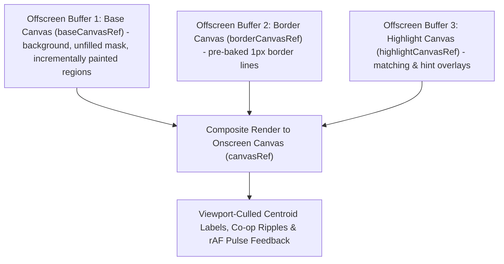
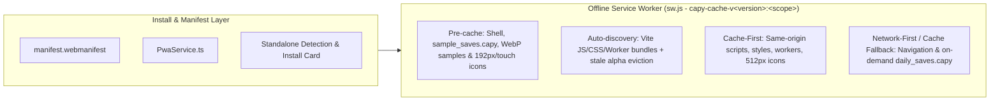

# Web Architecture & Technical Design -- Capy Web (`WEB.md`)

This document provides the complete technical reference for the Capy Web application in [`web/`](./web/), covering component layering, 3-tier offscreen canvas rendering, 6-mode touch gestures, state orchestration, Web Worker IPC, the native Android bridge, persistence schemas, and all `UserSettings` keys.

**Related Guides**: [`README.md`](./README.md) | [`ROADMAP.md`](./ROADMAP.md) | [`DEV.md`](./DEV.md) | [`AGENTS.md`](./AGENTS.md) | [`PUZZLE.md`](./PUZZLE.md) | [`APP.md`](./APP.md) | [`CLOUD.md`](./CLOUD.md) | [`TESTING.md`](./TESTING.md) | [`CHANGELOG.md`](./CHANGELOG.md)

**Table of Contents**:
1. [Architectural Overview & Design Principles](#1-architectural-overview--design-principles)
2. [Directory & Module Structure](#2-directory--module-structure)
3. [Component Hierarchy & Layering](#3-component-hierarchy--layering)
4. [State Management & Lifecycle (`App.tsx`)](#4-state-management--lifecycle-apptsx)
5. [Rendering Pipeline & Gesture Engine (`PuzzleCanvas.tsx`)](#5-rendering-pipeline--gesture-engine-puzzlecanvastsx)
6. [Background Engine & Worker Protocol](#6-background-engine--worker-protocol)
7. [Native Android Bridge (`NativeBridge.ts`)](#7-native-android-bridge-nativebridgets)
8. [Persistence, Storage Keys & `UserSettings` Dictionary](#8-persistence-storage-keys--usersettings-dictionary)
9. [Styling & Design Tokens (`index.css`)](#9-styling--design-tokens-indexcss)
10. [Progressive Web App (PWA) & Offline Caching](#10-progressive-web-app-pwa--offline-caching)
11. [Development & Build Verification](#11-development--build-verification)

---

## 1. Architectural Overview & Design Principles

Capy Web is a client-side color-by-number generator and interactive canvas player built with **React 19**, **TypeScript**, **Vite 6**, and **Tailwind CSS 4**.


### Core Tenets
1. **Zero Forced Server Dependency**: Image quantization, vector segmentation, and save storage run 100% locally in the browser or WebView. Puzzles generate and play offline without mandatory accounts.
2. **60--120 FPS Canvas Rendering**: Instead of mutating thousands of DOM or SVG nodes, Capy uses a **3-tier offscreen-cached HTML5 2D Canvas pipeline** with dirty-rect updates and zero React state churn during pan/zoom/scrubbing.
3. **Responsive Non-Blocking UI**: CPU-heavy computer vision runs inside a dedicated **Web Worker** (`puzzle.worker.ts`) using transferable `ArrayBuffer` buffers.
4. **Single Source of Truth**: `web/` powers the production Cloudflare Workers PWA (`https://capypaint.com/`), GitHub Pages previews (`https://shthed.github.io/capy/`), and the native Android app ([`app/`](./app/)) via [`NativeBridge.ts`](./web/src/services/NativeBridge.ts).
5. **Edge-to-Edge Safe-Area Layout**: Hardware inset custom properties (`--sat`, `--sab`, `--sal`, `--sar`) keep controls clear of notches, cutouts, and gesture bars across phones, tablets, and desktops.

---

## 2. Directory & Module Structure

### Entry, Build & Public Assets
- **[`web/index.html`](./web/index.html)**: Host HTML document with synchronous pre-React `www.capypaint.com -> https://capypaint.com` canonical redirect, `https://capypaint.com/` metadata, mobile viewport, and safe-area tags.
- **[`web/package.json`](./web/package.json)**: Single source of truth for `"version"`, dependencies (React 19, Vite 6, Tailwind CSS 4, Lucide), and CLI scripts (`test:sanity`, `lint`, `build`, `test`, `preview`).
- **[`web/tsconfig.json`](./web/tsconfig.json)**: Strict TypeScript compiler configuration.
- **[`web/vite.config.ts`](./web/vite.config.ts)**: Vite bundler configuration enforcing relative asset base (`base: './'`), lazy modal chunk splitting, build-only `transformIndexHtml` `<meta http-equiv="Content-Security-Policy">` injection (`buildMetaCspPolicy` + `extractInlineScriptHashes` so GitHub Pages and Android WebView enforce strict CSP without breaking Vite dev HMR), post-build `dist/sw.js` version + deterministic `computeDistAssetsDigest` (`SW_ASSETS_DIGEST`) stamping, and `CAPY_ANDROID_SHA256_CERT_FINGERPRINTS` injection into `dist/.well-known/assetlinks.json`.
- **[`web/public/sw.js`](./web/public/sw.js)**: Same-origin offline Service Worker isolating caches by version, `SW_ASSETS_DIGEST`, and deployment scope (`capy-cache-v<version>:<scopePath>`), automatically evicting stale `/alpha/*`, `/PR/*`, and `/pull/*` preview caches on activation while preserving the active scope, sibling Beta/Production caches, and non-Capy origin caches, moving `daily_saves.capy` and 512px icons to on-demand runtime caching, serving `.capy` bundles Network-First (`cache: 'no-cache'`) with exact-query isolation (no `ignoreSearch`), excluding `/api/` and `/.well-known/`, blocking `.apk` interception, and rejecting unexpected `text/html` fallback responses via `isCacheableAssetResponse` so SPA fallbacks never poison asset caches.
- **[`web/public/manifest.webmanifest`](./web/public/manifest.webmanifest)**: Standalone PWA manifest with relative `./` scope.
- **[`web/public/_headers`](./web/public/_headers)** & **[`web/public/_redirects`](./web/public/_redirects)**: Cloudflare Workers Static Assets strict security headers (SHA-256 `Content-Security-Policy` matching inline scripts without `'unsafe-inline'`, `script-src-attr 'none'`, GIS script narrowed to `https://accounts.google.com/gsi/client`, `upgrade-insecure-requests`, locked `script-src 'none'` override on `/privacy-policy.html`, `Cross-Origin-Opener-Policy: same-origin-allow-popups`, `Strict-Transport-Security`, `X-Frame-Options: SAMEORIGIN`, `X-Content-Type-Options: nosniff`, `Permissions-Policy`, and `Cache-Control: no-cache` on `/`, `/index.html`, `/sw.js`, and `/manifest.webmanifest`), immutable `/assets/*` caching with `! Cache-Control` overrides for unhashed sample/icon assets, and `/capy.apk` `302` release redirect (SPA fallback is handled by [`wrangler.jsonc`](./wrangler.jsonc) `not_found_handling: "single-page-application"`).
- **[`web/public/.well-known/assetlinks.json`](./web/public/.well-known/assetlinks.json)**: Root-domain Android Digital Asset Links manifest served at `https://capypaint.com/.well-known/assetlinks.json` for `com.capyboop.paint` (populated at build time from `CAPY_ANDROID_SHA256_CERT_FINGERPRINTS`).
- **[`web/public/privacy-policy.html`](./web/public/privacy-policy.html)**: Published Privacy Policy and Google Play / Google Auth Data Safety summary (`https://capypaint.com/privacy-policy.html`) hardened with a script-less `<meta http-equiv="Content-Security-Policy">` (`script-src 'none'`).
- **[`web/public/404.html`](./web/public/404.html)**: GitHub Pages fallback page with strict SHA-256 `<meta http-equiv="Content-Security-Policy">` redirecting expired `/capy/alpha/<id>`, `/capy/PR/<id>`, and `/capy/pull/<id>` preview URLs to `/capy/alpha/?missing=<id>` (with an infinite-redirect guard on `/capy/alpha/`).
- **[`web/public/assets/sample_saves.capy`](./web/public/assets/sample_saves.capy)** & **[`web/public/assets/daily_saves.capy`](./web/public/assets/daily_saves.capy)**: Deterministically pre-baked (`DETERMINISTIC_EXPORT_DATE_MS`) Max-Detail `.capy` v2 Gzip archives (`2048p`, `<= 2000` regions) covering all 4 built-in gallery samples (`sample_saves.capy`, eagerly precached for zero-worker boot) and all 20 static UTC Daily Puzzle combinations (`daily_saves.capy`, cached on-demand via Network-First when Play Daily is opened).

### Core Shell, Types & Styling (`web/src/`)
- **[`web/src/main.tsx`](./web/src/main.tsx)**: React 19 root mount, `isDebugStorageExposed()` gating for `window.capyStorage` (enabled only in dev builds, `?capy_debug=1`, or `localStorage['capy_dev_debug'] === '1'` unless `?capy_debug=0`), one-shot `sessionStorage`-guarded `vite:preloadError` reload recovery, and Service Worker bootstrap.
- **[`web/src/version.ts`](./web/src/version.ts)**: Exports `APP_VERSION`, `APP_VERSION_CODE = MAJOR*10000 + MINOR*100 + PATCH`, `parseSemVer`, and `resolveReleaseChannel` (`'stable' | 'beta' | 'alpha' | 'dev'` channel detection for `capypaint.com` with `showChannelSwitcher: false`, `/capy/`, `/capy/beta/`, `/capy/alpha/<num>/`, and `?capy_channel=` overrides).
- **[`web/src/App.tsx`](./web/src/App.tsx)**: Lean `< 1,500`-LOC composition and layout root wiring core state, release channel metadata, and feature hooks under `web/src/hooks/` (`useTutorialAndOffers`, `useCoopSession`, `useReplayController`, `useUndoRedo`, `useViewportAndShortcuts`, `usePaintController`, `useSnapshotLibrary`, `useSessionRestore`, `useCloudSyncController`).
- **[`web/src/index.css`](./web/src/index.css)**: Tailwind CSS 4 imports, safe-area utility classes, and `touch-action: none` resets.
- **[`web/src/types/index.ts`](./web/src/types/index.ts)**: Central TypeScript types (`PuzzleData`, `PaletteColor`, `UserSettings`, `SavedSnapshot`, `GeneratorConfig`, `GENERATION_PIPELINE_STEPS`, `SAMPLE_GALLERY`).

### Feature Hooks (`web/src/hooks/`)
- **[`useLatest.ts`](./web/src/hooks/useLatest.ts)**: SSR-safe `useIsomorphicLayoutEffect` and `useLatest<T>` ref mirror helper eliminating render-time `Ref.current` writes.
- **[`useSessionRestore.ts`](./web/src/hooks/useSessionRestore.ts)**: Launch session restoration hook running [`sessionRestorePipeline.ts`](./web/src/services/sessionRestorePipeline.ts) with `AbortController` / cancellation guards for `#s=<token>` share links, `?room=` joins, active saves, and starter sample bootstrap.
- **[`useUndoRedo.ts`](./web/src/hooks/useUndoRedo.ts)**: Synchronous ref-backed undo/redo history stacks with Co-op `PAINT_EVENT`/`UNFILL_EVENT` synchronization.
- **[`useReplayController.ts`](./web/src/hooks/useReplayController.ts)**: Chronological replay playback, timeline scrubbing, offscreen step fast-forwarding, and `SmoothDamp` follow-painting coordination.
- **[`useCoopSession.ts`](./web/src/hooks/useCoopSession.ts)**: Real-time Co-op room hosting/joining, `#s=<token>` share links, and `CoopRippleBuffer` peer paint/unfill emission.
- **[`useCloudSyncController.ts`](./web/src/hooks/useCloudSyncController.ts)**: Coalesced cloud library sync orchestration atop [`cloudSyncCoordinator.ts`](./web/src/services/cloudSyncCoordinator.ts) and [`ProviderContext.tsx`](./web/src/context/ProviderContext.tsx).
- **[`useTutorialAndOffers.ts`](./web/src/hooks/useTutorialAndOffers.ts)**: 12-step interactive tutorial progression, FIFO contextual feature offer queue, `SafeLocalStore` + `TUTORIAL_COMPLETED_KEY` persistence, `NativeBridge.pushBackHandler` layering, and `TargetSpotlightOverlay` state derivation.
- **[`useViewportAndShortcuts.ts`](./web/src/hooks/useViewportAndShortcuts.ts)**: Visible color/region culling sets, fullscreen state/toggle, debounced `350ms` viewport persistence with `beforeunload`/`pagehide` flush, and lookup-table desktop keyboard shortcuts (`Ctrl/Cmd+Z/Y`, `1`--`9`, `+/-`, `0`, Arrow/WASD).
- **[`usePaintController.ts`](./web/src/hooks/usePaintController.ts)**: Single and batch region painting, custom palette CRUD and theme presets, smart on-screen hint selection, and active coloring elapsed-time/hint session stats.
- **[`useSnapshotLibrary.ts`](./web/src/hooks/useSnapshotLibrary.ts)**: Worker puzzle generation (`generationSeqRef`), snapshot load/delete/clear/restore transitions (`snapshotTransitionSeqRef`/`snapshotTransitioningRef`), safe `blob:`-only URL revocation, prebaked sample loading, 2x detail-tile extraction, monotonic `resetEpoch` progress reset, and export/import callbacks.

### UI Components (`web/src/components/`)
- **[`PuzzleCanvas.tsx`](./web/src/components/PuzzleCanvas.tsx)**: 3-tier offscreen 2D canvas renderer, 6-mode touch/pointer gesture engine with custom zoom sensitivity, magnetic zoom detents, `reducedMotion` instant camera/highlight overrides, keyboard `panStepRequest` clamping, Pole-of-Inaccessibility label layout, Follow Painting camera controller, and Co-op ripples.
- **[`GameTopBar.tsx`](./web/src/components/GameTopBar.tsx)**: Responsive two-lane top bar (`topbar-left-lane` scrollable pill strip + `topbar-right-lane` fixed-shrink action buttons) with puzzle title, `computeProgressPercentage` completion badge (capped at `99%` until `100%` complete), non-production `BETA` / `ALPHA #<num>` channel pill (`topbar-channel-badge`), sub-tile parent breadcrumb pill (`topbar-parent-puzzle-btn`), opt-in Co-op button/presence pill (`topbar-coop-btn` / `topbar-active-coop-pill` when Cloud/Co-op UI is enabled), preview toggle, fullscreen, image upload, and settings button.
- **[`PaletteDock.tsx`](./web/src/components/PaletteDock.tsx)**: Always-visible bottom horizontal swatch dock (`palette-swatch-<n>`) for incomplete puzzles (including during replay) with completion badges, strict sorted order, symmetric `50%` active-swatch centering when scrollable (preserving `1–4` short-dock `mx-auto` centering), `reducedMotion` scroll overrides, programmatic color sync isolation (`onSyncActiveColor`), and dynamic sort modes.
- **[`FloatingActions.tsx`](./web/src/components/FloatingActions.tsx)**: Undo (`Ctrl+Z`, enabled by default, long-press `>= 450ms` for timeline scrubber), conditional Redo (`Ctrl+Y`), Watch Puzzle Replay (`replay-btn`), continuous Paint Mode, zoom `+/-`, and fit-to-screen reset (adapting vertical clearance for `ReplayControls`).
- **[`SettingsModal.tsx`](./web/src/components/SettingsModal.tsx)** & **[`web/src/components/settings/`](./web/src/components/settings/types.ts)**: Lazy-loaded `< 250`-LOC 5-tab modal shell accepting `<= 8` grouped prop contracts (`navigation`, `preferences`, `about`, `create`, `saves`, `cloudCoop`), managing `aria-labelledby`, focus capture/restoration on close, `LAST_SETTINGS_TAB_KEY` persistence, `localConfig` open resync, and Escape layering (`BrowserStorageModal` -> inline rename -> `SettingsModal`). Delegates rendering to focused primitives and tab modules under `web/src/components/settings/`: `SettingsTabBar.tsx`, `SettingToggleRow.tsx` (single source of truth re-exported as `SettingSwitchRow` in [`SettingsControls.tsx`](./web/src/components/SettingsControls.tsx)), `SettingSliderRow.tsx` (`useId()` `<label htmlFor>` + `aria-label` + `dimmed`/`disabled` states), `SnapshotCard.tsx` (unified `detail | grid` card reusing `snapshotPaths.ts`), `AboutTab.tsx` + `FeedbackSection.tsx`, `SettingsTab.tsx`, `HintsTab.tsx`, `CreateTab.tsx` (using [`web/src/data/presetGallery.ts`](./web/src/data/presetGallery.ts)), and `SavesTab.tsx` + `CloudAccountSection.tsx`.
- **[`BrowserStorageModal.tsx`](./web/src/components/BrowserStorageModal.tsx)**: Mobile-first (`360px` zero-overflow, `z-[65]`, `NativeBridge.pushBackHandler`, Escape-isolated) Browser Storage Analyzer & Cleaner modal showing live `navigator.storage.estimate()` quota/usage, `CacheStorage` breakdown, `IndexedDB` breakdown (including **Orphaned Records** and sibling channel DBs), Local Storage keys, and 4 inline-confirmed safe cleanup actions.
- **[`CloudAccountCard.tsx`](./web/src/components/CloudAccountCard.tsx)**: Mobile-first (`360px` zero-overflow) multi-provider `$0` BYOC account & sync status card wired inside `CloudAccountSection.tsx` (`cloud-coop-hub`), dynamically rendering login/switch buttons only for supported & configured providers (`Google`, `Microsoft`, `Apple`, and `Play Games` on Android), displaying live sync status (`Synced`/`Syncing...`/`Offline`/`Error`) + last-synced timestamp, and auto-hiding unconfigured providers.
- **[`OnboardingTutorial.tsx`](./web/src/components/OnboardingTutorial.tsx)**: Non-blocking 14-step interactive first-run tutorial card (`capy_tutorial_completed_v1`, `?skipTutorial=1`, per-visit auto-advance across all 14 steps with modal/loading pause, `[All Topics]` jump drawer `tutorial-topics-btn` / `tutorial-topics-drawer`, top `Large Text` accessibility toggle, and Android hardware back / modal-aware `Escape` guard).
- **[`FeatureOfferBanner.tsx`](./web/src/components/FeatureOfferBanner.tsx)**: Non-blocking contextual top quick-tip banner (`feature-offer-banner`, queued cleanly while suppressed by modals or loading, with `Jump to Guide` -> matching tutorial step and `Got it` dismissal).
- **[`TargetSpotlightOverlay.tsx`](./web/src/components/TargetSpotlightOverlay.tsx)**: Non-blocking SVG + CSS spotlight ring (`spotlight-ring`) and directional Bézier arrow (`spotlight-pointer`) highlighting the live target controls for all 14 `OnboardingTutorial` steps (`TUTORIAL_STEP_TARGETS`) and 8 `FeatureOfferBanner` tips (`FEATURE_OFFER_TARGETS`), honoring `reducedMotion` and `ResizeObserver` layout changes.
- **[`ReplayControls.tsx`](./web/src/components/ReplayControls.tsx)**: Compact YouTube-style playback scrubber HUD (`0.5x`--`20x`, Follow Painting, Auto-Loop, Skip-to-End, Exit) stacked cleanly above `PaletteDock` on incomplete puzzles and auto-dismissing when a palette swatch is clicked.
- **[`ColorPickerPopover.tsx`](./web/src/components/ColorPickerPopover.tsx)**: Lazy-loaded custom HSL/Hex swatch editor and 5 theme presets for Free Colour mode.
- **[`ErrorBoundary.tsx`](./web/src/components/ErrorBoundary.tsx)**: Root React crash-recovery boundary wrapping `main.tsx` (`exportEmergencySavesBackup` non-destructive `.capy` -> `.json` download, redacted message display, and retry `?capy_test_crash=1` URL strip).
- **[`LoadingOverlay.tsx`](./web/src/components/LoadingOverlay.tsx)**: Non-blocking bottom progress HUD supporting Simple (Fast Mode) and Detailed 6-stage pipeline inspection.

### Services, Providers, Utilities & Engine (`web/src/services/`, `web/src/utils/`, `web/src/engine/`)
- **[`telemetry.ts`](./web/src/services/telemetry.ts)** & **[`cloudSyncCoordinator.ts`](./web/src/services/cloudSyncCoordinator.ts)**: Bounded 50-entry FIFO non-PII swallowed-error ring buffer (`reportSwallowed` with `Bearer`/`ya29.`/query+fragment redaction and debug-gated console warnings), coalesced trailing-pass cloud sync controller (`createCoalescedSyncController` / `isManifestCloudSnapshotSlot`), and automatic background cross-device sync scheduler (`createAutoCloudSyncScheduler` with `15s` debounced mutation push, `30s` stale `visibilitychange` pull+merge, and `online` reconnect sync).
- **[`web/src/utils/`](./web/src/utils/base64.ts)**: Shared chunk-safe binary <-> base64 helpers (`base64.ts`), debug environment gate (`debugEnvironment.ts`), and safe snapshot thumbnail resolvers (`snapshotPaths.ts`).
- **[`CapyCodec.ts`](./web/src/services/CapyCodec.ts)**: Scanline RLE + LEB128 varints (`CompactPuzzleRecordV2`), strict `.capy` v2 Gzip / decompressed-size / RLE bounds (`MAX_BINARY_SAVE_DECOMPRESSED_BYTES` 16 MiB for single saves, `MAX_BINARY_ARCHIVE_DECOMPRESSED_BYTES` 256 MiB gated on `FLAG_ARCHIVE` with encode-time ceiling validation and format-vs-flag consistency checks, `decodeRegionMapRle`, `validateRegionMetaFloat32`), schema + `__proto__` stripping (`assertValidPalette`, `assertValidSourceRef`, `assertValidSavedSnapshot`, `unpackFramedPayload`), and CRDT `ProgressDeltaV2` tokens.
- **[`StorageService.ts`](./web/src/services/StorageService.ts)** & **[`web/src/services/storage/`](./web/src/services/storage/StorageKeys.ts)**: Thin backward-compatible static facade (`window.capyStorage` gated by `isDebugStorageExposed()`) over 11 acyclic storage modules (`StorageKeys.ts`, `SafeLocalStore.ts` with `keys()`/`entries()`, `IndexedDbStore.ts` with `closeDbHandle()`/`deleteOrphanedEntries()`, `BackupEngine.ts`, `SettingsStorage.ts`, `ActiveSessionStorage.ts`, `SnapshotStorage.ts`, `SnapshotArchiveCodec.ts`, `PuzzleSerializer.ts`, `StorageAnalyzer.ts`, `ImageCompression.ts`) providing centralized `localStorage` access with `reportSwallowed` telemetry, fail-closed IndexedDB (`capy_game_storage_v8`) writes with `InvalidStateError` handle eviction/retry and bounded LRU `previewCache`, live storage analysis & shared-origin-safe cleanup (`StorageAnalyzer.ts`), oversized custom photo compression (`ImageCompression.ts`), `quarantineCorruptLocalPayload` recovery, synchronous native flush on `deleteSnapshot`, `updatedAt` active-save freshness comparison, strict legacy `pixelsB64` bounds in `deserializePuzzle`, and atomic `importSnapshotData` (`isCloudCoopUiEnabled()` in [`StorageNamespace.ts`](./web/src/services/StorageNamespace.ts) gates unfinished Cloud/Co-op hub UI behind `?coop=1`, valid `4-8`-char `?room=...`, or `localStorage['capy_dev_cloud_coop_ui'] === '1'`).
- **[`SvgPrintExporter.ts`](./web/src/services/SvgPrintExporter.ts)** & **[`artworkExporter.ts`](./web/src/services/artworkExporter.ts)**: Pure SSR-testable printable monochrome vector `.svg` coloring sheet builder (`buildPrintableColoringSvg`, `exportPrintableColoringSvg`) tracing collinear-merged `#1e293b` `<path>` outlines from `regionMap` transitions, paired with canvas thumbnail preview generation (`generatePreviewDataUrl`), full-resolution PNG export (`exportColoredArtworkPng`), and `.capy` single/bulk archive export & import helpers (`exportSingleSnapshotArchive`, `exportAllSnapshotsArchive`, `importSnapshotsArchive`).
- **[`DailyPuzzleService.ts`](./web/src/services/DailyPuzzleService.ts)**: Pure, 100% offline deterministic UTC featured puzzle selector (`getDailyFeaturedPuzzle(utcDateStr?)` rotating `SAMPLE_GALLERY` artworks x `DAILY_PRESET_VARIATIONS` with honest `Max Detail` / `Free Colour Line Art • Max Detail` metadata backed by all 20 static `daily_saves.capy` entries).
- **[`PlayerStatsService.ts`](./web/src/services/PlayerStatsService.ts)**: Local + Android-backed `PlayerLifetimeStats` store (`capy_player_stats_v1`, routed through `SafeLocalStore`) with SSR memory fallback, non-negative clamping, native Android backup reset on `resetStats()`, and monotonic CRDT-ready `mergeLifetimeStats(a, b)`.
- **[`ShareLinkService.ts`](./web/src/services/ShareLinkService.ts)**: `< 2 KB` `#s=<token>` share URLs and `?room=<ROOM6>` Co-op room invite helpers.
- **[`FeedbackService.ts`](./web/src/services/FeedbackService.ts)**: Anonymous in-game feedback client (`resolveFeedbackApiUrl`, `buildGitHubIssueFallbackUrl`, `validateFeedbackDraft`, `submitAnonymousFeedback`) targeting `POST /api/feedback` with prefilled `capyboop/paint` GitHub issue-form fallback on offline/`503`/`502` responses.
- **[`FeatureOffersService.ts`](./web/src/services/FeatureOffersService.ts)**: Persistent first-time feature discovery store (`capy_feature_offers_v1`) covering 8 contextual quick tips (`paint_mode`, `undo_replay`, `replay_scrubber`, `free_color`, `create_gallery`, `photo_upload`, `infinite_zoom`, `saves_export`) scoped via `resolveScopedStorageKey` and mirrored via `NativeBridge.saveBackup`.
- **[`SoundService.ts`](./web/src/services/SoundService.ts)**: Zero-asset procedural Web Audio API synthesizer (`playRegionTap` tactile woodblock/brush envelope, `25ms` drag rate-throttling, lazy user-gesture unlock, and automatic `AudioContext.suspend()` on `visibilitychange` / `pagehide` / `blur`).
- **[`providers/OAuthPkceHelper.ts`](./web/src/services/providers/OAuthPkceHelper.ts)**, **[`providers/GoogleCloudSyncClient.ts`](./web/src/services/providers/GoogleCloudSyncClient.ts)**, **[`providers/MicrosoftCloudSyncClient.ts`](./web/src/services/providers/MicrosoftCloudSyncClient.ts)** & **[`providers/AppleCloudSyncClient.ts`](./web/src/services/providers/AppleCloudSyncClient.ts)**: Shared WebCrypto `S256` PKCE helper (`window.__capyReceiveOAuthCallback` + Web popup handoff), Google Drive `appDataFolder` REST v3 client, Microsoft Graph OneDrive `special/approot` REST client, and Apple Sign-In + CloudKit JS / iOS `CapyIOS` bridge client.
- **[`providers/types.ts`](./web/src/services/providers/types.ts)**: Hexagonal interfaces (`CloudProviderDriver`, `AuthProvider`, `CloudSaveProvider`, `RealtimeRoomProvider`, `CatalogStorageProvider`, `AiArtworkProvider`, `MonetizationProvider`).
- **[`providers/CloudProviderDrivers.ts`](./web/src/services/providers/CloudProviderDrivers.ts)**: Pluggable `$0` BYOC cloud drivers (`GoogleCloudDriver` with per-file `writeLocks` mutex, `PlayGamesAndroidDriver` with `<= 180 KB` multi-chunk `pgblob:*` binary split/reassembly, `MicrosoftCloudDriver` with OneDrive AppFolder CRUD + write mutex, `AppleCloudDriver` with CloudKit/iOS CRUD + write mutex, and `SteamCloudDriver`).
- **[`providers/ProviderRegistry.ts`](./web/src/services/providers/ProviderRegistry.ts)**: `MultiProviderAuthManager`, `CrdtCloudSaveAdapter` (`syncFullLibrary` with monotonic `resetEpoch` anti-resurrection), `HybridCoopRoomAdapter`, local `CommunityPuzzleIdea` notebook (`SEED_COMMUNITY_IDEAS` with `votes: 0`, sorted newest-first), and 100% ad-free `ConsentRewardedAdAdapter` (`adFreePlatform: true`).
- **[`NativeBridge.ts`](./web/src/services/NativeBridge.ts)**: Defensive wrapper around Android `window.CapyAndroid` (including allowlisted `openExternalOAuth`) and WebKit bridges with web fallbacks and LIFO back-button stack.
- **[`PwaService.ts`](./web/src/services/PwaService.ts)**: PWA install prompt capture, standalone mode detection, and Service Worker update activation.
- **[`PuzzleWorkerService.ts`](./web/src/services/PuzzleWorkerService.ts)**: Web Worker lifecycle, cancellation, live `SET_DETAILED_PROGRESS` toggling, and transferable `ArrayBuffer` reconstruction.
- **[`CoopRippleBuffer.ts`](./web/src/engine/CoopRippleBuffer.ts)**: Pre-allocated typed-array ring buffer (`Float32Array`, `Float64Array`, and pre-allocated hex stroke array) for zero-GC collaborator paint ripples that sleep at `0%` idle CPU when finished.
- **[`puzzle.worker.ts`](./web/src/engine/puzzle.worker.ts)**, **[`PuzzleGenerator.ts`](./web/src/engine/PuzzleGenerator.ts)**, **[`ImageAnalyzer.ts`](./web/src/engine/ImageAnalyzer.ts)**, **[`LineArtExtractor.ts`](./web/src/engine/LineArtExtractor.ts)**, **[`ColorQuantizer.ts`](./web/src/engine/ColorQuantizer.ts)**, **[`RegionSegmenter.ts`](./web/src/engine/RegionSegmenter.ts)**: Computer-vision segmentation pipeline (detailed in [`PUZZLE.md`](./PUZZLE.md)).

---

## 3. Component Hierarchy & Layering

Pointer events pass through empty overlay containers (`pointer-events-none`) directly to `PuzzleCanvas` while interactive buttons opt in with `pointer-events-auto`:

- **`z-0` (`PuzzleCanvas`)**: Full-bleed interactive pan/zoom 2D canvas.
- **`z-20` (`FloatingActions`, `PaletteDock`)**: Bottom-right tool stack and bottom horizontal swatch dock.
- **`z-30` (`GameTopBar`, `ReplayControls`)**: Top safe-area status bar and floating bottom YouTube-style replay scrubber HUD.
- **`z-[38]` (`TargetSpotlightOverlay`)**: Non-blocking (`pointer-events-none`) spotlight highlight ring(s) and directional pointer arrow anchored behind tutorial/offer cards.
- **`z-[39]` (`FeatureOfferBanner`)**: Contextual non-blocking feature tip banner.
- **`z-40` (`LoadingOverlay`, `OnboardingTutorial`)**: Non-blocking bottom-anchored generation HUD, 6-stage inspector drawer, and non-blocking top-anchored 14-step tutorial card.
- **`z-50` (`SettingsModal`, `ColorPickerPopover`)**: Modal configuration sheet and nested custom color popover.
- **`z-[60]` (`storage-quota-toast` in `App.tsx`, modal-docked `OnboardingTutorial`)**: Dismissible `QuotaExceededError` alert surfacing above open modals and modal-docked tutorial guide bar across Settings Steps 8--12.
- **`z-[65]` (`BrowserStorageModal`)**: Standalone Browser Storage Analyzer & Cleaner modal rendered outside `SettingsModal`'s `z-50` stacking context so it always stacks cleanly above modal-docked tutorial overlays.

### Component Responsibilities & Key Interactions

- **[`PuzzleCanvas.tsx`](./web/src/components/PuzzleCanvas.tsx)**:
  - Renders the puzzle via 3-tier offscreen canvas caching, hit-tests region taps via `regionMap`, renders Co-op collaborator ripples, and centers clean `sourceImage` previews while `puzzle.worker.ts` runs.
- **[`GameTopBar.tsx`](./web/src/components/GameTopBar.tsx)**:
  - Uses a two-lane flex layout (`topbar-left-lane` with `min-w-0 flex-1 overflow-x-auto no-scrollbar` and `topbar-right-lane` with `flex-shrink-0`) so left badges (including `ALPHA #NNN` / `BETA` on narrow `360px` mobile screens in both Normal and Large Text modes) never clip or overlap right action buttons. Displays puzzle title (`data-filled-count`, taps open Saves), completion percentage via `computeProgressPercentage` (capped at `99%` until `filledCount >= totalCount`), one-tap sub-tile **Parent Puzzle** breadcrumb pill (`topbar-parent-puzzle-btn`, rendered whenever the active puzzle's `SavedSnapshot.parentSnapshotId` still exists in `snapshots` so deleting a parent hides dangling pills, and restoring the parent puzzle's saved zoom/pan viewport on tap), opt-in Co-op button/presence pill (`topbar-coop-btn` / `topbar-active-coop-pill` when Cloud/Co-op UI is enabled via `isCloudCoopUiEnabled()`), preview eye toggle, web-only fullscreen toggle (hidden on `NativeBridge.isAndroid`), photo upload shortcut, and Settings button—all with `>= 38px` mobile touch targets and descriptive `aria-label` attributes.
- **[`PaletteDock.tsx`](./web/src/components/PaletteDock.tsx)**:
  - Renders (`data-testid="palette-dock"`) numbered color swatches with remaining region counts whenever an incomplete puzzle is active (remaining mounted during `ReplayControls` playback or pause). Tapping any swatch during replay (`isReplaying === true`) immediately dismisses `ReplayControls` and selects that color via `onColorSelected` without triggering a hint; outside replay, tapping an already-active swatch during Step 1 (`palette`) advances the tutorial cleanly without triggering a hint, and on all other steps triggers a directional region hint (`onColorHintRequested`). Defensive active-color fallback uses `onSyncActiveColor` silently without dismissing replay, `+` opens `ColorPickerPopover`, and swatches support sorting by `NUMBER`, `REMAINING`, `HUE`, or `LIGHTNESS` while strictly preserving sorted order and centering the active swatch at `50%` on scrollable docks.
- **[`FloatingActions.tsx`](./web/src/components/FloatingActions.tsx) & Global Keyboard Shortcuts**:
  - **Undo (`Ctrl+Z` / `Cmd+Z`)**: Undoes the last fill/repaint (enabled automatically in Free Color mode or via `enableUndo`, backed by synchronous `undoStackRef` / `redoStackRef` refs so rapid key bursts never pop stale closures). Long-pressing Undo (`>= 450ms`) opens `ReplayControls` for historical timeline scrubbing.
  - **Redo (`Ctrl+Y` / `Ctrl+Shift+Z`)**: Stacked above Undo whenever `redoStack.length > 0`; re-applies undone strokes.
  - **Desktop Gameplay Shortcuts (`1`--`9`, `+`/`=`, `-`/`_`, `0`, Arrow/WASD)**: When the puzzle canvas is active (no modal open, no `Ctrl`/`Meta`/`Alt` modifier held, and focus is not inside `<input>`, `<textarea>`, `<select>`, or `isContentEditable`), keys `1`--`9` select the corresponding visible palette swatch, `+`/`=` and `-`/`_` zoom in/out anchored at the viewport center, `0` resets zoom and pan to `1x` fit view, and `ArrowUp`/`W`, `ArrowDown`/`S`, `ArrowLeft`/`A`, `ArrowRight`/`D` pan the viewport by `64` CSS px clamped via `clampCanvasOffset` (calling `e.preventDefault()`).
  - **`Escape` & `Enter` Keys**: Pressing `Escape` closes `BrowserStorageModal` or cancels an active inline save-card rename in `SettingsModal` first (`Enter` commits the rename); otherwise `Escape` pops the topmost overlay on the LIFO modal stack (`ColorPickerPopover` -> `SettingsModal` -> `ReplayControls`).
  - Also hosts Watch Puzzle Replay (`replay-btn`), continuous Paint Mode brush toggle, optional `+/-` zoom buttons, and fit-to-screen reset (`reset-view-btn`), all with `>= 44px` touch targets and `aria-label` attributes, lifting dynamically so `ReplayControls` remains unobstructed.
- **[`SettingsModal.tsx`](./web/src/components/SettingsModal.tsx) & [`SettingsControls.tsx`](./web/src/components/SettingsControls.tsx)**:
  - Exposes `role="dialog" aria-modal="true"`, `role="tablist"` / `role="tab"` (`aria-selected`), unified `SettingSwitchRow` (`role="switch"`, `aria-checked`, `min-h-[44px]`), `SettingSectionCard` (1-column portrait mobile / 2-column `md:grid-cols-2` tablet & desktop), `CollapsibleSettingSection` with live header summaries, a compact `?` tour button (`settings-tour-btn`), and restores the last open tab via `localStorage['capy_last_settings_tab']` (`'0'`--`'4'`, defaulting first-time gear-icon taps to Tab 1 `Settings`):
  - **Tab 0 -- About**: App overview, primary **Send Feedback** CTA (`about-open-feedback-btn`) opening the collapsible mobile-first **Anonymous In-Game Feedback** form (`in-game-feedback-card`), **Replay Interactive Tutorial** (`about-replay-tutorial-btn`), **Privacy Policy** (`about-privacy-policy-link`, opening `https://capypaint.com/privacy-policy.html` externally on `NativeBridge.isAndroid`), collapsible **Open Source Licenses** (`about-licenses-section`), secondary footer **Report Bug / Ideas** link (`about-report-issue-link` -> `https://github.com/capyboop/paint/issues/new/choose`), 2-column **Lifetime Stats** card (`lifetime-stats-card`, spanning the 5th `Free Color Art` card across `col-span-2` when `stat-coop-regions` is hidden), `app-version-badge`, PWA install card / native status, Android APK download link, and **Release Channel** Stable/Beta switcher (`release-channel-card`, hidden on `NativeBridge.isAndroid`); `"Co-op"` copy and `stat-coop-regions` stay gated behind `showCloudCoopUi` (`isCloudCoopUiEnabled()`).
  - **Tab 1 -- Settings**: Organized into 6 grouped cards (*Accessibility* first on the page with `Large Text & Buttons`, independent `Text Size` `85%`--`150%` and `UI Size` `85%`--`140%` sliders, `Fat-Finger Tap Assist` + `Finger Reach Radius` `8px`--`40px` presets `12px`/`22px`/`34px` with non-destructive `34px` boost when `uiScale > 1.0`, and `Reduced Motion`; *UI* with `Canvas Background`, `Palette Order`, `Show Numbers on Regions`, and `Show Borders in Preview`; *Gameplay* with `Auto-Advance Color`, `Free Color Mode`, and `Custom Color Picker for All Puzzles`; *Controls & On-Screen Buttons* hiding web-only Full Screen on Android; *Navigation & Zoom*; *Sound & Haptics*) plus 2 collapsed-by-default sections (*Replay* showing live speed & auto-replay status and single canonical `Replay on Load` toggle; *Number Label Sizing* showing live min/max/scale summary and dimming when region numbers are hidden).
  - **Tab 2 -- Hints**: Grouped into *Hint Appearance* (`hints-section-style`: `highlightStyle` including `Center Glow`, `hintFillStyle` dimmed when not `FULL_REGION`, custom `hintColorArgb` defaulting to Amber `#f59e0b`, `hintIntensity`), *Assistance & Animation* (`hints-section-assist`: `highlightMatching`, `animateHint`, `showNextRegionHint`), and *Coloring Mode & Difficulty* (`hints-section-mode-difficulty`: `Tap Behavior` `difficulty` and `Color Mode` `regionColorMode`).
  - **Tab 3 -- Create**: Resyncs `localConfig` whenever opened (`prevIsOpenRef`) so persisted settings remain aligned across modal opens. Renders the deterministic UTC **Puzzle of the Day** hero card (`daily-puzzle-card`, `hint-toggle-daily-puzzle` `(i)` tooltip, and `daily-puzzle-play-btn` loading pre-generated `Max Detail` / `Free Color Line Art • Max Detail` puzzles from `./assets/daily_saves.capy` via `filterSnapshotId`), above-the-fold **Style & Hint Quick-Jump Bar** (`create-style-hint-bar`) showing human-readable scope copy alongside `Style Guide (10)` and `Hint & Options` (auto-opening `hint-tooltip-algorithm` on scroll), real-time gallery search (`gallery-search-input`), category filter chips, **Choose Photo from Device** (`create-upload-photo-btn`), **Infinite Zoom 2x Detail Tile** cropper (`infinite-zoom-subtile-btn`), collapsible **Preset Style Gallery & Visual Guide** (`preset-gallery-toggle` / `preset-gallery-panel`), `GeneratorConfig` controls with `(i)` tooltips and relocated **Detailed Generation Progress** (`setting-detailed-progress`), synced `Detail Level Preset` buttons + `Max Detail` quick button, and the clean local **Puzzle Idea Notebook** (`community-ideas-section`).
  - **Tab 4 -- Saves**: Renders the saved puzzles gallery (`saves-list-section`, defaulting to `Thumbnails` 2-column mobile / 3-column desktop grid via `capy_saves_view_mode`, or `saves-empty-recovery`) first at the top of the tab, followed by static library and selection controls (`selected-save-action-bar`: Sort, `Detail` / `Thumbnails` view toggle with `aria-pressed`, Pin/Unpin, Load, Replay, inline Rename, per-save Printable `.svg` `save-action-export-svg`, Export `.capy`, Import, Export All, `Reset Progress` `reset-progress-btn`, **Browser Storage** `saves-storage-info-btn` opening `BrowserStorageModal` for live storage inspection & targeted safe cleanups (`Clear Stale & Offline Caches`, `Clean Orphaned Save Data`, `Clear Preview Channel Data`, `Clear All Capy Storage`), Delete All), inline `saves-import-notice`, and by default a clean `saves-share-print-bar` exposing `< 2 KB` `Share Progress Link`, active-puzzle **Printable SVG** (`export-printable-svg-btn`), and `"Saves stored locally on this device"`; setting `?coop=1`, `?room=...`, or `localStorage['capy_dev_cloud_coop_ui'] === '1'` expands the full **Cloud Sync & Simultaneous Co-op Hub** (`cloud-coop-hub`).
- **[`OnboardingTutorial.tsx`](./web/src/components/OnboardingTutorial.tsx)**:
  - Launches automatically on first visit unless `?skipTutorial=1` (or `capy_tutorial_completed_v1 === '1'`). Guides new players through 12 interactive US-English steps (`Pick a Color`, `Tap to Color`, `Zoom & Move`, `Find Hard Shapes`, `Undo Mistakes`, `Watch a Replay`, `Peek at the Art`, `Paint Any Color`, `Daily Puzzle, Gallery & Photos`, `Your Saved Art`, `Customize Settings`, `Customize Hints`) with an `[All Topics]` jump drawer (`tutorial-topics-btn` / `tutorial-topics-drawer`), per-visit live-try auto-advance (`750ms` timer paused while `isModalOpen || isLoading || showTopics`), fixed-height flex-column card shell (`<= 1px` Next-button stability across Steps 1--7 on mobile and desktop) with a consistent compact header `Large Text` pill across all non-modal steps, modal-aware bottom-docked guide bar (`data-modal-docked="true"` at `z-[60]`) across Steps 8--12 (and any step when `SettingsModal` is open) that tells players which tab to tap first and transitions to control guidance once on that tab, unified `cleanupTutorialTransientModes`, `NativeBridge.pushBackHandler`, and modal-aware `Escape` dismissal.
- **[`FeatureOfferBanner.tsx`](./web/src/components/FeatureOfferBanner.tsx) & [`FeatureOffersService.ts`](./web/src/services/FeatureOffersService.ts)**:
  - Surfaces 9 non-blocking first-time contextual quick tips (`paint_mode`, `undo_replay`, `replay_scrubber`, `free_color`, `create_gallery`, `photo_upload`, `infinite_zoom`, `saves_export`, plus one-time `settings_hints_tip` for returning `v1` tutorial completers) below `GameTopBar` after modals/loading settle (deduped FIFO queue, deferred `markOfferSeen` until actually displayed, `Jump to Guide` opening `OnboardingTutorial` at the matching step, `Got it` dismissal, and `localStorage` + `NativeBridge.saveBackup` persistence).
- **[`TargetSpotlightOverlay.tsx`](./web/src/components/TargetSpotlightOverlay.tsx)**:
  - Renders non-blocking (`pointer-events-none`) glowing rings (`spotlight-ring`, warm amber for `tutorial` and sky blue for `offer`) with `preventRingOverlap` separation (`>= 2px` gap on tight groups) and a directional curved SVG arrow (`spotlight-pointer`) connecting the active tutorial or offer card to its visible target control(s)—including modal-aware spotlighting (`TUTORIAL_MODAL_STEP_TARGETS`, `data-modal-spotlight="true"` at `z-[58]` with automatic `scrollIntoView`) inside `SettingsModal` across Steps 8--12 (spotlighting only the target tab when on another tab, then spotlighting both tab and target control once on that tab)—adapting via `ResizeObserver`, external `MutationObserver`, scroll/resize listeners, `activeSettingsTab` / `textScale` / `uiScale` re-measurement, and transition-scoped `requestAnimationFrame` tracking (zero idle polling), and disabling pulse/dash motion when `reducedMotion` is enabled.
- **[`ReplayControls.tsx`](./web/src/components/ReplayControls.tsx)**:
  - Renders as a compact mobile-safe YouTube-style bottom control bar (`w-full max-w-2xl`, `>= 38px` mobile icon buttons with descriptive `aria-label` attributes, `min-w-[44px] sm:min-w-[140px]` scrubber track without `overflow-hidden` so `-top-6` scrub preview tooltips are never clipped), stacked cleanly above `PaletteDock` (`stackAbovePalette` when `!isCompleted`). It provides the full-width interactive pointer-captured timeline scrubber (`renderYouTubeScrubber`, `data-testid="replay-scrubber-track"` / `replay-scrubber`), Play/Pause/Replay, speed selector (`0.5x`, `1x`, `2x`, `5x`, `10x`, `20x`), **Follow Painting** (`replay-follow-btn`), **Auto-Loop** (`replay-loop-btn`), Skip-to-End, and Exit (auto-dismissed immediately when clicking any `PaletteDock` swatch or triggering a tutorial hint).
- **[`ColorPickerPopover.tsx`](./web/src/components/ColorPickerPopover.tsx)**:
  - Provides 5 curated Free Color theme palettes (Vibrant Classic, Mushroom Fantasy, Pastel Dreams, Earthy Nature, Neon Pop) and live HSL/Hex swatch editing/addition.
- **[`LoadingOverlay.tsx`](./web/src/components/LoadingOverlay.tsx)**:
  - Defaults to **Simple Progress (Fast Mode)** (amber-to-yellow bar, throttled worker IPC, zero main-thread rAF overhead) with a one-tap toggle into **Detailed Progress** (`Step 1/6`--`6/6`, live K-Means palette swatches, and `GenerationInspectionDetails` drawer).

---

## 4. State Management & Lifecycle (`App.tsx`)

### 1. Active Session, Undo & Redo State
- `puzzle: PuzzleData | null`: Active dimensions, `PaletteColor[]`, `Region[]`, `regionMap: Int32Array`, and `borderMap: Uint8Array`.
- `sourceImage: HTMLImageElement | null`: Decoded source image displayed cleanly on canvas while `puzzle.worker.ts` runs and used for `DETAIL` / B&W `multiply` compositing.
- `activeColorId: number`: Selected 1-based palette color ID.
- `filledRegionIds: Set<number>`: Colored region IDs preserving exact first-fill chronological insertion order across saves, reloads, and Free Colour repaints (`BF-1` -- repainting an already-filled region updates `paintedRegionColors` without moving the region ID to the tail of `filledRegionIds`).
- `paintedRegionColors: Map<number, number>`: Region ID $\rightarrow$ 1-based palette Color ID overrides in Free Colour mode.
- `undoStack: UndoHistoryEntry[]` & `redoStack: UndoHistoryEntry[]`: Record `{ regionId, wasPreviouslyFilled, previousPaintedColorId, paintedColorId }`, broadcasting restored `paintedColors` (`'PAINT_EVENT'`) for Free Colour repaints or `'UNFILL_EVENT'` (`broadcastUnfillEvent`) when undoing a first-time region fill back to `0` unfilled across Co-op peers (`BF-1`, `US-4.3`).
- `hintRegionId: number | null` & `isPreviewMode: boolean`: Active hint target and unmasked source-artwork preview state.

### 2. Chronological Replay & Historical Resumption State
- **Zero-Allocation Incremental Scrubbing**: During playback and pointer scrubbing, [`PuzzleCanvas.tsx`](./web/src/components/PuzzleCanvas.tsx) mutates `paintedCacheRef.current` and `prevColorsRef.current` in place (zero per-step `Set`/`Map`/`.slice()` allocations) and repaints only the dirty bounding box via `putImageData`.
- **Automatic Offscreen Step Fast-Forward**: When `settings.replayFollow` is `false`, `isRegionVisibleInViewport` performs an $O(1)$ frustum check per step and skips consecutive offscreen regions immediately.
- **Follow Painting Camera Controller (`settings.replayFollow`)**: When `true` and zoomed in (`scale > 1.05`), `stepFollow` runs a zero-allocation 60 FPS loop with an inner **Safe-Frame Dead-Zone** (`[18% w, 82% w]` $\times$ `[max(68px, 18% h), h - max(92px, 22% h)]`), **10-step Predictive Lookahead**, and a **Critically-Damped 2D Velocity Spring-Damper (`SmoothDamp`)**—gliding smoothly toward upcoming region clusters without ever mutating zoom scale, and disengaging automatically (`onManualPanStart`) if the player drags the canvas.
- **Strict Viewport Invariance**: Starting or ending a replay (`startReplay`, `finishAutoResume`, `replay-btn`, completion auto-replay, or replaying the already-active puzzle from Saves) never resets, zooms out, or teleports the camera. Loading a *different* saved puzzle restores its persisted `zoomScale`, `panOffsetX`, and `panOffsetY` (`restoreViewTrigger`) before replay begins.

### 3. Viewport Culling & Generation Sequence Safety
- **Spatial Culling**: `PuzzleCanvas` emits `visibleColorIds` and `visibleRegionIds` on pan/zoom/resize changes to power on-screen Smart Hint region targeting while `PaletteDock` strictly preserves sorted order.
- **Sequence Cancellation (`generationSeqRef`)**: Every worker generation increments `generationSeqRef.current`, calls `PuzzleWorkerService.cancelActive()` on any in-flight worker, and discards stale responses.

---

## 5. Rendering Pipeline & Gesture Engine (`PuzzleCanvas.tsx`)



### Dynamic Active Colour, Hints & Inscribed-Circle Labels
- **Borderless Completed Regions (`writeBaseCanvasPixels` / `writeRegionPixelsToImageData`)**: Completed (filled) regions render seamlessly with their Detail source pixels or Flat/Free Colour palette fill and omit region boundary lines, while unpainted regions retain 1px slate (`rgb(51, 65, 85)`) boundaries in standard Paint-by-Number mode.
- **Active Colour Highlighting**: When `highlightStyle` is `FULL_REGION` (default) or `BOUNDARY_ONLY`, unfilled regions matching `activeColorId` are highlighted using the selected `PaletteColor` (`{ id, r, g, b, argb, hex }` from `puzzle.palette`, 1-based `id`).
- **Hint Highlighting (`hintColorArgb`) & `NUMBER_ONLY`**: Hints render `SOLID`, `CHECKER`, or `STRIPES` overlays in `settings.hintColorArgb` (`#F59E0B` default). `NUMBER_ONLY` tints label text directly with a crisp white stroke halo rather than drawing centroid circles (reserved for `CENTROID_GLOW`).
- **Inscribed-Circle Label Fitting**: Labels render at each region's Pole of Inaccessibility (`centroidX`, `centroidY`), sized from `region.maxRadius / sqrt((0.3 * charCount)^2 + 0.1444)` with a 10% margin and clamped to `[minLabelSize, maxLabelSize]` so 1--3 digit numbers never cross borders.

### Viewport Clamping (`clampCanvasOffset`), Magnetic Detents & `ResizeObserver`
- **Zoom Range, Sensitivity & Magnetic Detents**: Smoothly clamped between **`0.5x`** and **`12.0x`**. Mouse-wheel, two-finger pinch (`Math.pow(rawRatio, zoomSensitivity)`), and one-finger double-tap drag deltas scale smoothly in log-space by `zoomSensitivity` (`0.5`--`2.0`). When `snapZoomLevels` is enabled, `applyZoomSnapDetent` snaps relative zoom within `+-4%` onto magnetic stops `[1, 2, 4, 8, 12]` while re-anchoring `offset` around the active cursor/pinch/double-tap focal point.
- **Dynamic Corner Margins**: Scales pan bounds dynamically with `containerWidth * 0.72` and `containerHeight * 0.72` when zoomed in so all four puzzle corners can pan comfortably past screen center above `PaletteDock` and below `GameTopBar`.
- **Immediate Resize & Rotation Clamping (`BF-2`) & Zero-Alloc Rendering**: A `ResizeObserver` on `containerRef` (plus `window` `resize` fallback) immediately re-clamps `offsetRef.current`, updates `containerSize`, refreshes `canvasRectRef`, resizes the high-DPI `<canvas>`, and repaints synchronously on portrait/landscape rotation or split-screen resize. `PuzzleCanvas` is wrapped in `React.memo` alongside `GameTopBar`, `FloatingActions`, `PaletteDock`, and `ReplayControls`; `drawCompositeFrame` reads `scaleRef.current`/`offsetRef.current`/`tapDotRef.current` directly without recreating resize/media/ripple effects during pan/zoom/tap, `highlightImageDataRef` reuses its buffer in place via `fill(0)`, wheel zoom uses a native `{ passive: false }` listener on `<canvas>`, pointer coordinate mapping reuses `getCachedCanvasRect()`, the idle hint pulse loop throttles to `>= 50ms` (`~20fps`), and `App.tsx` maintains an $O(1)$ `regionByIdRef` lookup map plus `Set`-equality viewport filters.

### 6-Mode Touch, Mouse & Gesture Engine
`PuzzleCanvas` orchestrates **6 distinct** interaction modes:
1. **Tap Hit-Testing**: Inverse-transforms client $(x, y)$ to `(puzzleX, puzzleY)` and calls zero-allocation `resolveNearTapRegionId(...)`. Direct hits on playable unfilled regions resolve in $O(1)$ via `regionMap[y * width + x]`. When `fatFingerAssist` is `true`, near-miss taps on border/filled/mismatched pixels scan integer offsets inside `Math.min(64, touchReachRadiusPx / totalScreenScale)` using scalar distance registers (zero heap allocations): in **Normal Mode**, snaps strictly to the closest unfilled `activeColorId` region; in **Easy Mode** (`difficulty: 'EASY'`) or **Free Colour Mode**, prefers `activeColorId` first and otherwise snaps to the closest unfilled micro-region of any color. In **Easy Mode**, tapping any unpainted region auto-selects its color and fills it; in **Normal Mode**, fills matching `activeColorId` regions; in **Free Colour Mode**, fills or repaints with `activeColorId`.
2. **Google Maps-Style One-Finger Double-Tap-and-Drag Zoom & Horizontal Pan**: Second tap-and-hold within `350ms` and `40px` zooms focal-point-invariantly on vertical drag (`dy > 0` zooms **in**, `dy < 0` zooms **out** unless `reverseDoubleTapZoom` is `true`, `Math.exp(((dir * dy) / 220) * zoomSensitivity)`), while horizontal drag (`|dx| >= |dy|`) pans cleanly even when Paint Mode is active.
3. **Background Margin Drag Panning**: Touching outside the artwork bounds (`x < 0 || y < 0 || x >= width || y >= height`) always pans the viewport even when Paint Mode is active.
4. **Smooth Pan Momentum (Inertial Gliding)**: Samples pointer velocity over a `100ms` sliding window via a pre-allocated 16-slot circular `pointerRingRef` buffer (zero per-move allocations); flicks $\ge 0.18\text{ px/ms}$ glide via `requestAnimationFrame` with $0.92^{\Delta t / 16}$ exponential friction decay and zero-latency cancellation on the next `pointerdown`.
5. **Multi-Touch Pinch-to-Zoom**: Two-finger midpoint focal tracking between `0.5x` and `12.0x` scaled by `Math.pow(rawRatio, zoomSensitivity)`, re-anchoring single-finger pan coordinates seamlessly when one finger lifts.
6. **Drag-to-Color (Continuous Paint Mode)**: Interpolates stroke segments across pointer moves inside the artwork and batch-fills matching regions via `onBatchRegionsClicked` (disabled automatically during replay).

---

## 6. Background Engine & Worker Protocol

Image quantization and segmentation execute in [`puzzle.worker.ts`](./web/src/engine/puzzle.worker.ts) via [`PuzzleWorkerService.ts`](./web/src/services/PuzzleWorkerService.ts) (code-split so [`PuzzleGenerator.ts`](./web/src/engine/PuzzleGenerator.ts) is imported dynamically only when a main-thread fallback is needed):

```typescript
// Main -> Worker Requests
type WorkerRequest =
  | {
      type: 'GENERATE';
      id: string;
      width: number;
      height: number;
      rgbaBuffer: ArrayBuffer; // Transferred zero-copy
      config: GeneratorConfig;
      detailedProgress?: boolean;
    }
  | {
      type: 'SET_DETAILED_PROGRESS';
      detailed: boolean; // Live HUD toggle without restarting worker
    };

// Worker -> Main Responses
type WorkerResponse =
  | {
      type: 'PROGRESS';
      id: string;
      progress: number; // Strictly monotonic 0.0 to 1.0
      status: string;
      payload?: GenerationProgressPayload; // Step 1..6 + GenerationInspectionDetails
    }
  | {
      type: 'SUCCESS';
      id: string;
      puzzleData: {
        width: number;
        height: number;
        palette: PaletteColor[];
        regions: Array<Omit<Region, 'pixels'> & { pixelsOffset: number; pixelsLength: number }>;
        packedPixelsBuffer: ArrayBuffer; // Single contiguous Int32Array sliced via subarray on main thread
        regionMap: ArrayBuffer; // Reconstructed to Int32Array on main thread
        borderMap: ArrayBuffer; // Reconstructed to Uint8Array on main thread
        isFreeColor?: boolean;
      };
    }
  | {
      type: 'ERROR';
      id: string;
      error: string;
    };
```

---

## 7. Native Android Bridge (`NativeBridge.ts`)

[`NativeBridge.ts`](./web/src/services/NativeBridge.ts) wraps `window.CapyAndroid` ([`CapyAndroidBridge.kt`](./app/src/main/java/com/capyboop/paint/CapyAndroidBridge.kt)) and `window.webkit.messageHandlers.CapyIOS` with safe browser fallbacks:

- **`haptic(type)`**: Calls `CapyAndroid.haptic(type)` (`EFFECT_TICK`, `EFFECT_CLICK`, `EFFECT_HEAVY_CLICK`, and custom multi-pulse `VibrationEffect.createWaveform` patterns for `success`/`error` with API 33+ `USAGE_TOUCH`); falls back to `navigator.vibrate(...)` on web.
- **`pushBackHandler(onClose)` / `setBackModalOpen(isOpen, onClose)`**: Maintains a LIFO stack of open modal/popover close callbacks synchronized with Android's `OnBackPressedCallback` via `CapyAndroid.setModalOpen(isOpen)` (`window.__capyCloseModal`), closing nested popovers before parent sheets.
- **`saveBackup(key, data)` / `loadBackup(key)`**: Mirrors JSON save state to Android internal storage (`filesDir/capy_saves/<key>.json`) via `CapyAndroid.saveBackup` / `CapyAndroid.loadBackup`; safe no-op / `null` on web.
- **`applySafeAreaInsets()`**: Reads `CapyAndroid.getSafeAreaInsets()` into `--safe-area-top/bottom/left/right` CSS custom properties; falls back to CSS `env(safe-area-inset-*)`.
- **`onSharedImage(handler)`**: Consumes cold-start `CapyAndroid.consumePendingSharedImage()` and live `window.__capyReceiveSharedImage` callbacks from background-downsampled `Intent.ACTION_SEND` (`image/*`) shares.
- **`onDeepLink(handler)`**: Consumes `CapyAndroid.consumePendingDeepLink()` and `window.__capyReceiveDeepLink` for verified Android App Links (`#s=<token>` and `?room=<ROOM6>`).
- **`isPlayGamesConfigured()` / `signInPlayGames()` & `onPlayGamesProfile(handler)`**: Queries `CapyAndroid.isPlayGamesConfigured()`, triggers demand-driven native Google Play Games Services v2 sign-in via `CapyAndroid.signInPlayGames()`, and receives resolved `{ playerId, displayName }` profiles via `window.__capyReceivePlayGamesProfile` (or fail-fast `window.__capyReceivePlayGamesError`).
- **`saveCloudSnapshot` / `loadCloudSnapshot` / `saveCloudBinaryChunk` / `loadCloudBinaryChunk` / `requestCloudSnapshotPull` / `onCloudSnapshot`**: Persists CRDT cloud state and chunked `<= 180 KB` binary parts (`pgblob_*_part_<i>`) to `filesDir/capy_cloud/`, commits/pulls Saved Games via `PlayGames.getSnapshotsClient`, and receives remote snapshot reconciliations via `window.__capyReceiveCloudSnapshot` (falling back to `localStorage['capy_cloud_vault_v1']` on web).
- **`shareTextLink(title, url)` / `shareImage(title, dataUrl)` / `exportOrShareFile(options)`**: Routes URLs (`CapyAndroid.shareTextLink`), PNGs (`CapyAndroid.shareImage`), printable `.svg` coloring sheets, and `.capy` v2 binary archives (`CapyAndroid.shareFile`) through Android's `Intent.ACTION_SEND` / `FileProvider` Share Sheet, falling back to `navigator.share`, clipboard copy, or deferred-revoke `<a download>` on web.
- **`CapyAndroid.getAppVersion()`**: Exposes native `BuildConfig.VERSION_NAME`.

---

## 8. Persistence, Storage Keys & `UserSettings` Dictionary

### Hybrid Storage Architecture
1. **IndexedDB (`capy_game_storage_v8` in [`IndexedDbStore.ts`](./web/src/services/storage/IndexedDbStore.ts) via [`StorageService.ts`](./web/src/services/StorageService.ts))**:
   - Awaits full `IDBTransaction` completion (`tx.oncomplete` / `tx.onerror` / `tx.onabort`) with `onblocked`, `onversionchange`, and `onclose` recovery, evicts and retries once on reclaimed `IDBDatabase` handles throwing `InvalidStateError` across both readwrite and readonly transactions, fails closed on puzzle/image write quota errors (notifying `onQuotaWarning` and aborting before `localStorage` metadata commits), requests durable storage via `navigator.storage.persist()` (`requestPersistentStorageOnce`), debounces `NativeBridge.saveBackup` disk writes (`flushPendingBackups()` on `pagehide`/`visibilitychange`), and emits `onQuotaWarning` (`storage-quota-toast`) on `QuotaExceededError`.
   - **`puzzles` store (`STORE_PUZZLES`)**: Stores `CompactPuzzleRecordV2` (`CapyCodec.compressPuzzleRecord` scanline RLE + LEB128 varints, `~20--45 KB` vs `~9.4 MB` raw `Int32Array`, reconstructing in `< 3ms`). If browser storage pressure evicts `puzzles` while `localStorage` survives, `App.tsx` regenerates from `sourceRef` and re-applies `snapshot.customPalette` and `snapshot.isFreeColor` via `mergeCustomPalette` (`BF-6`).
   - **`images` store (`STORE_IMAGES`)**: Stores custom uploaded/shared photo `Blob`s (`sourceRef = { kind: 'blob', uri: snapId }`) AND offloaded save thumbnails (`preview_${id}`, attached synchronously from a bounded `128`-entry LRU `previewCache` and hydrated asynchronously via `hydrateSnapshotPreviews`), while built-in samples reference `{ kind: 'sample', uri: './assets/samples/...' }` with zero blob duplication. Oversized custom photo uploads (`> 350 KB` or `> 2048px`) are downscaled to `<= 2048px` and encoded to WebP (`quality: 0.85`, verifying `blob.type === 'image/webp'` with a `#ffffff`-matted JPEG fallback when WebP encoding is unavailable) via [`ImageCompression.ts`](./web/src/services/storage/ImageCompression.ts), keeping the original blob whenever the compressed candidate is not smaller.
   - **Browser Storage Analyzer & Safe Cleanup ([`StorageAnalyzer.ts`](./web/src/services/storage/StorageAnalyzer.ts) & [`BrowserStorageModal.tsx`](./web/src/components/BrowserStorageModal.tsx))**: Opened from `Menu -> Saves -> Browser Storage` (`saves-storage-info-btn`), reports `navigator.storage.estimate()` origin totals (plus optional Chromium `usageDetails`), categorized `CacheStorage` buckets, `IndexedDB` breakdowns (`puzzles`, `images`, `preview_*`, **Orphaned Records**, and sibling `_alpha`/`_beta`/Production DBs using a non-creating probe when `indexedDB.databases()` is unavailable), and Local Storage keys via `SafeLocalStore.entries()`. Orphan detection unions live `snapshots.map(s => s.id)`, `activeState.activeSnapshotId`, and `sourceRef.uri` (`kind === 'blob'`) and fails closed if snapshot JSON is corrupt. All 4 targeted cleanup actions (`Clear Stale & Offline Caches`, `Clean Orphaned Save Data`, `Clear Preview Channel Data`, `Clear All Capy Storage`) strictly scope deletions to Capy Paint keys/caches/DBs so sibling apps on shared origins remain untouched.
2. **Binary `.capy` v2 Archives & CRDT Progress Deltas ([`CapyCodec.ts`](./web/src/services/CapyCodec.ts))**:
   - `StorageService.exportSnapshotBinary(id, options)` / `exportAllSnapshotsBinary(options)` emit `CAPY\x02<flags>` Gzip archives embedding `SavedSnapshot` metadata (including `customPalette` and `parentSnapshotId`), `CompactPuzzleRecordV2` geometry, custom image blobs, and an optional fixed `{ exportDate }` timestamp for byte-identical deterministic archive builds (`MAX_BINARY_SAVE_DECOMPRESSED_BYTES` `16 MiB` for single saves; `MAX_BINARY_ARCHIVE_DECOMPRESSED_BYTES` `256 MiB` gated on `FLAG_ARCHIVE` for multi-puzzle archives, validated at both encode and decode time alongside format-vs-flag consistency checks).
   - `CapyCodec.encodeProgressDeltaToken` / `mergeProgressDeltas` encode `ProgressDeltaV2` (`sourceRef`, `filledRegionIds`, `paintedRegionColors`, `isFreeColor`, `updatedAt`) into `< 2 KB` `#s=<token>` URL fragments with CRDT Grow-Only Set-Union (`filledRegionIds`) + Last-Writer-Wins (`paintedRegionColors`) merging.
3. **Instant First-Launch Sample & Daily Archives (`./assets/sample_saves.capy`, `./assets/daily_saves.capy`) & Atomic `.capy` Imports**:
   - On cold start with zero existing snapshots, `restoreSession` fetches `./assets/sample_saves.capy` (deterministically pre-generated on Max settings: `2048p`, `2000` max regions, `64` colours or `20` colours in Free Colour mode, `24 px²` min region area, fixed `exportDate`) and imports all 4 `SAMPLE_GALLERY` puzzles (`Capy Forest` default index `0`, `Capybara`, `Mushroom Forest`, `Snail Guitar`) directly into `localStorage` and `IndexedDB` without spawning `puzzle.worker.ts`. When `Play Daily` is clicked, `loadSampleFromPrebakedOrGenerate` fetches `./assets/daily_saves.capy` (packing all 20 static UTC daily artwork x preset combinations, strictly `<= 2000` regions each) and selectively imports only the matching `daily-<sampleId>-<presetId>` snapshot via `filterSnapshotId`. When `sample_saves.capy` is lazily imported alongside existing custom user saves, `StorageService.mergeImportedSnapshots` preserves custom saves first with strictly newer timestamps so `isAutoSample` entries never shadow user artwork.
   - `StorageService.importSnapshotData` validates and decompresses all puzzle records, schemas, and blobs in memory before mutating `IndexedDB` or `localStorage`, while `quarantineCorruptLocalPayload` isolates malformed `localStorage` payloads (`<key>__corrupt_quarantine`) and recovers native backups without clobbering them. `SettingsModal` surfaces inline accessible import notices (`saves-import-notice`, zero blocking `alert()` dialogs) and zero-snapshot starter recovery.

### Complete Browser Storage Key Inventory (`localStorage` & `sessionStorage`)
- **`capy_snapshots_v8`** (`localStorage`): Array of `SavedSnapshot` metadata records with inline `previewDataUrl` thumbnails stripped out and offloaded to IndexedDB (`preview_${id}`), mirrored via debounced backups to Android `filesDir/capy_saves/`.
- **`capy_active_session_v8`** (`localStorage`): Currently active `SavedSnapshot.id` string.
- **`capy_user_settings_v8`** (`localStorage`): Persisted `UserSettings` JSON object.
- **`capy_last_settings_tab`** (`localStorage`): Last active tab index (`'0'`--`'4'`) in `SettingsModal`.
- **`capy_tutorial_completed_v1`** (`localStorage`, backed up via `NativeBridge`): `'1'` once the first-run `OnboardingTutorial` is finished or skipped.
- **`capy_feature_offers_v1`** (`localStorage`, backed up via `NativeBridge`): JSON array of seen `FeatureOfferId` keys (`paint_mode`, `undo_replay`, `replay_scrubber`, `free_color`, `create_gallery`, `photo_upload`, `infinite_zoom`, `saves_export`) managed by [`FeatureOffersService.ts`](./web/src/services/FeatureOffersService.ts).
- **`capy_undo_default_migrated_v1`** (`localStorage`): One-time migration marker ensuring existing installs receive default `enableUndo: true` cleanly once.
- **`capy_saves_view_mode`** (`localStorage`): Saves tab layout mode (`'DETAIL' | 'THUMBNAILS'`, defaulting to `'THUMBNAILS'` when unset or invalid).
- **`capy_player_identity_v1`** (`localStorage`): `PlayerIdentity` (`playerId`, `displayName`, `avatarColorHex`, `provider`, `isAuthenticated`, optional `email` & `avatarUrl`).
- **`capy_tab_peer_suffix_v1`** (`sessionStorage`): Per-tab unique suffix isolating multi-tab `BroadcastChannel` Co-op peers.
- **`capy_cloud_vault_v1`** (`localStorage`): Local fallback key-value vault for `CloudSaveEnvelope` slots.
- **`capy_cloud_library_manifest_v2`** (`localStorage`): Local mirror of `CloudLibraryManifestV2` (`capy_cloud_manifest_v2.json`).
- **`capy_google_oauth_token_v1`** (`sessionStorage`): Session-scoped Google OAuth 2.0 access token, expiry timestamp, and user profile metadata (migrated out of persistent `localStorage`).
- **`capy_cloud_explicit_signout_v1`** (`localStorage`): Suppresses automatic startup Google One Tap / silent sign-in after explicit user sign-out until next manual sign-in.
- **`capy_google_oauth_client_id_v1`** (`localStorage`): Optional developer runtime override for `VITE_GOOGLE_CLIENT_ID`.
- **`capy_community_ideas_v1`** (`localStorage`): Moderated local `CommunityPuzzleIdea` notebook entries.
- **`capy_ai_credits_v1`** (`localStorage`): `AiCreditLedger` (`availableCredits`, `lifetimeEarnedCredits`, `lifetimeSpentCredits`, `adFreePlatform: true`, `personalizedAdsConsent: false`).
- **`capy_player_stats_v1`** (`localStorage`, backed up via `NativeBridge`): `PlayerLifetimeStats` (`totalRegionsColored`, `puzzlesCompleted`, `zeroHintPuzzles`, `fastestCompletionMs`, `freeColorCreations`, `coopRegionsPainted`).
- **`capy_preload_reload_v1`** (`sessionStorage`): Single-shot Vite dynamic-import preload-error reload guard in [`main.tsx`](./web/src/main.tsx).
- **Channel Sandbox Isolation ([`StorageNamespace.ts`](./web/src/services/StorageNamespace.ts))**: On `alpha` (`/capy/alpha/<num>/`) and `beta` (`/capy/beta/`) channels (unless overridden with `?capy_sandbox=0`, or forced with `?capy_sandbox=1`), all scoped `localStorage` keys, `sessionStorage` keys, and `NativeBridge` backup keys suffix `__sandbox_${channel}`, IndexedDB scopes to `capy_game_storage_v8_${channel}`, and `BroadcastChannel` Co-op rooms scope by channel so preview play never mutates Production saves.

### 8.1 Comprehensive `UserSettings` Reference (`capy_user_settings_v8`)

Defined in [`web/src/types/index.ts`](./web/src/types/index.ts) (`DEFAULT_SETTINGS`):

- **`autoAdvance`**: `boolean` (default `true`) -- Advances automatically to the next incomplete palette color when all regions of the active swatch are completed.
- **`difficulty`**: `'EASY' | 'NORMAL'` (default `'EASY'`) -- `'EASY'` auto-selects a tapped region's color and fills it; `'NORMAL'` requires matching `activeColorId`.
- **`fatFingerAssist`**: `boolean` (default `true` across both `'EASY'` and `'NORMAL'`, including upgrades when absent in saved settings; explicit `false` opt-outs are preserved; enabling `largeText` or interacting with reach-radius controls automatically enables `fatFingerAssist: true`) -- Enables zero-allocation radial near-tap snapping onto adjacent unfilled micro-regions when a tap lands on border, filled (in non-Free-Colour mode), or mismatched pixels, while preserving exact-region repainting in Free Colour mode and preventing single-tap double-painting in Paint Mode (`paintedInGestureRef`).
- **`touchReachRadiusPx`**: `number` (default `22`, range `8`--`40` CSS px, presets `12` / `22` / `34`) -- Screen-space finger reach radius scaled by `Math.min(64, touchReachRadiusPx / totalScreenScale)` for near-miss tap assist; dynamically boosted to `Math.max(touchReachRadiusPx, 34)` while `largeText` is active without mutating the saved value.
- **`isPaintMode`**: `boolean` (default `false`) -- Enables continuous drag-to-color brush painting.
- **`isFreeColorMode`**: `boolean` (default `false`) -- Enables Free Colour / Coloring Page mode allowing arbitrary swatch assignment and repainting.
- **`raisePaletteDock`**: `boolean` (default `true`) -- Floats `PaletteDock` comfortably above mobile gesture bars.
- **`regionColorMode`**: `'SOLID' | 'DETAIL'` (default `'DETAIL'`) -- Renders filled regions in flat quantized swatch color (`SOLID`) or original photographic texture (`DETAIL`).
- **`canvasBgColor`**: `'BLACK' | 'DARK_SLATE' | 'CHARCOAL' | 'LIGHT_GRAY' | 'PURE_WHITE' | 'CUSTOM'` (default `'CHARCOAL'`) -- Viewport background preset around the artwork.
- **`canvasBgArgb`**: `number` (default `0xff18181b` / `#18181B`) -- 32-bit ARGB color used when `canvasBgColor === 'CUSTOM'`.
- **`saveSortOrder`**: `'LAST_ACTIVE' | 'DATE' | 'PERCENT_COMPLETE'` (default `'LAST_ACTIVE'`) -- Sort order in the Saves tab (pinned saves stay grouped at top).
- **`highlightStyle`**: `'CENTROID_GLOW' | 'NUMBER_ONLY' | 'FULL_REGION' | 'BOUNDARY_ONLY'` (default `'FULL_REGION'`) -- Visual cue style for unpainted regions matching `activeColorId`.
- **`hintFillStyle`**: `'SOLID' | 'CHECKER' | 'STRIPES'` (default `'CHECKER'`) -- Pattern rendered over the targeted hint region.
- **`hintColorArgb`**: `number` (default `0xfff59e0b` / `#F59E0B`) -- 32-bit ARGB highlight color for active hints (matches the first Amber preset swatch).
- **`showRegionLabels`**: `boolean` (default `true`) -- Shows Pole-of-Inaccessibility region numbers on unpainted regions.
- **`showPreviewLabels`**: `boolean` (default `false`) -- Keeps region numbers visible while holding/toggling Preview mode.
- **`showPreviewBorders`**: `boolean` (default `false`) -- Keeps 1px region borders visible in Preview mode.
- **`highlightMatching`**: `boolean` (default `true`) -- Toggles active-swatch region highlighting on the canvas.
- **`animateHint`**: `boolean` (default `true`) -- Drives a zero-React-re-render `requestAnimationFrame` pulse on hinted regions (when `reducedMotion` is `false`).
- **`showNextRegionHint`**: `boolean` (default `true`) -- Targets and highlights the nearest unpainted matching region when requesting a hint.
- **`hintIntensity`**: `number` (default `0.65`, range `0.0`--`1.0`) -- Opacity multiplier for hint and active-color overlays.
- **`minLabelSize`**: `number` (default `6`, range `2`--`14` px) -- Minimum rendered label font size before tiny labels hide until zoomed in.
- **`maxLabelSize`**: `number` (default `18`, range `10`--`36` px) -- Maximum rendered label font size in large open regions.
- **`labelScale`**: `number` (default `1.0`, range `0.5`--`2.0`) -- Global multiplier applied to region number font sizes.
- **`showZoomButtons`**: `boolean` (default `false`) -- Shows onscreen `+` / `-` zoom buttons in `FloatingActions`.
- **`showResetViewButton`**: `boolean` (default `false`) -- Shows onscreen fit-to-screen reset button in `FloatingActions`.
- **`paletteSort`**: `'NUMBER' | 'REMAINING' | 'HUE' | 'LIGHTNESS'` (default `'HUE'`) -- Swatch ordering in `PaletteDock`.
- **`prioritizeOnScreen`**: `boolean` (default `false`) -- Legacy compatibility flag; `PaletteDock` strictly preserves sorted order and centers active swatches at `50%` on scrollable docks.
- **`hapticsEnabled`**: `boolean` (default `true`) -- Enables native Android / `navigator.vibrate` tactile feedback.
- **`panMomentum`**: `boolean` (default `true`) -- Enables smooth inertial gliding on canvas pan flicks (skipped when `reducedMotion` is `true`).
- **`enableCustomColorForAllPuzzles`**: `boolean` (default `false`) -- Unlocks custom swatch editing in standard Color-by-Number puzzles as well as Free Color puzzles.
- **`enableUndo`**: `boolean` (default `true`) -- Shows Undo/Redo controls on standard puzzles (migrated on once for existing installs; always enabled automatically in Free Color mode).
- **`replaySpeed`**: `number` (default `1`, options `0.5 | 1 | 2 | 5 | 10 | 20`) -- Playback speed multiplier for chronological puzzle replays.
- **`replayLoop`**: `boolean` (default `false`) -- Holds completed replays at `100%` for `350ms` and restarts automatically from step `0` when manually enabled during replay (automatically reset to `false` whenever loading or restoring a saved puzzle so save-load replays finish and resume gameplay cleanly).
- **`replayFollow`**: `boolean` (default `false`) -- Enables predictive safe-frame camera tracking during replay when zoomed in (`scale > 1.05`).
- **`autoReplayOnLoad`**: `boolean` (default `false`) -- When enabled (in Tab 1 collapsible *Replay* section), replays completed regions chronologically upon loading a saved puzzle with `replayLoop` disabled before automatically resuming live gameplay in place.
- **`reverseDoubleTapZoom`**: `boolean` (default `false`) -- Inverts one-finger double-tap drag zoom direction (`false`: down = zoom in; `true`: up = zoom in).
- **`zoomSensitivity`**: `number` (default `1.0`, range `0.5`--`2.0`) -- Log-space multiplier scaling mouse-wheel, two-finger pinch, one-finger double-tap drag, and `+/-` button zoom speed while preserving focal-point invariance.
- **`snapZoomLevels`**: `boolean` (default `false`) -- Snaps relative zoom onto magnetic stops (`1x`, `2x`, `4x`, `8x`, `12x`) whenever zoom enters `+-4%` of a stop.
- **`soundEnabled`**: `boolean` (default `true`) -- Enables zero-asset procedural Web Audio woodblock and brush tap synthesis (`SoundService.ts`).
- **`soundVolume`**: `number` (default `0.7`, range `0.0`--`1.0`) -- Master gain scalar for procedural Web Audio effects.
- **`reducedMotion`**: `boolean` (seeded from `window.matchMedia('(prefers-reduced-motion: reduce)').matches`, fallback `false`) -- Skips multi-frame camera glides, pan-momentum flick glides, and `requestAnimationFrame` hint-pulse oscillations (rendering a steady high-contrast highlight instead).
- **`largeText`**: `boolean` (default `false`) -- Preset toggle synced with `textScale > 1.0 || uiScale > 1.0` (`data-large-text="true"`). Turning it ON sets `textScale` and `uiScale` to at least `1.25` and enables `fatFingerAssist: true`; turning it OFF resets both sliders to `1.0`. Legacy saved `{ largeText: true }` payloads without `textScale`/`uiScale` migrate automatically to `1.25` / `1.25`.
- **`textScale`**: `number` (default `1.0`, range `0.85`--`1.50`, step `0.05`) -- Independent typography scale multiplier (`data-text-scaled="true"`, `--capy-text-scale`) scaling UI text classes and boosting `PuzzleCanvas` `maxLabelSize` without resizing buttons or switches.
- **`uiScale`**: `number` (default `1.0`, range `0.85`--`1.40`, step `0.05`) -- Independent control scale multiplier (`data-ui-scaled="true"`, `data-ui-boosted="true"`, `--capy-ui-scale`) scaling responsive `GameTopBar` pills/icon buttons, `FloatingActions` FABs, `ReplayControls`, `PaletteDock` swatches (with synchronized JS scroll/centering), unified `.capy-switch` tracks and knobs, range sliders, color dots, and general buttons/inputs, plus applying a non-destructive `>= 34px` effective reach radius boost when `uiScale > 1.0`.
- **`detailedLoadingProgress`**: `boolean` (default `false`) -- Switches `LoadingOverlay` between Simple Fast Mode (`false`) and Detailed 6-Stage Inspector Mode (`true`).
- **`generatorConfig`**: `GeneratorConfig` (default `DEFAULT_SETTINGS.generatorConfig` in [`StorageService.ts`](./web/src/services/StorageService.ts)) -- Persisted puzzle segmentation parameters (documented in [`PUZZLE.md`](./PUZZLE.md)).

---

## 9. Styling & Design Tokens (`index.css`)

Capy Web uses **Tailwind CSS 4** paired with hardware safe-area CSS variables:

```css
:root {
  --sat: max(env(safe-area-inset-top, 0px), var(--safe-area-top, 0px));
  --sab: max(env(safe-area-inset-bottom, 0px), var(--safe-area-bottom, 0px));
  --sal: max(env(safe-area-inset-left, 0px), var(--safe-area-left, 0px));
  --sar: max(env(safe-area-inset-right, 0px), var(--safe-area-right, 0px));
}
```

- **Gesture Isolation**: `touch-action: none; overscroll-behavior: none; user-select: none;` prevents browser pinch-zooming, pull-to-refresh, or text selection over the canvas.
- **Palette**: Dark slate surfaces (`#0f172a`, `#1e293b`) paired with warm amber accents (`#fbbf24`, `#f59e0b`).

---

## 10. Progressive Web App (PWA) & Offline Caching



1. **Web App Manifest ([`manifest.webmanifest`](./web/public/manifest.webmanifest))**: Standalone display mode (`display: "standalone"`), `#000000` theme/background colors, maskable adaptive icons, and relative `./` start URL/scope so root (`/capy/`) and PR previews (`/capy/alpha/<number>/`) work identically.
2. **Offline Service Worker ([`web/public/sw.js`](./web/public/sw.js))**:
   - Pre-caches the app shell (`./`, `./index.html`, `./manifest.webmanifest`), `./assets/sample_saves.capy`, all 4 built-in WebP sample images (`capybara.webp`, `mushrooms.webp`, `capy_forest.webp`, `snail_guitar.webp`), and compact icons (`icon-192.png`, `apple-touch-icon.png`), keying caches by version, `SW_ASSETS_DIGEST`, and normalized scope path (`capy-cache-v<version>:<scopePath>`). Heavy optional assets (`daily_saves.capy`, `icon-512.png`, `icon-maskable-512.png`) are cached on-demand via runtime strategies rather than eagerly precached (~4.3 MB saved per channel).
   - On `activate`, automatically evicts older versions of the active scope, legacy `capy-cache-v2`, and stale sibling `/alpha/*`, `/PR/*`, and `/pull/*` preview caches while preserving the active `CACHE_NAME`, sibling Beta/Production caches, and non-Capy origin caches.
   - Parses `index.html` on `install` to pre-cache hashed Vite JS/CSS/Worker bundles (`assets/index-*.js`, `assets/index-*.css`, `assets/puzzle.worker-*.js`) when unstamped in dev.
   - Scopes `fetch` interception strictly to same-origin non-`/api/`, non-`/.well-known/`, non-`.apk` GET requests with exact-query cache matching (no `ignoreSearch`), Network-First (`cache: 'no-cache'`) `.capy` handling, and `isCacheableAssetResponse` guards so unexpected `text/html` fallback responses never poison asset caches and Google OAuth / Drive API traffic is never cached.
3. **PWA Lifecycle ([`PwaService.ts`](./web/src/services/PwaService.ts))**: Captures `beforeinstallprompt` for the Settings install card, awaits `controllerchange` on `applyUpdate()`, and skips SW registration inside Android `WebViewAssetLoader` (`NativeBridge.isAndroid`).

---

## 11. Development & Build Verification

From `web/`:

```bash
npm ci                    # Clean dependency install
npm run lint              # Strict TypeScript + oxlint guardrails (tsc + oxlint)
npm run build             # Production Vite bundle -> web/dist/
npm test                  # Unified Vite SSR unit/codec + Playwright E2E suite
npm run gallery:capture   # Refresh docs/gallery/*.png showcase screenshots
npm run generate:samples  # Rebuild Max-settings sample_saves.capy & daily_saves.capy
npm run dev               # Local dev server on http://localhost:3000
```

From repository root:

```bash
./gradlew app:buildWeb          # Build web/dist/ via Gradle
./gradlew app:testDebugUnitTest # Run Android JUnit4 bridge unit tests
./gradlew app:assembleDebug     # Sync web/dist/ into assets/www/ and assemble debug APK
```
